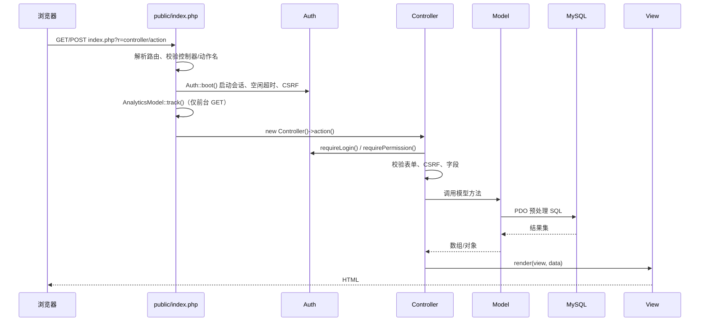

# 数聚 TeamHub 实现文档

> **课程**：互联网数据库开发　|　**团队**：M立方队　|　**编写**：钱泊瑜（2411282）　|　**日期**：2026-11-18

---

## 文档信息

| 项目 | 内容 |
| --- | --- |
| 文档名称 | 数聚 TeamHub 实现文档 |
| 项目名称 | 数聚 TeamHub——团队主页与内容管理系统 |
| 团队名称 | M立方队（M-Cubed） |
| 文档编号 | M3-DES-003 |
| 编写人 | 钱泊瑜（2411282） |
| 所属课程 | 互联网数据库开发 |
| 指导教师 | 乜鹏 |
| 最近修订 | 2026 年 11 月 23 日（队名定稿为 M立方队、文档编号更正） |
| 编写日期 | 2026 年 11 月 18 日 |
| 适用读者 | 团队成员、评审教师、后续维护者 |
| 文档范围 | 实现架构、代码组织、公共框架、业务模块、数据库实现、部署实现、Git 过程、编码规范与验证 |

### 术语与缩略语

| 术语 | 全称 / 英文 | 说明 |
| --- | --- | --- |
| MVC | Model-View-Controller | 把数据、视图与请求控制分离的分层架构。 |
| RBAC | Role-Based Access Control | 基于角色的访问控制。 |
| CSRF | Cross-Site Request Forgery | 跨站请求伪造；写操作校验一次性令牌。 |
| PDO | PHP Data Objects | PHP 的统一数据库访问接口。 |
| DTO | Data Transfer Object | 层间传递数据的只读结构。 |
| CRUD | Create / Read / Update / Delete | 数据的新增、读取、修改与删除。 |
| DDL | Data Definition Language | 建库、建表、建视图等结构定义语句。 |
| Slug | URL Slug | 公开链接的可读标识。 |
| 种子数据 | Seed Data | 建库时必须预置的字典与账号，不含业务内容。 |
| 业务数据 | Business Data | 成员、项目、公告、留言等由网页端录入生成的数据。 |

### 关联文档

| 文档 | 版本 | 用途 |
| --- | --- | --- |
| 《数聚 TeamHub 需求文档》 | | 功能编号（FR-*）、业务规则（BR-*）与验收场景（AC-*）的来源。 |
| 《数聚 TeamHub 设计文档》 | | 架构、表清单、路由表、编码规范与关键实现示例的来源。 |
| 《数聚 TeamHub 实现文档》 | | 本文档：实现架构、代码组织与关键代码。 |
| 《数聚 TeamHub 用户手册》 | | 面向四类角色的操作说明。 |
| 《数聚 TeamHub 部署文档》 | | 环境要求、一键部署、备份与还原。 |

> **阅读提示**：本仓库交付的是**源码与建库脚本**，不携带任何业务数据。数据库只预置运行必需的字典与管理员账号（角色、权限、技能字典、团队资料单例、站点设置），成员、项目、公告、留言、资源等内容全部由网页端录入后自动生成。因此本文档第 5 章描述的是表结构与数据产生方式，而不是某份固定数据。

---

## 目录

<details open>
<summary><strong>1 概述</strong></summary>

- [1.1 编写目的](#11-编写目的)
- [1.2 实现依据与交付物](#12-实现依据与交付物)
- [1.3 实现原则](#13-实现原则)
- [1.4 读者对象](#14-读者对象)
- [1.5 术语与缩略语](#15-术语与缩略语)
- [1.6 参考资料](#16-参考资料)
</details>

<details open>
<summary><strong>2 工程组织</strong></summary>

- [2.1 开发与运行环境](#21-开发与运行环境)
- [2.2 仓库与目录结构](#22-仓库与目录结构)
- [2.3 分支模型与提交规范](#23-分支模型与提交规范)
- [2.4 开发流程](#24-开发流程)
</details>

<details open>
<summary><strong>3 公共框架</strong></summary>

- [3.1 统一入口](#31-统一入口)
- [3.2 路由约定](#32-路由约定)
- [3.3 配置管理](#33-配置管理)
- [3.4 数据访问层](#34-数据访问层)
- [3.5 视图与模板](#35-视图与模板)
- [3.6 安全措施](#36-安全措施)
</details>

<details open>
<summary><strong>4 业务模块</strong></summary>

- [4.1 公共门户](#41-公共门户)
- [4.2 认证模块](#42-认证模块)
- [4.3 成员中心](#43-成员中心)
- [4.4 管理后台](#44-管理后台)
- [4.5 下载中心](#45-下载中心)
- [4.6 统计图表](#46-统计图表)
- [4.7 审计与日志](#47-审计与日志)
</details>

<details open>
<summary><strong>5 数据库实现</strong></summary>

- [5.1 install.sql 的职责与结构](#51-installsql-的职责与结构)
- [5.2 建表顺序与约束](#52-建表顺序与约束)
- [5.3 表清单与模块归属](#53-表清单与模块归属)
- [5.4 基础字典与初始账号](#54-基础字典与初始账号)
- [5.5 业务数据的产生方式](#55-业务数据的产生方式)
- [5.6 还原校验](#56-还原校验)
</details>

<details open>
<summary><strong>6 部署实现</strong></summary>

- [6.1 编排文件](#61-编排文件)
- [6.2 镜像定义](#62-镜像定义)
- [6.3 站点根与访问配置](#63-站点根与访问配置)
- [6.4 本地部署脚本](#64-本地部署脚本)
</details>

<details open>
<summary><strong>7 编码规范</strong></summary>

- [7.1 命名规范](#71-命名规范)
- [7.2 PHP 文件注释头](#72-php-文件注释头)
- [7.3 MVC 分层检查表](#73-mvc-分层检查表)
</details>

<details open>
<summary><strong>8 测试与验证</strong></summary>

- [8.1 测试策略](#81-测试策略)
- [8.2 可执行的检查项](#82-可执行的检查项)
- [8.3 核心测试用例](#83-核心测试用例)
- [8.4 验收对照](#84-验收对照)
</details>

<details open>
<summary><strong>9 附录</strong></summary>

- [9.1 附录 A：文件清单](#91-附录-a文件清单)
- [9.2 附录 B：需求到实现的索引](#92-附录-b需求到实现的索引)
- [9.3 附录 C：待确认事项](#93-附录-c待确认事项)
</details>

---

## 1 概述

实现的价值在于：任何人拿到仓库，都能看懂请求怎么走、数据存在哪、自己该往哪个文件里写。

### 1.1 编写目的

**核心目的：**　本文档说明「数聚 TeamHub」的代码是怎么组织并运行的：一条请求从入口到页面经过哪些文件，每张表由哪个模块读写，部署时又发生了什么。它把《设计文档》的架构落到具体目录与文件上，作为开发协作、代码评审与答辩说明的共同依据。

- **对团队**：统一文件归属与调用方向，避免出现“两个控制器各写一遍同一段 SQL”。
- **对评审**：把课程要求的 MVC 三层、每个 PHP 文件注释头、`install.sql`、作业下载、一键部署、Git 记录逐项对应到仓库文件。
- **对维护者**：说明数据从哪里来——仓库只提供结构与字典，业务内容由网页端录入，因此排查问题时先看录入入口，而不是翻找“预置数据”。

本仓库的属性是**纯源码仓库**：不提交数据库备份、不提交业务数据、不提交上传文件；一切业务内容都在系统运行过程中由管理员和成员通过页面录入生成。

### 1.2 实现依据与交付物

**表 1-1  实现依据**

| 依据 | 位置 | 在本文档中的用法 |
| --- | --- | --- |
| 作业硬性要求 | 课程 PPT、仓库 `README.md`「交付清单对照」 | 判定必须存在的文件与路径，如 `code/data/install.sql`、`code/data/team/`、`code/data/personal/`。 |
| 《需求文档》 | `docs/team/01-需求文档/` | 功能编号（FR-*）、业务规则（BR-*）、验收场景（AC-*）与页面编号（P-*）。 |
| 《设计文档》 | `docs/team/02-设计文档/` | 分层架构、21 张表与数据字典、路由表、编码规范与关键实现示例。 |
| 源码 | `code/` 下的入口、编排、镜像与脚本 | 逐段说明真实代码，不推测未写出的逻辑。 |
| Git 历史 | `git log` | 2.3 节的分支模型与提交规范；本仓库 Git 提交记录（可在线浏览）。 |
| 仓库约定 | 根目录 `AGENTS.md`、`README.md` | 命名法、注释头模板、分支模型、提交信息格式。 |

**表 1-2  交付物与职责**

| 交付物 | 路径 | 职责 |
| --- | --- | --- |
| 站点入口 | `code/public/index.php` | 唯一入口，解析路由并分发到控制器。 |
| MVC 源码 | `code/app/` 下的 controller、model、view | 控制器、模型、视图三层业务代码。 |
| 建库脚本 | `code/data/install.sql` | 建库、建表、索引、外键、视图与基础字典。 |
| 作业文件 | `code/data/team/`、`code/data/personal/` | 团队文档 PDF 与个人作业 zip，由下载中心读取。 |
| 部署编排 | `code/docker-compose.yml`、`code/Dockerfile` | 一键启动 web 与 db，自动导入建库脚本。 |
| 备选脚本 | `code/install.bat`、`code/install.sh` | 无 Docker 环境时的手动部署辅助。 |
| 静态资源 | `code/public/static/` 下的 css、js、img | 样式、脚本与图片，全部本地化，不依赖 CDN。 |

### 1.3 实现原则

- **入口唯一**：所有请求经 `public/index.php`，没有第二个可访问的 PHP 入口；`app/`、`data/` 位于 Web 根之外。
- **分层单向**：控制器 → 模型 → 数据库；视图只接收控制器传入的数据，反向调用一律不允许。
- **结构即数据**：仓库提交表结构，运行期数据由页面录入；同一份 `install.sql` 可以在任意空库还原出同样的空站点。
- **约定优于配置**：文件名、类名、动作名按统一规则推导，减少注册与配置代码。
- **安全默认**：参数白名单、PDO 预处理、输出转义、CSRF 校验、最小权限，均作为编码基线而非可选项。
- **可还原**：数据库、部署方式、脚本命令都写成可以重复执行的步骤，换一台机器仍能复现。

### 1.4 读者对象

**表 1-3  读者对象与阅读建议**

| 读者 | 关注重点 | 阅读建议 |
| --- | --- | --- |
| 写业务的成员 | 自己负责的文件放哪、怎么命名、调用哪一层 | 先看 2.2 目录结构、3.1 入口与 7.1 命名规范，再按第 4 章找到所属模块。 |
| 负责数据库的成员 | 表清单、建表顺序、字典数据、还原校验 | 直接读第 5 章，并对照设计文档 4.3、4.4 数据字典。 |
| 负责部署的成员 | Docker 编排、站点根、启动顺序、配置项 | 读第 6 章与《部署文档》第 4 章。 |
| 评审教师 | 课程要求是否落地、代码与 Git 记录 | 先看 1.2 交付物与第 8 章测试验证，再看第 4 章模块划分。 |
| 后续维护者 | 数据从哪来、改哪张表、怎么回滚 | 重点阅读第 5 章数据库实现与第 6 章部署实现。 |

### 1.5 术语与缩略语

本文档使用的 MVC、RBAC、CSRF、PDO、DTO、CRUD、DDL、Slug、种子数据、业务数据等术语，已在文档信息页的「术语与缩略语」表中统一解释，正文首次出现时不再重复定义。与《需求文档》《设计文档》用词保持一致。

### 1.6 参考资料

- 课程 PPT《互联网数据库开发——作业汇总》，计算机学院 & 网络空间安全学院，乜鹏，2026 年 10 月。
- 《数聚 TeamHub 需求文档》，团队 M3，2026-10-28（`docs/team/01-需求文档/`）。
- 《数聚 TeamHub 系统设计文档》，团队 M3，2026-10-28（`docs/team/02-设计文档/`）。
- 仓库根目录 `README.md`「开发规范」「交付清单对照」，以及 `AGENTS.md`「编辑规则」。
- PHP 8.2 官方文档：https://www.php.net/docs.php；MySQL 8.0 参考手册：https://dev.mysql.com/doc/。

## 2 工程组织

先让所有人拿到同一份代码、同一套命令，再谈实现细节。

### 2.1 开发与运行环境

开发与演示统一使用容器：镜像固定 PHP 与 MySQL 版本，宿主机只负责运行 Docker。

**表 2-1  实现环境**

| 项 | 取值 | 说明 |
| --- | --- | --- |
| 语言 | PHP 8.1+，镜像内为 8.2 | 使用 `declare(strict_types=1)` 与类型声明。 |
| 数据库 | MySQL 8.0（InnoDB、utf8mb4） | 支持窗口函数、CHECK 约束与 JSON 字段。 |
| Web 服务器 | Apache 2.4（容器内）；可选 Nginx + PHP-FPM | 需启用 `mod_rewrite` 以支持路由重写。 |
| 容器运行时 | Docker Engine 24+、Compose v2 | `docker compose up -d` 完成一键部署。 |
| 版本控制 | Git 2.x，`origin` 指向团队仓库 | 提交记录作为实现过程的证据。 |
| 本地调试 | `php -S localhost:8080 -t code/public` | 无容器时的快速调试方式。 |

### 2.2 仓库与目录结构

仓库由源码、六份文档、个人作业区三部分组成，源码集中在 `code/` 下，目录结构本身就是 MVC 分层的体现。

**代码 2-1  项目目录结构**

```text
nku2026DBdev/
├─ README.md                      # 总览：项目信息、模块职责、规范、交付清单
├─ AGENTS.md                      # 智能体与开发者约定（文档优先、禁止捏造）
├─ .gitignore                     # 忽略 runtime、上传目录、config.local.php 等
├─ docs/
│  ├─ assets/                     # 文档公共图片目录
│  └─ team/
│     ├─ 01-需求文档/M3_需求文档().md
│     ├─ 02-设计文档/M3_设计文档().md
│     ├─ 03-实现文档/M3_实现文档().md   # 本文件
│     ├─ 04-用户手册/M3_用户手册().md
│     ├─ 05-部署文档/M3_部署文档().md
│     └─ 06-项目展示PPT/
├─ personal/                      # 个人作业源文件（学号_姓名/作业N/）
└─ code/                          # 项目源码根
   ├─ docker-compose.yml          # 一键部署编排：web + db
   ├─ Dockerfile                  # php:8.2-apache + mysqli/pdo_mysql
   ├─ install.bat / install.sh    # 无 Docker 环境备选
   ├─ README.md                   # 源码目录说明
   ├─ app/
   │  ├─ controller/              # 控制器（XxxController.class.php）
   │  ├─ model/                   # 模型（XxxModel.class.php）
   │  └─ view/                    # 视图（小写_动作.php）
   ├─ data/
   │  ├─ install.sql              # 数据库唯一真源（建表 + 基础字典）
   │  ├─ team/                    # 团队文档 PDF
   │  └─ personal/                # 个人作业 zip
   └─ public/
      ├─ index.php                # 统一入口
      └─ static/                  # css / js / img 静态资源
```

**表 2-2  目录职责**

| 目录 | 可访问性 | 职责 | 禁止事项 |
| --- | --- | --- | --- |
| `code/public/` | 对浏览器开放 | 入口文件与静态资源 | 不放业务代码、不存上传文件 |
| `code/app/controller/` | 不可直接访问 | 收参数、调模型、选视图、跳转 | 不写 SQL、不拼 HTML |
| `code/app/model/` | 不可直接访问 | SQL、映射、分页、事务 | 不输出 HTML、不读 `$_GET`/`$_POST` |
| `code/app/view/` | 不可直接访问 | 渲染页面 | 不查数据库、不写业务逻辑 |
| `code/data/` | 不可直接访问 | 建库脚本与作业文件 | 不放可执行脚本、不直接暴露路径 |
| `code/runtime/` | 不可直接访问 | 日志与缓存 | 不提交 Git |

### 2.3 分支模型与提交规范

**表 2-3  分支职责**

| 分支 | 职责 | 允许的操作 | 禁止的操作 |
| --- | --- | --- | --- |
| `main` | 始终保持可运行、可演示 | 合并已验证的 `dev`、打发布 tag | 日常功能开发、直接 push 未验证代码 |
| `dev` | 开发主线，承载全部日常改动 | 功能开发、Bug 修复、文档更新 | 长期不合并 `main` 导致偏离 |

提交信息格式为 `类型: 描述`，类型取自 `feat` / `fix` / `docs` / `style` / `refactor` / `test` / `chore`；需要标明范围时写作 `类型(范围): 描述`，描述使用中文。

**表 2-4  提交类型**

| 类型 | 含义 | 示例 |
| --- | --- | --- |
| `feat` | 新增功能 | `feat: 完成成员列表技能筛选` |
| `fix` | 修复缺陷 | `fix: 修正留言审核状态回显` |
| `docs` | 文档修改 | `docs: 补充部署文档备份章节` |
| `style` | 格式调整 | `style: 统一控制器缩进` |
| `refactor` | 重构 | `refactor: 抽取分页逻辑到基类` |
| `test` | 测试相关 | `test: 增加登录锁定用例` |
| `chore` | 构建与杂务 | `chore: 初始化仓库结构` |

### 2.4 开发流程

**代码 2-2  日常开发命令**

```bash
git clone https://github.com/mon3trteam/nku2026DBdev.git
cd nku2026DBdev
git checkout dev                 # 首次克隆后执行一次

# 每次写代码前
git checkout dev
git pull

# …… 编写代码 ……

git status                       # 确认改了哪些文件
git add .                        # 或只添加指定文件
git commit -m "feat: 完成登录页面布局"
git push                         # 推送到团队仓库 dev
```

合入流程：`git checkout dev` → `git merge main` → 本地验证运行无误 → `git checkout main` → `git merge dev` → `git push`。约定智能体与自动化工具不得自动合入或 push `main`，避免未经人工验证的代码进入稳定分支。

## 3 公共框架

框架只做四件事：找到该执行的类、拿到该用的数据、渲染该看的页面、挡住不该进的人。

### 3.1 统一入口

`code/public/index.php` 是全站唯一入口，采用「约定式路由」：查询参数 `r` 指定「控制器/动作」，入口按命名约定加载控制器文件并调用动作方法。

**代码 3-1  public/index.php（节选，完整文件见仓库）**

```php
declare(strict_types=1);

define('APP_ROOT', dirname(__DIR__));   // code/
define('APP_DEBUG', filter_var(getenv('APP_DEBUG') ?: 'false', FILTER_VALIDATE_BOOLEAN));

// 站点根可能指向 public/，也可能仍指向 code/；按入口路径自动判断
$scriptName = str_replace('\', '/', (string) ($_SERVER['SCRIPT_NAME'] ?? ''));
if (preg_match('#^(.*)/public/index\.php$#', $scriptName, $matches) === 1) {
    $detectedBase = $matches[1];
}
define('APP_BASE', rtrim((string) (getenv('APP_BASE') ?: $detectedBase), '/'));
define('ASSET_VERSION', '20261116b');

require_once APP_ROOT . '/app/helpers.php';
require_once APP_ROOT . '/app/core/Db.class.php';
require_once APP_ROOT . '/app/core/Auth.class.php';
require_once APP_ROOT . '/app/model/AnalyticsModel.class.php';

// 会话必须在任何输出之前启动；随后初始化 CSRF token 并检查空闲超时
Auth::boot();

// ---- 简易路由：index.php?r=控制器/动作&参数=值 ----
$route  = is_string($_GET['r'] ?? null) ? $_GET['r'] : 'home/index';
$parts  = explode('/', $route);
$ctrl   = ucfirst(strtolower($parts[0] ?? 'home'));
$action = $parts[1] ?? 'index';

$controllerClass = $ctrl . 'Controller';
$controllerFile  = APP_ROOT . '/app/controller/' . $controllerClass . '.class.php';

$validCtrl   = preg_match('/^[A-Za-z][A-Za-z0-9]*$/', $ctrl) === 1;
$validAction = preg_match('/^[A-Za-z][A-Za-z0-9_]*$/', $action) === 1;

if (!$validCtrl || !$validAction || !is_file($controllerFile)) {
    http_response_code(404);
    render('error_404', ['pageTitle' => '页面不存在']);
    exit;
}

require_once $controllerFile;
if (!class_exists($controllerClass) || !method_exists($controllerClass, $action)) {
    http_response_code(404);
    render('error_404', ['pageTitle' => '页面不存在']);
    exit;
}

(new $controllerClass())->$action();
```
```

**表 3-1  入口实现的七个要点**

| 要点 | 实现 | 目的 |
| --- | --- | --- |
| 路径常量 | `APP_ROOT = dirname(__DIR__)` | 所有加载以 `code/` 为基准，不受工作目录影响。 |
| 调试开关 | `APP_DEBUG` | 上线置 `false`，避免错误细节输出到页面。 |
| 默认路由 | 缺省 `index/index` | 打开首页无需带参数。 |
| 名称归一化 | `ucfirst(strtolower())` | `member`、`Member`、`MEMBER` 指向同一个控制器。 |
| 路径安全 | `^[A-Za-z]+$` 白名单 | 拒绝 `..`、`/`、`\`，防止目录穿越。 |
| 错误分流 | 文件缺失 404、类不存在 500 | 区分“路由写错”与“类名写错”。 |
| 调用约定 | 实例化后调用动作方法 | 动作即控制器公开方法，参数由方法自行取用。 |

入口只负责“找到类并调用”，认证、权限、CSRF、限流由控制器基类与中间层统一处理（见 3.6），异常由全局处理器映射为 401/403/404/409/422/429/500。

### 3.2 路由约定

设计文档 5.2 给出了 REST 风格的目标路径，入口通过「控制器/动作」映射实现同样的页面归属；两套写法一一对应，链接生成统一走 `url()` 辅助函数，因此后续切换为 PATH_INFO 只需改这一处。

**请求生命周期（时序）**



关键点：

- 路由格式为 `index.php?r=控制器/动作`，控制器名只允许字母数字，动作名只允许字母、数字、下划线；不满足或文件不存在返回 404。
- `Auth::boot()` 在任何输出前启动会话；每次请求调用 `validateSession()`，同步角色、显示名、`must_change_password`，并检查空闲超时。
- 前台 GET 请求写入 `page_views`；写入失败只记 `error_log`，不影响页面。

**表 3-2  页面与控制器映射**

| 目标路径 | 入口写法 | 控制器 / 动作 | 说明 |
| --- | --- | --- | --- |
| `/` | `/?r=home/index` | `HomeController::index` | 首页聚合。 |
| `/team` | `/?r=team/index` | `TeamController::index` | 团队介绍。 |
| `/members` | `/?r=member/index` | `MemberController::index` | 成员列表与筛选。 |
| `/members/{slug}` | `/?r=member/show&slug=xxx` | `MemberController::show` | 成员主页。 |
| `/projects` | `/?r=project/index` | `ProjectController::index` | 项目列表。 |
| `/announcements` | `/?r=announcement/index` | `AnnouncementController::index` | 公告列表。 |
| `/resources` | `/?r=resource/index` | `ResourceController::index` | 资源下载。 |
| `/resources/{id}/download` | `/?r=resource/download&id=xx` | `ResourceController::download` | 下载并计数。 |
| `/messages` | `/?r=message/index` | `MessageController::index` | 留言板；POST 提交走 `message/submit`。 |
| `/login` | `/?r=auth/login` | `AuthController::login` | GET 渲染、POST 校验。 |
| `/me/profile` | `/?r=me/profile` | `MeController::profile` | 资料编辑。 |
| `/admin` | `/?r=admin/dashboard` | `AdminController::dashboard` | 数据看板。 |
| `/admin/messages` | `/?r=admin/messages` | `AdminController::messages` | 留言审核队列（单控制器承载全部后台动作）。 |
| `/admin/data-package` | `/?r=datapackage/index` | `DatapackageController::index` | 数据包导出/导入（export/import 为 POST）。 |
| `/healthz` | `/?r=system/healthz` | `SystemController::healthz` | 健康检查探活。 |

> 说明：后台全部动作由单一 `AdminController` 承载（dashboard/members/announcements/messages/resources/users/settings/logs/team 等），成员中心由 `MeController` 承载（index/profile/projects/security）；图片经 `asset()` 静态输出，无独立媒体控制器。

### 3.3 配置管理

配置分三层：环境变量存密钥与连接信息，代码常量存结构化默认值，数据库 `site_settings` 存管理员可改的运营文案。

**表 3-3  配置落点**

| 配置类型 | 位置 | 示例 | 是否入库 |
| --- | --- | --- | --- |
| 环境与密钥 | `code/.env` | `APP_ENV`、`APP_DEBUG`、`APP_KEY`、`DB_*` | 否，已在 `.gitignore` 中忽略 |
| 本地个人覆盖 | `code/app/config.local.php` | 本机数据库地址 | 否，已忽略 |
| 结构化默认 | 代码内常量 | 每页条数、权限码、上传上限 | 是 |
| 运营配置 | 数据库 `site_settings` | 站点名、SEO 描述、页脚、维护模式 | 是，由后台维护 |

`APP_DEBUG` 读取环境变量，默认 `false`；数据库连接参数不写死在代码中，统一从 `.env` 读取，部署时只改配置文件。

### 3.4 数据访问层

数据访问层由 `app/core/Db.class.php` 提供：全局单例 PDO 连接，全部查询使用命名占位符预处理，事务通过 `Db::transaction()` 封装（异常自动回滚）。配置读取 `config/database.php`，优先取环境变量（Docker 部署时由 compose 注入），未配置时回落到 `localhost` 默认值。

**表 3-4  数据访问层组件（与 `app/core/Db.class.php` 一致）**

| 成员 | 类型 | 职责 |
| --- | --- | --- |
| `Db::pdo()` | 方法 | 惰性创建 PDO 单例；`ERRMODE_EXCEPTION` + `FETCH_ASSOC` + 关闭模拟预处理；会话时区统一东八区 |
| `Db::fetchAll()` | 方法 | 预处理查询返回关联数组列表 |
| `Db::fetchOne()` | 方法 | 预处理查询单行，无结果返回 null |
| `Db::fetchValue()` | 方法 | 预处理查询单值 |
| `Db::execute()` | 方法 | 执行 INSERT/UPDATE/DELETE，返回受影响行数 |
| `Db::lastInsertId()` | 方法 | 取自增 ID |
| `Db::transaction()` | 方法 | 闭包包裹 BEGIN/COMMIT，异常自动 ROLLBACK |

**代码 3-2  连接与事务（摘自 app/core/Db.class.php）**

```php
public static function pdo(): PDO
{
    if (self::$pdo instanceof PDO) {
        return self::$pdo;
    }

    $config = require APP_ROOT . '/config/database.php';

    $dsn = sprintf(
        'mysql:host=%s;port=%d;dbname=%s;charset=%s',
        $config['host'],
        (int) $config['port'],
        $config['database'],
        $config['charset']
    );

    self::$pdo = new PDO($dsn, $config['username'], $config['password'], [
        PDO::ATTR_ERRMODE            => PDO::ERRMODE_EXCEPTION,
        PDO::ATTR_DEFAULT_FETCH_MODE => PDO::FETCH_ASSOC,
        PDO::ATTR_EMULATE_PREPARES   => false,
        PDO::ATTR_STRINGIFY_FETCHES  => false,
    ]);

    // 统一使用东八区，保证 created_at 与页面展示一致
    self::$pdo->exec("SET time_zone = '" . $config['timezone'] . "'");

    return self::$pdo;
}

public static function transaction(callable $work): mixed
{
    self::pdo()->beginTransaction();
    try {
        $result = $work(self::pdo());
        self::pdo()->commit();
        return $result;
    } catch (Throwable $e) {
        if (self::pdo()->inTransaction()) {
            self::pdo()->rollBack();
        }
        throw $e;
    }
}
```


## 4 业务模块

每个模块按「控制器—模型—视图」三层拆分，文件归属与《设计文档》3.x 一一对应。

### 4.1 公共门户

公共门户只负责展示与转化，除留言提交外不处理写操作。所有查询自带可见性条件：成员 `is_visible=1`、公告 `status='published'` 且未过期、项目未归档。

**表 4-1  公共门户文件归属**

| 页面（编号） | 控制器 / 动作 | 模型 | 视图 |
| --- | --- | --- | --- |
| 首页（P-01） | `HomeController::index` | `TeamModel`、`MemberModel`、`AnnouncementModel` | `home_index.php` |
| 团队介绍（P-02） | `TeamController::index` | `TeamModel`（含里程碑查询） | `team_index.php` |
| 成员列表（P-03） | `MemberController::index` | `MemberModel`、`AnalyticsModel` | `member_list.php` |
| 成员主页（P-04） | `MemberController::show` | `MemberModel`、`ProjectModel`、`MessageModel` | `member_show.php` |
| 项目（P-05/P-06） | `ProjectController::index / ::show` | `ProjectModel` | `project_list.php`、`project_show.php` |
| 公告（P-07/P-08） | `AnnouncementController::index / ::show` | `AnnouncementModel` | `announcement_list.php`、`announcement_show.php` |
| 资源下载（P-09） | `ResourceController::index / ::download` | `ResourceModel`、`MediaModel` | `resource_list.php` |
| 留言板（P-10） | `MessageController::index / ::submit` | `MessageModel`、`MemberModel` | `message_index.php` |

实现要点：

- 首页各区块有数量上限：精选项目 ≤ 3、公告 ≤ 3、成员 ≤ 4，数据不足时隐藏区块而不是留空白。
- 成员主页按 `slug` 查询，不可见成员返回 404，不泄露“存在但不可见”。
- 留言只展示 `approved` 状态，提交后进入 `pending`；表单带蜜罐字段、时间戳与 CSRF 令牌。

### 4.2 认证模块

认证只回答“你是谁”，不回答“你能做什么”——后者由权限中间层处理。

**表 4-2  认证模块文件归属**

| 功能（编号） | 控制器 / 动作 | 模型 | 视图 |
| --- | --- | --- | --- |
| 登录（FR-AUTH-01） | `AuthController::login` | `UserModel`、`AuthModel`、`LogModel` | `auth/login.php` |
| 登出与会话（FR-AUTH-02） | `AuthController::logout` | — | — |
| 修改密码（FR-AUTH-03） | 成员：`MeController::security / ::updatePassword`；管理员：`AdminController::security / ::updatePassword` | `UserModel` | `me/security.php`、`admin/security.php` |

实现要点：

1. 账号不存在、口令错误统一提示“用户名或密码不正确”，防账号枚举。
2. 连续 5 次失败锁定 15 分钟，锁定期内口令正确也拒绝（BR-09、AC-05）。
3. 登录成功调用 `session_regenerate_id(true)` 防会话固定，并写入登录日志。
4. `must_change_password=1` 的账号登录后强制跳转改密页。
5. 登出使用 POST + CSRF，清空会话并记录审计。

### 4.3 成员中心

**表 4-3  成员中心文件归属**

| 页面（编号） | 控制器 / 动作 | 模型 | 视图 |
| --- | --- | --- | --- |
| 概览（P-12） | `MeController::index` | `MemberModel`、`ProjectModel`、`MessageModel` | `me/index.php` |
| 个人资料（P-13） | `MeController::profile / ::updateProfile` | `MemberModel`、`MediaModel` | `me/profile.php` |
| 我的项目（P-14） | `MeController::projects / ::updateContribution` | `MemberModel`、`ProjectModel` | `me/projects.php` |
| 账号安全（P-15） | `MeController::security / ::updatePassword` | `UserModel`、`LogModel` | `me/security.php` |

实现要点：字段白名单（姓名、英文名、slug、角色、一句话介绍、简介、邮箱、GitHub、个人网站、所在地），slug 唯一且 3—60 位，技能 3—12 项、熟练度 1—5；保存携带 `updated_at` 做乐观锁，冲突返回 409（BR-17、AC-07）。

### 4.4 管理后台

**表 4-4  管理后台文件归属**

| 页面（编号） | 控制器 / 动作（均由单一 AdminController 承载） | 模型 | 视图 |
| --- | --- | --- | --- |
| 数据看板（P-16） | `AdminController::dashboard` | `DashboardModel`、`AnalyticsModel` | `admin/dashboard.php` |
| 团队资料（P-17） | `AdminController::team / ::updateTeam` | `TeamModel`、`SiteSettingModel` | `admin/team.php` |
| 成员管理（P-18） | `AdminController::members / ::memberEdit / ::updateMember / ::setMemberVisibility / ::setMemberFeatured` | `MemberModel`、`UserModel`、`MediaModel` | `admin/member_list.php`、`member_edit.php` |
| 公告管理（P-19） | `AdminController::announcements / ::announcementCreate / ::storeAnnouncement / ::announcementEdit / ::updateAnnouncement / ::setAnnouncementStatus` | `AnnouncementModel` | `admin/announcement_list.php`、`announcement_edit.php` |
| 项目管理（P-20） | `AdminController::projects / ::projectCreate / ::storeProject / ::projectEdit / ::updateProject / ::archiveProject / ::setProjectVisibility` | `ProjectModel`、`MediaModel` | `admin/project_list.php`、`project_edit.php` |
| 留言管理（P-21） | `AdminController::messages / ::messageEdit / ::updateMessage` | `MessageModel`、`MessageReplyModel`（回复随留言表单提交入库） | `admin/message_list.php`、`message_edit.php` |
| 资源管理（P-22） | `AdminController::resources / ::resourceUpload / ::storeResource / ::resourceEdit / ::updateResource` | `ResourceModel`、`MediaModel` | `admin/resource_list.php`、`resource_edit.php`、`resource_upload.php` |
| 用户与角色（P-23） | `AdminController::users / ::userCreate / ::storeUser / ::userEdit / ::updateUser / ::resetUserPassword / ::setUserStatus` | `UserModel`、`MediaModel` | `admin/user_list.php`、`user_edit.php` |
| 站点设置（P-24） | `AdminController::settings / ::updateSettings` | `SiteSettingModel` | `admin/setting.php` |
| 日志审计（P-25） | `AdminController::logs` | `LogModel` | `admin/log_list.php` |
| 数据包（新增） | `DatapackageController::index / ::export / ::import` | `DataPackageModel` | `admin/data_package.php` |
| 健康探活 | `SystemController::healthz` | — | — |

实现要点：所有写操作校验权限码与 CSRF；列表统一服务端分页、排序白名单；删除改为状态归档（BR-11）；敏感操作写审计且日志只追加（BR-18）。后台也是**业务数据的唯一录入入口**：团队成员、项目、公告、资源、留言回复都在这里创建并即时更新前台。

### 4.5 下载中心

下载中心读取 `code/data/team/` 与 `code/data/personal/` 两个目录，生成团队作业与个人作业的下载链接，是课程作业的硬性要求。

**表 4-5  下载中心实现要点**

| 要点 | 做法 | 对应规则 |
| --- | --- | --- |
| 目录白名单 | 只允许 `team`、`personal`，路径由服务端拼接，不接受请求传目录名 | BR-10、BR-14 |
| 目录穿越过滤 | 文件名先 `basename()`，拒绝含 `..`、`/`、`\`、空字节的输入；`realpath()` 结果必须仍在白名单目录内 | BR-10 |
| 类型限制 | 团队文档只放 PDF，个人作业只放 zip；扩展名白名单校验，不执行、不解压 | BR-10 |
| 流式输出 | 控制器 `readfile` 输出，设置 `Content-Type`、`Content-Length`、`Content-Disposition`，不暴露磁盘路径 | 设计文档 7.5 |
| 下载计数 | 下载成功后对 `resources.download_count` 原子自增，失败不计数 | 需求文档 3.5.4 |
| 展示命名 | 团队文档按 `队名_文档名(学号1_学号2_学号3).pdf`，个人作业按 `作业N(学号_姓名).zip` | 需求文档 3.5.4 |

**代码 4-1  下载动作的路径校验**

```php
<?php
/**
 * 文件名：ResourceController.class.php
 * 功能：下载中心控制器，输出 data/team 与 data/personal 下的作业文件并计数
 * 作者：（公共门户模块负责人 学号 姓名）
 * 创建日期：2026-10-29
 * 所属模块：资源下载
 */

declare(strict_types=1);

final class ResourceController
{
    private const WHITELIST = ['team', 'personal'];

    public function download(): void
    {
        $dir  = $_GET['dir'] ?? 'team';
        $name = basename((string) ($_GET['file'] ?? ''));

        // 1) 目录只允许白名单；2) 文件名不含穿越字符；3) 真实路径仍在白名单目录内
        if (!in_array($dir, self::WHITELIST, true)
            || $name === ''
            || str_contains($name, '..')
            || str_contains($name, '/')
            || str_contains($name, '\\')
            || str_contains($name, "\0")) {
            http_response_code(404);
            exit('404 Not Found');
        }

        $base = APP_ROOT . '/data/' . $dir;
        $path = realpath($base . '/' . $name);
        if ($path === false || !str_starts_with($path, realpath($base) . DIRECTORY_SEPARATOR)) {
            http_response_code(404);
            exit('404 Not Found');
        }

        // 输出与计数：readfile + Content-Disposition + 原子自增
    }
}
```

### 4.6 统计图表

看板使用 ECharts（`public/static/js/` 下的本地文件，不走 CDN），数据由受保护的 JSON 接口提供，前端 `fetch` 后渲染；图表加载失败时以表格兜底。

**表 4-6  图表实现**

| 图表 | 数据来源 | 缓存 | 渲染位置 |
| --- | --- | --- | --- |
| KPI 卡片（成员/项目/待审留言/近 7 日访问） | 各表聚合 | 30—60 秒 | 看板顶部 |
| 近 14 天访问趋势 | `page_views` 按日聚合 | 60 秒 | 看板折线图 |
| 留言状态分布 | `messages.status` 分组 | 30 秒 | 看板环形图 |
| 成员技能分布 | `member_skills` JOIN `skills` | 300 秒 | 看板横向柱状图 |
| 项目状态分布 | `projects.status` 分组 | 300 秒 | 看板堆叠柱状图 |

访问统计由中间层在响应后写入 `page_views`：路径、路由名、目标类型与 ID、访客哈希、Referer、UA、时间。IP 不做明文保存，使用 `hash_hmac('sha256', ip, APP_KEY . date('Y-m-d'))`，兼顾去重与隐私（BR-15）。

### 4.7 审计与日志

**表 4-7  日志分工**

| 日志 | 记录内容 | 位置 | 保留 |
| --- | --- | --- | --- |
| 应用日志 | 时间、级别、request_id、异常、脱敏上下文 | `code/runtime/logs/` | 14 天 |
| 登录日志 | 账号、成功/失败、原因、IP 哈希、UA | `login_logs` | 180 天 |
| 操作审计 | 操作者、动作、实体、前后 JSON 快照 | `audit_logs` | 180 天 |
| 访问日志 | 路径、状态码、耗时、UA | Web 服务器 | 14 天 |

审计写入与业务操作在同一事务内完成：主操作成功但审计写入失败时回滚，保证“有修改必有记录”（BR-18）。

## 5 数据库实现

数据库是课程设计的核心。表结构以《设计文档》4.4 的数据字典为唯一依据，`install.sql` 负责把结构变成可执行的 DDL。

### 5.1 install.sql 的职责与结构

`code/data/install.sql` 是数据库唯一真源：在空库上一次执行即可得到完整结构与运行必需的基础字典，不预置成员、项目、公告等业务内容。

**表 5-1  install.sql 的组成**

| 段落 | 内容 | 依据 |
| --- | --- | --- |
| 文件头 | 文件名、功能、作者、创建日期、所属模块、执行说明 | 仓库注释头约定 |
| 环境设置 | `SET NAMES utf8mb4`、`SET FOREIGN_KEY_CHECKS = 0` | 设计文档 4.7 |
| 建库 | `team_home`，`utf8mb4_0900_ai_ci` | 设计文档 4.1 |
| 建表 | 21 张表，按依赖顺序，含字段注释、主键、唯一键、索引 | 设计文档 4.3、4.4 |
| 视图 | `v_public_members`、`v_published_announcements`、`v_dashboard_daily_views` | 设计文档 4.5 |
| 补外键 | `ALTER TABLE media ADD FK uploaded_by`，解决 users 与 media 的循环依赖 | 设计文档 12.6 |
| 基础字典 | 角色、权限码、角色权限、技能字典、团队资料单例、站点设置 | 设计文档 4.7 |
| 管理员 | 用户名 + bcrypt 散列 + `must_change_password=1` | 设计文档 4.7、7.6 |
| 收尾 | `SET FOREIGN_KEY_CHECKS = 1`，输出执行摘要 | 设计文档 12.6 |

**代码 5-1  install.sql 的结构示例（节选）**

```sql
-- =====================================================================
-- 文件名：install.sql
-- 功能：团队主页项目数据库唯一真源（建库 + 建表 + 索引 + 视图 + 基础字典）
-- 作者：（SQL 框架模块负责人 学号 姓名）
-- 创建日期：2026-10-29
-- 所属模块：数据库
-- 说明：1) 本文件可在空库一次执行；2) 业务数据由网页端录入，不在此预置；
--       3) 初始管理员口令为 bcrypt 散列，首次登录强制修改。
-- =====================================================================

SET NAMES utf8mb4;
SET FOREIGN_KEY_CHECKS = 0;

CREATE DATABASE IF NOT EXISTS team_home
  CHARACTER SET utf8mb4 COLLATE utf8mb4_0900_ai_ci;
USE team_home;

CREATE TABLE roles (
  id TINYINT UNSIGNED NOT NULL AUTO_INCREMENT,
  code VARCHAR(30) NOT NULL COMMENT '角色编码',
  name VARCHAR(50) NOT NULL COMMENT '角色名称',
  PRIMARY KEY (id),
  UNIQUE KEY uk_code (code)
) ENGINE=InnoDB DEFAULT CHARSET=utf8mb4 COMMENT='角色';

-- …… 其余 20 张表、索引、视图与基础字典 ……

SET FOREIGN_KEY_CHECKS = 1;
```

### 5.2 建表顺序与约束

建表顺序按外键依赖排列，避免前向引用失败：

1. `roles`、`permissions`、`role_permissions` —— 权限字典，不依赖其它表。
2. `media` —— 媒体元数据，`uploaded_by` 外键稍后补。
3. `users` —— 账号，依赖 `roles` 与 `media`。
4. `team_profile`、`milestones`、`skills` —— 团队与技能字典。
5. `members`、`member_skills` —— 成员档案与技能关联。
6. `projects`、`project_members` —— 项目与参与成员。
7. `announcements`、`messages`、`message_replies` —— 内容与留言。
8. `resources`、`site_settings` —— 下载资源与站点配置。
9. `page_views`、`login_logs`、`audit_logs`、`schema_migrations` —— 运维与审计。

**表 5-2  约束策略**

| 约束 | 策略 | 示例 |
| --- | --- | --- |
| 主键 | `BIGINT UNSIGNED AUTO_INCREMENT` 代理键 | 所有业务表 |
| 唯一键 | 业务唯一字段 | `users.username`、`members.slug` |
| 外键 | 从属关系 CASCADE、可选引用 SET NULL、被引用资源 RESTRICT | `member_skills`、`media`、`resources` |
| 索引 | WHERE 高频列、JOIN 外键列、ORDER BY 列 | `idx_visible_sort`、`idx_status_created` |
| 字符集 | 全库 `utf8mb4`，排序规则统一 | 避免 JOIN 隐式转换 |
| 注释 | 每张表与每个字段写 COMMENT | 数据字典与数据库一致 |
| 归档 | 状态字段代替物理删除 | `archived`、`offline`、`disabled` |

### 5.3 表清单与模块归属

21 张表按五组划分，与设计文档 4.3 一致；「主要读写的模块」列说明该表主要由谁维护。

**表 5-3  21 张表与模块归属**

| 组 | 表 | 中文名 | 主要读写的模块 |
| --- | --- | --- | --- |
| 账号权限 | `users` | 账号 | 认证、用户与角色 |
| 账号权限 | `roles` | 角色 | 认证、用户与角色 |
| 账号权限 | `permissions` | 权限码 | 认证、用户与角色 |
| 账号权限 | `role_permissions` | 角色权限 | 认证、用户与角色 |
| 内容主体 | `team_profile` | 团队资料 | 团队介绍、后台团队资料 |
| 内容主体 | `milestones` | 里程碑 | 团队介绍、后台团队资料 |
| 内容主体 | `members` | 成员 | 成员列表、成员主页、成员中心、后台成员管理 |
| 内容主体 | `skills` | 技能字典 | 成员中心、后台成员管理 |
| 内容主体 | `member_skills` | 成员技能 | 成员中心、成员主页 |
| 内容主体 | `projects` | 项目 | 项目列表、后台项目管理 |
| 内容主体 | `project_members` | 项目成员 | 项目详情、我的项目 |
| 内容主体 | `announcements` | 公告 | 公告中心、后台公告管理 |
| 内容主体 | `messages` | 留言 | 留言板、后台留言管理 |
| 内容主体 | `message_replies` | 留言回复 | 成员主页、后台留言管理 |
| 资源 | `media` | 媒体 | 头像封面、公告配图、资源文件 |
| 资源 | `resources` | 下载资源 | 下载中心、后台资源管理 |
| 站点 | `site_settings` | 站点设置 | 后台站点设置、前台页脚 |
| 运维 | `page_views` | 访问记录 | 统计图表 |
| 运维 | `login_logs` | 登录日志 | 认证、日志审计 |
| 运维 | `audit_logs` | 操作审计 | 各写操作、日志审计 |
| 运维 | `schema_migrations` | 迁移记录 | 数据与运维 |

### 5.4 基础字典与初始账号

建库时只写入“系统跑起来必需”的字典数据，可重复执行（`INSERT ... ON DUPLICATE KEY UPDATE`），反复导入不会产生重复记录。

**表 5-4  基础字典**

| 数据 | 内容 | 说明 |
| --- | --- | --- |
| 角色 | 超级管理员、编辑、成员 | 与需求文档 2.4 的四级角色对应，访客不入库 |
| 权限码 | `dashboard.view`、`member.manage`、`content.manage`、`content.publish`、`message.moderate`、`resource.manage`、`user.manage`、`setting.manage`、`log.view`、`team.edit` | 与设计文档 5.2 路由表的 `perm:` 标注一致 |
| 管理员 | 用户名 + bcrypt 散列 + `must_change_password=1` | 口令只以散列形式存在，首次登录强制修改 |
| 技能字典 | 按分类的示例技能 | 成员只能选择，不能新增全局技能 |
| 团队资料 | `team_profile` 单例 `id=1` | 只能更新，不能新增第二行（BR-16） |
| 站点设置 | 站点名、SEO 描述、页脚、维护模式 | 后台可改，缓存 5 分钟 |

### 5.5 业务数据的产生方式

这是本项目的部署形态决定的：**仓库只携带源码与结构，业务数据在运行期由网页端录入生成**。

**表 5-5  数据从哪来**

| 数据 | 产生入口 | 写入表 | 说明 |
| --- | --- | --- | --- |
| 团队资料与里程碑 | 后台「团队资料」 | `team_profile`、`milestones` | 保存后首页与团队介绍页即时更新 |
| 成员档案 | 后台「成员管理」 | `members` | 同时可绑定登录账号 |
| 成员个人资料 | 成员中心「个人资料」 | `members`、`member_skills` | 成员自助维护，保存后公开页更新 |
| 项目 | 后台「项目管理」 | `projects`、`project_members` | 新建时选择参与成员 |
| 公告 | 后台「公告管理」 | `announcements` | 草稿 → 发布 → 下线或归档 |
| 留言与回复 | 前台留言板、后台「留言管理」 | `messages`、`message_replies` | 提交进入待审核，通过后公开 |
| 资源与文件 | 后台「资源管理」 | `resources`、`media` | 上传后写入文件与元数据，下载计数自增 |
| 访问与审计 | 系统自动 | `page_views`、`login_logs`、`audit_logs` | 由中间层与审计服务在请求过程中写入 |

由此带来三个使用上的结论：

1. **安装后是空站点**：首次部署只有字典与管理员，需要管理员登录后录入团队资料、成员与内容，成员再登录完善个人资料；这是正常的使用起点，不是缺少数据。
2. **数据可重建**：结构由 `install.sql` 保证，内容由页面录入保证，因此换机器部署只需执行同一份 SQL 再录入内容，不依赖任何导出文件。
3. **备份的是运行期数据**：备份对象是运行过程中产生的业务数据与上传文件，命令见《部署文档》第 8 章；源码与结构不在备份范围内。

### 5.6 还原校验

每次修改 `install.sql` 后，都应在干净数据库上完整还原一次并核对结构，校验 SQL 如下。

**代码 5-2  还原校验 SQL**

```sql
-- 1) 表数量应等于 21（作业要求 > 10）
SELECT COUNT(*) AS table_count
FROM information_schema.tables
WHERE table_schema = 'team_home' AND table_type = 'BASE TABLE';

-- 2) 视图数量应为 3
SELECT COUNT(*) AS view_count
FROM information_schema.views
WHERE table_schema = 'team_home';

-- 3) 外键与索引抽查
SELECT TABLE_NAME, CONSTRAINT_NAME, REFERENCED_TABLE_NAME
FROM information_schema.key_column_usage
WHERE table_schema = 'team_home' AND REFERENCED_TABLE_NAME IS NOT NULL;

-- 4) 基础字典抽查：角色 3 条、团队资料 1 条、管理员 1 条
SELECT (SELECT COUNT(*) FROM roles)        AS roles,
       (SELECT COUNT(*) FROM team_profile) AS team_profile,
       (SELECT COUNT(*) FROM users WHERE role_id = 1) AS admins;
```

## 6 部署实现

部署是一次加分项，也是评审复现项目的唯一通道。实现上采用「编排文件 + 镜像定义 + 备选脚本」三件套。

### 6.1 编排文件

`code/docker-compose.yml` 定义两个服务与一个命名卷，通过健康检查控制启动顺序。

**表 6-1  编排要点**

| 配置项 | 取值 | 作用 |
| --- | --- | --- |
| `db.image` | `mysql:8.0` | 与设计文档技术选型一致 |
| `db.environment` | `MYSQL_ROOT_PASSWORD`、`MYSQL_DATABASE=team_home`、`MYSQL_USER=team`、`MYSQL_PASSWORD` | 自动建库与建应用账号，口令经 `.env` 覆盖 |
| `db.volumes` | `db_data:/var/lib/mysql`、`./data/install.sql:/docker-entrypoint-initdb.d/install.sql:ro` | 数据持久化；首次启动自动导入建库脚本 |
| `db.healthcheck` | `mysqladmin ping`，间隔 5 秒、重试 10 次 | 供 web 等待数据库就绪 |
| `web.build` | `.`（即 `code/Dockerfile`） | 固定镜像构建方式 |
| `web.ports` | `8080:80` | 宿主机 8080 访问站点 |
| `web.volumes` | `.:/var/www/html` | 源码挂载便于开发；发布时可改为镜像内 `COPY` |
| `web.depends_on` | `db: condition: service_healthy` | 避免 web 先于数据库启动导致 500 |
| `restart` | `unless-stopped` | 宿主机重启后自动拉起 |

### 6.2 镜像定义

`code/Dockerfile` 基于 `php:8.2-apache`，安装数据库扩展并启用重写模块。

**表 6-2  镜像内容**

| 项 | 内容 | 作用 |
| --- | --- | --- |
| 基础镜像 | `php:8.2-apache` | 固定 PHP 与 Apache 版本 |
| 扩展安装 | `docker-php-ext-install mysqli pdo_mysql` | 数据库连接 |
| 重写模块 | `a2enmod rewrite` | 支持 PATH_INFO 路由与 `.htaccess` |
| 站点配置 | `apache-site.conf` 挂载或 COPY 到 `sites-available` | 把 DocumentRoot 指向 `/var/www/html/public` |
| 源码分发 | 开发期卷挂载，交付镜像时 `COPY . /var/www/html` | 开发便利与交付稳定两不误 |
| 端口 | `EXPOSE 80` | 由编排映射到宿主机 8080 |

### 6.3 站点根与访问配置

站点根必须指向 `public/`，否则 `app/`、`data/`、`runtime/` 会被浏览器直接访问，造成源码与作业文件泄露。

**表 6-3  三种运行方式的站点根**

| 运行方式 | 站点根设置 | 访问地址 |
| --- | --- | --- |
| Docker Compose | 启用虚拟主机配置，`DocumentRoot /var/www/html/public` | `http://localhost:8080/` |
| Apache（phpStudy/XAMPP） | 站点根指向 `code/public` | `http://localhost/` |
| Nginx + PHP-FPM | `root /opt/teamhub/code/public;` 配合 `try_files` | `http://teamhub.local/` |
| PHP 内置服务器 | `php -S localhost:8080 -t code/public` | `http://localhost:8080/` |

虚拟主机配置随镜像提供（见 6.2 的 `apache-site.conf`）；若部署时沿用 Apache 默认站点根，则需在地址后追加 `/public` 才能进入入口文件，配置步骤见《部署文档》4.4 与 5.4。

### 6.4 本地部署脚本

`code/install.bat` 与 `code/install.sh` 面向无法安装 Docker 的环境，按「建库 → 导入 SQL → 打印启动方式」三步执行，与《部署文档》第 5 章的手动流程一致。脚本与容器共用同一份 `install.sql`，因此两种方式得到的结构完全相同。

## 7 编码规范

规范的价值在于让代码在一周后仍能被自己读懂，也在于答辩时能解释“为什么这样写”。

### 7.1 命名规范

**表 7-1  命名规范**

| 对象 | 规范 | 示例 | 备注 |
| --- | --- | --- | --- |
| PHP 类 | PascalCase | `MemberController` | 文件名与类名一致 |
| 函数 / 变量 | camelCase | `getMemberList()` | 动词开头；布尔用 is/has/can |
| 常量 | ALL_UPPER | `APP_ROOT`、`APP_DEBUG` | 放配置或类常量 |
| 控制器文件 | `XxxController.class.php` | `MemberController.class.php` | 与类名一一对应 |
| 模型文件 | `XxxModel.class.php` | `MemberModel.class.php` | 与类名一一对应 |
| 视图文件 | `小写_动作.php` | `member_list.php` | 与控制器动作对应 |
| 数据库表 / 字段 | snake_case（表名复数） | `member_skills`、`created_at` | 表名避免保留字 |
| CSS 类 | BEM 简化 | `.member-card__name`、`.is-active` | 避免深层嵌套 |

### 7.2 PHP 文件注释头

作业要求每个 PHP 文件加注释头。仓库中所有 PHP、YAML、SQL 与脚本文件均按统一结构编写文件头，说明文件名、功能、作者、创建日期与所属模块。

**代码 7-1  注释头模板**

```php
<?php
/**
 * 文件名：MemberController.class.php
 * 功能：成员模块控制器，处理成员列表、成员主页与资料展示
 * 作者：（公共门户模块负责人 学号 姓名）
 * 创建日期：2026-10-29
 * 所属模块：公共门户
 */
```

**表 7-2  注释头字段**

| 字段 | 要求 |
| --- | --- |
| 文件名 | 与磁盘文件一致 |
| 功能 | 一句话说明该文件负责什么 |
| 作者 | 学号 + 姓名 |
| 创建日期 | `YYYY-MM-DD` |
| 所属模块 | 与《需求文档》功能分组对应，如公共门户、认证、成员中心、管理后台、数据与运维 |

新增 PHP 文件必须同时满足：注释头完整、`declare(strict_types=1);`、类名与文件名一致；否则在代码评审阶段退回。

### 7.3 MVC 分层检查表

**表 7-3  MVC 分层检查表**

| 层 | 必须做 | 禁止做 | 检查方式 |
| --- | --- | --- | --- |
| Controller | 收参数、调模型、选视图、设置跳转 | 写 SQL、拼 HTML、直接处理文件落盘 | 搜索 `SELECT`/`INSERT` 关键字，方法不超过 40 行 |
| Model | SQL、映射、分页、事务 | 输出 HTML、读取 `$_GET`/`$_POST` | 检查是否出现 `echo`、`$_POST` |
| View | 转义输出、循环、条件、组件 | 查数据库、写业务、执行命令 | 检查是否实例化模型或出现 SQL |

## 8 测试与验证

课程周期内不做完整测试体系，但 P0 链路必须有可重复执行的验证方法。

### 8.1 测试策略

**表 8-1  测试层级**

| 层级 | 范围 | 方式 | 通过标准 |
| --- | --- | --- | --- |
| 单元 | 校验规则、密码哈希、slug 生成、权限判断 | PHP 脚本直接调用 | 关键分支覆盖，异常类型正确 |
| 集成 | 模型、事务、视图、建库脚本 | 干净库 + 固定数据 | SQL 正确、回滚干净、脚本可重复执行 |
| 端到端 | 首页→成员→留言→审核；登录→资料→公开页 | 浏览器手工走查 | 主流程无阻塞，状态正确 |
| 安全 | SQLi、XSS、CSRF、越权、上传 | 手工载荷 + 检查清单 | 无高危问题，错误码正确 |
| 部署 | 空环境按部署文档还原 | 全新环境演练 | 30 分钟内还原，首页可访问 |

### 8.2 可执行的检查项

**表 8-2  检查项与命令**

| 检查 | 命令 / 方式 | 期望结果 |
| --- | --- | --- |
| PHP 语法 | `php -l code/public/index.php` | 无语法错误 |
| 入口可访问 | `curl -I http://localhost:8080/` | 200 |
| 路由 404 分支 | `curl -I "http://localhost:8080/?r=notexist/x"` | 404 |
| 敏感路径不可达 | `curl -I http://localhost:8080/data/install.sql` | 403 或 404 |
| 建库脚本 | 空库执行 `install.sql` | 无错误 |
| 表与视图数量 | 代码 5-2 前两条 | 21 张表、3 个视图 |
| 注释头覆盖 | 人工检查新增 PHP 文件 | 100% |
| 提交信息规范 | `git log --oneline` | 均为 `类型: 描述` |

### 8.3 核心测试用例

**表 8-3  核心测试用例**

| 编号 | 场景 | 操作 | 预期结果 |
| --- | --- | --- | --- |
| T-01 | 正确登录 | 成员账号 + 正确密码 + CSRF | 302 进入 `/me`，会话建立 |
| T-02 | 连续失败锁定 | 连续 5 次错误密码 | 第 6 次返回 423，锁定 15 分钟 |
| T-03 | 成员越权 | 成员访问 `/admin` | 403，菜单无入口 |
| T-04 | 资料保存 | 修改姓名、简介、技能 | 事务成功，公开页更新，写审计 |
| T-05 | 并发冲突 | 两个会话同时提交 | 后提交返回 409，不覆盖前者 |
| T-06 | 留言审核 | 提交 → 通过 → 查看公开页 | 状态变为 approved 并公开显示 |
| T-07 | 留言限流 | 同 IP 1 小时提交 4 条 | 第 4 条返回 429 |
| T-08 | XSS 载荷 | 留言写入 `<script>` | 转义显示，不执行 |
| T-09 | SQLi 载荷 | 搜索 `' OR 1=1 --` | 按普通字符串处理，无异常 |
| T-10 | 伪装上传 | jpg 扩展名 + PHP 内容 | 拒绝并清理临时文件 |
| T-11 | 空库安装 | 空库执行 `install.sql` | 21 表、3 视图、字典创建成功 |
| T-12 | 下载校验 | 请求 `../install.sql` | 404，真实路径不越出白名单目录 |

### 8.4 验收对照

**表 8-4  P0 验收场景与实现落点**

| 编号 | 场景摘要 | 实现落点 | 通过标准 |
| --- | --- | --- | --- |
| AC-01 | 首页首屏含团队名、定位、2 个 CTA | `HomeController::index` + `home_index.php` | 无需登录即可完成第一层判断 |
| AC-02 | 成员按技能筛选 | `MemberController::index` | 筛选结果与数量一致 |
| AC-03 | 成员主页可见、隐藏成员 404 | `MemberController::show` | 隐藏成员不泄露存在 |
| AC-04 | 留言提交后待审核 | `MessageController` + `MessageModel` | 通过前不出现在公开区 |
| AC-05 | 连续 5 次失败锁定 15 分钟 | `AuthController` + `UserModel` | 锁定期内正确口令也拒绝 |
| AC-06 | 资料保存后公开页更新并写审计 | `MeController::profile` | 公开页即时生效 |
| AC-07 | 并发保存返回 409 | 模型乐观锁 | 不覆盖他人修改 |
| AC-08 | 成员访问后台返回 403 | 权限中间层 | 菜单不显示管理入口 |
| AC-09 | 公告发布后出现在首页 | `AdminController::announcements / ::setAnnouncementStatus` | 草稿不出现在前台 |
| AC-10 | 公开资源可下载且计数 +1 | `ResourceController::download` | 私有资源返回 403 |
| AC-11 | 看板 4 个 KPI 与至少 2 个图表 | `AdminController` + ECharts | 无数据时显示 0 / 空状态 |
| AC-12 | 空库执行 install.sql 成功 | `code/data/install.sql` | 21 表、3 视图、字典与管理员就绪 |

### 8.5 部署回归测试记录（2026-11-08 执行）

| 检查 | 方式 | 结果 |
| --- | --- | --- |
| PHP 语法 | `php -l` 覆盖控制器、模型、视图、入口 | 全部通过 |
| 部署回归 | Python 脚本遍历前台/后台/成员中心/权限边界/错误页/安全头 | **109 项通过** |
| 团队价值观编辑 | 保存两条价值观、前台显示、非法空标题 422、数据恢复 | 通过 |
| 日志筛选 | 登录账号/结果/日期、审计动作筛选、非法参数忽略 | 通过 |
| 后台成员技能 | 非法数量 422、合法保存 3 项、表单回显、数据恢复 | 通过 |
| 资源上传下载 | 后台上传 TXT、前台列表可见、下载内容/MIME/文件名、计数 +1、临时数据清理 | 通过 |
| 团队与站点配置联动 | 团队名称保存后自动同步站点名称、SEO 描述与页脚版权中的旧名称；首页/团队页/导航同步 | 通过 |
| 全站品牌同步 | 登录页、公共导航、后台侧栏/页脚、成员中心侧栏/页脚统一读取 `site_identity()` 的当前站点名 | 15 项通过 |
| 干净镜像 | 无源码挂载的镜像在 8081 端口复测 | 109 项通过 |
| 数据库结构 | 空库导入 `install.sql` | 21 表、3 视图、27 外键 |
| 安全路径 | `config/`、`app/`、`data/`、`storage/`、`.htaccess`、上传目录 | 404/403，不可下载 |
| 安全响应头 | `curl -I` | `nosniff`、`SAMEORIGIN`、`Referrer-Policy`、`Permissions-Policy` 正常，无 `X-Powered-By` |

部署回归覆盖：前台全部公开路由与详情页；登录、登出、强制改密、错误口令；后台全部页面与主要写操作；成员中心页面；未登录重定向、editor 越权 403、超级管理员完整遍历；404/500 错误页；安全响应头与受保护路径。涉及写操作的测试在 `finally` 中恢复原数据（成员技能、资料完整度、价值观 JSON、`users.must_change_password`，并删除测试新增的 `audit_logs`）。

## 9 附录

### 9.1 附录 A：文件清单

**表 9-1  源码与文档文件清单**

| 目录 | 文件 | 说明 |
| --- | --- | --- |
| 根 | `README.md`、`AGENTS.md`、`.gitignore` | 总览、约定、忽略规则 |
| `docs/team/01~05` | `M3_需求文档().md`、`M3_设计文档().md`、`M3_实现文档().md`、`M3_用户手册().md`、`M3_部署文档().md` | 五份文档，同名 PDF 导出后放入 `code/data/team/` |
| `docs/assets/` | 图片资源 | 文档公共图（架构图、E-R 图等） |
| `personal/` | 各成员 `学号_姓名/作业N/` | 个人作业源文件 |
| `code/` | `docker-compose.yml`、`Dockerfile`、`install.bat`、`install.sh`、`README.md` | 部署与说明 |
| `code/app/` | `controller/`、`model/`、`view/` | MVC 三层业务代码 |
| `code/data/` | `install.sql`、`team/`、`personal/` | 建库脚本与作业下载文件 |
| `code/public/` | `index.php`、`static/` | 唯一入口与静态资源 |
| `code/runtime/` | 日志与缓存 | 不提交 Git |

### 9.2 附录 B：需求到实现的索引

**表 9-2  需求到实现的索引**

| 需求 / 设计条目 | 实现位置 | 关键文件 |
| --- | --- | --- |
| 统一入口与路由（设计 2.3、12.1） | 第 3.1、3.2 节 | `code/public/index.php` |
| 一键部署（设计 9.1—9.3） | 第 6 章 | `code/docker-compose.yml`、`code/Dockerfile` |
| 数据库唯一真源（设计 4.7） | 第 5 章 | `code/data/install.sql` |
| 作业下载（需求 3.5.4） | 第 4.5 节 | `ResourceController`、`code/data/team` 与 `code/data/personal` |
| 21 张表（设计 4.3） | 第 5.3 节 | `code/data/install.sql` |
| 动态图表（需求 FR-ADM-01） | 第 4.6 节 | `public/static/js`、`admin_dashboard.php` |
| 个人资料编辑（设计 3.4） | 第 4.3 节 | `MeController`、`MemberModel` |

### 9.3 附录 C：待确认事项

**表 9-3  待确认事项**

| 编号 | 事项 | 影响范围 | 建议决策时间 | 默认方案 |
| --- | --- | --- | --- | --- |
| M-01 | 是否为 MVC 引入命名空间与自动加载 | 目录结构、设计文档 2.4 | 页面开发前 | 保持扁平结构，`require` 手动加载 |
| M-02 | 路由何时从 `?r=` 升级为 PATH_INFO | 入口、链接生成、部署配置 | 首页与成员页跑通后 | 先用 `?r=`，链接统一走 `url()` |
| M-03 | 迁移文件是否在本期落地 | 数据库变更流程 | 表结构稳定后 | 本期仅维护 `install.sql` |
| M-04 | 演示环境（Docker 或 XAMPP） | 部署文档、演示脚本 | 演示前两周 | Docker 为主，XAMPP 备份 |
| M-05 | 负责人与工作量分配 | 本文档第 4 章、PPT | 各模块开工前 | 以《项目展示 PPT》为准 |

**维护约定：**　表结构、目录或路由发生变化时，应同步更新本文档 3.2、第 5 章与 11.2 的索引；合并代码后在第 7 章追加提交记录。

### 9.4 设计与实现差异、已知限制

**与设计文档的差异（2026-11-22 更新）**

- 图表：看板已接入本地 ECharts 5.6（vendor 离线部署），CSS 柱状图保留为无 JS 降级；设计文档 L272 的"ECharts 5.5 待引入"已达成。
- 数据包：新增后台数据包导出/导入（FR-DB-04 产品化），整站数据可一键迁移；仓库 install.sql 保持纯模板初始态。
- 迁移命令：未提供 `bin/console migrate`，以 install.sql 单一真源 + schema_migrations 预留。

**已知限制**

- 后台健康检查页（FR-DB-05 的独立页面）尚未实现，当前形态为公开 `/healthz` 探活端点（支持 `HEALTHZ_TOKEN` 令牌校验）。
- 技能字典暂无后台管理入口，由数据库字典数据维护。
- 后台列表页暂无分页（日志查询上限 100 条），成员前台列表每页 4 条。

