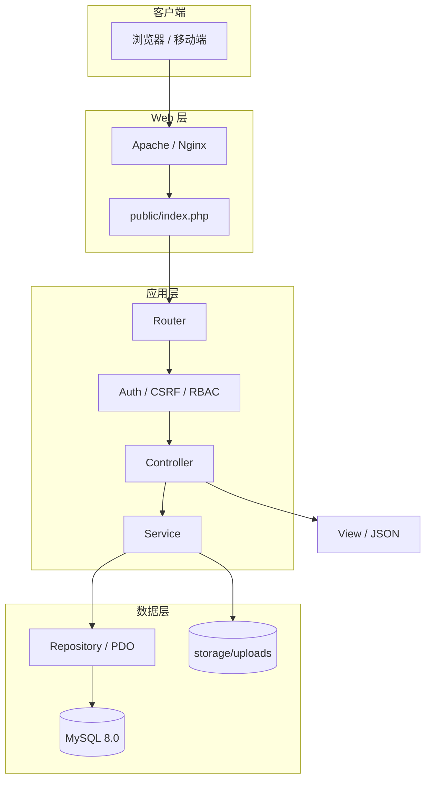
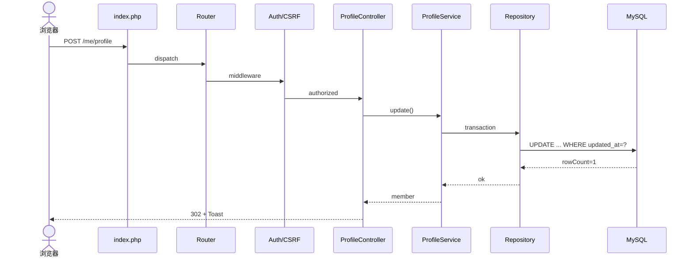
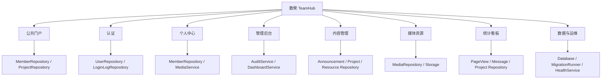
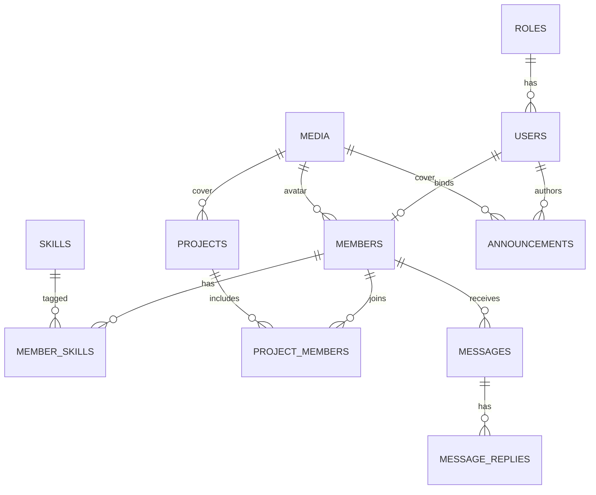
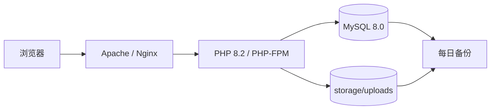

# 数聚 TeamHub 系统设计文档

> **课程**：互联网数据库开发　|　**团队**：M3　|　**编写**：钱泊瑜（2411282）　|　**日期**：2026-10-28

---

## 文档信息

| 项目 | 内容 |
| --- | --- |
| 文档名称 | 数聚 TeamHub 系统设计文档 |
| 项目名称 | 数聚 TeamHub——团队主页与内容管理系统 |
| 团队名称 | M3 |
| 文档编号 | DATANOVA-DES-001 |
| 编写人 | 钱泊瑜（2411282） |
| 所属课程 | 互联网数据库开发 |
| 指导教师 | 乜鹏 |
| 编写日期 | 2026 年 10 月 28 日 |
| 适用读者 | 团队成员、评审教师、后续维护者 |
| 文档范围 | 总体架构、模块、数据库、接口、页面、安全、性能、部署与测试设计 |

### 术语与缩略语

| 术语 | 全称 / 英文 | 说明 |
| --- | --- | --- |
| MVC | Model-View-Controller | 把数据、视图与请求控制分离的分层架构。 |
| RBAC | Role-Based Access Control | 基于角色的访问控制。 |
| CSRF | Cross-Site Request Forgery | 跨站请求伪造；写操作校验一次性令牌。 |
| XSS | Cross-Site Scripting | 跨站脚本；输出统一转义。 |
| SQLi | SQL Injection | SQL 注入；使用 PDO 预处理。 |
| PDO | PHP Data Objects | PHP 的统一数据库访问接口。 |
| Slug | URL Slug | 公开链接的可读标识。 |
| ADR | Architecture Decision Record | 记录关键技术决策与取舍。 |
| ER | Entity-Relationship | 实体—关系模型。 |
| P95 | 95th Percentile | 95% 的请求耗时低于该值。 |

### 关联文档

| 文档 | 版本 | 用途 |
| --- | --- | --- |
| 《数聚 TeamHub 需求文档》 | 需求、功能与验收基线 |
| 《数聚 TeamHub 设计文档》 | 架构、数据库、接口与安全设计 |
| 《数聚 TeamHub 实现文档》 | 开发过程、代码目录与结果 |
| 《数聚 TeamHub 用户手册》 | 用户使用说明 |
| 《数聚 TeamHub 部署文档》 | 环境、安装、备份与还原 |

---

## 目录

<details open>
<summary><strong>1 概述</strong></summary>

- [1.1 设计目标](#11-设计目标)
- [1.2 设计输入与需求追踪](#12-设计输入与需求追踪)
- [1.3 设计原则](#13-设计原则)
- [1.4 关键设计决策](#14-关键设计决策)
</details>

<details open>
<summary><strong>2 总体架构</strong></summary>

- [2.1 技术选型](#21-技术选型)
- [2.2 系统架构](#22-系统架构)
- [2.3 请求生命周期](#23-请求生命周期)
- [2.4 目录结构](#24-目录结构)
- [2.5 运行环境](#25-运行环境)
- [2.6 配置管理](#26-配置管理)
</details>

<details open>
<summary><strong>3 模块设计</strong></summary>

- [3.1 模块划分与依赖](#31-模块划分与依赖)
- [3.2 公共门户模块](#32-公共门户模块)
- [3.3 认证模块](#33-认证模块)
- [3.4 个人中心模块](#34-个人中心模块)
- [3.5 管理后台模块](#35-管理后台模块)
- [3.6 SQL 与数据访问框架](#36-sql-与数据访问框架)
- [3.7 媒体与资源模块](#37-媒体与资源模块)
- [3.8 统计与图表模块](#38-统计与图表模块)
- [3.9 审计与日志](#39-审计与日志)
- [3.10 错误处理](#310-错误处理)
</details>

<details open>
<summary><strong>4 数据库设计</strong></summary>

- [4.1 设计规范](#41-设计规范)
- [4.2 核心实体关系](#42-核心实体关系)
- [4.3 表清单](#43-表清单)
- [4.4 数据字典](#44-数据字典)
- [4.5 视图设计](#45-视图设计)
- [4.6 索引与性能设计](#46-索引与性能设计)
- [4.7 初始化、迁移与种子](#47-初始化迁移与种子)
- [4.8 事务与一致性](#48-事务与一致性)
- [4.9 备份与恢复](#49-备份与恢复)
</details>

<details open>
<summary><strong>5 接口设计</strong></summary>

- [5.1 接口规范](#51-接口规范)
- [5.2 路由表](#52-路由表)
- [5.3 关键接口](#53-关键接口)
- [5.4 安全、幂等与限流](#54-安全幂等与限流)
</details>

<details open>
<summary><strong>6 页面与交互设计</strong></summary>

- [6.1 视觉规范](#61-视觉规范)
- [6.2 组件规范](#62-组件规范)
- [6.3 关键页面线框](#63-关键页面线框)
- [6.4 响应式与可访问性](#64-响应式与可访问性)
- [6.5 前端性能](#65-前端性能)
</details>

<details open>
<summary><strong>7 安全设计</strong></summary>

- [7.1 威胁模型](#71-威胁模型)
- [7.2 认证与会话](#72-认证与会话)
- [7.3 授权与数据范围](#73-授权与数据范围)
- [7.4 输入与输出](#74-输入与输出)
- [7.5 文件上传与下载](#75-文件上传与下载)
- [7.6 密码与敏感数据](#76-密码与敏感数据)
- [7.7 安全响应头与 HTTPS](#77-安全响应头与-https)
- [7.8 审计与应急](#78-审计与应急)
</details>

<details open>
<summary><strong>8 性能与可靠性</strong></summary>

- [8.1 性能目标](#81-性能目标)
- [8.2 查询与索引](#82-查询与索引)
- [8.3 缓存策略](#83-缓存策略)
- [8.4 并发与锁](#84-并发与锁)
- [8.5 降级与容错](#85-降级与容错)
</details>

<details open>
<summary><strong>9 部署架构</strong></summary>

- [9.1 部署拓扑](#91-部署拓扑)
- [9.2 环境矩阵](#92-环境矩阵)
- [9.3 部署流程](#93-部署流程)
- [9.4 配置与密钥](#94-配置与密钥)
- [9.5 备份、监控与发布](#95-备份监控与发布)
</details>

<details open>
<summary><strong>10 测试设计</strong></summary>

- [10.1 测试策略](#101-测试策略)
- [10.2 测试矩阵](#102-测试矩阵)
- [10.3 关键测试用例](#103-关键测试用例)
- [10.4 验收与缺陷管理](#104-验收与缺陷管理)
</details>

<details open>
<summary><strong>11 编码规范与协作</strong></summary>

- [11.1 命名规范](#111-命名规范)
- [11.2 PHP 文件注释头](#112-php-文件注释头)
- [11.3 MVC 分层规范](#113-mvc-分层规范)
- [11.4 Git 与协作](#114-git-与协作)
- [11.5 代码评审清单](#115-代码评审清单)
</details>

<details open>
<summary><strong>12 关键实现示例</strong></summary>

- [12.1 路由与前端控制器](#121-路由与前端控制器)
- [12.2 数据库连接与事务](#122-数据库连接与事务)
- [12.3 仓储基类与分页](#123-仓储基类与分页)
- [12.4 登录服务](#124-登录服务)
- [12.5 个人资料更新与乐观锁](#125-个人资料更新与乐观锁)
- [12.6 install.sql 结构示例](#126-installsql-结构示例)
</details>

<details open>
<summary><strong>13 风险与演进</strong></summary>

- [13.1 技术风险](#131-技术风险)
- [13.2 演进路线](#132-演进路线)
- [13.3 设计复盘检查点](#133-设计复盘检查点)
</details>

<details open>
<summary><strong>14 附录</strong></summary>

- [14.1 附录 A：错误码](#141-附录-a错误码)
- [14.2 附录 B：设计追踪矩阵](#142-附录-b设计追踪矩阵)
- [14.3 附录 C：待确认与变更](#143-附录-c待确认与变更)
</details>

---

## 1 概述

设计不是把需求翻译成表，而是给出一组可解释、可验证、可演进的取舍。

### 1.1 设计目标

本设计要回答四个问题：系统由哪些层组成、每个模块如何协作、数据如何组织、如何安全地部署与验证。设计结果需同时满足课程要求（PHP、MySQL、MVC、install.sql、21 张表、动态图表、作业下载）与工程质量（可维护、可测试、可还原）。

1. **结构清晰**：请求从 public/index.php 进入，经路由、中间件、控制器、服务、仓储到数据库，视图只负责渲染。
2. **数据可解释**：21 张表有明确职责、主外键、索引与数据字典；关键查询能说明为什么这样建索引。
3. **安全默认**：认证、授权、CSRF、XSS、SQL 注入、上传与审计在架构层预留位置，而不是上线前补丁。
4. **可部署**：不依赖外部 CDN 与复杂构建；XAMPP 与 Nginx + PHP-FPM 均可运行，空库可还原。
5. **可演示**：数据看板、留言审核、个人资料与成员主页形成完整演示链路，每个技术点都能在页面上找到证据。

### 1.2 设计输入与需求追踪

设计输入包括《需求文档》的 32 项功能、18 条业务规则、21 项非功能指标，以及课程 PPT 的编码与提交要求。设计文档不重复需求全文，只在关键处引用需求编号；实现文档再引用设计章节，形成“需求—设计—实现—测试”的链路。

**表 1-1  设计输入与落点**

| 设计输入 | 来源 | 本设计中的落点 |
| --- | --- | --- |
| 32 项功能与角色 | 需求文档 3.4、4.3 | 模块划分、路由表、页面地图、权限矩阵 |
| 18 条业务规则 | 需求文档 3.9 | 服务层校验、数据库约束、状态机 |
| 21 张表 | 需求文档 3.11 | ER 图、表清单、数据字典、索引与视图 |
| 安全与性能指标 | 需求文档 3.10 | 认证/授权、输入输出、缓存、索引、测试 |
| 课程编码要求 | 课程 PPT | 目录结构、PHP 注释头、MVC 规范、install.sql |

### 1.3 设计原则

- **简单优先**：在满足需求的前提下选择最少组件；能用服务端渲染就不引入 SPA，能用 PDO 就不引入 ORM。
- **边界清晰**：Controller 不写 SQL，Repository 不写 HTML，View 不查数据库；跨层调用只允许相邻层。
- **显式优于隐式**：路由、权限、校验、事务边界都写出来；不依赖“魔术方法”和隐式全局状态。
- **安全默认**：默认拒绝、默认转义、默认预处理、默认最小权限；危险能力必须显式开启并审计。
- **可观测**：每个请求有 request_id；关键操作有审计；错误日志包含上下文但不泄露敏感信息。
- **可还原**：数据库结构、种子数据、配置样例、部署步骤都可重复执行；避免“只有某台电脑能跑”。
- **渐进增强**：核心页面在无 JS 时仍可浏览与提交；图表、动效、快捷操作作为增强。
- **为答辩而设计**：每个技术选择都能用一句话解释“为什么”，避免为炫技引入无法讲清的依赖。

### 1.4 关键设计决策

下表记录 8 个会影响后续实现的关键决策。ADR 的价值不在于“选了什么”，而在于把备选方案、理由与代价写清楚，便于答辩时回答“为什么不用框架/为什么不用 Vue/为什么不用 JWT”。

**表 1-2  关键设计决策（ADR）**

| 编号 | 决策 | 备选方案 | 选择理由 | 代价 / 缓解 |
| --- | --- | --- | --- | --- |
| ADR-01 | 自建轻量 MVC，不引入 Laravel/ThinkPHP | Laravel、ThinkPHP、原生脚本 | 课程要求讲清 MVC；依赖少、部署简单、代码可控。 | 需要自己实现路由/容器/校验；用约定与基类降低重复。 |
| ADR-02 | 服务端渲染 PHP 模板，不做 SPA | Vue/React SPA + API | SEO 友好、首屏快、部署简单；课程重点在数据库与全栈链路。 | 交互不如 SPA 顺滑；用局部 AJAX 与渐进增强补足。 |
| ADR-03 | Session 认证，不使用 JWT | JWT、OAuth | 同源应用、可即时撤销、实现简单；无需处理令牌续期与黑名单。 | 横向扩展需共享 Session；当前单机部署足够。 |
| ADR-04 | PDO + 轻量 QueryBuilder/Repository | Doctrine/Eloquent 等 ORM | SQL 透明、易讲解、无 Composer 依赖；便于课程展示索引与事务。 | 手写映射与查询；用基类与代码评审控制重复。 |
| ADR-05 | 一个账号一个角色 | 多角色、细粒度 ACL | 课程项目角色边界清晰；降低权限组合与测试成本。 | 灵活性较低；后续可扩展 user_roles。 |
| ADR-06 | 状态归档代替软删除 | deleted_at 软删除、物理删除 | 避免唯一索引与脏数据问题；保留历史可审计。 | 没有回收站；超级管理员可物理删除并留快照。 |
| ADR-07 | 文件存 Web 根外，由控制器流式输出 | 直接放 public/uploads | 防止 PHP 执行、路径遍历与直链盗取；可做权限校验。 | 多一次 PHP 转发；用缓存头与 X-Sendfile 优化。 |
| ADR-08 | 公告正文使用受限 Markdown，不允许原始 HTML | 富文本编辑器 + HTML 白名单 | 从源头降低 XSS；实现与审查更简单。 | 编辑体验较弱；用工具栏与预览弥补。 |

## 2 总体架构

用一条清晰的请求链路，把页面、业务、数据与基础设施连起来。

### 2.1 技术选型

技术选型遵循“课程要求优先、部署成本最低、可讲解性最强”三条原则。最终选择 PHP 8.2 + MySQL 8.0 + Apache/Nginx + Bootstrap 5 + 原生 JavaScript + ECharts，不引入 Composer 依赖与 Node 构建链。这样既满足课程对 PHP/MVC/install.sql 的要求，也避免因依赖安装失败导致演示环境不可用。

**表 2-1  技术选型**

| 层次 | 选型 | 版本 | 选择理由 | 备选与不选原因 |
| --- | --- | --- | --- | --- |
| 语言 | PHP | 8.1+（推荐 8.2） | 课程要求；内置 Web 支持；部署简单；类型系统足够。 | Node/Python 不符合 PHP 文件与 MVC 要求。 |
| 数据库 | MySQL | 8.0 | 课程主数据库；支持窗口函数、CTE、JSON、CHECK。 | SQLite 部署更简单但不适合多用户与课程演示。 |
| Web 服务器 | Apache / Nginx | 2.4 / 1.24 | XAMPP 自带 Apache；生产可用 Nginx + PHP-FPM。 | 纯 PHP 内置服务器不适合生产。 |
| 前端 | Bootstrap + 原生 JS | 5.3 | 响应式组件成熟；无需构建；易维护。 | Vue/React 需要构建链，增加部署复杂度。 |
| 图表 | Apache ECharts | 5.5（本地） | 中文文档好、图表类型全、可离线。 | Chart.js 功能较少；在线 CDN 演示有风险。 |
| 数据访问 | PDO + Repository | PHP 内置 | 预处理防注入；SQL 透明；便于讲索引与事务。 | ORM 隐藏 SQL，不利于课程讲解。 |
| 认证 | Session + RBAC | PHP 内置 | 同源、可撤销、实现简单。 | JWT 增加续期/撤销复杂度。 |
| 版本控制 | Git | 2.x | 课程要求；分支与提交记录可作为实现文档证据。 | SVN 也可，但团队更熟悉 Git。 |

### 2.2 系统架构

系统采用经典四层架构：表现层负责页面与交互；应用层负责路由、中间件、控制器与服务编排；领域与数据层负责业务规则、仓储与事务；基础设施层提供 MySQL、文件存储、Session、日志与备份。请求向下，数据向上；跨层调用只允许相邻层。



**表 2-2  分层职责与禁止事项**

| 层 | 主要组件 | 职责 | 禁止事项 |
| --- | --- | --- | --- |
| 表现层 | PHP View、Bootstrap、ECharts、静态资源 | 渲染页面、展示状态、收集输入、调用同源接口。 | 不直接查数据库；不写业务规则；不拼接 SQL。 |
| 应用层 | Router、Middleware、Controller、Service、Validator | 路由匹配、认证授权、参数校验、业务编排、响应。 | Controller 不写 SQL；Service 不输出 HTML。 |
| 领域与数据层 | Repository、QueryBuilder、Database、Transaction、Audit | 数据映射、查询构造、事务、审计、领域规则。 | Repository 不处理 HTTP；不返回模板。 |
| 基础设施 | MySQL、Storage、Session、Log、Backup | 持久化、文件、会话、日志、备份。 | 不被 View 直接访问；不暴露内部路径。 |

### 2.3 请求生命周期

以“更新个人资料”为例：浏览器提交 POST → `public/index.php` 引导 → Router 匹配 `/me/profile` → Auth/CSRF 中间件 → ProfileController 校验 → ProfileService 事务 → Repository 执行 UPDATE → 写审计 → 302 回资料页 + Toast。任何一层失败都返回明确的 HTTP 状态与用户可读的错误，不把堆栈暴露给浏览器。



1. **入口**：所有请求重写到 public/index.php，加载配置、错误处理、Session 与路由。
2. **路由**：按 HTTP 方法与路径匹配，解析 {slug} 等参数；未匹配返回 404。
3. **中间件**：按顺序执行请求 ID、安全头、认证、权限、CSRF、限流；失败短路。
4. **控制器**：只做参数收集、调用服务、选择响应；不写 SQL 与复杂业务。
5. **服务**：编排业务、校验规则、开启事务、调用仓储、写审计。
6. **仓储**：使用 PDO 预处理执行 SQL，返回数组/DTO；不处理 HTTP。
7. **视图/JSON**：HTML 页面统一转义；JSON 接口使用统一 envelope 与错误码。
8. **收尾**：记录访问统计、请求耗时与错误日志；释放连接。

### 2.4 目录结构

目录遵循“Web 根最小化”原则：只有 `public/` 可被 Web 访问，应用代码、配置、数据、日志与上传文件都在 Web 根之外。课程要求的 `data/install.sql`、`data/team/`、`data/personal/` 保留在项目数据目录中，下载由资源控制器统一输出。

**代码 2-1  项目目录结构**

```text
teamhub/
├─ app/
│  ├─ Controllers/
│  │  ├─ Public/          # 首页、团队、成员、留言
│  │  ├─ Auth/            # 登录、登出
│  │  ├─ Me/              # 成员中心、资料、安全
│  │  └─ Admin/           # 看板、成员、公告、项目、留言、资源、用户、日志
│  ├─ Core/               # Router、Request、Response、View、Session、Csrf、Database
│  ├─ Middleware/         # Auth、Rbac、Csrf、RateLimit、SecurityHeaders
│  ├─ Models/             # 数据实体与值对象
│  ├─ Repositories/       # 每张核心表一个仓储
│  ├─ Services/           # Auth、Profile、Member、Dashboard、Media、Audit
│  ├─ Support/            # Validator、Markdown、Image、Str、Arr
│  └─ Views/              # layouts、partials、public、auth、me、admin、errors
├─ bin/console            # migrate / seed / user:create / health
├─ config/                # app.php、database.php、permissions.php
├─ data/
│  ├─ install.sql         # 课程要求的初始化 SQL
│  ├─ team/               # 团队作业、文档、PPT
│  └─ personal/           # 个人作业（按学号_姓名）
├─ database/migrations/   # 增量迁移，按版本号命名
├─ public/                # 唯一 Web 根：index.php、assets、.htaccess
├─ routes/web.php         # 路由表
├─ storage/               # uploads、logs、cache、sessions（不可公开访问）
├─ tests/                 # 单元与集成测试脚本
└─ README.md              # 启动、配置、常用命令
```

命名约定：控制器 `XxxController`、服务 `XxxService`、仓储 `XxxRepository`、视图 `kebab-case.php`；数据库表与字段使用 `snake_case`；类文件使用 PSR-4 风格路径（本项目用简化自动加载器映射 `App\` 到 `app/`）。

### 2.5 运行环境

**表 2-3  运行环境矩阵**

| 环境 | 操作系统 | Web 服务器 | PHP | MySQL | 用途 |
| --- | --- | --- | --- | --- | --- |
| 开发 | Windows 10/11 | Apache 2.4（XAMPP） | 8.2 + 扩展 pdo_mysql、gd、mbstring、fileinfo | 8.0 | 本地开发、调试、演示备份。 |
| 生产 | Ubuntu 22.04 LTS | Nginx 1.24 + PHP-FPM | 8.2 + 同上 | 8.0 | 课程展示/校园服务器。 |
| 降级 | 任意 LAMP | Apache + mod_php | 8.1+ | 8.0 | 无法安装 Nginx 时的备选。 |

PHP 必需扩展：`pdo_mysql`（数据库）、`mbstring`（中文）、`fileinfo`（MIME 校验）、`gd`（图片缩放/水印）、`openssl`（加密/随机数）、`json`。可选：`intl`（日期格式化）、`zip`（批量导出）。`php.ini` 建议：`upload_max_filesize=10M`、`post_max_size=12M`、`max_execution_time=30`、`memory_limit=256M`。

### 2.6 配置管理

配置分三层：`.env` 保存环境相关密钥与连接信息；`config/*.php` 保存结构化配置与默认值；数据库 `site_settings` 保存可由管理员修改的站点配置。三者边界清晰：密钥只进 `.env`，代码常量进 `config`，运营文案进数据库。

**表 2-4  配置分层**

| 配置项 | 位置 | 示例 | 是否入库 | 说明 |
| --- | --- | --- | --- | --- |
| APP_ENV / APP_DEBUG | .env | production / false | 否 | 生产关闭调试，避免泄露堆栈。 |
| APP_KEY | .env | 32 字节随机串 | 否 | 用于 IP 哈希、Cookie 签名；不得提交 Git。 |
| DB_HOST / DB_NAME / DB_USER / DB_PASS | .env | 127.0.0.1 / teamhub / teamhub_user / | 否 | 最小权限账号，禁止 root。 |
| SESSION_LIFETIME | .env | 1800 | 否 | 空闲过期秒数。 |
| UPLOAD_MAX_MB | .env | 10 | 否 | 上传大小上限。 |
| 站点名称 / SEO / 页脚 | site_settings | 数聚 TeamHub / ... | 是 | 管理员可改，缓存 5 分钟。 |
| 角色权限码 | config/permissions.php | member.edit / message.moderate | 否 | 代码与数据库角色关联。 |

## 3 模块设计

每个模块只做一件事，并通过明确的接口与其它模块协作。

### 3.1 模块划分与依赖

系统分为 8 个模块：公共门户、认证、个人中心、管理后台、内容管理、媒体资源、统计看板、数据与运维。模块之间通过 Service 接口与数据表关联，不直接跨模块操作对方的 Repository；公共组件（Validator、View、Audit）向下复用。



**表 3-1  模块职责与依赖**

| 模块 | 核心类 | 依赖 | 对外接口 |
| --- | --- | --- | --- |
| 公共门户 | HomeController、TeamController、MemberController、HomeService | MemberRepository、ProjectRepository、AnnouncementRepository | GET /、/team、/members、/members/{slug} |
| 认证 | AuthController、AuthService、AuthMiddleware | UserRepository、LoginLogRepository、Session | GET/POST /login、POST /logout |
| 个人中心 | ProfileController、SecurityController、ProfileService | MemberRepository、MediaService、AuditService | GET/POST /me/profile、/me/security |
| 管理后台 | Admin\DashboardController、MemberController、SettingController | DashboardService、MemberService、SettingService | /admin/* |
| 内容管理 | AnnouncementController、ProjectController、ResourceController | 对应 Repository、MediaService、AuditService | /admin/announcements\|projects\|resources |
| 媒体资源 | MediaController、MediaService | MediaRepository、Image、Storage | POST /admin/media、GET /media/{id} |
| 统计看板 | DashboardService、StatsRepository | PageViewRepository、MessageRepository、ProjectRepository | GET /admin/api/dashboard |
| 数据运维 | MigrationRunner、Seeder、HealthService | Database、schema_migrations | CLI migrate/seed/health、GET /healthz |

### 3.2 公共门户模块

公共门户负责“展示与转化”，不处理写操作（留言除外）。HomeController 聚合团队资料、精选项目、公告与成员；TeamController 渲染团队故事、时间线、价值观与能力矩阵；MemberController 处理成员列表筛选与成员主页。所有查询都必须带 `is_visible=1` / `status=published` 条件，禁止把后台数据原样透出。

**表 3-2  公共门户类设计**

| 类 / 方法 | 职责 | 关键规则 |
| --- | --- | --- |
| HomeController::index | 聚合首屏、项目、公告、成员数据 | 每块最多 3/4 条；失败时降级为空数组并记录日志。 |
| TeamController::index | 团队故事、时间线、价值观、技能聚合 | 只展示 is_visible=1 的里程碑与成员。 |
| MemberController::index | 成员列表、搜索、技能筛选、排序 | 关键词长度 ≤ 50；排序字段白名单。 |
| MemberController::show | 按 slug 查成员、技能、项目、留言 | 不可见成员 404；留言只查 approved。 |
| HomeService::compose | 组织首页数据、缓存、兜底 | 缓存 60 秒；后台写操作后主动失效。 |

视图层使用 `layouts/public.php` + 页面模板 + 可复用 partials（`member-card`、`project-card`、`announcement-item`）。所有输出通过 `e()` 转义；卡片图片使用 `loading=lazy` 与固定宽高比，避免 CLS。

### 3.3 认证模块

认证模块负责“证明你是谁”，不负责“你能做什么”（后者由 RBAC 中间件负责）。AuthService 统一处理账号查找、密码校验、失败计数、锁定、Session 建立与登录日志；AuthController 只负责表单与跳转。

**表 3-3  认证模块组件**

| 组件 | 职责 | 关键实现 |
| --- | --- | --- |
| AuthController | 登录页、提交、登出 | GET 渲染；POST 校验 CSRF；成功后按角色跳转。 |
| AuthService | 凭据校验、锁定、会话 | password_verify；5 次失败锁 15 分钟；session_regenerate_id(true)。 |
| AuthMiddleware | 保护 /me 与 /admin | 未登录 302 到 /login?next=...；已登录但无权限 403。 |
| RbacMiddleware | 权限码校验 | 从 config/permissions.php 读取角色权限；服务端二次校验。 |
| LoginLogRepository | 登录审计 | 记录成功/失败、IP 哈希、UA；不记录明文密码。 |

登录失败不区分“账号不存在/密码错误”；账号禁用返回统一提示；锁定期内即使密码正确也拒绝。登录成功后清空失败计数、更新 `last_login_at`、重建 Session、生成新 CSRF Token。

### 3.4 个人中心模块

个人中心面向成员本人，核心是“安全地修改自己的公开资料”。ProfileService 负责字段白名单、slug 唯一性、头像/封面关联、技能同步、资料完整度计算与审计；ProfileController 负责表单渲染、错误回填与跳转。

**表 3-4  个人资料服务设计**

| 方法 | 输入 | 处理 | 输出 / 异常 |
| --- | --- | --- | --- |
| ProfileController::edit | 当前用户 | 加载成员、技能、媒体 | 渲染表单；无成员档案则 404。 |
| ProfileService::update | member_id、字段、updated_at | 校验 → 事务 → 乐观锁 → 审计 | 成功返回新资料；冲突 409；校验 422。 |
| ProfileService::updateAvatar | 临时 media_id | 校验归属/尺寸 → 关联 → 清理旧图 | 返回新头像 URL；失败 422。 |
| ProfileService::syncSkills | skill_id + proficiency 列表 | 校验数量/范围 → 删旧插新 | 事务内完成；失败回滚。 |
| ProfileService::completeness | 成员资料 | 按字段权重计算 0—100 | 用于后台提示与成员概览。 |

并发控制采用 `updated_at` 乐观锁：`UPDATE ... WHERE id=? AND updated_at=?`，影响行数为 0 视为冲突。资料修改与技能同步在同一事务中；审计日志写失败时回滚，保证“有修改必有记录”。

### 3.5 管理后台模块

后台采用“框架 + 模块”的设计：`layouts/admin.php` 提供侧栏、顶栏、面包屑、Toast 容器；每个管理模块实现 `index/create/store/edit/update/archive` 等动作，共用 `BaseAdminController` 的权限、分页、批量操作与审计钩子。

**表 3-5  管理后台模块**

| 页面 / 组件 | 职责 | 关键设计 |
| --- | --- | --- |
| Dashboard | KPI、4 类图表、待办 | KPI 服务端渲染；图表走 /admin/api/dashboard；缓存 60 秒。 |
| 成员管理 | 列表、编辑、排序、账号绑定 | 资料完整度、可见/精选开关；归档不删除关联。 |
| 公告管理 | 草稿、预览、发布、置顶、下线 | 状态机；发布前校验；slug 唯一。 |
| 项目管理 | CRUD、成员关联、状态 | 至少 1 名成员；项目成员角色/贡献。 |
| 留言管理 | 审核、回复、批量、垃圾 | 默认待审核；操作写审计；支持撤销。 |
| 资源管理 | 上传、分类、公开/隐藏 | MIME/大小校验；下载计数。 |
| 用户与角色 | 建号、重置密码、禁用、角色 | 仅超级管理员；临时密码只显示一次。 |
| 日志审计 | 登录日志、操作审计 | 按人/动作/时间筛选；只读。 |

### 3.6 SQL 与数据访问框架

这是本项目的技术核心之一。目标不是造一个 ORM，而是提供一组“足够用、可讲解、防注入”的数据访问原语：连接管理、查询构造、仓储基类、事务、迁移、种子、健康检查。所有 SQL 最终都经过 PDO 预处理，排序/表名等不可绑定的部分使用白名单。

**表 3-6  数据访问框架组件**

| 组件 | 职责 | 关键约束 |
| --- | --- | --- |
| Database | 单例连接、DSN、异常模式、事务封装 | ERRMODE_EXCEPTION、EMULATE_PREPARES=false、utf8mb4。 |
| QueryBuilder | select/where/order/limit 拼接 | 值全部绑定；字段/排序白名单；不拼用户输入。 |
| BaseRepository | find/findBy/paginate/create/update/archive | 表名与可写字段在子类声明；统一时间戳。 |
| Transaction | beginTransaction/commit/rollback 封装 | 嵌套用 savepoint；异常自动回滚。 |
| MigrationRunner | 按版本执行 database/migrations/*.sql | 记录 schema_migrations；校验和；文件锁。 |
| Seeder | 初始化角色、权限、管理员、示例数据 | 可重复执行；使用 INSERT ... ON DUPLICATE KEY UPDATE。 |
| HealthService | DB、迁移、存储、备份检查 | 只读；不执行任意 SQL。 |

分页统一返回 `{items, total, page, per_page, last_page}`；默认每页 15，最大 100。列表查询先执行 count，再执行带 limit 的数据查询；排序字段必须在 Repository 的 `$sortable` 白名单中，否则回退 `id DESC`。

> **为什么不用 ORM**
>
> 课程答辩需要讲清 SQL、索引、事务与执行计划。ORM 会把 SQL 藏在方法后面，反而不利于展示；自建轻量仓储让每条查询可见、可优化，同时通过基类避免重复。代价是需要手写映射与分页，但本项目表数量与查询复杂度可控。

### 3.7 媒体与资源模块

媒体模块统一管理头像、封面、公告配图与作业文件。上传后先进入临时目录，校验通过再落盘并写 `media` 表；业务表只保存 `media_id`，不保存路径。读取时通过 `/media/{id}` 控制器输出，按 `visibility` 与引用关系鉴权。

1. **接收**：检查 $_FILES 错误码、大小、扩展名；拒绝可执行文件与双扩展名。
2. **识别**：用 finfo_file 读取真实 MIME；图片用 getimagesize 校验尺寸与类型。
3. **处理**：图片按最长边 2000 px 缩放，转 WebP/JPEG，剥离 EXIF；生成 400×400 头像缩略图。
4. **落盘**：随机文件名 YYYY/MM/{random}.{ext}，存 storage/uploads；计算 SHA-256 去重。
5. **入库**：写 media（原名、MIME、大小、宽高、路径、上传人、可见性）。
6. **引用**：业务表保存 media_id；删除业务记录时只解除引用，定时任务清理无引用文件。
7. **输出**：控制器校验可见性，设置 Content-Type、Content-Length、Cache-Control 与 X-Content-Type-Options。

资源下载在媒体之上增加 `resources` 元数据（标题、分类、下载次数、公开性）。下载接口使用 `readfile` 流式输出，不暴露真实路径；下载计数用原子 `UPDATE ... SET download_count = download_count + 1` 避免并发丢计数。

### 3.8 统计与图表模块

访问统计由 `PageViewMiddleware` 在响应后写入 `page_views`：路径、路由名、目标类型/ID、访客哈希、会话哈希、Referer、UA、时间。IP 不明文保存，使用 `hash_hmac('sha256', ip, APP_KEY . date('Y-m-d'))`，兼顾去重与隐私。

**表 3-7  统计指标与缓存**

| 指标 | SQL 口径 | 缓存 | 用途 |
| --- | --- | --- | --- |
| 近 14 天访问 | 按 DATE(viewed_at) 分组，COUNT(*) 与 COUNT(DISTINCT visitor_hash) | 60 秒 | 看板折线图 |
| 待审核留言 | COUNT(*) WHERE status='pending' | 30 秒 | KPI 与待办 |
| 成员技能分布 | member_skills JOIN skills，按分类计数 | 300 秒 | 横向柱状图 |
| 项目状态分布 | projects 按 status 分组 | 300 秒 | 环形/堆叠图 |
| 热门内容 | page_views 按 target_type/id 聚合 | 300 秒 | P1 热门推荐 |

图表数据通过 `GET /admin/api/dashboard` 返回 JSON，前端 `dashboard.js` 使用 `fetch` 获取并渲染；不在页面内联 JavaScript 数据，兼容 CSP。ECharts 加载失败时显示 ``<table>`` 数据兜底。

### 3.9 审计与日志

日志分三类：应用日志（`storage/logs/app-YYYY-MM-DD.log`）、访问日志（Web 服务器）、业务审计（`audit_logs`）。应用日志按天轮转、保留 14 天；审计日志保留 180 天。每条日志带 `request_id`，便于把用户报错与堆栈关联。

**表 3-8  日志分类**

| 日志 | 记录内容 | 保留 | 访问权限 |
| --- | --- | --- | --- |
| 应用日志 | 时间、级别、request_id、异常、上下文（脱敏） | 14 天 | 仅服务器/管理员 |
| 登录日志 | 账号、成功/失败、原因、IP 哈希、UA | 180 天 | 超级管理员 |
| 操作审计 | 操作者、动作、实体、前后 JSON、IP 哈希 | 180 天 | 超级管理员 |
| 访问日志 | 路径、状态码、耗时、UA | 14 天 | 服务器 |

### 3.10 错误处理

异常体系以 `AppException` 为基类，派生 `ValidationException`（422）、`AuthException`（401）、`ForbiddenException`（403）、`NotFoundException`（404）、`ConflictException`（409）、`RateLimitException`（429）。全局异常处理器把异常映射为 HTML 错误页或 JSON 错误体，生产环境隐藏堆栈。

**表 3-9  异常与 HTTP 映射**

| 异常 | HTTP | 用户提示 | 日志级别 |
| --- | --- | --- | --- |
| ValidationException | 422 | 请检查标红字段 | info |
| AuthException | 401 | 请先登录 | warning |
| ForbiddenException | 403 | 你没有权限执行此操作 | warning |
| NotFoundException | 404 | 页面或资源不存在 | info |
| ConflictException | 409 | 数据已被修改，请刷新后重试 | warning |
| RateLimitException | 429 | 操作过于频繁，请稍后再试 | warning |
| Throwable | 500 | 服务暂时不可用，请稍后重试 | error |

## 4 数据库设计

21 张表不是数量目标，而是让账号、内容、资源与运维各有归处。

### 4.1 设计规范

数据库使用 MySQL 8.0、InnoDB、utf8mb4/utf8mb4_0900_ai_ci。表名与字段名统一 `snake_case`，表名用复数；主键统一 `id BIGINT UNSIGNED AUTO_INCREMENT`（小字典表可用 SMALLINT/TINYINT）；外键命名为 `{table}_id`；每张业务表包含 `created_at` 与 `updated_at`，需要审计的表另加操作者字段。

- **主键**：代理主键 + 业务唯一键（如 slug、username），避免用业务字段做外键。
- **外键**：核心关系建约束；删除策略按语义选择 CASCADE（从属）、SET NULL（可选引用）、RESTRICT（被引用资源）。
- **枚举**：状态少且稳定用 ENUM；需要运营扩展的分类用字典表或 VARCHAR + 应用校验。
- **时间**：统一 DATETIME，应用层使用 Asia/Shanghai；不使用数据库本地时区函数做业务判断。
- **JSON**：只存结构不固定的扩展字段（社交链接、价值观），不把可查询的核心字段塞进 JSON。
- **归档**：使用状态字段（archived/offline/disabled），不做 deleted_at 软删除，避免唯一索引与脏数据。
- **字符集**：全库 utf8mb4；连接、表、字段一致；排序规则统一，避免 JOIN 时隐式转换。
- **注释**：每张表与每个字段写 COMMENT，数据字典与数据库保持一致。

### 4.2 核心实体关系

系统以成员（members）为中心：账号（users）与成员一对一可选绑定；成员通过 member_skills 关联技能；通过 project_members 关联项目；留言（messages）可指向成员并由管理员回复；公告、项目、团队资料引用媒体。账号权限采用“用户—角色—权限”三表，角色权限通过 role_permissions 关联。



> **读图提示**
>
> 图中只画核心关系，媒体（media）与团队资料（team_profile）的引用关系较多，未全部连线；完整外键见 4.4 数据字典。所有业务表的主键均为代理键，外键列均建索引。

### 4.3 表清单

21 张表分为五组：账号权限 4 张、内容主体 10 张、资源 2 张、站点 1 张、运维 4 张。表数量满足课程“>10 张”的要求，同时避免为凑数创建无业务含义的表。

**表 4-1  数据库表清单**

| 组 | 表 | 中文名 | 职责 | 预估行数 |
| --- | --- | --- | --- | --- |
| 账号权限 | users | 账号 | 登录凭据、状态、角色、最后登录。 | < 100 |
| 账号权限 | roles | 角色 | 超级管理员/编辑/成员。 | 3 |
| 账号权限 | permissions | 权限码 | 功能级权限字典。 | < 50 |
| 账号权限 | role_permissions | 角色权限 | 角色与权限的多对多。 | < 150 |
| 内容主体 | team_profile | 团队资料 | 单例：名称、口号、故事、社交、价值观。 | 1 |
| 内容主体 | milestones | 里程碑 | 团队发展时间线。 | < 20 |
| 内容主体 | members | 成员 | 公开档案、账号绑定、可见/精选。 | < 50 |
| 内容主体 | skills | 技能字典 | 技能名称、分类、颜色。 | < 60 |
| 内容主体 | member_skills | 成员技能 | 熟练度、年限。 | < 500 |
| 内容主体 | projects | 项目 | 项目主体、状态、技术栈、封面。 | < 200 |
| 内容主体 | project_members | 项目成员 | 成员在项目中的角色与贡献。 | < 600 |
| 内容主体 | announcements | 公告 | 草稿/发布/下线、置顶、过期。 | < 500 |
| 内容主体 | messages | 留言 | 访客留言、审核状态、IP 哈希。 | < 10k |
| 内容主体 | message_replies | 留言回复 | 管理员/成员回复、可见性。 | < 10k |
| 资源 | media | 媒体 | 上传文件元数据、路径、哈希、可见性。 | < 5k |
| 资源 | resources | 下载资源 | 作业/文档分类、下载计数、公开性。 | < 500 |
| 站点 | site_settings | 站点设置 | 键值配置、分组、公开性。 | < 100 |
| 运维 | page_views | 访问记录 | 路径、目标、访客哈希、时间。 | < 100k/年 |
| 运维 | login_logs | 登录日志 | 成功/失败、原因、IP 哈希。 | < 10k/年 |
| 运维 | audit_logs | 操作审计 | 操作者、实体、前后 JSON。 | < 20k/年 |
| 运维 | schema_migrations | 迁移记录 | 版本、文件、校验和、耗时。 | < 100 |

### 4.4 数据字典

以下按表给出字段、类型、可空、键/默认与说明。类型中的 `UNSIGNED` 省略重复描述；所有表默认 `ENGINE=InnoDB`、`CHARSET=utf8mb4`、`COLLATE=utf8mb4_0900_ai_ci`。“FK→”表示外键引用，“UK”表示唯一键，“AI”表示自增。

#### 4.4.1 users（账号表）

保存登录账号、密码哈希、状态与登录安全字段。一个账号只分配一个角色；成员档案通过 members.user_id 可选绑定。

**表 4-2  users 数据字典**

| 字段 | 类型 | 空 | 键 / 默认 | 说明 |
| --- | --- | --- | --- | --- |
| id | BIGINT UNSIGNED | 否 | PK / AI | 账号主键。 |
| role_id | TINYINT UNSIGNED | 否 | FK→roles.id / 3 | 角色；默认成员。 |
| username | VARCHAR(50) | 否 | UK | 登录用户名，3—50 位。 |
| email | VARCHAR(120) | 否 | UK | 登录邮箱，同时用于联系。 |
| password_hash | VARCHAR(255) | 否 | — | password_hash() 结果，不保存明文。 |
| display_name | VARCHAR(50) | 否 | — | 后台显示名，可与成员姓名不同。 |
| avatar_media_id | BIGINT UNSIGNED | 是 | FK→media.id | 账号头像，可选。 |
| status | TINYINT UNSIGNED | 否 | 默认 1 | 1 正常、0 禁用、2 锁定。 |
| failed_login_count | SMALLINT UNSIGNED | 否 | 默认 0 | 连续失败次数。 |
| locked_until | DATETIME | 是 | NULL | 锁定截止时间；空表示未锁定。 |
| must_change_password | TINYINT UNSIGNED | 否 | 默认 0 | 1 表示下次登录必须改密。 |
| last_login_at | DATETIME | 是 | NULL | 最近成功登录时间。 |
| last_login_ip_hash | CHAR(64) | 是 | NULL | 最近登录 IP 的 HMAC-SHA256。 |
| password_changed_at | DATETIME | 是 | NULL | 密码最后修改时间。 |
| created_at | DATETIME | 否 | 默认 CURRENT_TIMESTAMP | 创建时间。 |
| updated_at | DATETIME | 否 | ON UPDATE | 更新时间。 |

索引与约束：uk_username、uk_email、idx_role_status(role_id,status)、idx_status(status)。

#### 4.4.2 roles（角色表）

角色字典。代码中通过 role.code 判断角色，通过 role_permissions 判断权限，避免散落硬编码。

**表 4-3  roles 数据字典**

| 字段 | 类型 | 空 | 键 / 默认 | 说明 |
| --- | --- | --- | --- | --- |
| id | TINYINT UNSIGNED | 否 | PK / AI | 角色主键。 |
| code | VARCHAR(30) | 否 | UK | super_admin / editor / member。 |
| name | VARCHAR(50) | 否 | — | 角色显示名。 |
| description | VARCHAR(255) | 是 | NULL | 职责说明。 |
| is_system | TINYINT UNSIGNED | 否 | 默认 0 | 1 表示内置角色，不可删除。 |
| created_at | DATETIME | 否 | 默认 CURRENT_TIMESTAMP | 创建时间。 |
| updated_at | DATETIME | 否 | ON UPDATE | 更新时间。 |

索引与约束：uk_code。内置 3 行：super_admin、editor、member。

#### 4.4.3 permissions（权限码表）

功能级权限字典，例如 member.edit、message.moderate、setting.manage。权限码与控制器方法一一对应。

**表 4-4  permissions 数据字典**

| 字段 | 类型 | 空 | 键 / 默认 | 说明 |
| --- | --- | --- | --- | --- |
| id | SMALLINT UNSIGNED | 否 | PK / AI | 权限主键。 |
| code | VARCHAR(80) | 否 | UK | 权限码，点号分隔。 |
| name | VARCHAR(80) | 否 | — | 中文名称。 |
| module | VARCHAR(30) | 否 | — | 所属模块。 |
| description | VARCHAR(255) | 是 | NULL | 说明与使用场景。 |
| created_at | DATETIME | 否 | 默认 CURRENT_TIMESTAMP | 创建时间。 |

索引与约束：uk_code、idx_module(module)。

#### 4.4.4 role_permissions（角色权限表）

角色与权限的多对多关联。编辑拥有内容类权限，超级管理员拥有全部权限。

**表 4-5  role_permissions 数据字典**

| 字段 | 类型 | 空 | 键 / 默认 | 说明 |
| --- | --- | --- | --- | --- |
| role_id | TINYINT UNSIGNED | 否 | PK / FK→roles.id | 角色。 |
| permission_id | SMALLINT UNSIGNED | 否 | PK / FK→permissions.id | 权限。 |
| created_at | DATETIME | 否 | 默认 CURRENT_TIMESTAMP | 授权时间。 |

索引与约束：主键(role_id, permission_id)；idx_permission(permission_id)。

#### 4.4.5 team_profile（团队资料表）

单例表，id 固定为 1。保存团队名称、口号、故事、联系方式、社交链接、价值观与品牌图。

**表 4-6  team_profile 数据字典**

| 字段 | 类型 | 空 | 键 / 默认 | 说明 |
| --- | --- | --- | --- | --- |
| id | TINYINT UNSIGNED | 否 | PK / 默认 1 | 固定为 1，数据库 CHECK 约束。 |
| name | VARCHAR(80) | 否 | — | 团队名称。 |
| english_name | VARCHAR(80) | 是 | NULL | 英文名。 |
| slogan | VARCHAR(120) | 是 | NULL | 口号。 |
| short_intro | VARCHAR(500) | 是 | NULL | 首页一句话介绍。 |
| story | TEXT | 是 | NULL | 团队故事，300—800 字。 |
| founded_on | DATE | 是 | NULL | 成立日期。 |
| location | VARCHAR(100) | 是 | NULL | 所在地。 |
| email | VARCHAR(120) | 是 | NULL | 团队联系邮箱。 |
| phone | VARCHAR(30) | 是 | NULL | 联系电话，默认不公开。 |
| logo_media_id | BIGINT UNSIGNED | 是 | FK→media.id | Logo。 |
| cover_media_id | BIGINT UNSIGNED | 是 | FK→media.id | 封面。 |
| social_json | JSON | 是 | NULL | GitHub/公众号/邮箱等链接。 |
| values_json | JSON | 是 | NULL | 价值观卡片数组。 |
| status | TINYINT UNSIGNED | 否 | 默认 1 | 1 正常、0 维护。 |
| updated_by | BIGINT UNSIGNED | 是 | FK→users.id | 最后修改人。 |
| created_at | DATETIME | 否 | 默认 CURRENT_TIMESTAMP | 创建时间。 |
| updated_at | DATETIME | 否 | ON UPDATE | 更新时间。 |

索引与约束：CHECK(id=1)；idx_updated_by(updated_by)。

#### 4.4.6 milestones（里程碑表）

团队发展时间线。按 year 与 sort_order 排序，最多展示 12 条。

**表 4-7  milestones 数据字典**

| 字段 | 类型 | 空 | 键 / 默认 | 说明 |
| --- | --- | --- | --- | --- |
| id | INT UNSIGNED | 否 | PK / AI | 主键。 |
| year | SMALLINT UNSIGNED | 否 | — | 年份。 |
| title | VARCHAR(120) | 否 | — | 里程碑标题。 |
| description | TEXT | 是 | NULL | 说明，建议 80 字以内。 |
| sort_order | INT | 否 | 默认 0 | 同年排序，越小越靠前。 |
| is_visible | TINYINT UNSIGNED | 否 | 默认 1 | 是否公开。 |
| created_at | DATETIME | 否 | 默认 CURRENT_TIMESTAMP | 创建时间。 |
| updated_at | DATETIME | 否 | ON UPDATE | 更新时间。 |

索引与约束：idx_year_sort(year, sort_order)、idx_visible(is_visible)。

#### 4.4.7 members（成员表）

公开成员档案。user_id 可选绑定账号；slug 用于公开链接；资料完整度用于后台提示。

**表 4-8  members 数据字典**

| 字段 | 类型 | 空 | 键 / 默认 | 说明 |
| --- | --- | --- | --- | --- |
| id | BIGINT UNSIGNED | 否 | PK / AI | 主键。 |
| user_id | BIGINT UNSIGNED | 是 | UK / FK→users.id | 绑定账号；一个账号最多一个档案。 |
| slug | VARCHAR(60) | 否 | UK | 公开链接标识，小写字母/数字/连字符。 |
| name | VARCHAR(50) | 否 | — | 姓名或昵称。 |
| english_name | VARCHAR(60) | 是 | NULL | 英文名。 |
| role_title | VARCHAR(60) | 否 | — | 团队角色，如“前端开发”。 |
| tagline | VARCHAR(150) | 是 | NULL | 一句话介绍。 |
| bio | TEXT | 是 | NULL | 个人简介，200—500 字。 |
| avatar_media_id | BIGINT UNSIGNED | 是 | FK→media.id | 头像。 |
| cover_media_id | BIGINT UNSIGNED | 是 | FK→media.id | 封面。 |
| email | VARCHAR(120) | 是 | NULL | 联系邮箱，默认不公开。 |
| github_url | VARCHAR(255) | 是 | NULL | GitHub 链接。 |
| website_url | VARCHAR(255) | 是 | NULL | 个人网站。 |
| location | VARCHAR(100) | 是 | NULL | 所在地。 |
| join_date | DATE | 是 | NULL | 加入团队日期。 |
| sort_order | INT | 否 | 默认 0 | 展示排序。 |
| is_featured | TINYINT UNSIGNED | 否 | 默认 0 | 首页精选。 |
| is_visible | TINYINT UNSIGNED | 否 | 默认 1 | 是否公开。 |
| profile_completeness | TINYINT UNSIGNED | 否 | 默认 0 | 0—100，后台计算。 |
| created_at | DATETIME | 否 | 默认 CURRENT_TIMESTAMP | 创建时间。 |
| updated_at | DATETIME | 否 | ON UPDATE | 更新时间。 |

索引与约束：uk_slug、uk_user_id、idx_visible_sort(is_visible,sort_order)、idx_featured(is_featured,is_visible)。

#### 4.4.8 skills（技能字典）

全局技能库，由管理员维护；成员只能选择，不能自行新增，避免“PHP/PHP语言”重复。

**表 4-9  skills 数据字典**

| 字段 | 类型 | 空 | 键 / 默认 | 说明 |
| --- | --- | --- | --- | --- |
| id | SMALLINT UNSIGNED | 否 | PK / AI | 主键。 |
| name | VARCHAR(50) | 否 | UK | 技能名。 |
| category | VARCHAR(30) | 否 | 默认 tech | tech/design/data/soft 等。 |
| color | CHAR(7) | 是 | NULL | 前端标签色，如 #2A9D8F。 |
| sort_order | INT | 否 | 默认 0 | 排序。 |
| created_at | DATETIME | 否 | 默认 CURRENT_TIMESTAMP | 创建时间。 |

索引与约束：uk_name、idx_category(category, sort_order)。

#### 4.4.9 member_skills（成员技能表）

成员与技能的多对多，附带熟练度与年限。熟练度用于成员主页进度条与能力矩阵聚合。

**表 4-10  member_skills 数据字典**

| 字段 | 类型 | 空 | 键 / 默认 | 说明 |
| --- | --- | --- | --- | --- |
| member_id | BIGINT UNSIGNED | 否 | PK / FK→members.id | 成员；删除时 CASCADE。 |
| skill_id | SMALLINT UNSIGNED | 否 | PK / FK→skills.id | 技能；删除时 CASCADE。 |
| proficiency | TINYINT UNSIGNED | 否 | 默认 3 | 1—5，CHECK 约束。 |
| years | DECIMAL(3,1) | 是 | NULL | 使用年限，0—20。 |
| created_at | DATETIME | 否 | 默认 CURRENT_TIMESTAMP | 创建时间。 |

索引与约束：主键(member_id, skill_id)；idx_skill(skill_id)；CHECK(proficiency BETWEEN 1 AND 5)。

#### 4.4.10 projects（项目表）

项目作品主体。状态、可见性、精选、排序控制前台展示；项目成员关系放在 project_members。

**表 4-11  projects 数据字典**

| 字段 | 类型 | 空 | 键 / 默认 | 说明 |
| --- | --- | --- | --- | --- |
| id | BIGINT UNSIGNED | 否 | PK / AI | 主键。 |
| slug | VARCHAR(80) | 否 | UK | 公开链接标识。 |
| title | VARCHAR(120) | 否 | — | 项目名称。 |
| summary | VARCHAR(300) | 是 | NULL | 列表摘要。 |
| description | LONGTEXT | 是 | NULL | 详情正文，受限 Markdown。 |
| cover_media_id | BIGINT UNSIGNED | 是 | FK→media.id | 封面。 |
| tech_stack | VARCHAR(255) | 是 | NULL | 技术栈，逗号分隔。 |
| status | ENUM('planning','ongoing','completed','archived') | 否 | 默认 ongoing | 项目状态。 |
| start_date | DATE | 是 | NULL | 开始日期。 |
| end_date | DATE | 是 | NULL | 结束日期。 |
| repo_url | VARCHAR(255) | 是 | NULL | 仓库地址。 |
| demo_url | VARCHAR(255) | 是 | NULL | 演示地址。 |
| is_featured | TINYINT UNSIGNED | 否 | 默认 0 | 首页精选。 |
| is_visible | TINYINT UNSIGNED | 否 | 默认 1 | 是否公开。 |
| view_count | INT UNSIGNED | 否 | 默认 0 | 详情浏览量，冗余计数。 |
| sort_order | INT | 否 | 默认 0 | 排序。 |
| created_by | BIGINT UNSIGNED | 否 | FK→users.id | 创建人。 |
| created_at | DATETIME | 否 | 默认 CURRENT_TIMESTAMP | 创建时间。 |
| updated_at | DATETIME | 否 | ON UPDATE | 更新时间。 |

索引与约束：uk_slug、idx_status_visible(status,is_visible)、idx_featured(is_featured,is_visible)、idx_created_by(created_by)。

#### 4.4.11 project_members（项目成员表）

项目与成员的多对多，记录角色与贡献。项目至少 1 名成员，由服务层校验。

**表 4-12  project_members 数据字典**

| 字段 | 类型 | 空 | 键 / 默认 | 说明 |
| --- | --- | --- | --- | --- |
| project_id | BIGINT UNSIGNED | 否 | PK / FK→projects.id | 项目；CASCADE。 |
| member_id | BIGINT UNSIGNED | 否 | PK / FK→members.id | 成员；CASCADE。 |
| role_name | VARCHAR(50) | 是 | NULL | 项目角色，如“后端”。 |
| contribution | VARCHAR(255) | 是 | NULL | 贡献说明。 |
| sort_order | INT | 否 | 默认 0 | 展示排序。 |
| created_at | DATETIME | 否 | 默认 CURRENT_TIMESTAMP | 创建时间。 |

索引与约束：主键(project_id, member_id)；idx_member(member_id)。

#### 4.4.12 announcements（公告表）

公告/动态。草稿、发布、下线三态；支持置顶与过期时间；正文使用受限 Markdown。

**表 4-13  announcements 数据字典**

| 字段 | 类型 | 空 | 键 / 默认 | 说明 |
| --- | --- | --- | --- | --- |
| id | BIGINT UNSIGNED | 否 | PK / AI | 主键。 |
| title | VARCHAR(150) | 否 | — | 标题。 |
| slug | VARCHAR(100) | 否 | UK | 公开链接标识。 |
| summary | VARCHAR(300) | 是 | NULL | 摘要。 |
| content | LONGTEXT | 否 | — | 正文，受限 Markdown。 |
| cover_media_id | BIGINT UNSIGNED | 是 | FK→media.id | 封面。 |
| category | VARCHAR(30) | 否 | 默认 news | news/notice/activity 等。 |
| status | ENUM('draft','published','offline') | 否 | 默认 draft | 状态。 |
| is_pinned | TINYINT UNSIGNED | 否 | 默认 0 | 是否置顶，最多 2 条。 |
| published_at | DATETIME | 是 | NULL | 发布时间。 |
| expires_at | DATETIME | 是 | NULL | 过期时间；空表示长期。 |
| view_count | INT UNSIGNED | 否 | 默认 0 | 浏览量。 |
| author_id | BIGINT UNSIGNED | 否 | FK→users.id | 作者。 |
| created_at | DATETIME | 否 | 默认 CURRENT_TIMESTAMP | 创建时间。 |
| updated_at | DATETIME | 否 | ON UPDATE | 更新时间。 |

索引与约束：uk_slug、idx_status_published(status,published_at)、idx_pinned(is_pinned,published_at)、idx_author(author_id)。

#### 4.4.13 messages（留言表）

访客留言。默认待审核，只有 approved 公开；保留 IP 哈希与 UA 用于反垃圾，不保存明文 IP。

**表 4-14  messages 数据字典**

| 字段 | 类型 | 空 | 键 / 默认 | 说明 |
| --- | --- | --- | --- | --- |
| id | BIGINT UNSIGNED | 否 | PK / AI | 主键。 |
| member_id | BIGINT UNSIGNED | 是 | FK→members.id | 目标成员；SET NULL。 |
| author_name | VARCHAR(50) | 否 | — | 访客昵称，2—30 字。 |
| author_email | VARCHAR(120) | 是 | NULL | 邮箱，不公开。 |
| author_website | VARCHAR(255) | 是 | NULL | 个人网站，可选。 |
| content | VARCHAR(1000) | 否 | — | 留言正文，10—500 字。 |
| status | ENUM('pending','approved','rejected','spam') | 否 | 默认 pending | 审核状态。 |
| ip_hash | CHAR(64) | 是 | NULL | IP 的 HMAC-SHA256。 |
| user_agent | VARCHAR(255) | 是 | NULL | 浏览器 UA，截断保存。 |
| admin_note | VARCHAR(255) | 是 | NULL | 审核备注/拒绝原因。 |
| created_at | DATETIME | 否 | 默认 CURRENT_TIMESTAMP | 提交时间。 |
| updated_at | DATETIME | 否 | ON UPDATE | 更新时间。 |

索引与约束：idx_status_created(status,created_at)、idx_member_status(member_id,status)、idx_ip_created(ip_hash,created_at)。

#### 4.4.14 message_replies（留言回复表）

管理员或成员对留言的回复。status=visible 才公开；is_admin 区分官方回复。

**表 4-15  message_replies 数据字典**

| 字段 | 类型 | 空 | 键 / 默认 | 说明 |
| --- | --- | --- | --- | --- |
| id | BIGINT UNSIGNED | 否 | PK / AI | 主键。 |
| message_id | BIGINT UNSIGNED | 否 | FK→messages.id | 所属留言；CASCADE。 |
| user_id | BIGINT UNSIGNED | 是 | FK→users.id | 回复人账号；SET NULL。 |
| replier_name | VARCHAR(50) | 否 | — | 显示名快照。 |
| content | VARCHAR(1000) | 否 | — | 回复正文。 |
| is_admin | TINYINT UNSIGNED | 否 | 默认 0 | 1 表示官方回复。 |
| status | ENUM('visible','hidden') | 否 | 默认 visible | 是否公开。 |
| created_at | DATETIME | 否 | 默认 CURRENT_TIMESTAMP | 创建时间。 |
| updated_at | DATETIME | 否 | ON UPDATE | 更新时间。 |

索引与约束：idx_message_status(message_id,status)、idx_user(user_id)。

#### 4.4.15 media（媒体表）

统一文件元数据。业务表只存 media_id；文件位于 storage/uploads，不通过直链访问。

**表 4-16  media 数据字典**

| 字段 | 类型 | 空 | 键 / 默认 | 说明 |
| --- | --- | --- | --- | --- |
| id | BIGINT UNSIGNED | 否 | PK / AI | 主键。 |
| disk_name | VARCHAR(120) | 否 | UK | 随机磁盘文件名。 |
| original_name | VARCHAR(255) | 否 | — | 原始文件名，仅展示。 |
| mime_type | VARCHAR(100) | 否 | — | 真实 MIME。 |
| extension | VARCHAR(10) | 否 | — | 规范化扩展名。 |
| size_bytes | INT UNSIGNED | 否 | — | 文件大小。 |
| width | SMALLINT UNSIGNED | 是 | NULL | 图片宽。 |
| height | SMALLINT UNSIGNED | 是 | NULL | 图片高。 |
| sha256 | CHAR(64) | 否 | — | 文件哈希，用于去重。 |
| storage_path | VARCHAR(255) | 否 | — | 相对 storage 的路径。 |
| visibility | ENUM('public','private') | 否 | 默认 public | 可见性。 |
| uploaded_by | BIGINT UNSIGNED | 是 | FK→users.id | 上传人；SET NULL。 |
| created_at | DATETIME | 否 | 默认 CURRENT_TIMESTAMP | 上传时间。 |

索引与约束：uk_disk_name、idx_sha256(sha256)、idx_mime(mime_type)、idx_uploaded_by(uploaded_by)。

#### 4.4.16 resources（下载资源表）

课程作业、设计文档、部署资料等下载资源。media_id 指向实际文件；下载走控制器并计数。

**表 4-17  resources 数据字典**

| 字段 | 类型 | 空 | 键 / 默认 | 说明 |
| --- | --- | --- | --- | --- |
| id | BIGINT UNSIGNED | 否 | PK / AI | 主键。 |
| title | VARCHAR(150) | 否 | — | 资源标题。 |
| category | ENUM('team','personal','design','doc','other') | 否 | 默认 other | 资源分类。 |
| description | VARCHAR(500) | 是 | NULL | 说明。 |
| media_id | BIGINT UNSIGNED | 否 | FK→media.id | 文件；RESTRICT。 |
| download_count | INT UNSIGNED | 否 | 默认 0 | 下载次数。 |
| is_public | TINYINT UNSIGNED | 否 | 默认 1 | 是否公开。 |
| sort_order | INT | 否 | 默认 0 | 排序。 |
| uploaded_by | BIGINT UNSIGNED | 否 | FK→users.id | 上传人。 |
| created_at | DATETIME | 否 | 默认 CURRENT_TIMESTAMP | 创建时间。 |
| updated_at | DATETIME | 否 | ON UPDATE | 更新时间。 |

索引与约束：idx_category_public(category,is_public)、idx_media(media_id)、idx_uploaded_by(uploaded_by)。

#### 4.4.17 site_settings（站点设置表）

键值配置，按 group_name 分组。is_public=1 的配置可被前台读取；敏感配置不入库。

**表 4-18  site_settings 数据字典**

| 字段 | 类型 | 空 | 键 / 默认 | 说明 |
| --- | --- | --- | --- | --- |
| id | INT UNSIGNED | 否 | PK / AI | 主键。 |
| setting_key | VARCHAR(80) | 否 | UK | 配置键，点号分隔。 |
| setting_value | TEXT | 是 | NULL | 配置值。 |
| value_type | ENUM('string','int','bool','json') | 否 | 默认 string | 值类型。 |
| group_name | VARCHAR(30) | 否 | 默认 general | 分组：seo/footer/contact。 |
| label | VARCHAR(100) | 是 | NULL | 后台显示名。 |
| is_public | TINYINT UNSIGNED | 否 | 默认 0 | 是否允许前台读取。 |
| updated_by | BIGINT UNSIGNED | 是 | FK→users.id | 最后修改人。 |
| created_at | DATETIME | 否 | 默认 CURRENT_TIMESTAMP | 创建时间。 |
| updated_at | DATETIME | 否 | ON UPDATE | 更新时间。 |

索引与约束：uk_setting_key、idx_group(group_name)、idx_public(is_public)。

#### 4.4.18 page_views（访问记录表）

匿名访问统计。visitor_hash 为 IP+日期+APP_KEY 的 HMAC，不保存明文 IP；用于趋势与热门内容。

**表 4-19  page_views 数据字典**

| 字段 | 类型 | 空 | 键 / 默认 | 说明 |
| --- | --- | --- | --- | --- |
| id | BIGINT UNSIGNED | 否 | PK / AI | 主键。 |
| path | VARCHAR(255) | 否 | — | 请求路径。 |
| route_name | VARCHAR(80) | 是 | NULL | 路由名，便于聚合。 |
| target_type | VARCHAR(30) | 是 | NULL | member/project/announcement。 |
| target_id | BIGINT UNSIGNED | 是 | NULL | 目标 ID。 |
| visitor_hash | CHAR(64) | 否 | — | 访客哈希。 |
| session_hash | CHAR(64) | 是 | NULL | 会话哈希。 |
| referrer | VARCHAR(255) | 是 | NULL | 来源页，截断。 |
| user_agent | VARCHAR(255) | 是 | NULL | UA，截断。 |
| viewed_at | DATETIME | 否 | 默认 CURRENT_TIMESTAMP | 访问时间。 |

索引与约束：idx_viewed(viewed_at)、idx_path_date(path,viewed_at)、idx_target(target_type,target_id)、idx_visitor(visitor_hash,viewed_at)。

#### 4.4.19 login_logs（登录日志表）

记录登录成功/失败、原因、IP 哈希与 UA。用于锁定判断与安全审计，不记录密码。

**表 4-20  login_logs 数据字典**

| 字段 | 类型 | 空 | 键 / 默认 | 说明 |
| --- | --- | --- | --- | --- |
| id | BIGINT UNSIGNED | 否 | PK / AI | 主键。 |
| user_id | BIGINT UNSIGNED | 是 | FK→users.id | 账号；不存在时为空。 |
| username_attempted | VARCHAR(50) | 否 | — | 尝试登录的账号。 |
| success | TINYINT UNSIGNED | 否 | — | 1 成功、0 失败。 |
| failure_reason | VARCHAR(50) | 是 | NULL | not_found/wrong_password/locked。 |
| ip_hash | CHAR(64) | 否 | — | IP 哈希。 |
| user_agent | VARCHAR(255) | 是 | NULL | UA。 |
| created_at | DATETIME | 否 | 默认 CURRENT_TIMESTAMP | 时间。 |

索引与约束：idx_user_created(user_id,created_at)、idx_ip_created(ip_hash,created_at)、idx_success(success)。

#### 4.4.20 audit_logs（操作审计表）

记录后台敏感操作。before_json/after_json 保存快照；日志只追加，不修改。

**表 4-21  audit_logs 数据字典**

| 字段 | 类型 | 空 | 键 / 默认 | 说明 |
| --- | --- | --- | --- | --- |
| id | BIGINT UNSIGNED | 否 | PK / AI | 主键。 |
| actor_id | BIGINT UNSIGNED | 是 | FK→users.id | 操作者；SET NULL。 |
| action | VARCHAR(50) | 否 | — | create/update/publish/archive/moderate。 |
| entity_type | VARCHAR(50) | 否 | — | 实体类型。 |
| entity_id | BIGINT UNSIGNED | 是 | NULL | 实体 ID。 |
| before_json | JSON | 是 | NULL | 修改前快照。 |
| after_json | JSON | 是 | NULL | 修改后快照。 |
| ip_hash | CHAR(64) | 是 | NULL | IP 哈希。 |
| created_at | DATETIME | 否 | 默认 CURRENT_TIMESTAMP | 时间。 |

索引与约束：idx_actor_created(actor_id,created_at)、idx_entity(entity_type,entity_id)、idx_action(action)。

#### 4.4.21 schema_migrations（迁移记录表）

记录已执行的迁移版本、文件、校验和与耗时。启动/部署时据此判断是否需要迁移。

**表 4-22  schema_migrations 数据字典**

| 字段 | 类型 | 空 | 键 / 默认 | 说明 |
| --- | --- | --- | --- | --- |
| id | INT UNSIGNED | 否 | PK / AI | 主键。 |
| version | VARCHAR(30) | 否 | UK | 版本号，如 20261028_0001。 |
| filename | VARCHAR(255) | 否 | — | 迁移文件名。 |
| checksum | CHAR(64) | 否 | — | 文件 SHA-256，防止篡改。 |
| applied_at | DATETIME | 否 | 默认 CURRENT_TIMESTAMP | 执行时间。 |
| execution_ms | INT UNSIGNED | 是 | NULL | 执行耗时。 |

索引与约束：uk_version、idx_applied(applied_at)。

### 4.5 视图设计

视图用于把高频、固定的查询口径固化，减少页面层重复拼 SQL；视图只读，不承担写操作。本期设计 3 个视图：公开成员、已发布公告、按日访问统计。视图字段与前台 DTO 对齐，避免在控制器里做大量拼装。

**表 4-23  视图设计**

| 视图 | 返回内容 | 使用位置 | 刷新方式 |
| --- | --- | --- | --- |
| v_public_members | 可见成员 + 技能数 + 项目数 + 精选/排序 | 成员列表、首页成员速览 | 实时视图，随基表变化。 |
| v_published_announcements | 已发布且未过期公告，置顶优先 | 首页动态、公告中心 | 实时视图；查询带 limit。 |
| v_dashboard_daily_views | 按日聚合访问量与访客数 | 看板趋势图 | 实时视图；看板层再缓存 60 秒。 |

**代码 4-1  公开成员与公告视图**

```sql
CREATE OR REPLACE VIEW v_public_members AS
SELECT m.id, m.slug, m.name, m.english_name, m.role_title,
       m.tagline, m.avatar_media_id, m.is_featured, m.sort_order,
       (SELECT COUNT(*) FROM member_skills ms WHERE ms.member_id = m.id) AS skill_count,
       (SELECT COUNT(*) FROM project_members pm WHERE pm.member_id = m.id) AS project_count
FROM members m
WHERE m.is_visible = 1;
 
CREATE OR REPLACE VIEW v_published_announcements AS
SELECT a.*
FROM announcements a
WHERE a.status = 'published'
  AND (a.expires_at IS NULL OR a.expires_at > NOW());
```

视图不用于复杂报表；看板聚合仍由 `StatsRepository` 写明确 SQL，便于 EXPLAIN 与索引调整。如果后续数据量增大，可把 `v_dashboard_daily_views` 物化为每日统计表，由定时任务刷新。

### 4.6 索引与性能设计

索引围绕真实查询设计，不为“看起来快”而给每个字段建索引。原则：WHERE 高频列、JOIN 外键列、ORDER BY 列优先；组合索引遵循最左前缀；低基数列（如 status）单独建索引价值有限，通常与时间或可见性组合。

**表 4-24  核心查询与索引**

| 查询场景 | 索引 | 说明 |
| --- | --- | --- |
| 成员列表：visible + sort | idx_visible_sort(is_visible, sort_order) | 覆盖默认列表；精选查询走 idx_featured。 |
| 成员主页：slug | uk_slug | 唯一索引，等值查询。 |
| 项目列表：status + visible | idx_status_visible(status, is_visible) | 默认过滤进行中/已完成。 |
| 公告列表：published + 时间 | idx_status_published(status, published_at) | 配合 expires_at 过滤；置顶另走 idx_pinned。 |
| 留言审核：status + 时间 | idx_status_created(status, created_at) | 待审核队列按时间倒序。 |
| 成员留言：member + status | idx_member_status(member_id, status) | 成员主页只查 approved。 |
| 访问趋势：viewed_at | idx_viewed(viewed_at) | 按日 GROUP BY；范围扫描。 |
| 审计查询：actor + 时间 | idx_actor_created(actor_id, created_at) | 按人筛选最近操作。 |
| 登录限流：ip + 时间 | idx_ip_created(ip_hash, created_at) | 统计 15 分钟内失败次数。 |

避免 N+1：成员列表一次查成员，再一次查技能（`WHERE member_id IN (...)`），在服务层组装；项目详情一次查项目、一次查成员、一次查媒体。分页使用 `LIMIT offset, size`，当 offset 很大时改为基于 `id` 的 keyset 分页（P1）。上线前对核心查询执行 `EXPLAIN`，确认使用索引、没有全表扫描与临时表排序。

> **不要过早优化**
>
> 课程数据量下，正确索引 + 避免 N+1 已足够。缓存与物化视图放在 P1，先用 EXPLAIN 与慢查询日志证明瓶颈，再优化。

### 4.7 初始化、迁移与种子

课程要求数据库抽取为 `/data/install.sql`。该文件面向“空库一次安装”，按外键依赖顺序建表，最后创建视图与种子数据。后续结构变更不直接改 install.sql，而是新增 `database/migrations/YYYYMMDD_NNNN_description.sql`，由迁移器按版本执行。

**表 4-25  初始化与迁移**

| 文件 / 命令 | 作用 | 执行时机 | 注意事项 |
| --- | --- | --- | --- |
| data/install.sql | 空库初始化：库、21 张表、索引、外键、3 视图、种子 | 首次部署/演示环境 | 会 DROP 同名表；执行前备份。 |
| database/migrations/*.sql | 增量结构变更 | 版本升级 | 只追加，不修改已执行文件；校验和。 |
| bin/console migrate | 按版本执行迁移并写 schema_migrations | 部署/启动 | 文件锁防并发；失败停止。 |
| bin/console seed | 角色、权限、管理员、技能、示例数据 | 首次安装/测试 | 可重复执行，使用 upsert。 |
| bin/console user:create | 创建管理员并生成临时密码 | 首次安装 | 临时密码只显示一次，强制改密。 |

`install.sql` 的结构：`SET NAMES utf8mb4` → `SET FOREIGN_KEY_CHECKS=0` → `DROP VIEW/TABLE` → `CREATE TABLE`（按依赖顺序）→ `ALTER TABLE media ADD FK uploaded_by`（解决 users↔media 循环）→ `CREATE VIEW` → `INSERT` 种子 → `SET FOREIGN_KEY_CHECKS=1`。所有表使用 `CREATE TABLE` 明确字符集与注释，不依赖服务器默认值。

种子数据包括：3 个角色、权限码、角色权限、1 个超级管理员（`must_change_password=1`）、技能字典、团队资料单例、站点设置默认值。示例成员/项目/公告只在开发环境写入，生产环境不写假数据。

### 4.8 事务与一致性

事务边界放在 Service 层，Repository 只执行单条 SQL。需要“多表同时成功或同时失败”的场景必须显式事务；单条 UPDATE 依赖数据库原子性，不额外开事务。

**表 4-26  事务边界**

| 业务场景 | 涉及表 | 事务边界 | 失败处理 |
| --- | --- | --- | --- |
| 成员资料保存 | members、member_skills、audit_logs | 更新资料 + 同步技能 + 审计 | 任一步失败回滚；返回 422/409。 |
| 项目创建/编辑 | projects、project_members、audit_logs | 项目主体 + 成员关联 + 审计 | 成员为空则拒绝；回滚。 |
| 留言审核 | messages、audit_logs | 状态更新 + 审计 | 状态非法则 409；回滚。 |
| 资源上传 | media、resources、audit_logs | 媒体入库 + 资源入库 + 审计 | 文件落盘失败则清理临时文件。 |
| 角色权限调整 | role_permissions、audit_logs | 删旧授权 + 插新授权 + 审计 | 全量替换；失败回滚。 |

并发控制：成员/项目/公告/团队资料更新使用 `updated_at` 乐观锁；影响行数为 0 返回 409。浏览量与下载量使用原子自增 `SET view_count = view_count + 1`，允许最终一致；不与业务事务耦合。外键删除策略：从属关系 CASCADE，可选引用 SET NULL，被引用资源 RESTRICT。

不使用触发器维护业务计数，原因是触发器难以测试、排错与迁移；计数由服务层显式更新，配合定时校对任务（P1）修正偏差。

### 4.9 备份与恢复

备份采用“数据库 dump + 上传文件打包”的组合。数据库每日 02:00 全量备份，保留 7 天；上传文件每周日全量、每日增量（rsync/tar）。备份文件放在 Web 根之外，文件名含日期与校验和，至少一份异地副本。

**代码 4-2  备份命令示例**

```bash
# 数据库备份（示例，密码走 ~/.my.cnf，不写在命令行）
mysqldump --single-transaction --routines --triggers \
  --default-character-set=utf8mb4 teamhub | gzip > /backup/teamhub_$(date +%F).sql.gz
 
# 上传文件与配置备份
tar -czf /backup/storage_$(date +%F).tar.gz storage/uploads config/.env
 
# 校验与保留
sha256sum /backup/teamhub_$(date +%F).sql.gz > /backup/teamhub_$(date +%F).sha256
find /backup -type f -mtime +7 -delete
```

恢复顺序：停应用 → 恢复数据库 → 恢复 `storage/uploads` → 恢复 `.env` → 执行 `migrate` → 清缓存 → 启动 → 冒烟测试。恢复演练每学期至少 1 次，记录恢复耗时（目标 RTO ≤ 30 分钟）与数据丢失窗口（RPO ≤ 24 小时）。备份文件必须做恢复验证，不能只检查“文件存在”。

## 5 接口设计

接口是模块之间的合同：输入、输出、错误与权限都要写清楚。

### 5.1 接口规范

页面接口以 HTML 为主，管理后台的图表与少量交互使用同源 JSON。JSON 响应统一 envelope，便于前端处理成功、分页与字段级错误；HTTP 状态码表达语义，不用 200 包裹所有错误。

**代码 5-1  统一响应结构**

```json
{
  "ok": true,
  "data": { "...": "..." },
  "meta": { "request_id": "req_20261028_ab12cd", "page": 1, "per_page": 15, "total": 42 }
}
 
{
  "ok": false,
  "error": {
    "code": "VALIDATION_ERROR",
    "message": "请检查标红字段",
    "fields": { "slug": "只能包含小写字母、数字和连字符" }
  },
  "meta": { "request_id": "req_20261028_ab12cd" }
}
```

**表 5-1  HTTP 状态码约定**

| 状态码 | 语义 | 典型场景 | 响应体 |
| --- | --- | --- | --- |
| 200 | 成功 | GET 列表/详情、JSON 数据 | data + meta |
| 201 | 已创建 | POST 新建资源/公告 | data + Location |
| 204 | 无内容 | DELETE/批量操作成功 | 空 |
| 302 | 重定向 | 表单提交成功后的 PRG 跳转 | Location |
| 400 | 请求错误 | JSON 解析失败、缺少必要参数 | error.code=BAD_REQUEST |
| 401 | 未认证 | 未登录访问受保护接口 | error.code=UNAUTHENTICATED |
| 403 | 无权限 | 成员访问管理接口 | error.code=FORBIDDEN |
| 404 | 不存在 | slug 不存在/隐藏成员 | error.code=NOT_FOUND |
| 409 | 冲突 | slug 重复、乐观锁失败 | error.code=CONFLICT |
| 419 | CSRF 失效 | 令牌缺失/过期 | error.code=CSRF_EXPIRED |
| 422 | 校验失败 | 字段格式/长度/范围错误 | error.fields |
| 429 | 限流 | 登录/留言过于频繁 | error.code=RATE_LIMITED |
| 500 | 服务器错误 | 未捕获异常 | error.code=INTERNAL |

### 5.2 路由表

路由按“公共 / 认证 / 成员中心 / 管理后台 / 媒体与健康检查”分组。`{slug}` 与 `{id}` 为路径参数；`auth` 表示需登录，`perm:xxx` 表示需权限码，`csrf` 表示写操作需令牌。

**表 5-2  路由表**

| 方法 | 路径 | 处理器 | 访问控制 | 说明 |
| --- | --- | --- | --- | --- |
| GET | / | Public\HomeController@index | 公开 | 首页聚合。 |
| GET | /team | Public\TeamController@index | 公开 | 团队介绍。 |
| GET | /members | Public\MemberController@index | 公开 | 成员列表/筛选。 |
| GET | /members/{slug} | Public\MemberController@show | 公开 | 成员主页。 |
| GET | /projects | Public\ProjectController@index | 公开 | 项目列表。 |
| GET | /projects/{slug} | Public\ProjectController@show | 公开 | 项目详情。 |
| GET | /announcements | Public\AnnouncementController@index | 公开 | 公告列表。 |
| GET | /announcements/{slug} | Public\AnnouncementController@show | 公开 | 公告详情。 |
| GET | /resources | Public\ResourceController@index | 公开 | 资源列表。 |
| GET | /resources/{id}/download | Public\ResourceController@download | 公开/校验 | 下载并计数。 |
| GET | /messages | Public\MessageController@index | 公开 | 留言板。 |
| POST | /messages | Public\MessageController@store | csrf + 限流 | 提交留言。 |
| GET | /login | Auth\LoginController@show | 公开 | 登录页。 |
| POST | /login | Auth\LoginController@login | csrf + 限流 | 登录。 |
| POST | /logout | Auth\LoginController@logout | auth + csrf | 登出。 |
| GET | /me | Me\DashboardController@index | auth | 成员概览。 |
| GET | /me/profile | Me\ProfileController@edit | auth | 资料编辑页。 |
| POST | /me/profile | Me\ProfileController@update | auth + csrf | 保存资料。 |
| POST | /me/avatar | Me\ProfileController@avatar | auth + csrf | 上传头像/封面。 |
| POST | /me/skills | Me\ProfileController@skills | auth + csrf | 同步技能。 |
| GET | /me/projects | Me\ProjectController@index | auth | 我的项目。 |
| GET | /me/security | Me\SecurityController@edit | auth | 账号安全。 |
| POST | /me/security/password | Me\SecurityController@password | auth + csrf | 修改密码。 |
| GET | /admin | Admin\DashboardController@index | auth + perm:dashboard.view | 数据看板。 |
| GET | /admin/api/dashboard | Admin\DashboardController@data | auth + perm:dashboard.view | 图表 JSON。 |
| GET | /admin/team | Admin\TeamController@edit | auth + perm:team.edit | 团队资料。 |
| POST | /admin/team | Admin\TeamController@update | auth + csrf + perm:team.edit | 保存团队资料。 |
| GET | /admin/members | Admin\MemberController@index | auth + perm:member.manage | 成员列表。 |
| GET | /admin/members/{id}/edit | Admin\MemberController@edit | auth + perm:member.manage | 编辑成员。 |
| POST | /admin/members/{id} | Admin\MemberController@update | auth + csrf + perm:member.manage | 保存成员。 |
| POST | /admin/members/{id}/archive | Admin\MemberController@archive | auth + csrf + perm:member.manage | 归档成员。 |
| GET | /admin/announcements | Admin\AnnouncementController@index | auth + perm:content.manage | 公告列表。 |
| GET | /admin/announcements/create | Admin\AnnouncementController@create | auth + perm:content.manage | 新建公告。 |
| POST | /admin/announcements | Admin\AnnouncementController@store | auth + csrf + perm:content.manage | 保存公告。 |
| POST | /admin/announcements/{id}/publish | Admin\AnnouncementController@publish | auth + csrf + perm:content.publish | 发布。 |
| POST | /admin/announcements/{id}/offline | Admin\AnnouncementController@offline | auth + csrf + perm:content.publish | 下线。 |
| GET | /admin/projects | Admin\ProjectController@index | auth + perm:content.manage | 项目列表。 |
| POST | /admin/projects | Admin\ProjectController@store | auth + csrf + perm:content.manage | 保存项目。 |
| GET | /admin/messages | Admin\MessageController@index | auth + perm:message.moderate | 留言队列。 |
| POST | /admin/messages/{id}/moderate | Admin\MessageController@moderate | auth + csrf + perm:message.moderate | 审核。 |
| POST | /admin/messages/{id}/reply | Admin\MessageController@reply | auth + csrf + perm:message.moderate | 回复。 |
| GET | /admin/resources | Admin\ResourceController@index | auth + perm:resource.manage | 资源列表。 |
| POST | /admin/resources | Admin\ResourceController@store | auth + csrf + perm:resource.manage | 上传资源。 |
| GET | /admin/users | Admin\UserController@index | auth + perm:user.manage | 账号列表。 |
| POST | /admin/users | Admin\UserController@store | auth + csrf + perm:user.manage | 创建账号。 |
| POST | /admin/users/{id}/reset-password | Admin\UserController@reset | auth + csrf + perm:user.manage | 重置临时密码。 |
| GET | /admin/settings | Admin\SettingController@edit | auth + perm:setting.manage | 站点设置。 |
| POST | /admin/settings | Admin\SettingController@update | auth + csrf + perm:setting.manage | 保存设置。 |
| GET | /admin/logs | Admin\LogController@index | auth + perm:log.view | 日志审计。 |
| GET | /media/{id} | Public\MediaController@show | 公开/校验 | 输出图片或文件。 |
| GET | /healthz | System\HealthController@index | 内网/令牌 | 健康检查。 |

### 5.3 关键接口

#### 5.3.1 登录

**代码 5-2  登录接口**

```http
POST /login
Content-Type: application/x-www-form-urlencoded
 
login=qian-boyu&password=********&_token=csrf_xxx&next=/me/profile
 
# 成功：302 Location: /me/profile（或 /admin）
# 失败：200 重新渲染登录页 + 顶部错误文案；AJAX 请求返回 401 JSON
# 锁定：423 Locked + “请于 14:32 后重试”
# 限流：429 Too Many Requests + Retry-After
```

#### 5.3.2 更新个人资料

**代码 5-3  更新个人资料接口**

```http
POST /me/profile
Content-Type: application/x-www-form-urlencoded
X-CSRF-Token: csrf_xxx
 
name=钱泊瑜&slug=qian-boyu&role_title=前端开发&tagline=用数据与界面讲好团队故事
&bio=...&email=...&github_url=https://github.com/...&updated_at=2026-10-28 20:30:00
 
# 200 / 302 成功
# 422 { "ok": false, "error": { "code": "VALIDATION_ERROR", "fields": { "slug": "..." } } }
# 409 { "ok": false, "error": { "code": "CONFLICT", "message": "数据已被修改，请刷新" } }
```

#### 5.3.3 看板数据

**代码 5-4  看板数据接口**

```http
GET /admin/api/dashboard?days=14
 
{
  "ok": true,
  "data": {
    "kpi": { "members": 4, "projects": 12, "pending_messages": 7, "views_7d": 1286 },
    "trend": [ { "date": "2026-10-15", "views": 80, "visitors": 42 }, ... ],
    "message_status": [ { "status": "pending", "count": 7 }, ... ],
    "skills": [ { "name": "PHP", "count": 3 }, ... ],
    "projects": [ { "status": "ongoing", "count": 5 }, ... ]
  },
  "meta": { "request_id": "req_...", "cached": true }
}
```

#### 5.3.4 留言审核

**代码 5-5  留言审核接口**

```http
POST /admin/messages/42/moderate
Content-Type: application/json
X-CSRF-Token: csrf_xxx
 
{ "action": "approve", "note": "内容合规" }
 
# action: approve | reject | spam
# 200 { "ok": true, "data": { "id": 42, "status": "approved" } }
# 409 状态已变化；403 无权限；419 CSRF 失效
```

### 5.4 安全、幂等与限流

- **CSRF**：所有 POST/PUT/PATCH/DELETE 校验 _token 或 X-CSRF-Token；失败返回 419，不执行任何写操作。
- **幂等**：创建类接口使用一次性表单 token 或业务唯一键（slug/username）防重复提交；审核接口用状态机保证重复调用结果一致。
- **限流**：登录按 IP/账号，留言按 IP/会话，上传按用户；阈值与窗口见需求 3.9；命中返回 429 + Retry-After。
- **批量操作**：一次最多 50 条；返回成功/失败明细；失败项不静默丢弃。
- **内容协商**：AJAX 请求返回 JSON，普通表单返回 302 + Flash；同一控制器根据 Accept/X-Requested-With 分支。
- **日志**：每个响应带 X-Request-Id；错误日志包含 request_id、路径、用户 ID、异常类，不记录密码与完整 Cookie。

## 6 页面与交互设计

把品牌感建立在一致性上，而不是装饰上。

### 6.1 视觉规范

视觉方向为“学术团队的克制感 + 数据产品的清晰度”：深海军蓝建立信任，青绿色表达数据与生长，暖金用于强调，珊瑚色只用于风险/提醒。页面留白充足，卡片圆角 12—16 px，阴影很轻，避免“模板站”的塑料感。

**表 6-1  品牌色与使用规则**

| 角色 | 色值 | 使用场景 | 注意事项 |
| --- | --- | --- | --- |
| 主色 深海蓝 | #102A43 | 导航、标题、页脚、主按钮文字 | 大面积使用；与白色对比度足够。 |
| 辅色 青绿 | #2A9D8F | 链接、进度条、图表、成功状态 | 不用于错误提示；与金色搭配需控制面积。 |
| 强调 暖金 | #C99A2E | 精选标签、置顶、重点数字 | 小面积点缀；文字用深色底。 |
| 提醒 珊瑚 | #D95F43 | 删除、拒绝、错误、风险 | 只用于负向操作；不要与品牌主色混用。 |
| 背景 浅灰 | #F7F9FB | 页面底色、卡片分区 | 与白色卡片形成层次。 |
| 正文 墨蓝 | #243B53 | 正文与表格文字 | 避免纯黑，降低长时间阅读疲劳。 |

字体：中文正文使用系统宋体/思源宋体栈，标题使用微软雅黑/思源黑体栈；英文与数字使用 Times New Roman/Inter 栈。不加载外部 Web Font，避免校园网环境下字体阻塞。正文 16 px、行高 1.75；后台表格 13—14 px；行高 1.5。

**表 6-2  字体层级**

| 层级 | 字号 / 行高 | 字重 | 用途 |
| --- | --- | --- | --- |
| H1 首屏 | clamp(32px, 4vw, 56px) / 1.15 | 700 | 首页主标题、团队页标题 |
| H2 区块 | 28—32 px / 1.3 | 700 | 项目、成员、公告区块 |
| H3 卡片 | 18—20 px / 1.4 | 600 | 卡片标题、后台模块标题 |
| 正文 | 16 px / 1.75 | 400 | 公共页面正文 |
| 辅助 | 13—14 px / 1.5 | 400 | 日期、标签、说明 |
| 表格/后台 | 13—14 px / 1.5 | 400/600 | 列表、表单、看板 |

间距采用 8 px 网格：4/8/12/16/24/32/48/64；卡片内边距 20—24 px；区块垂直间距 64—96 px；表单控件高度 40—44 px；圆角 8 px（控件）、12 px（卡片）、16 px（大面板）。阴影只用于悬浮层，静态卡片用 1 px 边框。

### 6.2 组件规范

**表 6-3  核心组件规范**

| 组件 | 状态 | 规范 | 使用位置 |
| --- | --- | --- | --- |
| 按钮 | 默认/hover/focus/disabled/loading | 主按钮青绿、次按钮描边；loading 保留宽度；禁用降低透明度。 | 全站 |
| 表单 | 默认/focus/error/success/disabled | 标签在上；错误红框 + 文案；帮助文本灰色；必填星号。 | 登录、资料、后台 |
| 卡片 | 默认/hover | 1 px 边框 + 12 px 圆角；hover 上浮 2 px；整卡可点击。 | 项目、成员、公告 |
| 表格 | 默认/空/加载/错误 | 表头深色；斑马纹；操作列固定；窄屏横向滚动。 | 后台列表 |
| 弹窗 | 默认/确认/危险 | 遮罩 40% 黑；Esc 关闭；焦点锁定；危险操作红色按钮。 | 删除、归档、批量 |
| Toast | 成功/失败/警告 | 右上角；3 秒消失；可手动关闭；不遮挡主操作。 | 全站反馈 |
| 分页 | 默认/禁用 | 总数 + 页码 + 上一页/下一页；当前页高亮；URL 可分享。 | 列表页 |
| 空状态 | 空/无权限/404 | 图标 + 一句解释 + 主行动；不显示空白表格。 | 全站 |

### 6.3 关键页面线框

以下线框用于对齐信息层级与交互，不是最终视觉稿。实现时保持区块顺序与主行动不变，颜色、图片与文案可按品牌调整。五张图分别覆盖首页、团队介绍、成员主页、管理看板与个人资料编辑，正好对应钱泊瑜负责的前端与后台界面。

```text
┌──────────────────────────────────────────────────────────────┐
│ 数聚 TeamHub    首页  团队介绍  成员  项目  公告  资源  登录  │
├──────────────────────────────────────────────────────────────┤
│ 数据库 × 全栈 × 协作                                          │
│ 把团队的每一次协作，                                          │
│ 变成看得见的作品。                    [ 数据网络 / 团队插画 ] │
│ 数聚团队主页 · 项目、成员与课程作业的一站式展示空间            │
│ [ 认识我们 → ]  [ 查看项目 ]                                 │
├──────────────────────────────────────────────────────────────┤
│  4 团队成员     12 课程项目     21 数据表     3 展示维度       │
├───────────────────────────────┬──────────────────────────────┤
│ 精选项目                       │ 最新动态                     │
│ ┌─────────┐ ┌─────────┐       │ • 公告标题 1   2026.10.2x    │
│ │ 封面    │ │ 封面    │       │ • 公告标题 2   2026.10.2x    │
│ │ 项目 01 │ │ 项目 02 │       │ • 公告标题 3   2026.10.2x    │
│ └─────────┘ └─────────┘       │                              │
├───────────────────────────────┴──────────────────────────────┤
│ 成员速览   头像 成员1   头像 成员2   头像 成员3   头像 成员4   │
└──────────────────────────────────────────────────────────────┘
```

```text
┌──────────────────────────────────────────────────────────────┐
│ 数聚 TeamHub    首页  团队介绍  成员  项目  公告  资源  登录  │
├──────────────────────────────────────────────────────────────┤
│ 关于数聚                                                     │
│ 一群把数据当作语言的年轻人                                    │
│ 我们来自不同专业，用数据库、代码与设计，把课程作业做成作品。  │
│ [ 我们的故事 ]                                               │
├──────────────────────────────────────────────────────────────┤
│ 团队故事                        我们相信，好的团队项目不是   │
│ ┌───────────────────────┐       功能的堆叠，而是让每个人     │
│ │ 团队合影 / 工作场景   │       都能被看见、被记录。         │
│ └───────────────────────┘       [共同目标] [透明协作]        │
├──────────────────────────────────────────────────────────────┤
│ 成长时间线                                                    │
│  ● 2026.01      ● 2026.02      ● 2026.03      ● 2026.04      │
│  里程碑 1       里程碑 2       里程碑 3       里程碑 4        │
├──────────────────────────────────────────────────────────────┤
│ 成员网格   头像 成员1   头像 成员2   头像 成员3   头像 成员4   │
└──────────────────────────────────────────────────────────────┘
```

```text
┌──────────────────────────────────────────────────────────────┐
│ 数聚 TeamHub    首页  团队介绍  成员  项目  公告  资源  登录  │
├──────────────────────────────────────────────────────────────┤
│ 成员封面 / 几何纹理                                           │
│  ┌──────┐  成员姓名                         [GitHub] [Email] │
│  │ 头像 │  前端开发 / 数据库设计                             │
│  └──────┘  一句话介绍自己的关注方向与代表作品                 │
├───────────────────────────────┬──────────────────────────────┤
│ 关于我                         │ 代表项目                     │
│ 3—5 行个人简介：研究方向、     │ ┌──────────────────────────┐ │
│ 团队角色、做过的项目。         │ │ 项目 1  角色/技术栈/成果 │ │
│                                │ └──────────────────────────┘ │
│ 技能矩阵                       │ ┌──────────────────────────┐ │
│ PHP        ████████░░          │ │ 项目 2  角色/技术栈/成果 │ │
│ MySQL      ███████░░░          │ └──────────────────────────┘ │
│ JavaScript ██████░░░░          │                              │
│ UI Design  █████░░░░░          │ ┌──────────────────────────┐ │
│                                │ │ 给 TA 留言  [提交]       │ │
│                                │ └──────────────────────────┘ │
└───────────────────────────────┴──────────────────────────────┘
```

```text
┌──────────────┬───────────────────────────────────────────────┐
│ 数聚 TeamHub │ 数据看板                         搜索   管理员 │
│ ADMIN        ├───────────────────────────────────────────────┤
│ 数据看板     │ ┌────────┐ ┌────────┐ ┌────────┐ ┌────────┐  │
│ 团队资料     │ │成员 4  │ │项目 12 │ │待审 7  │ │访问1,286│  │
│ 成员管理     │ └────────┘ └────────┘ └────────┘ └────────┘  │
│ 项目管理     │ ┌──────────────────────┐ ┌──────────────────┐ │
│ 公告管理     │ │ 近 14 天访问趋势     │ │ 成员技能分布     │ │
│ 留言管理     │ │      ╱╲    ╱╲        │ │    ◔ 21 项技能   │ │
│ 资源管理     │ │  ╱╲╱  ╲╱   ╲        │ │                  │ │
│ 用户与角色   │ └──────────────────────┘ └──────────────────┘ │
│ 站点设置     │ ┌───────────────────────────────────────────┐ │
│ 日志审计     │ │ 待审核留言  访客 / 摘要 / 成员 / 操作     │ │
│              │ │ 访客1  这是一条待审核留言…  成员A  通过/拒绝│ │
└──────────────┴───────────────────────────────────────────────┘
```

```text
┌──────────────────────────────────────────────────────────────┐
│ 成员中心 / 个人资料                            查看公开主页 ↗ │
├──────────────┬───────────────────────────────────────────────┤
│ 我的空间     │ 基本资料                            ┌──────┐   │
│ 概览         │ 姓名 / 昵称  [钱泊瑜            ]  │ 头像 │   │
│ 个人资料     │ 公开 slug    [qian-boyu          ]  └──────┘   │
│ 我的项目     │ 团队角色     [前端开发 / 数据库设计]  [更换头像] │
│ 账号安全     │ 一句话介绍   [用数据与界面讲好团队故事]         │
│              │ 个人简介     [支持 200—500 字           ]       │
│              │ GitHub       [https://github.com/...    ]       │
│              │ 个人网站     [https://...               ]       │
│              │ 技能标签     [PHP] [MySQL] [JavaScript] [UI]    │
├──────────────┴───────────────────────────────────────────────┤
│ 最后保存：2026-10-28 20:30              [取消] [保存修改]    │
└──────────────────────────────────────────────────────────────┘
```

### 6.4 响应式与可访问性

断点：<576 px 手机、576—767 px 大屏手机、768—991 px 平板、992—1199 px 小桌面、≥1200 px 桌面。采用移动优先 CSS；公共页在 <768 px 单列，后台侧栏在 <992 px 折叠为抽屉。

**表 6-4  响应式断点**

| 断点 | 布局 | 导航 | 表格 / 卡片 |
| --- | --- | --- | --- |
| <576 | 单列；Hero 文字优先，视觉图下移 | 汉堡抽屉；CTA 全宽 | 卡片单列；表格横向滚动 |
| 576—767 | 单列；数据条 2×2 | 抽屉 | 卡片单列；筛选折叠 |
| 768—991 | 两列；团队页图文上下 | 顶部导航 + 抽屉 | 卡片两列；表格横向滚动 |
| 992—1199 | 两列/三列；后台侧栏展开 | 完整顶部导航 | 表格完整；看板 2×2 |
| ≥1200 | 12 栏；Hero 左文右图 | 完整导航 | 表格/图表完整 |

- **键盘**：所有交互可 Tab 到达；focus ring 2 px 青绿；弹窗焦点锁定，Esc 关闭。
- **语义**：每页一个 H1；标题层级不跳级；表格有 `<caption>`；表单 `<label for>` 关联。
- **对比度**：正文 ≥ 4.5:1；大字号 ≥ 3:1；不只靠颜色表达状态。
- **图片**：内容图有 alt；装饰图 alt=""；图表提供数据表或文字摘要。
- **动效**：尊重 prefers-reduced-motion；不自动播放视频；滚动动画不影响阅读。
- **触控**：点击区域 ≥ 44×44 px；移动端表单键盘类型正确（email/tel/url）。

### 6.5 前端性能

前端不引入构建链，但要做最基本的性能控制：静态资源本地化、图片按需加载、CSS/JS 版本化、缓存头、避免布局抖动。首屏只加载公共样式与少量 JS；ECharts 仅在后台看板页加载。

**表 6-5  前端性能措施**

| 措施 | 做法 | 预期收益 |
| --- | --- | --- |
| 资源本地化 | Bootstrap、ECharts、图标全部放 public/assets/vendor | 离线可用；避免 CDN 失败。 |
| 图片优化 | 上传时转 WebP/JPEG，限制最长边 2000 px；列表用缩略图 | 减少首屏字节与 CLS。 |
| 懒加载 | 非首屏图片 loading=lazy；图表进入视口再初始化 | 降低首屏 JS/网络。 |
| 缓存 | 静态资源 Cache-Control: public, max-age=31536000, immutable；文件名带版本 | 二次访问几乎零请求。 |
| CSS | 关键样式内联 ≤ 14 KB；其余异步或按页加载 | 减少阻塞渲染。 |
| JS | 原生 ES6；事件委托；无全局依赖；defer 加载 | 降低主线程占用。 |
| 字体 | 系统字体栈；不加载外部字体 | 避免 FOIT/FOUT。 |
| 服务端 | gzip/brotli；OPcache；查询缓存 | 降低 TTFB。 |

性能预算：首页 HTML ≤ 60 KB、CSS ≤ 80 KB、首屏 JS ≤ 30 KB、首屏图片合计 ≤ 300 KB；LCP ≤ 2.5 s、CLS ≤ 0.1、INP ≤ 200 ms。超出预算时优先删减装饰与第三方脚本。

## 7 安全设计

安全不是最后加的插件，而是每个入口的默认动作。

### 7.1 威胁模型

采用 STRIDE 对主要资产（账号、成员资料、留言、资源文件、审计日志）做威胁建模。系统是公开可访问的课程项目，重点防“低门槛自动化攻击”和“越权访问”，不假设攻击者拥有服务器权限。

**表 7-1  STRIDE 威胁与对策**

| 威胁 | 典型场景 | 影响 | 设计对策 |
| --- | --- | --- | --- |
| Spoofing 仿冒 | 撞库、弱密码、会话固定 | 账号被冒用 | bcrypt、登录限流、Session 重建、HttpOnly/SameSite。 |
| Tampering 篡改 | 越权改他人资料、改隐藏字段 | 数据被改 | 服务端字段白名单、数据级权限、CSRF、乐观锁。 |
| Repudiation 抵赖 | 否认发布/审核/删除 | 无法追责 | audit_logs 记录操作者、时间、前后快照。 |
| Information disclosure 泄露 | 错误页堆栈、明文 IP、直链下载 | 隐私/源码泄露 | 生产关闭 debug、IP 哈希、文件走控制器、最小权限。 |
| Denial of service 拒绝服务 | 登录/留言刷量、超大文件 | 服务不可用 | 限流、大小限制、超时、队列/退避。 |
| Elevation of privilege 提权 | 成员访问 /admin、IDOR | 越权管理 | RBAC + 资源归属校验 + 403 默认拒绝。 |

### 7.2 认证与会话

认证采用服务端 Session：登录成功后 `session_regenerate_id(true)`，写入 `user_id`、`role_code` 与新 CSRF Token；Cookie 设置 `HttpOnly`、`SameSite=Lax`，HTTPS 下加 `Secure`。空闲 30 分钟过期，绝对时长 8 小时；修改密码后使旧会话失效（`password_changed_at` 对比会话创建时间）。

**表 7-2  认证与会话控制**

| 控制 | 参数 | 说明 |
| --- | --- | --- |
| 密码哈希 | PASSWORD_DEFAULT（bcrypt cost 12） | 兼容性好；如环境支持 Argon2id 可切换并 rehash。 |
| 密码策略 | ≥ 10 位，3 类字符 | 不强制频繁更换；禁止与用户名相同。 |
| 失败锁定 | 5 次 / 15 分钟 | 按账号计数；同时按 IP 限流 10 次/15 分钟。 |
| 会话固定 | 登录后重建 ID | 旧 ID 立即失效。 |
| Cookie | HttpOnly + SameSite=Lax + Secure | 禁止 JS 读取；跨站 POST 不带 Cookie。 |
| 登出 | POST + CSRF | 清空 Session、过期 Cookie、写日志。 |
| 临时密码 | 首次登录强制修改 | must_change_password=1；只显示一次。 |

### 7.3 授权与数据范围

授权分两层：功能级（能否进入某控制器/方法）与数据级（能否操作某条记录）。功能级用权限码，数据级在 Service 层校验“当前用户是否绑定该成员/是否为作者/是否超级管理员”。仅靠前端隐藏菜单或 URL 参数判断都属于漏洞。

**表 7-3  权限码与数据范围**

| 权限码 | 功能 | editor | super_admin | 数据范围 |
| --- | --- | --- | --- | --- |
| dashboard.view | 查看看板 | ✓ | ✓ | 全部聚合数据 |
| team.edit | 编辑团队资料 | ✓ | ✓ | 单例 |
| member.manage | 成员管理 | ✓ | ✓ | 全部成员 |
| content.manage | 公告/项目/资源 | ✓ | ✓ | 全部内容 |
| content.publish | 发布/下线 | ✓ | ✓ | 全部内容 |
| message.moderate | 留言审核/回复 | ✓ | ✓ | 全部留言 |
| user.manage | 账号/角色 | — | ✓ | 全部账号 |
| setting.manage | 站点设置 | — | ✓ | 全部配置 |
| log.view | 日志审计 | — | ✓ | 全部日志 |
| db.health | 数据健康检查 | — | ✓ | 只读 |

对象级校验示例：`/admin/members/{id}` 必须先查成员是否存在，再判断当前用户是否有 `member.manage`；成员访问 `/me/profile` 时只允许操作 `members.user_id = current_user.id` 的记录，不能通过改 `member_id` 越权。

### 7.4 输入与输出

**表 7-4  输入输出安全**

| 风险 | 入口 | 控制措施 | 验证 |
| --- | --- | --- | --- |
| SQL 注入 | 搜索、筛选、排序、ID | PDO 预处理；表名/排序白名单；不拼接用户输入。 | 用 ' OR 1=1 -- 等载荷测试。 |
| XSS | 留言、简介、公告正文、标题 | 输出 e() 转义；正文受限 Markdown 先转义；CSP。 | 提交 `<script>` 与事件属性。 |
| CSRF | 所有写操作 | Session Token + 隐藏字段/请求头；hash_equals。 | 跨站表单/无 token 请求应 419。 |
| 越权 | ID 参数、slug | 服务层数据范围校验；隐藏资源 404。 | 改他人 ID、隐藏成员 ID。 |
| 路径遍历 | 文件下载/媒体 | 只按 media_id 查库；路径白名单；realpath 校验。 | ../、绝对路径、双扩展名。 |
| 开放重定向 | 登录 next 参数 | 只允许站内相对路径；白名单。 | next=https://evil.com。 |
| 暴力破解 | 登录、留言 | 失败计数、IP 限流、验证码（P1）。 | 脚本高频请求应 429/423。 |
| 敏感信息泄露 | 错误页、日志 | 生产关闭 debug；日志脱敏；不返回堆栈。 | 触发 500 检查响应。 |

输出转义统一使用 `e($value)`（`htmlspecialchars(..., ENT_QUOTES | ENT_SUBSTITUTE, 'UTF-8')`）。公告正文允许的 Markdown 子集：标题、粗体、斜体、链接、无序/有序列表、引用、代码块；链接只允许 http/https，并加 `rel="noopener noreferrer"`。原始 HTML 一律转义显示。

### 7.5 文件上传与下载

**表 7-5  上传与下载控制**

| 控制点 | 规则 | 失败处理 |
| --- | --- | --- |
| 扩展名 | 图片 jpg/jpeg/png/webp；文档 pdf/zip/docx/pptx；禁止 php/phtml/htaccess | 拒绝并记录。 |
| MIME | finfo_file 与扩展名双重校验；图片 getimagesize | 拒绝并删除临时文件。 |
| 大小 | 图片 ≤ 2 MB；封面 ≤ 5 MB；资源 ≤ 10 MB | 返回 422。 |
| 尺寸 | 图片最长边 ≤ 2000 px；头像 1:1；封面 16:9 | 自动缩放/裁剪或拒绝。 |
| 文件名 | 随机 YYYY/MM/{32hex}.{ext}；原名只入库展示 | 避免路径遍历与覆盖。 |
| 存储 | storage/uploads，Web 根外；权限 0750 | 目录不可执行。 |
| 输出 | /media/{id} 校验可见性；设置正确 Content-Type；X-Content-Type-Options: nosniff | 403/404。 |
| 清理 | 无引用文件定时清理；删除记录先解引用 | 保留 7 天宽限。 |

图片重新编码可剥离 EXIF（含 GPS）与潜在恶意载荷；PDF/ZIP 不做内容渲染，只作为下载文件。上传目录禁止 PHP 执行：Apache 用 `php_admin_flag engine off`，Nginx 用 `location ~ \.php$ { deny all; }`。

### 7.6 密码与敏感数据

- 密码只保存 password_hash，不记录明文、不写日志、不在 URL 中出现；重置密码生成一次性临时密码并强制修改。
- IP 不保存明文，统一 HMAC-SHA256（APP_KEY + 日期）；User-Agent 截断 255 字符。
- 邮箱默认不公开；成员主页如展示邮箱，使用实体编码或 JS 拼接降低爬虫抓取（P1）。
- .env、备份、日志、上传文件都不在 Web 根；Git 忽略 .env、storage/、vendor/。
- 导出/备份包含个人信息时，限制访问权限并记录操作；超过保留期的日志与访问明细定期清理。

### 7.7 安全响应头与 HTTPS

**代码 7-1  安全响应头**

```http
Content-Security-Policy: default-src 'self'; img-src 'self' data:;
  style-src 'self' 'unsafe-inline'; script-src 'self'; frame-ancestors 'none';
  base-uri 'self'; form-action 'self'
X-Content-Type-Options: nosniff
X-Frame-Options: DENY
Referrer-Policy: strict-origin-when-cross-origin
Permissions-Policy: camera=(), microphone=(), geolocation=()
Strict-Transport-Security: max-age=31536000; includeSubDomains（仅 HTTPS）
```

生产环境强制 HTTPS，HTTP 301 到 HTTPS；TLS 1.2+，禁用弱套件。Session Cookie 在 HTTPS 下加 `Secure`。CSP 采用“默认拒绝 + 按需放行”，不引入 `unsafe-eval`；内联样式仅因 Bootstrap 工具类保留。

### 7.8 审计与应急

审计日志覆盖登录、登出、资料修改、内容发布/下线、留言审核、用户/角色变更、设置修改、备份/迁移。日志只追加，不提供后台删除入口；发现异常时按“定位—隔离—修复—复盘”处理。

1. **定位**：按 request_id、用户、IP 哈希、时间范围检索应用日志与审计日志。
2. **隔离**：禁用受影响账号、下线被篡改内容、必要时关闭上传/登录入口。
3. **修复**：修复漏洞、轮换 APP_KEY/数据库密码、强制相关用户改密。
4. **复盘**：记录时间线、影响范围、根因、改进项；更新威胁模型与测试用例。

## 8 性能与可靠性

先证明瓶颈，再谈优化；先保证可用，再追求极致。

### 8.1 性能目标

**表 8-1  性能与可靠性目标**

| 指标 | 目标 | 测量方法 | 备注 |
| --- | --- | --- | --- |
| 首页 LCP | ≤ 2.5 s | Chrome Lighthouse / Performance | 校园网/4G 模拟。 |
| 首页 CLS | ≤ 0.1 | Lighthouse | 图片固定宽高比。 |
| 后台列表 P95 | ≤ 500 ms | 接口计时/日志 | 1 万条留言以内。 |
| 留言提交 P95 | ≤ 800 ms | 接口计时 | 含限流与入库。 |
| 并发访客 | 100 | 压测工具 | 只读页面为主。 |
| 数据库连接 | ≤ 20/请求峰值 | MySQL status | 单请求单连接。 |
| 备份恢复 RTO | ≤ 30 min | 恢复演练 | 含应用启动。 |
| 数据丢失 RPO | ≤ 24 h | 备份策略 | 每日全量。 |

### 8.2 查询与索引

性能问题优先从 SQL 找：用慢查询日志定位 > 100 ms 的语句，用 `EXPLAIN` 看 type/rows/Extra。常见问题包括：缺索引、`LIKE '%x%'` 全表扫描、N+1、深分页、`ORDER BY` 无索引、统计查询重复计算。

**表 8-2  常见查询问题与优化**

| 问题 | 表现 | 优化 |
| --- | --- | --- |
| 成员列表 N+1 | 每条成员再查技能/项目 | 批量 WHERE member_id IN (...)，服务层组装。 |
| 深分页 | LIMIT 100000, 15 变慢 | keyset 分页：WHERE id < ? ORDER BY id DESC LIMIT 15（P1）。 |
| 模糊搜索 | LIKE '%关键词%' 无法用索引 | 数据量小可接受；>1 万行改用 FULLTEXT 或搜索表。 |
| 统计重复 | 每次看板都全表聚合 | 60 秒缓存；P1 物化每日统计。 |
| 排序无索引 | filesort | 为高频排序建组合索引；否则限制排序字段。 |
| 大表 COUNT | 总数查询慢 | 缓存总数；或使用近似统计（P1）。 |

### 8.3 缓存策略

本期不引入 Redis，使用文件缓存（`storage/cache`）缓存低频、可容忍短暂不一致的数据：站点设置、团队资料、技能字典、看板聚合。缓存键带版本号，写操作后主动删除；TTL 作为兜底。

**表 8-3  缓存对象与失效**

| 缓存对象 | 键 | TTL | 失效时机 |
| --- | --- | --- | --- |
| 站点设置 | settings:v1 | 300 s | 后台保存设置。 |
| 团队资料 | team:profile:v1 | 300 s | 后台保存团队资料。 |
| 技能字典 | skills:all:v1 | 600 s | 新增/编辑技能。 |
| 看板聚合 | dashboard:{days}:v1 | 60 s | 发布/审核/成员变更。 |
| 首页聚合 | home:v1 | 60 s | 内容发布/成员更新。 |

不使用页面整页缓存，避免登录态、CSRF Token 与个性化内容串号；缓存只存公开数据。缓存文件权限 0640，键名做哈希，避免路径注入。

### 8.4 并发与锁

并发写采用“数据库约束 + 乐观锁 + 事务”组合：唯一键防重复，`updated_at` 防覆盖，事务保证多表一致。迁移使用文件锁，避免两个部署进程同时执行；备份使用 `--single-transaction` 保证一致性快照。

- **同一成员资料并发编辑**：后提交者 409，不覆盖先提交者。
- **同一留言重复审核**：状态机校验当前状态，重复调用返回 409 或幂等成功。
- **下载计数/浏览量**：原子自增，允许最终一致。
- **定时清理无引用文件**：先标记、后删除，避免与上传并发竞态。
- **迁移**：flock 文件锁 + schema_migrations 唯一键双保险。

### 8.5 降级与容错

**表 8-4  故障与降级**

| 故障 | 影响 | 降级策略 | 恢复 |
| --- | --- | --- | --- |
| MySQL 不可用 | 页面 500 | 返回 503 维护页；健康检查告警；不暴露 SQL。 | 恢复数据库后自动重连。 |
| 上传目录不可写 | 上传失败 | 提示联系管理员；已有图片走占位图。 | 修复权限/磁盘。 |
| ECharts 加载失败 | 图表空白 | 显示数据表兜底与“图表暂不可用”。 | 刷新/本地资源修复。 |
| 缓存目录不可写 | 性能下降 | 跳过缓存，直接查库；记录警告。 | 修复权限后自动恢复。 |
| 邮件服务失败 | 通知未发 | 站内提示；不阻塞主流程。 | 重试队列（P1）。 |
| 磁盘空间不足 | 上传/日志失败 | 停止上传；清理旧日志/备份；告警。 | 扩容/清理。 |

## 9 部署架构

让“能在我的电脑跑”变成“按文档就能还原”。

### 9.1 部署拓扑

开发环境使用 Windows + XAMPP，一键启动 Apache/PHP/MySQL；生产环境使用 Ubuntu + Nginx + PHP-FPM + MySQL 8.0。两种环境共用同一套代码与 `install.sql`，差异只在 Web 服务器配置与路径。



Web 根只指向 `public/`；`app/`、`config/`、`data/`、`storage/` 均在 Web 根之外。上传文件走 `/media/{id}` 控制器；备份目录不在 Web 根，且禁止列目录。

### 9.2 环境矩阵

**表 9-1  开发与生产环境对照**

| 项 | 开发（XAMPP） | 生产（Ubuntu） | 备注 |
| --- | --- | --- | --- |
| Web 根 | C:\xampp\htdocs\teamhub\public | /var/www/teamhub/public | 不要指向项目根。 |
| PHP | 8.2（mod_php） | 8.2（PHP-FPM） | 扩展一致。 |
| MySQL | 8.0（3306） | 8.0（本地 socket/127.0.0.1） | 仅本机访问。 |
| 配置 | .env（本地） | .env（权限 0640） | 不入 Git。 |
| 上传 | storage/uploads | /var/lib/teamhub/uploads 或项目 storage | 可写、不可执行。 |
| 日志 | storage/logs | /var/log/teamhub + logrotate | 按天轮转。 |
| HTTPS | 可选 | 必须 | Let's Encrypt/校级证书。 |

### 9.3 部署流程

1. **准备**：安装 PHP 8.2 + 扩展、MySQL 8.0、Web 服务器；创建系统用户与目录。
2. **取代码**：git clone 到 /var/www/teamhub；切换发布 tag/commit。
3. **装依赖**：本项目无 Composer 依赖；确认 public/assets/vendor 已包含 Bootstrap/ECharts。
4. **配环境**：复制 .env.example 为 .env，填数据库、APP_KEY、APP_URL；权限 0640。
5. **建库**：创建数据库与最小权限账号；导入 data/install.sql。
6. **迁移**：执行 php bin/console migrate；确认 schema_migrations 最新版本。
7. **种子**：执行 php bin/console seed；创建管理员并记录临时密码。
8. **配 Web**：Nginx root .../public；try_files $uri /index.php?$query_string；禁止访问隐藏文件。
9. **权限**：storage/ 可写；app/、config/ 只读；上传目录禁止 PHP 执行。
10. **验证**：/healthz、首页、登录、上传、下载、备份各走一遍；记录部署日志。

> **一键部署加分项**
>
> 提供 deploy/install.sh（Linux）与 deploy/install.bat（Windows XAMPP）：检查环境、创建 .env、导入 SQL、执行迁移、创建管理员、打印访问地址。脚本必须可重复执行、失败可回滚，并在部署文档中给出 dry-run 说明。

### 9.4 配置与密钥

**表 9-2  环境变量**

| 变量 | 示例 | 必填 | 说明 |
| --- | --- | --- | --- |
| APP_ENV | production | 是 | production/staging/local。 |
| APP_DEBUG | false | 是 | 生产必须 false。 |
| APP_URL | https://teamhub.example.edu | 是 | 生成绝对链接。 |
| APP_KEY | base64:... | 是 | 32 字节随机；用于 HMAC。 |
| DB_HOST | 127.0.0.1 | 是 | 不要用公网地址。 |
| DB_PORT | 3306 | 是 | 默认 3306。 |
| DB_DATABASE | teamhub | 是 | 库名。 |
| DB_USERNAME | teamhub_app | 是 | 最小权限账号。 |
| DB_PASSWORD |  | 是 | 不提交 Git。 |
| SESSION_LIFETIME | 1800 | 否 | 秒。 |
| UPLOAD_MAX_MB | 10 | 否 | 与 php.ini 对齐。 |

密钥轮换：APP_KEY 轮换会使 IP 哈希与签名失效，需评估；数据库密码轮换后更新 `.env` 并重启 PHP-FPM。任何密钥不得写入代码、文档、截图或 Git 历史。

### 9.5 备份、监控与发布

备份策略见 4.9；监控至少覆盖：`/healthz` 200、磁盘剩余 > 20%、MySQL 连接数、5xx 比例、备份文件存在且不过期。发布采用“备份 → 拉代码 → 迁移 → 清缓存 → 冒烟 → 观察”的流程；失败时回滚代码与数据库快照。

**表 9-3  最小监控清单**

| 监控项 | 阈值 | 检查方式 | 告警动作 |
| --- | --- | --- | --- |
| 健康检查 | 连续 3 次失败 | curl /healthz | 通知管理员；检查 DB/存储。 |
| 磁盘 | < 20% | df -h | 清理日志/备份；扩容。 |
| 5xx 比例 | > 1% / 5 min | Web 日志 | 查看应用日志与 request_id。 |
| 慢查询 | > 100 ms | MySQL slow log | EXPLAIN；加索引/改查询。 |
| 备份 | 缺失/超过 24h | 检查备份目录 | 立即补备；排查 cron。 |
| 登录失败 | > 50 / 15 min | login_logs | 封禁 IP/加强限流。 |

## 10 测试设计

测试不是证明“能跑”，而是证明“在异常时仍然可控”。

### 10.1 测试策略

采用分层测试：单元测试覆盖校验、密码、权限判断；集成测试覆盖 Repository/事务/迁移；端到端测试覆盖登录、资料修改、留言审核、内容发布；安全与性能测试作为专项。课程周期短，优先保证 P0 链路的可重复验证。

**表 10-1  测试层级**

| 层级 | 范围 | 工具/方式 | 通过标准 |
| --- | --- | --- | --- |
| 单元 | Validator、AuthService、Slug、Markdown、权限判断 | PHP 脚本 / PHPUnit（可选） | 关键分支覆盖；异常类型正确。 |
| 集成 | Repository、事务、迁移、视图 | 测试库 + 固定数据 | SQL 正确；回滚干净；迁移可重复。 |
| 端到端 | 首页→成员→留言→审核；登录→资料→公开页 | 浏览器手工/Playwright（可选） | 主流程无阻塞；状态正确。 |
| 安全 | SQLi、XSS、CSRF、越权、上传 | 手工载荷 + 检查清单 | 无高危；错误码正确。 |
| 性能 | 首页、列表、看板 | Lighthouse、ab/wrk | 达到 8.1 目标。 |
| 兼容性 | Chrome/Edge/Firefox/Safari；360—1440 px | 浏览器/设备 | 布局不破；交互可用。 |

### 10.2 测试矩阵

**表 10-2  核心测试矩阵**

| 编号 | 场景 | 输入/操作 | 预期 | 类型 |
| --- | --- | --- | --- | --- |
| T-01 | 正确登录 | 成员账号 + 正确密码 + CSRF | 302 到 /me；Session 建立。 | E2E |
| T-02 | 错误密码 5 次 | 连续错误 | 第 6 次锁定 15 分钟；日志记录。 | 安全 |
| T-03 | 成员越权 | 成员访问 /admin | 403；菜单无入口。 | 权限 |
| T-04 | 资料保存 | 修改姓名/简介/技能 | 事务成功；公开页更新；审计。 | E2E |
| T-05 | 并发冲突 | 两个会话同时提交 | 后提交 409；不覆盖。 | 集成 |
| T-06 | 留言审核 | 提交→通过→公开 | 状态 approved；公开区出现。 | E2E |
| T-07 | 留言限流 | 同 IP 1 小时 4 条 | 第 4 条 429。 | 安全 |
| T-08 | XSS 载荷 | 留言/简介写入 `<script>` | 转义显示；不执行。 | 安全 |
| T-09 | SQLi 载荷 | 搜索 ' OR 1=1 -- | 按普通字符串处理；无异常。 | 安全 |
| T-10 | 上传伪装 | jpg 扩展名 + PHP 内容 | 拒绝；临时文件清理。 | 安全 |
| T-11 | 空库安装 | 执行 install.sql | 21 表/视图/种子成功。 | 集成 |
| T-12 | 备份恢复 | dump → 新库恢复 | 数据一致；页面可访问。 | 部署 |

### 10.3 关键测试用例

1. **登录锁定**：构造 5 次失败，断言第 6 次返回 423，且 login_logs 有 6 条记录、users.locked_until 正确。
2. **CSRF**：不带 token 的 POST 返回 419，数据库无变化；带错误 token 同样拒绝。
3. **越权**：成员 A 的会话请求成员 B 的资料更新，返回 403；直接改 member_id 无效。
4. **乐观锁**：两个请求携带同一 updated_at，第二个返回 409，数据库保留第一个结果。
5. **留言状态机**：pending→approved→spam，重复 approve 不重复写审计。
6. **上传**：伪造 MIME、双扩展名、超大文件分别被拒绝；合法图片生成缩略图并写 media。
7. **迁移**：空库执行全部迁移两次，第二次不重复执行；校验和不匹配时停止。
8. **备份恢复**：恢复后核对表数量、关键行数、最近留言、上传文件可访问。
9. **性能**：首页/列表/看板在 100 并发下无 5xx；P95 达标。
10. **无障碍**：键盘完成登录与留言；焦点可见；表单错误可被读屏识别。

### 10.4 验收与缺陷管理

验收以需求 4.14 的 12 条 P0 场景为准；测试发现的缺陷记录编号、复现步骤、期望/实际、严重级别、责任人、状态。严重级别：S1 阻断主流程、S2 功能错误、S3 体验问题、S4 文案/样式。S1/S2 必须在演示前清零。

**表 10-3  缺陷严重级别**

| 级别 | 定义 | 示例 | 处理时限 |
| --- | --- | --- | --- |
| S1 阻断 | 无法登录/无法安装/数据丢失 | install.sql 失败、登录 500 | 立即；演示前必须修复 |
| S2 严重 | 主流程错误但可绕过 | 留言审核后不展示 | 24 小时内 |
| S3 一般 | 体验/边界问题 | 空状态文案、移动端换行 | 演示前尽量修复 |
| S4 轻微 | 样式/文案 | 间距、错别字 | 可延后 |

## 11 编码规范与协作

统一命名与分层，让代码可以被别人读懂、被自己一周后读懂。

### 11.1 命名规范

**表 11-1  命名规范**

| 对象 | 规范 | 示例 | 备注 |
| --- | --- | --- | --- |
| 类 | PascalCase | ProfileController、MemberRepository | 文件名与类名一致。 |
| 方法/变量 | camelCase | updateProfile、$memberId | 动词开头；布尔用 is/has/can。 |
| 常量 | UPPER_SNAKE | APP_KEY、MAX_UPLOAD_MB | 放 config 或类常量。 |
| 数据库表 | snake_case 复数 | member_skills、page_views | 避免保留字。 |
| 数据库字段 | snake_case | created_at、is_visible | 外键 {table}_id。 |
| 视图 | kebab-case | member-card.php、admin/index.php | 目录按模块。 |
| CSS | BEM 简化 | .member-card__name、.is-active | 避免深层嵌套。 |
| Git 分支 | feature/fix/docs + 模块 | feature/profile-edit | 短横线。 |

### 11.2 PHP 文件注释头

课程要求每个 PHP 文件加注释头。注释头至少包含文件路径、模块、职责、作者、日期、版本；修改时更新版本与日期。注释解释“为什么”，不重复代码“做什么”。

**代码 11-1  PHP 文件注释头模板**

```php
<?php
/**
 * 文件：app/Controllers/Me/ProfileController.php
 * 模块：成员中心 / 个人资料
 * 职责：渲染资料表单、接收更新请求、处理校验错误与跳转
 * 作者：钱泊瑜
 * 日期：2026-10-28
 * 版本：1.0
 */
declare(strict_types=1);
 
namespace App\Controllers\Me;
 
use App\Core\BaseController;
use App\Services\ProfileService;
 
final class ProfileController extends BaseController
{
    public function __construct(private ProfileService $profiles)
    {
        parent::__construct();
    }
}
```

### 11.3 MVC 分层规范

**表 11-2  MVC 分层规范**

| 层 | 可以做 | 不可以做 | 检查点 |
| --- | --- | --- | --- |
| Controller | 收参数、调服务、选视图/JSON、设置 Flash | 写 SQL、复杂业务、直接操作 $_FILES 落盘 | 方法 ≤ 40 行；无 SQL 字符串。 |
| Service | 业务规则、事务、跨仓储编排、审计 | 输出 HTML、读 $_GET/$_POST 全局 | 事务边界清晰；异常类型正确。 |
| Repository | SQL、映射、分页、排序白名单 | 业务判断、HTTP、模板 | 全部预处理；表名/字段白名单。 |
| View | 转义输出、循环、条件、组件 | 查数据库、写业务、执行命令 | 无 SQL；所有变量已转义。 |
| Middleware | 认证、权限、CSRF、限流、安全头 | 业务逻辑、渲染页面 | 失败短路；顺序正确。 |

### 11.4 Git 与协作

采用 `main`（可发布）+ `develop`（集成）+ `feature/*`（功能）+ `fix/*`（缺陷）分支模型。每个合并请求至少 1 人评审；提交信息遵循 Conventional Commits，便于生成实现文档的提交记录。

**代码 11-2  分支与提交规范**

```text
# 分支
main        # 可发布，保护，不直接提交
develop     # 集成分支
feature/profile-edit
fix/login-lockout
docs/design
 
# 提交信息
feat(profile): 支持头像上传与乐观锁
fix(auth): 修正锁定时间未生效
docs(design): 补充 21 张表数据字典
test(message): 增加留言审核状态机用例
```

合并请求描述包含：变更内容、影响范围、测试方式、截图/录屏、关联需求编号。评审重点：权限、SQL、XSS、空状态、错误处理、注释头、是否破坏既有接口。

### 11.5 代码评审清单

- 所有 SQL 是否使用预处理？排序/表名是否白名单？
- 所有输出是否转义？公告 Markdown 是否先转义再渲染？
- 写操作是否校验 CSRF？是否做数据级权限校验？
- 事务边界是否正确？异常是否回滚？审计是否写入？
- 上传是否校验扩展名、MIME、大小、尺寸？文件名是否随机？
- 错误是否返回正确 HTTP 状态？是否泄露堆栈/路径/SQL？
- 是否新增 N+1？是否缺索引？是否影响分页性能？
- 是否补充注释头、测试用例、空/错/加载状态？
- 是否更新文档、迁移、.env.example？
- 是否引入不必要依赖或外部 CDN？

## 12 关键实现示例

用少量可运行的骨架代码，固定分层、事务与安全的写法。

以下代码用于约束实现方式，不是最终完整代码。命名、异常、事务边界与安全校验应与前文设计一致；实现文档中再给出最终文件、行号与测试结果。

### 12.1 路由与前端控制器

**代码 12-1  路由分发**

```php
<?php
declare(strict_types=1);
 
namespace App\Core;
 
final class Router
{
    /** @var array<string, array<string, array{0:class-string,1:string}>> */
    private array $routes = [];
 
    public function get(string $path, array $handler): void
    {
        $this->routes['GET'][$path] = $handler;
    }
 
    public function post(string $path, array $handler): void
    {
        $this->routes['POST'][$path] = $handler;
    }
 
    public function dispatch(Request $request): Response
    {
        $method = $request->method();
        foreach ($this->routes[$method] ?? [] as $path => $handler) {
            $pattern = '#^' . preg_replace('#\{([a-z_]+)\}#', '(?P<$1>[^/]+)', $path) . '$#';
            if (preg_match($pattern, $request->path(), $matches) !== 1) {
                continue;
            }
            $params = array_filter($matches, 'is_string', ARRAY_FILTER_USE_KEY);
            [$class, $action] = $handler;
            return (new $class($this->container))->$action($request, ...array_values($params));
        }
        throw new NotFoundException('路由不存在');
    }
}
```

### 12.2 数据库连接与事务

**代码 12-2  PDO 连接与事务**

```php
<?php
declare(strict_types=1);
 
namespace App\Core;
 
use PDO;
 
final class Database
{
    private static ?PDO $pdo = null;
 
    public static function pdo(): PDO
    {
        if (self::$pdo === null) {
            $dsn = sprintf(
                'mysql:host=%s;port=%d;dbname=%s;charset=utf8mb4',
                $_ENV['DB_HOST'], (int) ($_ENV['DB_PORT'] ?? 3306), $_ENV['DB_DATABASE']
            );
            self::$pdo = new PDO($dsn, $_ENV['DB_USERNAME'], $_ENV['DB_PASSWORD'], [
                PDO::ATTR_ERRMODE => PDO::ERRMODE_EXCEPTION,
                PDO::ATTR_DEFAULT_FETCH_MODE => PDO::FETCH_ASSOC,
                PDO::ATTR_EMULATE_PREPARES => false,
                PDO::ATTR_STRINGIFY_FETCHES => false,
            ]);
        }
        return self::$pdo;
    }
 
    public static function transaction(callable $work): mixed
    {
        $pdo = self::pdo();
        $pdo->beginTransaction();
        try {
            $result = $work($pdo);
            $pdo->commit();
            return $result;
        } catch (\Throwable $e) {
            if ($pdo->inTransaction()) {
                $pdo->rollBack();
            }
            throw $e;
        }
    }
}
```

### 12.3 仓储基类与分页

**代码 12-3  仓储基类与分页**

```php
<?php
declare(strict_types=1);
 
namespace App\Repositories;
 
use App\Core\Database;
use PDO;
 
abstract class BaseRepository
{
    protected string $table;
    /** @var list<string> */
    protected array $sortable = ['id'];
 
    public function find(int $id): ?array
    {
        $stmt = Database::pdo()->prepare("SELECT * FROM {$this->table} WHERE id = :id LIMIT 1");
        $stmt->execute(['id' => $id]);
        $row = $stmt->fetch();
        return $row === false ? null : $row;
    }
 
    public function paginate(array $filters = [], int $page = 1, int $perPage = 15): array
    {
        $page = max(1, $page);
        $perPage = min(100, max(1, $perPage));
        $where = ['1 = 1'];
        $params = [];
 
        if (!empty($filters['q'])) {
            $where[] = '(name LIKE :q OR title LIKE :q)';
            $params['q'] = '%' . $filters['q'] . '%';
        }
        if (isset($filters['status']) && $filters['status'] !== '') {
            $where[] = 'status = :status';
            $params['status'] = $filters['status'];
        }
 
        $sort = in_array($filters['sort'] ?? '', $this->sortable, true)
            ? $filters['sort'] : 'id';
        $dir = ($filters['dir'] ?? 'desc') === 'asc' ? 'ASC' : 'DESC';
        $sqlWhere = implode(' AND ', $where);
 
        $count = Database::pdo()->prepare("SELECT COUNT(*) FROM {$this->table} WHERE {$sqlWhere}");
        $count->execute($params);
        $total = (int) $count->fetchColumn();
 
        $offset = ($page - 1) * $perPage;
        $sql = "SELECT * FROM {$this->table} WHERE {$sqlWhere}
                ORDER BY {$sort} {$dir} LIMIT {$perPage} OFFSET {$offset}";
        $stmt = Database::pdo()->prepare($sql);
        $stmt->execute($params);
 
        return [
            'items' => $stmt->fetchAll(),
            'total' => $total,
            'page' => $page,
            'per_page' => $perPage,
            'last_page' => (int) ceil($total / $perPage),
        ];
    }
}
```

> **安全注意**
>
> 示例中的 $this->table、$sort、$dir 必须来自子类常量/白名单，不能直接使用请求参数；LIMIT/OFFSET 已强制转为整数。生产代码应把查询构造拆到 QueryBuilder，避免字符串拼接扩散。

### 12.4 登录服务

**代码 12-4  登录服务**

```php
<?php
declare(strict_types=1);
 
namespace App\Services;
 
use App\Core\Database;
use App\Core\Session;
use App\Exceptions\AuthException;
 
final class AuthService
{
    public function __construct(
        private UserRepository $users,
        private LoginLogRepository $logs,
        private AuditService $audit
    ) {}
 
    public function attempt(string $login, string $password, string $ip): array
    {
        $user = $this->users->findByLogin($login);
        if ($user === null) {
            $this->logs->fail(null, $login, 'not_found', $ip);
            throw new AuthException('用户名或密码不正确');
        }
        if ((int) $user['status'] !== 1) {
            $this->logs->fail((int) $user['id'], $login, 'disabled', $ip);
            throw new AuthException('账号不可用，请联系管理员');
        }
        if ($user['locked_until'] !== null && strtotime($user['locked_until']) > time()) {
            throw new AuthException('尝试次数过多，请稍后再试');
        }
        if (!password_verify($password, $user['password_hash'])) {
            $this->users->recordFailure((int) $user['id']);
            $this->logs->fail((int) $user['id'], $login, 'wrong_password', $ip);
            throw new AuthException('用户名或密码不正确');
        }
        if (password_needs_rehash($user['password_hash'], PASSWORD_DEFAULT)) {
            $this->users->rehash((int) $user['id'], $password);
        }
 
        session_regenerate_id(true);
        Session::put('uid', (int) $user['id']);
        Session::put('role', $user['role_code']);
        Session::put('csrf', bin2hex(random_bytes(32)));
        $this->users->recordSuccess((int) $user['id'], $ip);
        $this->logs->success((int) $user['id'], $login, $ip);
        return $user;
    }
}
```

### 12.5 个人资料更新与乐观锁

**代码 12-5  资料更新与乐观锁**

```php
<?php
declare(strict_types=1);
 
namespace App\Services;
 
use App\Core\Database;
use App\Exceptions\ConflictException;
 
final class ProfileService
{
    public function __construct(
        private MemberRepository $members,
        private AuditService $audit
    ) {}
 
    public function update(int $memberId, array $input, int $actorId): array
    {
        $data = $this->validate($input);           // 字段白名单 + 长度/格式
        return Database::transaction(function () use ($memberId, $data, $input, $actorId) {
            $before = $this->members->find($memberId);
            if ($before === null) {
                throw new \App\Exceptions\NotFoundException('成员不存在');
            }
            $affected = $this->members->updateIfUnchanged(
                $memberId, $data, $input['updated_at']
            );
            if ($affected === 0) {
                throw new ConflictException('资料已被修改，请刷新后重试');
            }
            $after = $this->members->find($memberId);
            $this->audit->record($actorId, 'member.update', 'members', $memberId, $before, $after);
            return $after;
        });
    }
}
```

### 12.6 install.sql 结构示例

**代码 12-6  install.sql 结构示例**

```sql
CREATE DATABASE IF NOT EXISTS teamhub
  CHARACTER SET utf8mb4 COLLATE utf8mb4_0900_ai_ci;
USE teamhub;
SET NAMES utf8mb4;
SET FOREIGN_KEY_CHECKS = 0;
 
CREATE TABLE roles (
  id TINYINT UNSIGNED NOT NULL AUTO_INCREMENT,
  code VARCHAR(30) NOT NULL,
  name VARCHAR(50) NOT NULL,
  PRIMARY KEY (id), UNIQUE KEY uk_code (code)
) ENGINE=InnoDB DEFAULT CHARSET=utf8mb4 COMMENT='角色';
 
CREATE TABLE media (
  id BIGINT UNSIGNED NOT NULL AUTO_INCREMENT,
  storage_path VARCHAR(255) NOT NULL,
  mime_type VARCHAR(100) NOT NULL,
  uploaded_by BIGINT UNSIGNED NULL,
  PRIMARY KEY (id)
) ENGINE=InnoDB DEFAULT CHARSET=utf8mb4 COMMENT='媒体';
 
CREATE TABLE users (
  id BIGINT UNSIGNED NOT NULL AUTO_INCREMENT,
  role_id TINYINT UNSIGNED NOT NULL DEFAULT 3,
  username VARCHAR(50) NOT NULL,
  password_hash VARCHAR(255) NOT NULL,
  avatar_media_id BIGINT UNSIGNED NULL,
  status TINYINT UNSIGNED NOT NULL DEFAULT 1,
  PRIMARY KEY (id),
  UNIQUE KEY uk_username (username),
  CONSTRAINT fk_users_role FOREIGN KEY (role_id) REFERENCES roles (id),
  CONSTRAINT fk_users_avatar FOREIGN KEY (avatar_media_id) REFERENCES media (id)
) ENGINE=InnoDB DEFAULT CHARSET=utf8mb4 COMMENT='账号';
 
ALTER TABLE media
  ADD CONSTRAINT fk_media_user FOREIGN KEY (uploaded_by) REFERENCES users (id);
 
SET FOREIGN_KEY_CHECKS = 1;
```

完整 `install.sql` 还包含其余 18 张表、索引、3 个视图与种子数据；文件末尾应输出执行摘要（表数量、视图数量、默认管理员用户名），便于部署脚本判断是否成功。

## 13 风险与演进

把“以后再说”变成有优先级的路线，而不是无限延期。

### 13.1 技术风险

**表 13-1  技术风险与缓解**

| 风险 | 触发信号 | 影响 | 缓解 |
| --- | --- | --- | --- |
| 自建框架失控 | 路由/校验/权限重复代码增多 | 维护成本上升 | 基类 + 约定 + 评审；只做必要抽象。 |
| SQL 分散 | Controller/View 出现 SQL | 注入与性能风险 | Repository 强制；评审检查 SQL 关键字。 |
| 迁移不一致 | 手改生产库、迁移文件被编辑 | 环境漂移 | 只追加迁移；校验和；部署前备份。 |
| 上传漏洞 | 伪造 MIME/双扩展名/目录可执行 | 服务器被控 | 白名单 + 重编码 + 禁止执行 + 权限。 |
| 性能退化 | 列表变慢、N+1 | 体验下降 | EXPLAIN、慢查询、分页、缓存。 |
| 部署差异 | 本地正常服务器 500 | 演示失败 | 环境矩阵、脚本、预演、日志。 |
| 文档脱节 | 实现与设计不一致 | 答辩被问倒 | 追踪矩阵；实现后回填。 |
| 单点故障 | MySQL/磁盘故障 | 系统不可用 | 备份、健康检查、降级页。 |

### 13.2 演进路线

本期以 P0 闭环为主；以下能力不纳入承诺，按“投入产出比”排序，答辩时只作为“后续可做”说明，避免被追问未完成功能。

**表 13-2  演进路线**

| 优先级 | 能力 | 价值 | 前置条件 |
| --- | --- | --- | --- |
| P1 | 公告定时发布、CSV 导出、访问来源分析 | 提升运营效率 | P0 稳定；权限/审计完善。 |
| P1 | 成员资料修改历史/版本对比 | 增强可追溯 | 审计表扩展。 |
| P1 | 图片裁剪/多尺寸响应式图 | 提升视觉与性能 | GD/Imagick 环境。 |
| P1 | 全文搜索（成员/项目/公告） | 提升查找效率 | 数据量增长；FULLTEXT/搜索表。 |
| P2 | 多角色/细粒度 ACL | 适应更复杂团队 | user_roles 表与权限缓存。 |
| P2 | 评论/点赞/收藏 | 增强互动 | 反垃圾与审核能力。 |
| P2 | 多语言（中/英） | 对外展示 | 文案抽取与路由前缀。 |
| P2 | 对象存储/CDN | 提升媒体性能 | 云资源与成本。 |

### 13.3 设计复盘检查点

在 M2、M4、M6 三个节点回看设计：M2 检查目录/路由/数据库是否按设计落地；M4 检查安全、权限、事务与性能；M6 检查文档、演示与部署是否一致。每次复盘记录“设计假设是否成立、哪里需要改、为什么”，作为实现文档的素材。

## 14 附录

把错误码、追踪矩阵与待确认事项集中，便于实现与答辩查阅。

### 14.1 附录 A：错误码

**表 14-1  错误码**

| 错误码 | HTTP | 含义 | 前端处理 |
| --- | --- | --- | --- |
| BAD_REQUEST | 400 | 请求格式错误 | 提示检查输入/刷新。 |
| UNAUTHENTICATED | 401 | 未登录 | 跳转登录并带 next。 |
| FORBIDDEN | 403 | 无权限 | 显示 403；返回首页。 |
| NOT_FOUND | 404 | 资源不存在/隐藏 | 404 页面；推荐内容。 |
| CONFLICT | 409 | 唯一键/乐观锁冲突 | 提示刷新/更换 slug。 |
| CSRF_EXPIRED | 419 | CSRF 失效 | 刷新页面后重试。 |
| VALIDATION_ERROR | 422 | 字段校验失败 | 字段级错误回填。 |
| RATE_LIMITED | 429 | 限流 | 显示等待时间。 |
| ACCOUNT_LOCKED | 423 | 账号锁定 | 显示剩余时间。 |
| UPLOAD_REJECTED | 422 | 文件类型/大小不合规 | 提示允许的格式/大小。 |
| INTERNAL | 500 | 服务器错误 | 通用错误页 + request_id。 |
| MAINTENANCE | 503 | 维护中 | 维护页/稍后重试。 |

### 14.2 附录 B：设计追踪矩阵

下表把需求、设计、实现与测试连接起来。实现文档应补充具体文件路径与提交号；测试文档应补充用例编号与结果。

**表 14-2  设计追踪矩阵**

| 需求 | 设计章节 | 关键实现 | 测试 |
| --- | --- | --- | --- |
| FR-PUB-01 首页 | 3.2、6.3 | HomeController/HomeService/home/index.php | T-01/AC-01 |
| FR-PUB-02 团队介绍 | 3.2、6.3 | TeamController/team/index.php | 页面走查 |
| FR-PUB-03/04 成员 | 3.2、6.3 | MemberController/MemberRepository/members/show.php | T-03/AC-02 |
| FR-PUB-08 留言 | 3.2、7.4 | MessageController/MessageService | T-06/T-07/T-08 |
| FR-AUTH-01/02 | 3.3、7.2 | LoginController/AuthService/AuthMiddleware | T-01/T-02 |
| FR-MEM-02/03 | 3.4、7.3 | ProfileController/ProfileService | T-04/T-05 |
| FR-ADM-01 看板 | 3.5、3.8 | DashboardController/DashboardService/dashboard.js | AC-11 |
| FR-ADM-03/04/06 | 3.5、4.12 | Member/Announcement/MessageController | T-06/T-03 |
| FR-ADM-08 用户 | 7.3 | UserController/RbacMiddleware | T-03 |
| FR-DB-01/02 | 4.7 | data/install.sql/MigrationRunner | T-11 |
| FR-DB-04 备份 | 4.9、9.5 | backup 脚本 | T-12 |

### 14.3 附录 C：待确认与变更

**表 14-3  待确认事项**

| 编号 | 事项 | 影响 | 默认决策 |
| --- | --- | --- | --- |
| D-01 | 团队正式名称/Logo | 标题、文档信息、SEO | 数聚团队 DataNova（暂定） |
| D-02 | 成员名单与学号 | 文档文件名、分工表 | 按 4 人规划 |
| D-03 | 部署环境 | Nginx/Apache 配置 | XAMPP + 生产 Nginx 备选 |
| D-04 | 是否接入 SMTP | 通知/重置密码 | 不接入，站内提示 |
| D-05 | 作业文件公开范围 | 资源权限 | 团队作业公开，个人作业确认后公开 |
| D-06 | 是否做英文版 | 文案/路由 | 本期不做 |

**变更控制：**　设计变更必须记录：变更点、原因、影响范围、是否影响数据库/接口/页面、验证方式。涉及表结构或接口契约的变更，需同步更新需求文档的追踪矩阵与实现文档。
