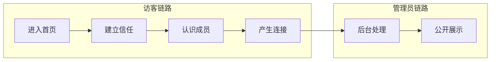
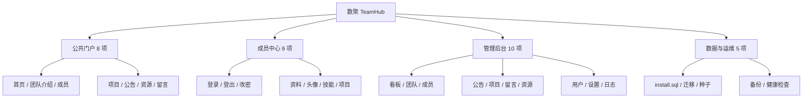
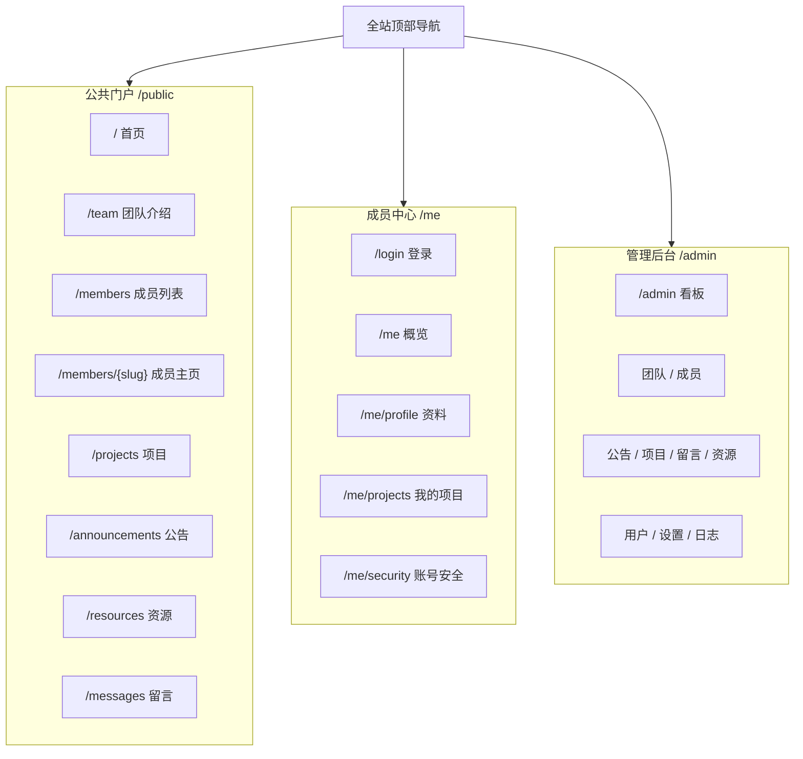
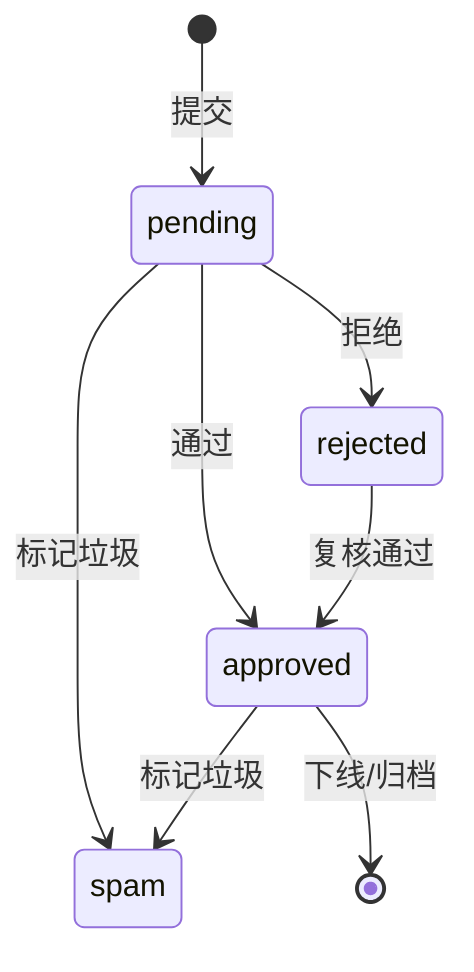

# 数聚 TeamHub 需求文档（含功能设计）

> **课程**：互联网数据库开发　|　**团队**：M3　|　**编写**：钱泊瑜（2411282）　|　**日期**：2026-10-28
---

## 文档信息

| 项目 | 内容 |
| --- | --- |
| 文档名称 | 数聚 TeamHub 需求文档（含功能设计） |
| 项目名称 | 数聚 TeamHub——团队主页与内容管理系统 |
| 团队名称 | M3 |
| 文档编号 | DATANOVA-DES-001 |
| 编写人 | 钱泊瑜（2411282） |
| 所属课程 | 互联网数据库开发 |
| 指导教师 | 乜鹏 |
| 编写日期 | 2026 年 10 月 28 日 |
| 适用读者 | 团队成员、评审教师、后续维护者 |
| 文档范围 | 需求分析、功能设计、验收标准与项目计划 |

### 术语与缩略语

| 术语 | 全称 / 英文 | 说明 |
| --- | --- | --- |
| MVC | Model-View-Controller | 把数据、视图与请求控制分离的分层架构。 |
| RBAC | Role-Based Access Control | 基于角色的访问控制。 |
| CSRF | Cross-Site Request Forgery | 跨站请求伪造；写操作校验一次性令牌。 |
| XSS | Cross-Site Scripting | 跨站脚本；输出统一转义。 |
| SQLi | SQL Injection | SQL 注入；使用 PDO 预处理。 |
| PDO | PHP Data Objects | PHP 的统一数据库访问接口。 |
| Slug | URL Slug | 公开链接的可读标识。 |
| ADR | Architecture Decision Record | 记录关键技术决策与取舍。 |
| ER | Entity-Relationship | 实体—关系模型。 |
| P95 | 95th Percentile | 95% 的请求耗时低于该值。 |

### 关联文档

| 文档 | 版本 | 用途 |
| --- | --- | --- |
| 《数聚 TeamHub 需求文档》 | 需求、功能与验收基线 |
| 《数聚 TeamHub 设计文档》 | 架构、数据库、接口与安全设计 |
| 《数聚 TeamHub 实现文档》 | 开发过程、代码目录与结果 |
| 《数聚 TeamHub 用户手册》 | 用户使用说明 |
| 《数聚 TeamHub 部署文档》 | 环境、安装、备份与还原 |

> **阅读提示**：本文档的图表使用 Mermaid 与 ASCII 线框，可在 Typora、VS Code（Markdown Preview Mermaid Support）、GitHub 或支持 Mermaid 的 Markdown 阅读器中直接预览；如渲染器不支持，代码块仍可读。

---

## 目录

<details open>
<summary><strong>1 引言</strong></summary>

- [1.1 编写目的](#11-编写目的)
- [1.2 项目背景](#12-项目背景)
- [1.3 文档范围](#13-文档范围)
- [1.4 读者对象](#14-读者对象)
- [1.5 术语与缩略语](#15-术语与缩略语)
- [1.6 参考资料](#16-参考资料)
</details>

<details open>
<summary><strong>2 项目概述</strong></summary>

- [2.1 产品定位](#21-产品定位)
- [2.2 建设目标](#22-建设目标)
- [2.3 成功标准](#23-成功标准)
- [2.4 用户角色](#24-用户角色)
- [2.5 系统边界](#25-系统边界)
- [2.6 课程要求落实情况](#26-课程要求落实情况)
- [2.7 假设、依赖与约束](#27-假设依赖与约束)
</details>

<details open>
<summary><strong>3 需求分析</strong></summary>

- [3.1 需求来源与分析方法](#31-需求来源与分析方法)
- [3.2 用户画像与典型场景](#32-用户画像与典型场景)
- [3.3 核心业务流程](#33-核心业务流程)
- [3.4 功能需求总览](#34-功能需求总览)
- [3.5 公共门户需求](#35-公共门户需求)
- [3.6 认证与成员中心需求](#36-认证与成员中心需求)
- [3.7 管理后台需求](#37-管理后台需求)
- [3.8 数据与运维需求](#38-数据与运维需求)
- [3.9 业务规则](#39-业务规则)
- [3.10 非功能需求](#310-非功能需求)
- [3.11 数据需求](#311-数据需求)
- [3.12 接口与外部依赖](#312-接口与外部依赖)
</details>

<details open>
<summary><strong>4 功能设计</strong></summary>

- [4.1 设计原则](#41-设计原则)
- [4.2 功能结构](#42-功能结构)
- [4.3 角色与权限矩阵](#43-角色与权限矩阵)
- [4.4 页面地图与导航](#44-页面地图与导航)
- [4.5 首页功能设计](#45-首页功能设计)
- [4.6 团队介绍页设计](#46-团队介绍页设计)
- [4.7 成员主页设计](#47-成员主页设计)
- [4.8 登录与认证设计](#48-登录与认证设计)
- [4.9 个人资料编辑设计](#49-个人资料编辑设计)
- [4.10 管理后台设计](#410-管理后台设计)
- [4.11 内容管理通用模式](#411-内容管理通用模式)
- [4.12 留言审核状态机](#412-留言审核状态机)
- [4.13 交互与状态规范](#413-交互与状态规范)
- [4.14 功能验收标准](#414-功能验收标准)
- [4.15 需求追踪矩阵](#415-需求追踪矩阵)
</details>

<details open>
<summary><strong>6 附录</strong></summary>

- [5.1 附录 A：页面清单](#51-附录-a页面清单)
- [5.2 附录 B：优先级说明](#52-附录-b优先级说明)
- [5.3 附录 C：待确认事项](#53-附录-c待确认事项)
</details>

---

## 1 引言

先把问题定义清楚，再决定做什么。

### 1.1 编写目的

**核心目的：**　本文档用于定义“数聚 TeamHub”课程设计的产品边界、用户角色、功能清单、业务规则、验收标准与项目计划，作为后续《设计文档》《实现文档》《部署文档》和项目展示 PPT 的共同基线。文档不追求功能数量，而强调“每个功能都能被验收、每条数据都能被追溯、每项课程要求都能在系统中找到落点”。

- **对团队**：统一“做什么、不做什么、先做什么”的认识，减少开发阶段的返工与接口争议。
- **对评审**：把课程 PPT 中的团队主页、前后台、10 张以上数据表、动态图表、MVC、install.sql 等要求逐项对应到章节与验收项。
- **对维护者**：留下可执行的需求上下文，后续增删功能时可以判断影响范围，而不是只靠口头记忆。

本文档的写作边界是“需求与功能设计”，不展开类图、表结构、接口签名和部署命令；这些内容在《设计文档》中给出。凡涉及尚未确认的团队名称、成员名单、域名和服务器，本文档以“暂定/待确认”标注，避免把假设写成事实。

### 1.2 项目背景

**课程背景：**　课程 PPT 要求每组制作一个包含前后台功能的团队主页：前台展示团队及个人、支持留言，后台支持团队与个人信息编辑、信息发布；数据库表数量需超过 10 张，动态图形展示可加分；同时要求使用 Git/SVN 等版本控制、Tower/Trello 等项目管理工具，并按规范提交需求、设计、实现、用户手册、部署文档与展示 PPT。编码要求中还明确提出：每个 PHP 文件加注释头、数据库抽取为 `/data/install.sql`、所有团队作业放入 `/data/team/`、项目页面提供团队及个人作业下载链接、每位组员至少编写 MVC 三层各一个文件。

**现实问题：**　目前团队的课程材料分散在聊天记录、个人作业压缩包、云文档与本地目录中：访客无法快速了解团队，成员的项目与技能缺少统一展示，公告和作业文件没有稳定入口，留言与反馈也无法沉淀。使用现成的建站工具虽然能快速上线，但难以满足“PHP + MySQL + MVC + install.sql + 课程作业下载”的组合要求，也不利于在答辩时讲清楚数据库设计与代码分层。因此需要一套自主可控、部署简单、结构清晰的团队主页系统。

**项目命名：**　“数聚”取“数据聚合”之意，强调团队以数据库为核心、向前后端与内容运营延伸。系统既是一个面向访客的品牌主页，也是团队日常维护内容、沉淀课程成果的轻量内容管理系统（CMS）。

### 1.3 文档范围

**范围内：**　本文档覆盖以下范围：

- **公共门户**：首页、团队介绍、成员列表与成员主页、项目作品、公告中心、资源下载、留言板。
- **认证与成员中心**：登录、登出、会话管理、个人资料编辑、头像与封面、技能标签、我的项目、修改密码。
- **管理后台**：数据看板、团队资料、成员管理、公告管理、项目管理、留言管理、资源管理、用户与角色、站点设置、日志审计。
- **数据与运维需求**：install.sql 初始化、迁移版本管理、种子数据、备份恢复、数据健康检查。
- **非功能需求**：性能、安全、可用性、兼容性、可维护性、隐私与合规。

**范围外：**　以下内容不在本期范围：

- 公开注册、第三方 OAuth 登录、短信验证码、在线支付、实时聊天、邮件营销。
- 多租户、多团队隔离、复杂审批流、可视化拖拽建站、原生移动 App。
- 对公告正文开放任意 HTML；为避免 XSS，正文只支持受限 Markdown。
- 在线执行任意 SQL；数据库管理仅提供只读健康检查与迁移状态，避免误操作与提权。

### 1.4 读者对象

**表 1-1  读者对象与阅读建议**

| 读者 | 关注重点 | 阅读建议 |
| --- | --- | --- |
| 团队成员 | 自己负责的模块、接口边界、交付时间 | 重点阅读第 3、4、5 章；开发前核对权限矩阵与验收标准。 |
| 评审教师 | 课程要求是否落实、数据库规模、前后台完整度 | 先看 2.6 课程要求落实表，再看第 4 章页面与功能设计。 |
| 后续维护者 | 业务规则、数据留存、异常与边界 | 重点阅读 3.9 业务规则、3.10 非功能需求与附录待确认事项。 |
| 展示听众 | 项目解决什么问题、有什么亮点 | 可先看 2.1 产品定位、2.3 成功标准与 4.5—4.10 的页面设计。 |

### 1.5 术语与缩略语

本文档使用的 MVC、RBAC、CSRF、XSS、SQLi、PDO、Slug、MVP、MoSCoW、KPI 等术语，已在文档信息页的“术语与缩略语”表中统一解释。正文首次出现时不再重复定义；若与团队内部叫法冲突，以本文档为准并在评审时记录。

### 1.6 参考资料

- 课程 PPT《互联网数据库开发——作业汇总》，计算机学院 & 网络空间安全学院，乜鹏，2026 年 10 月。
- **课程团队作业要求**：团队主页前后台、数据库表数量 > 10、动态图形加分、Git/Tower 协作、六类提交文档。
- **PHP 8.2 官方文档**：https://www.php.net/docs.php；MySQL 8.0 参考手册：https://dev.mysql.com/doc/。
- OWASP Application Security Verification Standard 4.0：https://owasp.org/www-project-application-security-verification-standard/。
- **Bootstrap 5.3 文档**：https://getbootstrap.com/docs/5.3/；Apache ECharts 5.5 文档：https://echarts.apache.org/。
- **团队个人作业 1—3**：Web 前端请求、页面设计、WordPress 建站实践（作为前端与内容运营的参考）。

## 2 项目概述

先回答“为谁做、做到什么程度、哪些不做”，再进入功能细节。

### 2.1 产品定位

**一句话定位：**　数聚 TeamHub 是一个“品牌主页 + 轻量内容管理”的一体化系统：访客在公共门户了解团队、成员、项目与公告，通过留言建立联系；团队成员登录成员中心维护自己的公开资料；内容编辑与超级管理员在后台维护团队信息、发布内容、审核留言并查看运营数据。系统不追求大而全，而是把“展示—连接—运营—沉淀”这一条主线做完整。

**表 2-1  产品定位与价值层**

| 价值层 | 对谁 | 解决什么问题 | 对应功能 |
| --- | --- | --- | --- |
| 展示窗口 | 访客、评审、合作方 | 团队是谁、做过什么、成员各自擅长什么，缺少统一且可信的入口。 | 首页、团队介绍、成员主页、项目作品、公告、资源下载 |
| 连接入口 | 访客、学弟学妹、合作方 | 想进一步了解或合作时，没有低门槛、可管理的联系方式。 | 留言板、成员留言、管理员回复 |
| 运营底座 | 成员、内容编辑、管理员 | 资料和内容散落，修改要走开发；访问与留言数据无法沉淀。 | 成员中心、管理后台、数据看板、日志审计 |
| 课程成果 | 课程团队 | 课程要求多且分散，容易漏项；答辩时缺少可演示的数据库与工程细节。 | 21 张表、install.sql、MVC、动态图表、作业下载 |

### 2.2 建设目标

1. **10 秒说清楚“我们是谁”**：首页首屏包含团队名称、一句话定位、代表项目与成员入口，访客无需滚动即可完成第一层判断。
2. **一处维护、多处复用**：团队资料、成员资料、项目与公告只在后台维护一次，公共门户、成员主页与下载区自动同步。
3. **低门槛内容运营**：非技术成员经过 10 分钟培训即可完成公告发布、成员编辑、留言审核与资源上传。
4. **课程要求可验证**：21 张表、/data/install.sql、MVC 三层、每文件注释头、作业下载、动态图表均有明确落点与验收证据。
5. **安全与可部署**：在校园服务器或 XAMPP 环境可还原部署；具备认证、授权、CSRF、XSS、SQL 注入防护与备份方案。

目标不是“功能越多越好”，而是让 P0 功能形成闭环：访客能看懂并留言，成员能维护资料，管理员能发布与审核，数据能备份与恢复。P1/P2 功能在不影响主流程的前提下增量交付。

### 2.3 成功标准

**表 2-2  项目成功标准**

| 维度 | 成功标准 | 验证方式 |
| --- | --- | --- |
| 功能完整 | 32 项功能中 P0 全部通过验收；P1 完成率不低于 80%。 | 按 4.14 验收用例逐条演示；缺陷清单闭环。 |
| 数据规模 | 21 张业务/支撑表；核心表具备主键、外键、索引与注释；install.sql 可在空库一次执行成功。 | 空库导入、重复部署、数据字典核对。 |
| 课程要求 | 2.6 表中的 10 项课程要求全部有对应实现与文档位置。 | 答辩现场按表抽查；提交目录核对。 |
| 质量基线 | 核心页面 LCP ≤ 2.5 s；后台列表 P95 ≤ 500 ms；无高危安全问题。 | 浏览器 Performance、接口计时、安全检查清单。 |
| 可运营 | 管理员可在 3 分钟内完成一次公告发布；留言审核路径不超过 2 次点击。 | 可用性走查与计时任务。 |
| 展示效果 | 8—10 分钟演示能讲清业务、数据库、前后台与分工；至少 1 个动态图表。 | PPT 试讲与问答演练。 |

### 2.4 用户角色

系统采用“访客—成员—编辑—超级管理员”四级角色。访客无需登录；成员账号由管理员创建，不开放公开注册；编辑负责内容运营；超级管理员拥有用户、角色、设置与审计权限。一个账号只分配一个角色，降低课程设计阶段的权限复杂度。

**表 2-3  用户角色与权限边界**

| 角色 | 典型身份 | 核心诉求 | 关键权限 | 使用频率 |
| --- | --- | --- | --- | --- |
| 访客 Visitor | 评审、同学、合作方、学弟学妹 | 快速了解团队与成员，下载资料，留言。 | 浏览公开页面、提交留言、下载公开资源。 | 高，匿名 |
| 成员 Member | 团队正式成员 | 维护自己的公开资料与账号安全。 | 登录、编辑本人资料/头像/技能、查看本人项目、修改密码。 | 中，每周 |
| 编辑 Editor | 内容运营、宣传负责人 | 发布公告、维护项目与资源、审核留言。 | 成员全部权限 + 内容增删改发、留言审核、资源管理。 | 高，每周多次 |
| 超级管理员 Super Admin | 组长/技术负责人 | 管理账号、角色、站点配置与审计。 | 全部权限 + 用户与角色、站点设置、日志、数据健康检查。 | 中，按需 |

### 2.5 系统边界

**表 2-4  系统边界**

| 类别 | 包含 | 不包含 / 交由外部 |
| --- | --- | --- |
| 业务边界 | 团队品牌展示、成员资料、项目作品、公告、资源下载、留言与审核、基础运营数据。 | 公开注册、支付、即时通讯、邮件营销、复杂审批流。 |
| 技术边界 | PHP 应用、MySQL 数据库、文件存储、Session、服务端渲染页面、ECharts 图表。 | 独立 App、小程序、微服务、消息队列、Redis 集群。 |
| 数据边界 | 团队自有的成员、项目、公告、留言、资源与访问统计数据。 | 第三方用户画像、跨站追踪、敏感个人信息。 |
| 运维边界 | 单机/单节点部署、每日备份、日志轮转、健康检查。 | 多活容灾、自动扩缩容、跨地域复制。 |

### 2.6 课程要求落实情况

下表把课程 PPT 中的团队作业要求逐项映射到本文档章节与后续实现证据。答辩时可按“要求—章节—证据”三列抽查，避免出现“做了但讲不出来”或“文档写了但系统没有”的情况。

**表 2-5  课程要求与文档/实现落点**

| 课程要求 | 本文档落点 | 实现/验收证据 |
| --- | --- | --- |
| 给队伍起名字 | 2.1 产品定位、封面与文档信息 | 团队名称、Logo、页脚版权、PPT 封面统一。 |
| 团队主页包含前后台 | 2.4 角色、3.4 功能总览、4.4 页面地图 | 公共门户 + 成员中心 + /admin 后台三套布局。 |
| 前台展示团队及个人 | 3.5 公共门户、4.5—4.7 页面设计 | 首页、团队介绍、成员列表、成员主页、项目与公告。 |
| 前台留言 | 3.5.5 留言板、4.12 状态机 | 留言表单、待审核、管理员回复、公开展示。 |
| 后台编辑团队/个人信息 | 3.6.2、3.7.2、4.9 资料编辑 | 团队资料表单、成员资料表单、头像/封面/技能。 |
| 后台信息发布 | 3.7.4 内容管理、4.11 通用模式 | 公告/项目/资源的新增、编辑、发布、下线。 |
| 数据库表数量 > 10 | 4.3 表清单、4.4 数据字典（设计文档） | 21 张表：账号权限 4、内容 10、资源 2、站点 1、运维 4。 |
| 动态图形展示加分 | 3.7.1 数据看板 | ECharts 访问趋势、留言分布、技能分布、项目状态。 |
| Git/Tower 等协作工具 | 5.3 协作工具与配置管理 | Git 提交记录、分支、Tower/Trello 任务截图。 |
| PHP 注释头、install.sql、/data/team、作业下载、每人 MVC | 2.7 约束、5.2 分工、设计文档 2.5/11.2 | 统一文件头、data/install.sql、data/team/、资源下载页、MVC 文件归属表。 |

### 2.7 假设、依赖与约束

**前提说明：**　以下假设用于让需求可落地；若与实际情况不符，应在评审时更新并同步影响范围。

- 团队按 4 人规模规划，设组长 1 名；最终名单、学号与分工以提交前确认表为准。
- **技术栈以课程要求为准**：PHP 8.1+、MySQL 8.0、Apache/Nginx；前端使用 Bootstrap 5 + 原生 JavaScript，不引入 Node 构建链。
- 部署环境优先 Windows + XAMPP，兼容 Ubuntu + Nginx + PHP-FPM；演示环境可离线运行，不依赖外部 CDN。
- 系统语言为简体中文；时间统一使用 Asia/Shanghai；金额、支付等场景不涉及。
- 成员账号由管理员创建；不依赖邮件服务，忘记密码走管理员重置临时密码。
- 图片与作业文件存放在服务器本地磁盘；单文件不超过 10 MB，单次上传不超过 5 个文件。
- 访问统计仅用于团队运营，不接入第三方统计；IP 只保存加盐哈希，不保存明文。
- 课程提交截止时间为 2026 年 12 月 1 日；开发窗口为 2026 年 10 月 28 日至 11 月 30 日。

> **范围控制**
>
> 本期以 P0 闭环为第一优先级：访客能看懂、能留言；成员能登录、能改资料；管理员能发布、能审核；数据能安装、能备份。P1 功能（如公告定时发布、CSV 导出、访问来源分析）在不影响 P0 验收的前提下增量实现。

## 3 需求分析

从课程约束与真实使用场景出发，把“想要”收敛为可验收的需求。

### 3.1 需求来源与分析方法

需求来源分为四类：课程 PPT 的硬性要求、团队现状与痛点、同类团队/实验室主页的共性做法、以及开发与部署约束。分析时先把原始诉求写成用户故事，再用场景走查补齐异常路径，最后用 MoSCoW 分级，确保课程截止前先形成闭环。

**表 3-1  需求分析方法**

| 方法 | 输入 | 输出 | 在本项目中的使用 |
| --- | --- | --- | --- |
| 文档分析 | 课程 PPT、个人作业 1—3、课程编码要求 | 硬性约束清单 | 提取前后台、表数量、install.sql、MVC、下载等 10 项要求。 |
| 同类观察 | 高校实验室主页、开源团队主页、个人作品集 | 信息架构与交互惯例 | 确定“首屏定位—项目证明—成员入口—留言转化”的主线。 |
| 场景走查 | 访客、成员、编辑、管理员四类角色 | 主流程与异常路径 | 覆盖首次访问、资料修改、公告发布、留言审核等场景。 |
| 约束推演 | 单机部署、无邮件服务、课程周期 5 周 | 范围与优先级 | 砍掉公开注册、支付、实时聊天，保留管理员建号与临时密码。 |
| MoSCoW 分级 | 功能清单与依赖关系 | P0/P1/P2 计划 | P0 先闭环，P1 增量，P2 作为展示亮点或后续演进。 |

### 3.2 用户画像与典型场景

**表 3-2  用户画像**

| 画像 | 目标 | 痛点 | 系统应对 |
| --- | --- | --- | --- |
| 评审教师 / 合作方 | 8 分钟内判断团队水平与项目真实性。 | 材料分散、页面打不开、看不到个人贡献。 | 首页给结论，成员主页给证据，资源区给文档，后台给数据。 |
| 学弟学妹 / 潜在成员 | 了解团队方向、成员风格与加入方式。 | 只有群聊，没有公开介绍；不好意思直接问。 | 团队故事、技能矩阵、成员社交链接、低门槛留言。 |
| 团队成员 | 快速更新自己的资料与项目，不依赖开发。 | 改头像/简介要找人；不同页面信息不一致。 | 成员中心自助编辑，一处修改多处生效。 |
| 内容编辑 / 管理员 | 发布公告、维护项目、审核留言、看运营数据。 | 没有后台；留言无法过滤；不知道哪些内容有人看。 | 后台 CRUD、审核队列、ECharts 看板、审计日志。 |

#### 3.2.1 场景一：评审第一次访问

评审从课程提交邮件进入首页，首屏看到团队名称、定位、代表项目与成员入口；滚动后看到最新公告和成员速览。点击“成员”进入列表，按技能筛选出前端成员，再进入成员主页查看项目与留言。整个过程不超过 4 次点击，不需要登录，也不需要下载文档。

#### 3.2.2 场景二：成员更新资料

成员登录后进入 `/me/profile`，修改一句话介绍、头像和技能熟练度；保存时系统校验 slug 唯一性与图片格式。保存成功后，公开成员主页立即生效，并在审计日志中留下修改前后的快照。若两人同时编辑，后保存者会收到“资料已被他人修改，请刷新后重试”的提示。

#### 3.2.3 场景三：编辑发布公告

编辑在后台新建公告，填写标题、摘要、正文、封面与分类，先“保存草稿”预览，再“发布”。发布后公告出现在首页最新动态与公告中心；可置顶、下线或设置过期时间。所有发布动作记录作者、时间与前后状态。

#### 3.2.4 场景四：管理员审核留言

访客在成员主页留言，提交后进入“待审核”，不立即公开。管理员在后台看到待审核数量，打开详情，选择通过、拒绝或标记垃圾，并可回复。通过后留言出现在成员主页；拒绝/垃圾保留记录，便于复盘与反垃圾。

### 3.3 核心业务流程

系统有两条主链路：访客的“看见—信任—连接”链路，以及管理员的“内容生产—审核—展示—复盘”链路。两条链路在留言与内容发布处交汇，形成可追踪的运营闭环。



**表 3-3  核心业务流程**

| 流程 | 触发 | 关键步骤 | 成功结果 | 异常处理 |
| --- | --- | --- | --- | --- |
| 访客浏览 | 打开首页 | 首页 → 团队/成员/项目 → 留言或下载 | 获得团队认知并产生连接 | 页面 404/空数据时给出返回入口与推荐内容。 |
| 成员改资料 | 登录后进入成员中心 | 编辑 → 校验 → 保存 → 公开页更新 | 资料一处修改、多处生效 | 校验失败回填；并发冲突提示刷新。 |
| 内容发布 | 编辑新建公告/项目 | 草稿 → 预览 → 发布/下线 | 公共门户出现新内容 | 必填缺失、slug 冲突、封面非法时阻止提交。 |
| 留言审核 | 访客提交留言 | 待审核 → 通过/拒绝/垃圾 → 回复 | 公开区出现合规留言 | 限流、蜜罐、CSRF 拦截；审核可撤回。 |

### 3.4 功能需求总览

系统共 32 项功能，按公共门户、认证、成员中心、管理后台、数据与运维五组编号。优先级采用 MoSCoW：P0 为课程答辩前必须完成，P1 为应完成，P2 为可选加分。编号在后续设计、实现与测试文档中保持不变。

**表 3-4  功能需求总览（32 项）**

| 编号 | 功能 | 主要角色 | 优先级 | 模块 |
| --- | --- | --- | --- | --- |
| FR-PUB-01 | 首页 | 访客 | P0 | 公共门户 |
| FR-PUB-02 | 团队介绍 | 访客 | P0 | 公共门户 |
| FR-PUB-03 | 成员列表 | 访客 | P0 | 公共门户 |
| FR-PUB-04 | 成员主页 | 访客 | P0 | 公共门户 |
| FR-PUB-05 | 公告中心 | 访客 | P0 | 公共门户 |
| FR-PUB-06 | 项目作品 | 访客 | P1 | 公共门户 |
| FR-PUB-07 | 资源下载 | 访客 | P0 | 公共门户 |
| FR-PUB-08 | 留言板 | 访客 | P0 | 公共门户 |
| FR-AUTH-01 | 登录 | 成员/编辑/管理员 | P0 | 认证 |
| FR-AUTH-02 | 登出与会话 | 已登录用户 | P0 | 认证 |
| FR-AUTH-03 | 修改密码 | 已登录用户 | P0 | 认证 |
| FR-MEM-01 | 个人中心概览 | 成员 | P1 | 成员中心 |
| FR-MEM-02 | 基本资料编辑 | 成员 | P0 | 成员中心 |
| FR-MEM-03 | 头像与封面 | 成员 | P0 | 成员中心 |
| FR-MEM-04 | 技能标签 | 成员 | P1 | 成员中心 |
| FR-MEM-05 | 我的项目 | 成员 | P1 | 成员中心 |
| FR-MEM-06 | 账号安全 | 成员 | P0 | 成员中心 |
| FR-ADM-01 | 数据看板 | 编辑/管理员 | P0 | 管理后台 |
| FR-ADM-02 | 团队资料 | 编辑/管理员 | P0 | 管理后台 |
| FR-ADM-03 | 成员管理 | 编辑/管理员 | P0 | 管理后台 |
| FR-ADM-04 | 公告管理 | 编辑/管理员 | P0 | 管理后台 |
| FR-ADM-05 | 项目管理 | 编辑/管理员 | P1 | 管理后台 |
| FR-ADM-06 | 留言管理 | 编辑/管理员 | P0 | 管理后台 |
| FR-ADM-07 | 资源管理 | 编辑/管理员 | P1 | 管理后台 |
| FR-ADM-08 | 用户与角色 | 超级管理员 | P1 | 管理后台 |
| FR-ADM-09 | 站点设置 | 超级管理员 | P1 | 管理后台 |
| FR-ADM-10 | 日志审计 | 超级管理员 | P1 | 管理后台 |
| FR-DB-01 | 初始化安装 | 管理员 | P0 | 数据与运维 |
| FR-DB-02 | 迁移管理 | 管理员 | P0 | 数据与运维 |
| FR-DB-03 | 种子数据 | 管理员 | P1 | 数据与运维 |
| FR-DB-04 | 备份恢复 | 管理员 | P0 | 数据与运维 |
| FR-DB-05 | 数据健康检查 | 超级管理员 | P1 | 数据与运维 |

### 3.5 公共门户需求

#### 3.5.1 首页（FR-PUB-01）

首页是访客的第一落点，应在首屏回答“你们是谁、做过什么、如何联系”。页面由导航、首屏、数据条、精选项目、最新公告、成员速览、留言入口与页脚组成。首屏主标题不超过 20 字，副标题不超过 40 字，行动按钮不超过 2 个。

- **内容来源**：团队资料（team_profile）、精选项目（projects.is_featured）、已发布公告（announcements）、精选成员（members.is_featured）。
- **数量限制**：精选项目最多 3 个、公告最多 3 条、成员最多 4 位；不足时展示占位卡片或隐藏整个区块。
- **交互**：主按钮进入团队介绍，次按钮进入项目列表；“了解我们”支持锚点滚动；卡片整卡可点击。
- **异常**：数据库不可用时展示静态兜底文案与维护提示，不暴露 SQL 错误；图片缺失时使用品牌占位图。
- **性能**：首屏不加载 ECharts 等重资源；图片使用 WebP/JPEG 并设置宽高，避免布局抖动。

#### 3.5.2 团队介绍（FR-PUB-02）

团队介绍页承担“建立信任”的职责，应包含团队故事、发展时间线、价值观、能力矩阵、成员网格、团队资料下载与联系入口。内容由后台“团队资料”和“里程碑”维护，不允许在前端硬编码。

- 团队故事支持 300—800 字，可分 2—3 段；首段必须说明团队定位与研究方向。
- 时间线按年份升序或降序展示，最少 3 个、最多 12 个里程碑；每个里程碑含年份、标题、说明。
- 能力矩阵按技能分类聚合成员熟练度，展示“技能—人数—平均熟练度”，不公开成员隐私。
- 成员网格默认按 sort_order、精选优先排序；点击进入成员主页。

#### 3.5.3 成员列表与成员主页（FR-PUB-03/04）

成员列表支持按姓名搜索、按技能筛选、按角色/年份排序；成员主页是个人品牌页，聚合头像、封面、姓名、团队角色、一句话介绍、个人简介、技能、项目、社交链接、留言入口与最近留言。公开链接使用稳定 slug，例如 `/members/qian-boyu`。

- 成员主页只展示 is_visible=1 的成员；隐藏成员返回 404，不泄露其存在。
- 技能熟练度以 1—5 的进度条展示，禁止展示手机号、身份证等敏感信息；邮箱与社交链接由成员自行选择是否公开。
- 项目按 sort_order、结束时间倒序；每个项目展示角色、贡献说明与技术栈。
- 页面应输出唯一 `<title>`、meta description、Open Graph 标签，便于分享；头像必须有 alt 文本。
- 留言区默认展示最近 5 条已通过留言；提交后进入待审核，不即时公开。

#### 3.5.4 项目、公告与资源（FR-PUB-05/06/07）

项目、公告与资源共用“列表 + 详情”的展示模式：列表支持关键词、分类/状态筛选与分页；详情展示正文、封面、作者/成员、发布时间与相关推荐。资源下载必须记录下载次数，并提供文件大小、类型与更新时间。

- 公告状态只展示 published 且未过期的记录；置顶公告排在列表顶部，最多 2 条。
- 项目状态分为规划中、进行中、已完成、已归档；默认只展示前三种，归档项目可在筛选后查看。
- 资源分类包括团队作业、个人作业、设计文档、部署资料与其他；下载走控制器权限校验与计数，不直接暴露磁盘路径。
- 列表为空时给出明确空状态与返回入口，不显示空白表格。

#### 3.5.5 留言板（FR-PUB-08）

留言是访客与团队建立联系的最低门槛方式。留言表单包含昵称、邮箱（可选，不公开）、个人网站（可选）、目标成员（可选）与内容；提交后默认进入待审核，管理员通过后才公开。系统应提供蜜罐字段、IP 限流与内容长度校验，并在页面上明确告知“留言需审核，邮箱不会公开”。

- 内容长度 10—500 字；昵称 2—30 字；邮箱格式校验；网址只允许 http/https。
- 同一 IP 每小时最多提交 3 条；同一浏览器会话 10 分钟内最多 1 条；命中限流返回友好提示。
- 敏感词与链接数量作为辅助判断，不自动公开；管理员可标记垃圾并批量处理。
- 留言与回复均支持管理员回复；回复可设为可见/隐藏，删除采用状态标记，保留审计。

### 3.6 认证与成员中心需求

#### 3.6.1 登录与会话（FR-AUTH-01/02）

系统不开放公开注册。管理员创建账号后，成员使用用户名或邮箱登录；首次登录强制修改临时密码。登录需要 CSRF 令牌，失败统一提示“用户名或密码不正确”，避免账号枚举。连续失败触发账号锁定与 IP 限流，成功登录后重建 Session ID，并按角色跳转。

- **密码规则**：至少 10 位，包含大写、小写、数字、符号中的至少三类；不得与用户名相同。
- **会话**：HttpOnly、SameSite=Lax、HTTPS 下 Secure；空闲 30 分钟过期，绝对时长 8 小时。
- **登出**：清空 Session、过期 Cookie、记录登出审计；支持“退出所有设备”作为 P1。
- 未登录访问 /me 或 /admin 时跳转登录，并保留 intended URL；无权限返回 403 页面。

#### 3.6.2 个人中心与资料编辑（FR-MEM-01/02/03/04/05）

成员中心是成员自助维护资料的入口，包含概览、个人资料、我的项目、账号安全四个页面。个人资料分为基本资料、头像与封面、技能标签三个区块；保存后公开主页立即更新，并记录修改前后快照。

- **可编辑字段**：姓名、英文名、slug、团队角色、一句话介绍、个人简介、邮箱、GitHub、个人网站、所在地、加入日期（只读）。
- slug 只允许小写字母、数字与连字符，长度 3—60；修改后旧链接返回 301 到新地址（P1）。
- 头像 1:1，建议 400×400；封面 16:9，建议 1600×900；支持 JPG/PNG/WebP，单文件 ≤ 2 MB。
- 技能从技能库选择，熟练度 1—5；每人最多 12 项，至少 3 项；成员不能自行新增全局技能（由管理员维护）。
- “我的项目”只展示与本人关联的项目；成员可维护自己在项目中的角色与贡献说明，不能修改项目主体信息。

#### 3.6.3 账号安全（FR-MEM-06）

账号安全页提供修改密码、查看最近登录记录、退出登录。修改密码需要输入当前密码与新密码两次；成功后使旧会话失效，并记录 `password_changed_at`。成员不能修改自己的角色、状态与用户名；这些操作仅超级管理员可执行。

### 3.7 管理后台需求

后台采用“左侧导航 + 顶部工具栏 + 内容区”的固定布局，所有管理页共享列表、筛选、分页、批量操作、确认对话框与Toast 反馈。后台只对编辑与超级管理员开放；成员无法进入 `/admin`。

#### 3.7.1 数据看板（FR-ADM-01）

看板是管理员登录后的默认页，展示成员总数、已发布项目数、待审核留言数、近 7 日访问量四个 KPI，以及近 14 天访问趋势、留言状态分布、成员技能分布、项目状态分布四类图表。图表使用 ECharts，数据通过受保护的 JSON 接口获取，不在页面内拼接 SQL 或明文密钥。

- KPI 支持点击跳转到对应列表并带上筛选条件；无数据时显示 0 与空状态说明。
- 访问趋势按天聚合，访客数按 visitor_hash 去重；不展示具体 IP。
- 图表在 768 px 以下改为纵向堆叠，避免横向滚动；提供数据表兜底（无障碍）。
- 看板数据缓存 60 秒；发布/审核操作后主动失效，保证演示时数据及时。

#### 3.7.2 团队资料与站点设置（FR-ADM-02/09）

团队资料是单例表单（`team_profile.id=1`），包含名称、英文名、口号、简介、故事、成立时间、所在地、邮箱、电话、Logo、封面、社交链接与价值观。站点设置以键值对维护站点名称、SEO 描述、页脚文案、备案信息、维护模式等。两者都支持预览与恢复默认值，保存前二次确认。

#### 3.7.3 成员管理（FR-ADM-03）

成员列表展示头像、姓名、团队角色、关联账号、精选/可见状态、资料完整度与排序值；支持搜索、筛选、拖动排序、批量显示/隐藏与归档。编辑成员时可同步创建或绑定账号；删除采用归档，不物理删除历史项目与留言关联。

#### 3.7.4 公告、项目与资源管理（FR-ADM-04/05/07）

三类内容共用“列表—新建/编辑—预览—发布/下线—归档”的生命周期。公告额外支持置顶、定时发布与过期时间；项目额外支持成员关联、技术栈、仓库/演示链接与状态；资源额外支持分类、文件替换与下载计数。

**表 3-5  内容管理字段与发布规则**

| 内容 | 关键字段 | 发布规则 | 列表默认排序 |
| --- | --- | --- | --- |
| 公告 | 标题、slug、摘要、正文、封面、分类、置顶、发布时间、过期时间 | 草稿可预览；发布需标题/正文/发布时间；过期自动不展示。 | 置顶优先，发布时间倒序 |
| 项目 | 标题、slug、摘要、正文、封面、技术栈、状态、起止时间、成员 | 至少 1 名成员；归档项目不在默认列表展示。 | 精选优先，sort_order 升序 |
| 资源 | 标题、分类、说明、文件、可见性 | 文件必须通过 MIME/大小校验；公开资源才出现在前台。 | 分类、sort_order、更新时间 |

#### 3.7.5 留言管理（FR-ADM-06）

留言管理是运营高频页面，默认进入“待审核”筛选，展示访客、内容摘要、目标成员、提交时间、IP 哈希前 8 位与状态。管理员可查看详情、通过、拒绝、标记垃圾、回复、批量通过/拒绝；所有操作记录操作者、时间与原因。

#### 3.7.6 用户、角色与日志（FR-ADM-08/10）

超级管理员可创建成员账号、重置临时密码、禁用账号、分配角色；角色权限以权限码维护，不在代码中散落角色判断。日志页分为登录日志与操作审计：登录日志记录成功/失败、IP 哈希与 User-Agent；操作审计记录实体、动作、前后 JSON 快照。

> **最小权限**
>
> 编辑不能管理用户、角色、站点设置与日志；超级管理员不能查看成员明文密码（系统只保存哈希）。任何角色都不能在后台执行任意 SQL。

### 3.8 数据与运维需求

#### 3.8.1 初始化与迁移（FR-DB-01/02/03）

课程要求数据库抽取为 `/data/install.sql`。该文件应支持在空库一次执行：创建数据库、21 张表、索引、外键、3 个视图与基础种子数据（角色、权限、管理员、示例技能）。后续结构变更放入 `database/migrations/`，按版本号顺序执行，由 `schema_migrations` 记录已应用版本与校验和，避免重复执行。

#### 3.8.2 备份恢复与健康检查（FR-DB-04/05）

备份采用 `mysqldump` + 文件目录打包，每日一次、保留 7 天，备份文件不放在 Web 根目录。恢复流程必须写入部署文档，并在演示前做一次恢复演练。健康检查页只读展示数据库版本、表数量、迁移版本、最后备份时间、磁盘剩余空间与`storage` 可写状态，不提供任意 SQL 输入框。

### 3.9 业务规则

以下规则是功能设计与测试的共同依据；编号在实现与测试用例中复用。

**表 3-6  业务规则**

| 编号 | 规则 | 违反时的处理 |
| --- | --- | --- |
| BR-01 | 只有 status=1 的账号可以登录；禁用/锁定账号不得建立会话。 | 统一提示联系管理员，不暴露具体状态。 |
| BR-02 | 一个账号只分配一个角色；角色变更后下一次请求生效。 | 旧会话权限缓存失效，写审计。 |
| BR-03 | 成员账号必须绑定唯一成员档案；一个成员档案最多绑定一个账号。 | 绑定冲突时阻止保存并提示。 |
| BR-04 | 公开成员必须 is_visible=1 且至少填写姓名、角色、一句话介绍、头像。 | 前台隐藏；后台提示资料完整度。 |
| BR-05 | slug 全局唯一，只允许小写字母、数字、连字符，长度 3—60。 | 表单校验失败；修改时检查冲突。 |
| BR-06 | 公告只有 published 且未过期才公开；置顶公告最多 2 条。 | 超出时自动取消最早置顶并提示。 |
| BR-07 | 项目至少关联 1 名成员；归档项目默认不展示。 | 保存失败；归档需二次确认。 |
| BR-08 | 留言默认 pending，只有 approved 公开；回复只有 visible 公开。 | 未审核内容不出现在公开查询。 |
| BR-09 | 同一 IP 每小时最多 3 条留言；同一账号 5 次登录失败锁定 15 分钟。 | 返回 429/423 与等待时间。 |
| BR-10 | 上传文件必须通过扩展名、MIME、大小、图片尺寸校验；文件名随机化。 | 拒绝并记录安全日志。 |
| BR-11 | 删除内容采用归档/状态标记，不物理删除审计相关记录。 | 超级管理员二次确认；保留快照。 |
| BR-12 | 所有写操作必须校验 CSRF；GET 请求不得产生副作用。 | 返回 419 并记录。 |
| BR-13 | 列表默认每页 15 条，最大 100 条；排序字段必须在白名单内。 | 非法参数回退默认值。 |
| BR-14 | 公开页面不得输出明文邮箱、IP、密码哈希、内部路径。 | 脱敏或仅管理员可见。 |
| BR-15 | 访问统计只保存加盐哈希与聚合结果，不保存明文 IP。 | 统计任务过滤非法值。 |
| BR-16 | 团队资料为单例，id=1；只能更新，不能新增第二行。 | 数据库约束 + 服务层校验。 |
| BR-17 | 并发更新使用 updated_at 乐观锁；影响行数为 0 视为冲突。 | 返回 409，提示刷新。 |
| BR-18 | 后台所有敏感操作写审计日志，日志只追加不修改。 | 日志写入失败时主操作回滚。 |

### 3.10 非功能需求

**表 3-7  非功能需求**

| 类别 | 编号 | 目标 | 验证方式 |
| --- | --- | --- | --- |
| 性能 | NFR-P-01 | 校园网环境下首页 LCP ≤ 2.5 s；后台列表 P95 ≤ 500 ms。 | Chrome Performance、接口计时。 |
| 性能 | NFR-P-02 | 支持 100 个并发访客浏览；留言提交 P95 ≤ 800 ms。 | 压测脚本/并发工具。 |
| 安全 | NFR-S-01 | 通过 OWASP Top 10 基础检查；无 SQL 注入、XSS、CSRF 高危问题。 | 安全检查清单 + 手工渗透。 |
| 安全 | NFR-S-02 | 密码只保存哈希；会话 Cookie HttpOnly/SameSite；敏感操作有审计。 | 代码审查 + 浏览器检查。 |
| 可用性 | NFR-A-01 | 演示期间可用性 ≥ 99%；错误页不暴露堆栈。 | 演示前巡检、故障演练。 |
| 易用性 | NFR-U-01 | 访客 3 次点击内到达成员主页；管理员 3 分钟内完成公告发布。 | 可用性走查与计时任务。 |
| 兼容性 | NFR-C-01 | Chrome/Edge/Firefox/Safari 最近两个大版本；360—1440 px 响应式。 | 多浏览器与设备检查。 |
| 可维护性 | NFR-M-01 | MVC 分层清晰；每个 PHP 文件有注释头；关键服务有单元测试。 | 代码审查、静态检查。 |
| 可部署性 | NFR-D-01 | 空环境按部署文档 30 分钟内还原；install.sql 一次成功。 | 全新环境演练。 |
| 数据 | NFR-D-02 | 字符集 utf8mb4；每日备份保留 7 天；恢复演练成功。 | 备份日志与恢复验证。 |
| SEO | NFR-SEO-01 | 公开页有唯一 title/description、语义化标题、sitemap。 | 浏览器与爬虫检查。 |
| 无障碍 | NFR-A11Y-01 | 键盘可操作；对比度 ≥ 4.5:1；图片有 alt。 | 键盘走查 + 对比度工具。 |
| 隐私 | NFR-PR-01 | 不收集身份证、手机号；IP 哈希化；邮箱默认不公开。 | 数据字典与页面检查。 |
| 可观测 | NFR-O-01 | 错误日志含请求 ID；关键操作可追踪到人、时间、实体。 | 日志抽查。 |

### 3.11 数据需求

系统共 21 张表，按账号权限、内容主体、资源、站点与运维五组划分。课程要求表数量 > 10，本项目在满足业务的前提下保留必要的权限、审计、迁移与统计表，避免“为凑表而建表”。数据量按课程演示规模估算，单表不超过 1 万行；设计上仍保留分页、索引与归档策略，便于后续扩展。

**表 3-8  数据分组与留存**

| 数据组 | 表 | 用途 | 预估量级 | 留存策略 |
| --- | --- | --- | --- | --- |
| 账号权限 | users / roles / permissions / role_permissions | 登录、角色与权限码。 | 用户 < 100；权限 < 50 | 账号归档不删除；日志保留 180 天。 |
| 内容主体 | team_profile / milestones / members / skills / member_skills / projects / project_members / announcements / messages / message_replies | 团队、成员、项目、公告、留言。 | 成员 < 50；项目 < 200；留言 < 10k | 内容归档；留言状态保留；回复随留言。 |
| 资源 | media / resources | 上传文件与下载资源。 | 文件 < 5k；资源 < 500 | 文件与记录同步归档；备份 7 天。 |
| 站点 | site_settings | 键值配置。 | < 100 | 随版本迁移。 |
| 运维 | page_views / login_logs / audit_logs / schema_migrations | 访问统计、登录、审计、迁移。 | 访问 < 100k/年 | 访问聚合后清理明细；审计 180 天。 |

### 3.12 接口与外部依赖

系统以服务端渲染为主，后台图表与少量交互使用同源 JSON 接口。除 MySQL 与本地文件系统外，不强制依赖外部服务；邮件通知作为可选能力，未配置 SMTP 时不影响主流程。

**表 3-9  外部依赖与降级**

| 依赖 | 用途 | 是否必需 | 失败时的影响与降级 |
| --- | --- | --- | --- |
| MySQL 8.0 | 业务数据、会话外的持久化数据。 | 必需 | 页面返回 503 维护页；健康检查告警。 |
| 本地文件系统 | 头像、封面、资源文件、日志、缓存。 | 必需 | 上传失败并提示；已有图片走占位图。 |
| PHP Session | 登录态与 CSRF 令牌。 | 必需 | 无法登录；提示检查 storage/session 权限。 |
| SMTP（可选） | 留言回复通知、密码重置提醒。 | 非必需 | 只站内提示；不阻塞提交。 |
| ECharts（本地） | 后台动态图表。 | 非必需 | 图表区域显示数据表兜底。 |
| Git / Tower | 版本控制与任务协作。 | 非必需 | 不影响运行；影响协作效率。 |

## 4 功能设计

把需求翻译成页面、状态、权限与可验收的交互。

### 4.1 设计原则

- **内容优先**：先保证团队故事、成员与项目可读，再考虑动效；首屏不堆装饰性组件。
- **一条主线**：首页建立信任 → 团队/成员页提供证据 → 项目/公告补充上下文 → 留言/下载完成转化。
- **低认知负担**：全站导航不超过 7 项；后台高频操作不超过 2 次点击；表单按“必填—选填—高级”分组。
- **状态完整**：每个列表都有加载、空、错误、无权限四种状态；每个表单都有成功、失败、冲突与离开确认。
- **权限最小化**：前台不暴露后台入口；后台按角色显示菜单；服务端二次校验，不信任前端隐藏。
- **可追溯**：内容的创建、修改、发布、归档都记录操作者与时间；敏感操作保留前后快照。
- **移动优先**：360 px 起可用；后台表格在窄屏转为卡片或横向滚动，不强行压缩列。
- **可部署**：不依赖外部 CDN 与复杂构建；静态资源本地化，XAMPP 与 Nginx 均可运行。

### 4.2 功能结构

系统分为公共门户、成员中心（含认证）、管理后台、数据与运维四条主线。公共门户面向匿名访客；成员中心面向已登录成员；管理后台面向编辑与超级管理员；数据与运维为前三条主线提供安装、迁移、备份与健康检查能力。



四条主线通过统一的数据模型连接：成员是内容与留言的中心，项目与公告由管理员维护，资源由后台上传，访问与审计数据由系统自动记录。这样既避免“前台一套数据、后台一套数据”，也方便在答辩时沿着一条数据链讲清楚。

### 4.3 角色与权限矩阵

权限判断以“功能 + 数据范围”为单位：访客只能读公开数据；成员只能改本人资料；编辑可管理内容但不能管理用户与设置；超级管理员拥有全部权限。下表“本人”表示仅能操作与当前账号绑定的成员档案。

**表 4-1  角色与权限矩阵**

| 功能 / 权限 | 访客 | 成员 | 编辑 | 超级管理员 |
| --- | --- | --- | --- | --- |
| 浏览公开页面 | ✓ | ✓ | ✓ | ✓ |
| 提交留言 | ✓ | ✓ | ✓ | ✓ |
| 登录 / 登出 | — | ✓ | ✓ | ✓ |
| 编辑本人资料 / 头像 / 技能 | — | 本人 | 本人 | ✓ |
| 修改本人密码 | — | ✓ | ✓ | ✓ |
| 查看本人项目 | — | 本人 | 本人 | ✓ |
| 团队资料 / 站点设置 | — | — | 团队资料 | ✓ |
| 成员管理 | — | — | ✓ | ✓ |
| 公告 / 项目 / 资源管理 | — | — | ✓ | ✓ |
| 留言审核与回复 | — | — | ✓ | ✓ |
| 用户 / 角色管理 | — | — | — | ✓ |
| 日志审计 / 数据健康检查 | — | — | — | ✓ |
| 数据库迁移 / 备份 | — | — | — | ✓（命令行） |

> **权限实现要点**
>
> 前端隐藏菜单只是体验优化，不能代替服务端鉴权。每个受保护的控制器方法必须声明所需权限码；数据级权限（本人/全部）在 Service 层校验，避免只靠 URL 参数判断。

### 4.4 页面地图与导航

公共门户使用顶部导航与页脚；成员中心使用左侧二级导航；管理后台使用左侧固定导航 + 顶部面包屑。三套布局共享品牌色、按钮、表单、表格与提示组件，但信息密度不同：前台偏展示，后台偏效率。



**表 4-2  三套布局的导航规则**

| 布局 | 适用页面 | 导航结构 | 关键约束 |
| --- | --- | --- | --- |
| 公共布局 | 首页、团队、成员、项目、公告、资源、留言 | 顶部 7 项 + 登录按钮；页脚含联系方式、版权、后台入口。 | 移动端抽屉导航；当前页高亮；后台入口不显眼。 |
| 成员中心 | 概览、个人资料、我的项目、账号安全 | 左侧 4 项；顶部显示“查看公开主页”。 | 只允许本人访问；提交后 Toast 反馈。 |
| 管理后台 | 看板与 10 个管理模块 | 左侧 10 项；顶部面包屑、搜索、账号菜单。 | 按权限隐藏菜单；危险操作二次确认。 |

### 4.5 首页功能设计

首页的目标不是“把所有内容放上去”，而是让访客在 10 秒内完成“你们是谁—做过什么—怎么联系”的判断。因此首屏只保留定位、两个行动按钮与一个视觉锚点；项目与公告作为证据紧随其后；成员与留言作为转化入口放在后段。

**表 4-3  首页信息架构**

| 区块 | 内容 | 数据来源 | 交互 / 规则 |
| --- | --- | --- | --- |
| 首屏 Hero | 团队名、口号、一句话定位、2 个 CTA、代表项目/成员数 | team_profile、聚合统计 | 主 CTA 进入团队介绍；次 CTA 进入项目列表；背景不使用自动播放视频。 |
| 数据条 | 成员数、项目数、数据表数、展示维度 | 聚合查询/配置 | 数字滚动动画可选；无数据时显示 0。 |
| 精选项目 | 最多 3 个项目卡片：封面、标题、技术栈、角色 | projects + project_members | 整卡可点击；不足 3 个时按实际数量展示。 |
| 最新动态 | 最多 3 条公告：标题、日期、分类 | announcements | 置顶优先；点击进入详情。 |
| 成员速览 | 最多 4 位成员：头像、姓名、角色 | members | 点击进入成员主页；移动端横向滑动。 |
| 留言入口 | 一句邀请 + 按钮 | 静态文案 | 滚动到留言区或进入 /messages。 |

```text
┌──────────────────────────────────────────────────────────────┐
│ 数聚 TeamHub    首页  团队介绍  成员  项目  公告  资源  登录  │
├──────────────────────────────────────────────────────────────┤
│ 数据库 × 全栈 × 协作                                          │
│ 把团队的每一次协作，                                          │
│ 变成看得见的作品。                    [ 数据网络 / 团队插画 ] │
│ 数聚团队主页 · 项目、成员与课程作业的一站式展示空间            │
│ [ 认识我们 → ]  [ 查看项目 ]                                 │
├──────────────────────────────────────────────────────────────┤
│  4 团队成员     12 课程项目     21 数据表     3 展示维度       │
├───────────────────────────────┬──────────────────────────────┤
│ 精选项目                       │ 最新动态                     │
│ ┌─────────┐ ┌─────────┐       │ • 公告标题 1   2026.10.2x    │
│ │ 封面    │ │ 封面    │       │ • 公告标题 2   2026.10.2x    │
│ │ 项目 01 │ │ 项目 02 │       │ • 公告标题 3   2026.10.2x    │
│ └─────────┘ └─────────┘       │                              │
├───────────────────────────────┴──────────────────────────────┤
│ 成员速览   头像 成员1   头像 成员2   头像 成员3   头像 成员4   │
└──────────────────────────────────────────────────────────────┘
```

**布局与性能：**　响应式规则：≥1200 px 为 12 栏，Hero 左文右图；768—1199 px 为 8 栏，项目卡片两列；<768 px 单列，导航折叠为抽屉，数据条改为 2×2。首屏图片使用 `loading=eager`，其余图片懒加载；字体使用系统字体栈，避免外部字体阻塞。

**验收要点：**　验收要点：首屏包含团队名、定位、至少 2 个项目/成员入口；项目与公告数量不足时不出现空白大块；所有卡片有 hover/focus 态；键盘 Tab 可依次访问导航、CTA、卡片。

### 4.6 团队介绍页设计

团队介绍页承担“建立信任”的职责，结构上采用“故事—时间线—价值观—能力—成员—资料”的叙事顺序。故事区用两栏：左侧团队合影/工作场景，右侧 2—3 段文字；时间线用横向节点，移动端改为纵向；能力矩阵不展示个人隐私，只展示技能覆盖与平均熟练度。

**表 4-4  团队介绍页信息架构**

| 区块 | 内容 | 交互 / 规则 |
| --- | --- | --- |
| 页头 | 标题“关于数聚”、一句话副标题 | 背景使用品牌色；文字对比度 ≥ 4.5:1。 |
| 团队故事 | 300—800 字，可分 2—3 段；配图 1 张 | 后台可编辑；图片缺失时使用品牌纹理。 |
| 成长时间线 | 3—12 个里程碑：年份、标题、说明 | 按年份排序；节点可 hover 显示说明。 |
| 价值观 | 3—4 张卡片：标题 + 80 字以内说明 | 来自 values_json；后台可增删排序。 |
| 能力矩阵 | 按技能分类聚合：技能名、人数、平均熟练度 | 只展示聚合数据；不暴露成员个人评分。 |
| 成员网格 | 头像、姓名、角色、技能标签 | 精选优先；支持按角色筛选。 |
| 资料下载 | 团队作业、设计文档、部署资料 | 跳转资源区；显示文件类型与大小。 |

```text
┌──────────────────────────────────────────────────────────────┐
│ 数聚 TeamHub    首页  团队介绍  成员  项目  公告  资源  登录  │
├──────────────────────────────────────────────────────────────┤
│ 关于数聚                                                     │
│ 一群把数据当作语言的年轻人                                    │
│ 我们来自不同专业，用数据库、代码与设计，把课程作业做成作品。  │
│ [ 我们的故事 ]                                               │
├──────────────────────────────────────────────────────────────┤
│ 团队故事                        我们相信，好的团队项目不是   │
│ ┌───────────────────────┐       功能的堆叠，而是让每个人     │
│ │ 团队合影 / 工作场景   │       都能被看见、被记录。         │
│ └───────────────────────┘       [共同目标] [透明协作]        │
├──────────────────────────────────────────────────────────────┤
│ 成长时间线                                                    │
│  ● 2026.01      ● 2026.02      ● 2026.03      ● 2026.04      │
│  里程碑 1       里程碑 2       里程碑 3       里程碑 4        │
├──────────────────────────────────────────────────────────────┤
│ 成员网格   头像 成员1   头像 成员2   头像 成员3   头像 成员4   │
└──────────────────────────────────────────────────────────────┘
```

### 4.7 成员主页设计

成员主页是“个人品牌页”，需要在第一屏建立识别：封面、头像、姓名、团队角色、一句话介绍、社交链接与“编辑资料”入口。第二屏开始是“关于我—技能—代表项目—留言”。页面既要有个人温度，也要有可验证的项目证据。

**表 4-5  成员主页信息架构**

| 区块 | 内容 | 规则 |
| --- | --- | --- |
| 封面与头像 | 16:9 封面、1:1 头像、姓名、英文名 | 头像压封面 48 px；移动端缩小；必须有 alt。 |
| 身份信息 | 团队角色、一句话介绍、所在地、加入时间 | 角色不超过 20 字；一句话不超过 60 字。 |
| 社交链接 | GitHub、邮箱、个人网站 | 只展示成员选择公开的链接；邮箱做混淆。 |
| 关于我 | 200—500 字个人简介 | 支持分段；不允许原始 HTML。 |
| 技能矩阵 | 技能名 + 1—5 进度条，按分类分组 | 最多 12 项；无技能时显示引导。 |
| 代表项目 | 项目卡片：封面、名称、角色、技术栈、成果 | 按 sort_order；最多 6 个，更多进入项目列表。 |
| 留言 | 最近 5 条已通过留言 + 留言表单 | 未审核不展示；表单与全站留言一致。 |

```text
┌──────────────────────────────────────────────────────────────┐
│ 数聚 TeamHub    首页  团队介绍  成员  项目  公告  资源  登录  │
├──────────────────────────────────────────────────────────────┤
│ 成员封面 / 几何纹理                                           │
│  ┌──────┐  成员姓名                         [GitHub] [Email] │
│  │ 头像 │  前端开发 / 数据库设计                             │
│  └──────┘  一句话介绍自己的关注方向与代表作品                 │
├───────────────────────────────┬──────────────────────────────┤
│ 关于我                         │ 代表项目                     │
│ 3—5 行个人简介：研究方向、     │ ┌──────────────────────────┐ │
│ 团队角色、做过的项目。         │ │ 项目 1  角色/技术栈/成果 │ │
│                                │ └──────────────────────────┘ │
│ 技能矩阵                       │ ┌──────────────────────────┐ │
│ PHP        ████████░░          │ │ 项目 2  角色/技术栈/成果 │ │
│ MySQL      ███████░░░          │ └──────────────────────────┘ │
│ JavaScript ██████░░░░          │                              │
│ UI Design  █████░░░░░          │ ┌──────────────────────────┐ │
│                                │ │ 给 TA 留言  [提交]       │ │
│                                │ └──────────────────────────┘ │
└───────────────────────────────┴──────────────────────────────┘
```

**链接与 SEO：**　成员主页使用 `/members/{slug}` 作为稳定链接；slug 冲突时提示更换。页面输出 `Person` 结构化数据（P1），包含姓名、角色、头像、社交链接与所属团队，便于分享与搜索。隐藏成员返回 404，不暴露“存在但不可见”。

### 4.8 登录与认证设计

登录页采用居中卡片：品牌标识、标题“成员登录”、用户名/邮箱、密码、显示密码按钮、登录按钮、“忘记密码请联系管理员”。不提供公开注册入口。登录失败在表单顶部统一提示，不区分账号不存在/密码错误。

**表 4-6  登录页状态设计**

| 状态 | 页面表现 | 后续动作 |
| --- | --- | --- |
| 初始 | 空表单，用户名自动聚焦，CSRF 隐藏字段 | 输入时实时清除错误。 |
| 校验失败 | 字段下方红色提示；密码不回填 | 保留用户名；焦点回到第一个错误字段。 |
| 凭据错误 | 顶部 Alert：“用户名或密码不正确” | 记录失败日志；达到阈值锁定。 |
| 账号锁定 | Alert 显示剩余等待时间 | 禁用提交按钮；提供联系管理员链接。 |
| 成功 | 按钮 loading → 跳转 intended URL 或角色首页 | 重建 Session；记录登录日志。 |
| 无权限 | 403 页面，说明所需角色 | 提供返回首页/切换账号。 |

**安全交互：**　密码框默认不可见，提供“显示/隐藏”；提交按钮防重复点击；登录成功后不在 URL 中携带敏感信息；退出使用 POST + CSRF，避免被 GET 预取。

### 4.9 个人资料编辑设计

个人资料编辑采用“左侧成员中心导航 + 右侧分栏表单 + 底部固定保存条”。表单按“基本资料—头像与封面—技能标签”分组，每组独立校验，但一次保存。页面顶部显示资料完整度与“查看公开主页”链接，让成员知道修改会如何呈现。

**表 4-7  个人资料字段与校验**

| 字段组 | 字段 | 校验规则 | 展示位置 |
| --- | --- | --- | --- |
| 基本资料 | 姓名、英文名、slug、团队角色、一句话介绍、个人简介、所在地、加入日期 | 姓名 2—30；slug 3—60 且唯一；简介 ≤ 500 字；加入日期只读。 | 成员主页头部、关于我 |
| 联系方式 | 邮箱、GitHub、个人网站 | 邮箱格式；URL 只允许 http/https；邮箱默认不公开。 | 成员主页社交区 |
| 头像与封面 | 头像、封面 | JPG/PNG/WebP；头像 ≤ 2 MB；封面 ≤ 5 MB；比例 1:1 / 16:9。 | 成员主页头部、列表卡片 |
| 技能标签 | 技能、熟练度 | 最多 12 项、至少 3 项；熟练度 1—5。 | 成员主页技能矩阵 |
| 账号安全 | 当前密码、新密码、确认密码 | 当前密码正确；新密码 10 位以上且 3 类字符；两次一致。 | 账号安全页 |

```text
┌──────────────────────────────────────────────────────────────┐
│ 成员中心 / 个人资料                            查看公开主页 ↗ │
├──────────────┬───────────────────────────────────────────────┤
│ 我的空间     │ 基本资料                            ┌──────┐   │
│ 概览         │ 姓名 / 昵称  [钱泊瑜            ]  │ 头像 │   │
│ 个人资料     │ 公开 slug    [qian-boyu          ]  └──────┘   │
│ 我的项目     │ 团队角色     [前端开发 / 数据库设计]  [更换头像] │
│ 账号安全     │ 一句话介绍   [用数据与界面讲好团队故事]         │
│              │ 个人简介     [支持 200—500 字           ]       │
│              │ GitHub       [https://github.com/...    ]       │
│              │ 个人网站     [https://...               ]       │
│              │ 技能标签     [PHP] [MySQL] [JavaScript] [UI]    │
├──────────────┴───────────────────────────────────────────────┤
│ 最后保存：2026-10-28 20:30              [取消] [保存修改]    │
└──────────────────────────────────────────────────────────────┘
```

**保存与冲突：**　保存策略：前端做即时校验，服务端做最终校验；保存时携带 `updated_at`，若数据库中的值已变化，返回 409 并提示刷新。头像上传先进入临时区，保存成功后才关联到成员；旧头像在确认无引用后异步清理。

### 4.10 管理后台设计

后台以“效率”为第一目标：左侧固定导航、顶部面包屑与账号菜单、内容区使用统一卡片与表格。数据看板是登录默认页，KPI 卡片可点击跳转到对应列表；图表只做运营判断，不追求复杂交互。

**表 4-8  数据看板指标与交互**

| KPI / 图表 | 指标定义 | 数据来源 | 交互 |
| --- | --- | --- | --- |
| 成员总数 | members.is_visible=1 的数量，附本月新增 | members | 点击进入成员列表。 |
| 已发布项目 | projects.status in (ongoing, completed) 且可见 | projects | 点击进入项目列表。 |
| 待审核留言 | messages.status=pending 的数量 | messages | 点击进入待审核筛选。 |
| 近 7 日访问 | 按 visitor_hash 去重的访问量，附环比 | page_views | 点击进入访问统计（P1）。 |
| 访问趋势 | 近 14 天每日访问量/访客数 | page_views 按日聚合 | 切换 7/14/30 天（P1）。 |
| 留言状态分布 | 待审核/已通过/已拒绝/垃圾占比 | messages | 点击扇区筛选列表。 |
| 技能分布 | 按技能分类统计成员数 | member_skills + skills | 横向柱状图，适合中文标签。 |
| 项目状态 | 规划/进行/完成/归档数量 | projects | 堆叠柱状图或环形图。 |

```text
┌──────────────┬───────────────────────────────────────────────┐
│ 数聚 TeamHub │ 数据看板                         搜索   管理员 │
│ ADMIN        ├───────────────────────────────────────────────┤
│ 数据看板     │ ┌────────┐ ┌────────┐ ┌────────┐ ┌────────┐  │
│ 团队资料     │ │成员 4  │ │项目 12 │ │待审 7  │ │访问1,286│  │
│ 成员管理     │ └────────┘ └────────┘ └────────┘ └────────┘  │
│ 项目管理     │ ┌──────────────────────┐ ┌──────────────────┐ │
│ 公告管理     │ │ 近 14 天访问趋势     │ │ 成员技能分布     │ │
│ 留言管理     │ │      ╱╲    ╱╲        │ │    ◔ 21 项技能   │ │
│ 资源管理     │ │  ╱╲╱  ╲╱   ╲        │ │                  │ │
│ 用户与角色   │ └──────────────────────┘ └──────────────────┘ │
│ 站点设置     │ ┌───────────────────────────────────────────┐ │
│ 日志审计     │ │ 待审核留言  访客 / 摘要 / 成员 / 操作     │ │
│              │ │ 访客1  这是一条待审核留言…  成员A  通过/拒绝│ │
└──────────────┴───────────────────────────────────────────────┘
```

**通用列表模式：**　通用列表模式：页头（标题 + 说明 + 主操作）→ 筛选栏（关键词、状态、分类、时间）→ 批量操作条 → 表格 → 分页。表格支持服务端分页、排序白名单、空状态、加载骨架与错误重试；危险操作使用二次确认对话框，并在成功后 Toast。

### 4.11 内容管理通用模式

公告、项目、资源共用同一套内容生命周期：草稿（draft）→ 已发布（published）→ 已下线（offline）→ 归档（archived）。新建时默认草稿；发布前必须预览；下线不删除数据；归档内容不在前台默认展示，但保留详情与审计。

**表 4-9  内容生命周期**

| 状态 | 前台可见 | 可编辑 | 允许的下一步 | 说明 |
| --- | --- | --- | --- | --- |
| 草稿 draft | 否 | 是 | 预览、发布、删除 | 仅作者与管理员可见。 |
| 已发布 published | 是 | 是 | 下线、归档 | 记录发布时间与作者。 |
| 已下线 offline | 否 | 是 | 重新发布、归档 | 保留历史，适合临时撤下。 |
| 已归档 archived | 否（筛选可见） | 超级管理员 | 恢复为草稿 | 不再参与首页推荐。 |

**批量与反馈：**　批量操作：公告支持批量下线/归档；项目支持批量推荐/归档；资源支持批量公开/隐藏。批量操作必须显示影响条数，执行后给出成功/失败统计，失败项保留选中状态以便重试。

### 4.12 留言审核状态机

留言状态只有四个：待审核、已通过、已拒绝、垃圾。状态转换由管理员触发，访客不能直接修改；已通过可以再次标记为垃圾，已拒绝可以复核通过。每次转换记录操作者、时间、原因（可选）与前后的状态。



**表 4-10  留言状态转换**

| 当前状态 | 动作 | 目标状态 | 权限 | 副作用 |
| --- | --- | --- | --- | --- |
| 待审核 | 通过 | 已通过 | 编辑/管理员 | 进入公开查询；通知（可选）。 |
| 待审核 | 拒绝 | 已拒绝 | 编辑/管理员 | 不公开；保留记录。 |
| 待审核 | 标记垃圾 | 垃圾 | 编辑/管理员 | 加入反垃圾样本；批量处理。 |
| 已拒绝 | 复核通过 | 已通过 | 编辑/管理员 | 重新公开；记录复核人。 |
| 已通过 | 标记垃圾 | 垃圾 | 编辑/管理员 | 立即从公开区移除。 |
| 任意 | 删除 | 物理删除 | 超级管理员 | 仅限违规/测试数据；写审计快照。 |

### 4.13 交互与状态规范

#### 4.13.1 表单与反馈

- 必填项用 * 标识；错误提示紧贴字段，颜色 + 图标 + 文案三重表达，不只靠颜色。
- 提交按钮进入 loading 并禁用，防止重复提交；成功后 Toast 3 秒自动消失，失败保留表单。
- 离开有未保存修改的页面时弹出确认；删除/下线/归档必须二次确认，确认按钮使用危险色。
- 服务端校验错误以字段级错误返回；无法定位到字段时显示在表单顶部。

#### 4.13.2 列表、搜索与分页

- 搜索输入 300 ms 防抖；回车立即提交；筛选条件变化时重置到第 1 页。
- 分页显示总数、每页条数、上一页/下一页与页码；当前页高亮；无结果时显示空状态与清除筛选。
- 排序只允许白名单字段；排序状态写入 URL，便于分享与返回。
- 表格在窄屏可横向滚动；首列与操作列尽量固定，避免误触。

#### 4.13.3 空、加载、错误与无权限

**表 4-11  页面状态规范**

| 状态 | 页面表现 | 用户可做的动作 |
| --- | --- | --- |
| 加载 | 骨架屏或局部 Spinner；不整页白屏。 | 等待；超过 8 秒显示“仍在加载”。 |
| 空 | 插画/图标 + 一句解释 + 主行动按钮。 | 新建、清除筛选、返回首页。 |
| 错误 | 错误码 + 人话说明 + 重试按钮；不显示堆栈。 | 重试、返回、联系管理员。 |
| 无权限 | 403 页面，说明所需角色。 | 返回首页、切换账号。 |
| 404 | 品牌化 404，推荐热门内容。 | 返回首页、搜索成员/项目。 |

#### 4.13.4 可访问性与移动端

- 所有交互元素可键盘聚焦，focus ring 可见；弹窗打开后焦点锁定，Esc 关闭。
- 图片有 alt；装饰图 alt 为空；图表提供数据表兜底。
- 正文对比度 ≥ 4.5:1；按钮文字 ≥ 4.5:1；不只用颜色表达状态。
- 移动端点击区域 ≥ 44×44 px；导航抽屉不遮挡当前焦点；表格可横向滚动并提示。

### 4.14 功能验收标准

验收采用 Given-When-Then 描述，确保开发、测试与答辩对“完成”的理解一致。以下 12 条为 P0 核心场景，全部通过才视为课程设计主流程闭环。

**表 4-12  P0 核心验收场景**

| 编号 | 场景（Given-When-Then） | 预期结果 |
| --- | --- | --- |
| AC-01 | 给定访客首次打开首页，当页面加载完成，则首屏应出现团队名、定位、2 个 CTA、至少 1 个项目或成员入口。 | 无需登录即可完成第一层判断。 |
| AC-02 | 给定成员列表有数据，当访客按技能筛选“PHP”，则只显示具备该技能的可见成员。 | 筛选结果与数量一致；清空后恢复全部。 |
| AC-03 | 给定成员主页可见，当访客访问 /members/{slug}，则应展示头像、角色、技能、项目与留言入口。 | 隐藏成员返回 404。 |
| AC-04 | 给定访客提交合规留言，当提交成功，则留言状态为待审核且不出现在公开区。 | 管理员通过后才公开。 |
| AC-05 | 给定账号连续 5 次密码错误，当第 6 次尝试，则账号锁定 15 分钟并提示剩余时间。 | 正确密码在锁定期内也不能登录。 |
| AC-06 | 给定成员修改简介与头像，当保存成功，则公开主页立即显示新内容并写审计。 | 旧值可在审计中追溯。 |
| AC-07 | 给定两人同时编辑同一成员资料，当后保存者提交，则返回 409 并提示刷新。 | 不得覆盖他人修改。 |
| AC-08 | 给定成员访问 /admin，当权限不足，则返回 403 而不是登录页或空白。 | 菜单不显示管理入口。 |
| AC-09 | 给定编辑发布公告，当点击发布，则公告出现在首页与公告中心，状态为 published。 | 草稿不出现在前台。 |
| AC-10 | 给定资源为公开，当访客点击下载，则文件下载成功且下载次数 +1。 | 私有资源返回 403。 |
| AC-11 | 给定数据库有访问数据，当管理员打开看板，则 4 个 KPI 与至少 2 个图表渲染成功。 | 无数据时显示 0/空状态，不报错。 |
| AC-12 | 给定空数据库，当执行 data/install.sql，则 21 张表、索引、外键、视图与种子数据创建成功。 | 重复执行有明确提示/可重置。 |

### 4.15 需求追踪矩阵

追踪矩阵把功能需求、功能设计、验收场景与测试类型连接起来，确保“需求—设计—测试”没有断点。实现文档中的任务拆分应沿用同一组编号。

**表 4-13  需求追踪矩阵（节选）**

| 需求 | 功能设计 | 验收 | 测试类型 | 优先级 |
| --- | --- | --- | --- | --- |
| FR-PUB-01 | 4.5 首页 | AC-01 | UI/响应式 | P0 |
| FR-PUB-03/04 | 4.7 成员主页 | AC-02/03 | UI/权限 | P0 |
| FR-PUB-08 | 3.5.5、4.12 | AC-04 | 功能/安全 | P0 |
| FR-AUTH-01/02 | 4.8 登录 | AC-05 | 功能/安全 | P0 |
| FR-MEM-02/03 | 4.9 资料编辑 | AC-06/07 | 功能/并发 | P0 |
| FR-MEM-06 | 4.9 账号安全 | AC-05/06 | 功能/安全 | P0 |
| FR-ADM-01 | 4.10 看板 | AC-11 | UI/数据 | P0 |
| FR-ADM-03/04/06 | 4.10/4.11/4.12 | AC-08/09 | 功能/权限 | P0 |
| FR-ADM-07 | 4.11 内容管理 | AC-10 | 功能/权限 | P1 |
| FR-DB-01/02 | 3.8、设计文档 4.4 | AC-12 | 集成/部署 | P0 |

## 5 附录

把页面、优先级与待确认事项集中列出，方便评审与后续维护。

### 5.1 附录 A：页面清单

**表 5-1  页面清单**

| 编号 | 页面 | 路由 | 布局 | 主要功能 | 优先级 |
| --- | --- | --- | --- | --- | --- |
| P-01 | 首页 | / | 公共 | Hero、数据条、精选项目、公告、成员、留言入口 | P0 |
| P-02 | 团队介绍 | /team | 公共 | 故事、时间线、价值观、能力、成员、下载 | P0 |
| P-03 | 成员列表 | /members | 公共 | 搜索、技能筛选、排序、成员卡片 | P0 |
| P-04 | 成员主页 | /members/{slug} | 公共 | 资料、技能、项目、留言 | P0 |
| P-05 | 项目列表 | /projects | 公共 | 筛选、分页、项目卡片 | P1 |
| P-06 | 项目详情 | /projects/{slug} | 公共 | 正文、成员、技术栈、相关项目 | P1 |
| P-07 | 公告列表 | /announcements | 公共 | 置顶、分类、分页 | P0 |
| P-08 | 公告详情 | /announcements/{slug} | 公共 | 正文、作者、时间、相关公告 | P0 |
| P-09 | 资源下载 | /resources | 公共 | 分类、文件信息、下载 | P0 |
| P-10 | 留言板 | /messages | 公共 | 留言列表、表单、审核说明 | P0 |
| P-11 | 登录 | /login | 认证 | 账号密码、错误、锁定 | P0 |
| P-12 | 成员概览 | /me | 成员中心 | 资料完整度、最近项目、快捷入口 | P1 |
| P-13 | 个人资料 | /me/profile | 成员中心 | 基本资料、头像、技能、保存 | P0 |
| P-14 | 我的项目 | /me/projects | 成员中心 | 关联项目、角色、贡献 | P1 |
| P-15 | 账号安全 | /me/security | 成员中心 | 改密、登录记录、退出 | P0 |
| P-16 | 数据看板 | /admin | 管理后台 | KPI、图表、待办 | P0 |
| P-17 | 团队资料 | /admin/team | 管理后台 | 团队信息、社交、价值观 | P0 |
| P-18 | 成员管理 | /admin/members | 管理后台 | CRUD、排序、账号绑定 | P0 |
| P-19 | 公告管理 | /admin/announcements | 管理后台 | CRUD、发布、置顶、下线 | P0 |
| P-20 | 项目管理 | /admin/projects | 管理后台 | CRUD、成员、状态 | P1 |
| P-21 | 留言管理 | /admin/messages | 管理后台 | 审核、回复、批量、垃圾 | P0 |
| P-22 | 资源管理 | /admin/resources | 管理后台 | 上传、分类、公开/隐藏 | P1 |
| P-23 | 用户与角色 | /admin/users | 管理后台 | 建号、重置密码、角色 | P1 |
| P-24 | 站点设置 | /admin/settings | 管理后台 | SEO、页脚、维护模式 | P1 |
| P-25 | 日志审计 | /admin/logs | 管理后台 | 登录日志、操作审计 | P1 |

### 5.2 附录 B：优先级说明

本期不设 P2 功能；所有“未来可做”的内容写入待确认事项或设计文档的演进路线，避免影响 P0 闭环。

**表 5-2  优先级统计**

| 优先级 | 定义 | 数量 | 占比 | 处理策略 |
| --- | --- | --- | --- | --- |
| P0 / Must | 课程答辩前必须完成，缺失会导致主流程不闭环。 | 21 | 66% | 优先排期；每日检查；不通过不进入下一阶段。 |
| P1 / Should | 应完成，能显著提升完整度与展示效果。 | 11 | 34% | P0 稳定后增量；可降级为演示说明。 |
| P2 / Could | 后续演进或加分项，不纳入本期承诺。 | 0 | 0% | 记录在待确认事项，答辩时不作承诺。 |

### 5.3 附录 C：待确认事项

**表 5-3  待确认事项**

| 编号 | 待确认事项 | 影响范围 | 建议决策时间 | 默认方案 |
| --- | --- | --- | --- | --- |
| Q-01 | 团队正式名称、英文名与 Logo | 标题、文档信息、页脚、SEO、PPT | M1 结束前 | 数聚团队 DataNova（暂定） |
| Q-02 | 成员名单、学号与最终分工 | 文档文件名、分工表、PPT | M1 结束前 | 按 4 人规模规划 |
| Q-03 | 部署环境（XAMPP/校园服务器/云主机） | 部署文档、域名、HTTPS | M2 结束前 | 本地 XAMPP + 演示备份 |
| Q-04 | 是否接入 SMTP 邮件通知 | 留言回复、密码重置 | M3 结束前 | 不接入，站内提示 |
| Q-05 | 团队主页域名与备案 | SEO、分享链接 | M4 结束前 | 使用学校/临时域名 |
| Q-06 | 是否展示成员联系方式 | 隐私、成员主页 | M3 结束前 | 邮箱默认不公开，社交链接自选 |
| Q-07 | 作业文件是否公开下载 | 资源权限、版权 | M4 结束前 | 团队作业公开，个人作业经本人确认 |
| Q-08 | 是否需要英文版 | 页面文案、SEO | M5 结束前 | 本期只做简体中文 |

**闭环要求：**　以上事项确认后，应更新本文档的文档信息、相关章节与追踪矩阵，并在修订记录中增加版本。未确认事项不得在答辩中描述为已完成能力。
