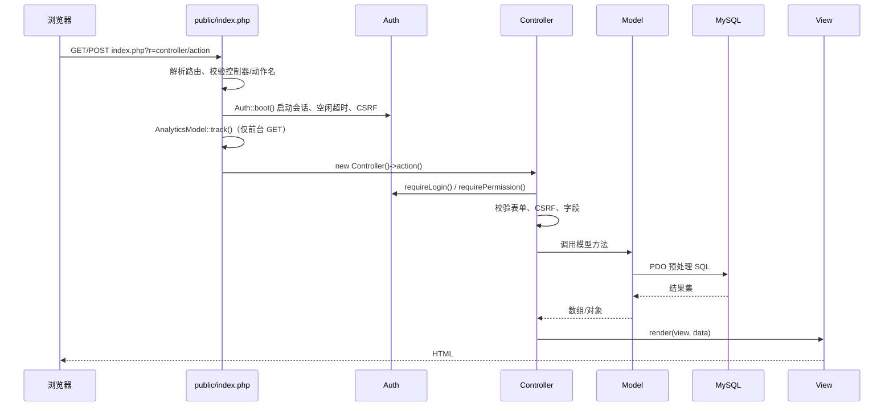

# 数聚 TeamHub 后端实现文档

> **课程**：互联网数据库开发　|　**团队**：M3　|　**编写**：金暄琛（2411672）　|　**日期**：2026-11-08　|　**版本**：v1.0

---

## 文档信息

| 项目 | 内容 |
| --- | --- |
| 文档名称 | 数聚 TeamHub 后端实现文档 |
| 项目名称 | 数聚 TeamHub——团队主页与内容管理系统 |
| 团队名称 | M3 |
| 文档编号 | DATANOVA-IMP-001 |
| 编写人 | M3 后端模块（学号待填） |
| 所属课程 | 互联网数据库开发 |
| 编写日期 | 2026 年 11 月 8 日 |
| 适用读者 | 课程评审教师、团队成员、后续维护者 |
| 文档范围 | 后端架构、请求链路、数据库访问、模块实现、安全、测试与已知限制 |

### 关联文档

| 文档 | 用途 |
| --- | --- |
| 《数聚 TeamHub 需求文档》 | 功能范围与验收基线 |
| 《数聚 TeamHub 设计文档》 | 总体架构、数据字典、接口与页面设计 |
| 本文档 | 后端代码如何落地设计、关键实现与验证结果 |
| 《数聚 TeamHub 用户手册》 | 前台/后台操作说明 |
| 《数聚 TeamHub 部署文档》 | 环境、安装、备份与还原 |

---

## 1 概述

本文档说明“数聚 TeamHub”后端的实际实现，包括：

- 自建轻量 MVC 的目录约定与请求分发；
- PDO 数据访问层的封装与事务；
- 认证、RBAC、CSRF、登录防爆破与会话安全；
- 前台公共页面、成员中心、管理后台、媒体上传、下载中心、统计看板与日志；
- 已执行的测试、验证结果，以及设计与实现的差异、已知限制。

项目没有使用 Laravel、ThinkPHP 或 ORM，也没有 Composer/Node 构建依赖。选择自建框架的原因是课程需要讲清 MVC 与数据库访问链路，同时减少演示环境的不确定性。代码按“控制器薄、模型承载数据、视图只渲染”的约定组织。

---

## 2 技术栈与运行环境

| 层 | 实现 | 说明 |
| --- | --- | --- |
| 语言 | PHP 8.2（最低 8.0） | `declare(strict_types=1)`、类型声明、`match` |
| Web 服务器 | Apache 2.4 + mod_php | Docker 镜像 `php:8.2-apache`；也支持 Nginx + PHP-FPM |
| 数据库 | MySQL 8.0 | `utf8mb4`、InnoDB、外键、视图、CHECK |
| 数据访问 | PDO + 原生预处理 | 不引入 ORM；命名占位符 |
| 会话 | PHP Session | `HttpOnly`、`SameSite=Lax`、HTTPS 时 `Secure` |
| 前端 | 服务端渲染 PHP 模板 + Bootstrap + 原生 JS | 后端输出数据，视图内联少量 JS |
| 图表 | CSS 柱状图/进度条 + 可访问表格 | 不依赖 ECharts 等外部图表库 |
| 部署 | Docker Compose | `web` + `db` + 命名卷；无 Docker 时用安装脚本 |

**与设计文档的差异**：设计文档的技术选型提到 ECharts、`bin/console migrate` 等目标方案；当前实现使用 CSS 图表和 `install.sql` 单一真源，未引入图表库和独立迁移命令。这样减少依赖，保证离线演示可用。差异以本文档第 15 节为准。

---

## 3 开发过程

后端按以下阶段推进，每个阶段都以“可运行 + 可验证”为完成标准：

| 阶段 | 主要工作 | 产出 |
| --- | --- | --- |
| 1 需求与数据模型 | 梳理前台/后台功能，确定 21 张表、3 个视图、角色与权限 | `data/install.sql`、设计文档数据字典 |
| 2 框架与认证 | 入口路由、`Db`、`Auth`、CSRF、登录/登出、RBAC | `public/index.php`、`app/core/` |
| 3 公共前台 | 首页、团队、成员、项目、公告、留言、下载 | 公共控制器/模型/视图 |
| 4 成员中心 | 个人资料、技能、项目贡献、改密 | `MeController`、`MemberModel` |
| 5 管理后台 | 看板、成员、项目、公告、留言、资源、用户、设置、日志 | `AdminController` 及各模型 |
| 6 媒体与统计 | 图片上传、替换/清理、访问统计、审计日志 | `MediaModel`、`AnalyticsModel`、`LogModel` |
| 7 安全与部署 | 目录隔离、安全响应头、上传限制、健康检查、安装脚本 | `apache-site.conf`、`uploads.ini`、`install.sh/.bat` |
| 8 回归与文档 | 路由/权限/安全回归，修复问题，补齐文档 | 测试记录、本文档、部署文档 |

开发过程中坚持两条数据库纪律：

1. **结构只改 `data/install.sql`**，并在干净库上完整导入验证；
2. **业务 SQL 全部使用 PDO 预处理**，不拼接用户输入。

---

## 4 目录与分层

```
code/
├── public/
│   ├── index.php              # 唯一入口：常量、会话、路由、异常兜底
│   ├── .htaccess              # /healthz 重写
│   └── static/                # CSS/JS/图片/上传文件
├── app/
│   ├── helpers.php            # e()/url()/asset()/render()/csrf_field()
│   ├── core/
│   │   ├── Db.class.php       # PDO 单例、查询封装、事务
│   │   └── Auth.class.php     # 会话、登录态、RBAC、CSRF、IP 哈希
│   ├── controller/            # 接收请求、校验、调用模型、渲染视图
│   ├── model/                 # SQL、事务、数据组装
│   └── view/                  # 布局、局部模板、页面
├── config/
│   ├── database.php           # 数据库配置（环境变量优先）
│   └── app.php                # APP_KEY、会话、上传上限
├── data/
│   ├── install.sql            # 21 表 + 3 视图 + 种子
│   ├── team/                  # 团队文档下载源
│   └── personal/              # 个人作业下载源
├── storage/                   # 运行时文件（不在 Web 根内）
├── docker-compose.yml
├── Dockerfile
├── apache-site.conf
├── uploads.ini
├── install.sh / install.bat
└── README.md
```

分层约定：

| 层 | 可以做 | 不应该做 |
| --- | --- | --- |
| Controller | 读取 `$_GET/$_POST`、校验、调用模型、`render()`/`redirect()` | 写复杂 SQL、拼 HTML |
| Model | 预处理 SQL、事务、把行转成视图需要的结构 | 读取 `$_POST`、输出 HTML |
| View | 转义输出、循环渲染、调用 `url()`/`asset()` | 查数据库、写业务判断 |

公共函数：

- `e()`：`htmlspecialchars` 统一转义，防止 XSS；
- `url()`：生成 `index.php?r=...`，自动处理 `APP_BASE`；
- `asset()`：静态资源加版本号，避免缓存旧文件；
- `render()`：提取数据并包含布局/视图；
- `csrf_field()`：输出隐藏的 `_token`。

---

## 5 请求生命周期



关键点：

- 路由格式为 `index.php?r=控制器/动作`，控制器名只允许字母数字，动作名只允许字母、数字、下划线；不满足或文件不存在返回 404。
- `Auth::boot()` 在任何输出前启动会话；每次请求调用 `validateSession()`，同步角色、显示名、`must_change_password`，并检查空闲超时。
- 前台 GET 请求写入 `page_views`；写入失败只记 `error_log`，不影响页面。
- 控制器/模型抛出的异常由入口统一捕获，返回 500 页面；详细异常写日志，不输出给用户。

---

## 6 数据库访问层

### 6.1 连接与配置

`app/core/Db.class.php` 使用 PDO 单例：

- DSN：`mysql:host=...;port=...;dbname=...;charset=utf8mb4`；
- `PDO::ATTR_ERRMODE = ERRMODE_EXCEPTION`；
- `PDO::ATTR_DEFAULT_FETCH_MODE = FETCH_ASSOC`；
- `PDO::ATTR_EMULATE_PREPARES = false`，使用 MySQL 原生预处理；
- 连接后执行 `SET time_zone = '+08:00'`，与 PHP 的 `Asia/Shanghai` 一致。

配置来自 `config/database.php`，优先读环境变量；Docker 内 `DB_HOST=db`，手动部署用 `127.0.0.1`。

### 6.2 查询封装

| 方法 | 用途 |
| --- | --- |
| `Db::fetchAll($sql, $params)` | 查询多行 |
| `Db::fetchOne($sql, $params)` | 查询单行，无结果返回 `null` |
| `Db::fetchValue($sql, $params)` | 查询单值（COUNT/SUM/EXISTS） |
| `Db::execute($sql, $params)` | INSERT/UPDATE/DELETE，返回受影响行数 |
| `Db::lastInsertId()` | 最近插入 ID |
| `Db::transaction(callable $work)` | 开启事务、提交/回滚 |

所有业务 SQL 使用命名占位符，例如：

```php
$rows = Db::fetchAll(
    'SELECT id, name, role_title FROM members
      WHERE is_visible = 1
      ORDER BY sort_order, id
      LIMIT :limit OFFSET :offset',
    ['limit' => $limit, 'offset' => $offset]
);
```

注意：PDO 原生预处理不允许同名占位符重复出现（`LIMIT :n OFFSET :n` 会失败），需要分别命名。项目中的分页、搜索都遵守这一约束。

### 6.3 数据模型

数据库共 **21 张表、3 个视图、27 个外键**，覆盖：

- 身份与权限：`roles`、`permissions`、`role_permissions`、`users`；
- 团队与成员：`team_profile`、`milestones`、`members`、`skills`、`member_skills`；
- 内容：`projects`、`project_members`、`announcements`、`messages`、`message_replies`；
- 媒体与资源：`media`、`resources`；
- 站点与统计：`site_settings`、`page_views`、`login_logs`、`audit_logs`；
- 迁移预留：`schema_migrations`。

视图：

- `v_public_members`：公开成员档案；
- `v_published_announcements`：已发布公告；
- `v_dashboard_daily_views`：按日聚合访问量。

`data/install.sql` 是唯一真源，包含建库、删表、建表、索引、外键、视图与种子数据。修改结构后必须在空库导入验证；`schema_migrations` 目前只作为后续增量迁移的预留表，项目尚未提供独立迁移命令。

---

## 7 认证、会话与权限

### 7.1 登录流程

1. 用户提交 `login`、`password`、`_token`；
2. 校验 CSRF；
3. 按用户名/IP 查询近期失败次数，超过阈值直接拒绝（登录防爆破）；
4. `password_verify()` 校验 bcrypt 散列；
5. 成功后 `session_regenerate_id(true)`，写入 `user_id`、角色、显示名、密码时间戳；
6. 更新 `last_login_at`、`last_login_ip_hash`，写 `login_logs`；
7. 若 `must_change_password=1`，跳转到改密页；否则按角色跳转后台/成员中心。

失败时写 `login_logs`（用户名尝试、失败原因、IP HMAC、User-Agent），不记录明文密码。

### 7.2 会话安全

`Auth::boot()` 设置：

```php
session_set_cookie_params([
    'lifetime' => 0,
    'path'     => '/',
    'secure'   => Auth::isHttps(),
    'httponly' => true,
    'samesite' => 'Lax',
]);
```

- 会话空闲超过 `SESSION_LIFETIME`（默认 1800 秒）自动退出；
- 每次请求调用 `validateSession()`，若用户被禁用、角色变化、密码被重置（密码时间戳变化），旧会话立即失效；
- 退出登录清空 `$_SESSION` 并删除会话 Cookie。

### 7.3 RBAC

权限表 `permissions` 的 `code` 形如 `member.manage`、`content.publish`、`user.manage`、`setting.manage`、`log.view`。角色通过 `role_permissions` 关联权限。

控制器在动作开头调用：

```php
Auth::requireLogin();
Auth::requirePermission('member.manage');
```

- 未登录：跳转登录页，`next` 参数经过 `Auth::safeNext()` 白名单校验，防开放重定向；
- 已登录但无权限：返回 403 页面；
- 内置角色：`super_admin`、`editor`、`member`（以 `install.sql` 种子为准）。

### 7.4 CSRF

- `Auth::csrfToken()` 在会话中生成 32 字节随机令牌；
- 所有 POST 表单包含 `csrf_field()`；
- 控制器用 `Auth::verifyCsrf($_POST['_token'] ?? '')` 校验，使用 `hash_equals()` 常量时间比较；
- 校验失败返回 419/403 页面，不执行写操作。

---

## 8 公共前台模块

| 路由 | 控制器/动作 | 模型 | 主要功能 |
| --- | --- | --- | --- |
| `home/index` | `HomeController@index` | `MemberModel`、`ProjectModel`、`AnnouncementModel` | 首页精选成员、项目、最新公告、团队指标 |
| `team/index` | `TeamController@index` | `TeamModel` | 团队简介、使命、价值观、里程碑 |
| `member/index` | `MemberController@index` | `MemberModel` | 成员列表、技能筛选、分页 |
| `member/show` | `MemberController@show` | `MemberModel` | 成员详情、技能、参与项目、留言入口 |
| `project/index` | `ProjectController@index` | `MemberModel` | 项目列表与相关项目 |
| `project/show` | `ProjectController@show` | `MemberModel` | 项目详情、成员分工、仓库/演示外链 |
| `announcement/index` | `AnnouncementController@index` | `AnnouncementModel` | 公告列表、分类筛选 |
| `announcement/show` | `AnnouncementController@show` | `AnnouncementModel` | 公告详情、相关公告 |
| `message/index` | `MessageController@index` | `MessageModel` | 已审核留言、分页 |
| `message/store` | `MessageController@store` | `MessageModel` | 提交留言、校验、限流、PRG |
| `resource/index` | `ResourceController@index` | `ResourceModel` | 下载中心、团队/个人分类 |
| `resource/download` | `ResourceController@download` | `ResourceModel` | 文件下载、计数、路径校验 |

实现细节：

- 所有列表只查询 `is_visible=1` / `status='published'` / 审核通过的数据；
- 输出统一 `e()` 转义；公告正文使用受限的 `markdown_lite()`，先转义再加白名单标签；
- 分页参数做上下界校验，避免负数/超大 `OFFSET`；
- 留言提交校验昵称、邮箱、内容长度，按 IP/时间窗口限流，成功后 302 重定向（PRG），防止重复提交；
- 下载中心把文件限制在 `data/team`、`data/personal`、`storage/uploads` 三个根目录内，`realpath()` 后做前缀比较，并过滤 `../`、NUL、绝对路径。

---

## 9 成员中心

`MeController` 要求登录，按当前用户绑定的成员档案操作：

| 功能 | 动作 | 说明 |
| --- | --- | --- |
| 概览 | `me/index` | 资料完整度、参与项目、收到的留言与快捷入口 |
| 编辑资料 | `me/profile`、`me/updateProfile` | 昵称、英文名、职位、简介、联系方式、头像等 |
| 项目贡献 | `me/projects`、`me/updateContribution` | 查看参与项目并更新自己的分工/贡献 |
| 安全设置 | `me/security`、`me/updatePassword` | 修改密码，校验旧密码，更新密码时间戳使旧会话失效 |

资料更新使用事务；技能通过 `member_skills` 关联表维护，保存时先删后插，保证集合一致。资料完整度按必填字段与技能数量计算。

---

## 10 管理后台

`AdminController` 构造函数统一要求登录，各动作再调用 `requirePermission()`。

| 模块 | 主要动作 | 权限 |
| --- | --- | --- |
| 数据看板 | `dashboard` | `dashboard.view` |
| 成员管理 | `members`、`memberEdit`、`updateMember`、`setMemberVisibility`、`setMemberFeatured` | `member.manage` |
| 项目管理 | `projects`、`projectCreate`、`storeProject`、`projectEdit`、`updateProject`、`archiveProject`、`setProjectVisibility` | `content.manage` |
| 公告管理 | `announcements`、`announcementCreate`、`storeAnnouncement`、`announcementEdit`、`updateAnnouncement`、`setAnnouncementStatus` | `content.manage` / `content.publish` |
| 留言审核 | `messages`、`messageEdit`、`updateMessage` | `message.moderate` |
| 资源管理 | `resources`、`resourceUpload`、`storeResource`、`resourceEdit`、`updateResource` | `resource.manage` |
| 用户管理 | `users`、`userCreate`、`storeUser`、`userEdit`、`updateUser`、`resetUserPassword`、`setUserStatus` | `user.manage` |
| 站点设置 | `settings`、`updateSettings` | `setting.manage` |
| 团队信息 | `team`、`updateTeam` | `team.edit` |
| 日志 | `logs` | `log.view` |
| 账号安全 | `security`、`updatePassword` | 登录即可 |

统一实现方式：

1. 读取并 trim 输入；
2. 校验必填、长度、枚举、ID 合法性；
3. 校验失败时保留旧输入并显示字段错误（422 或重新渲染表单）；
4. 写操作校验 CSRF；
5. 多表写入用 `Db::transaction()`；
6. 成功后记录 `audit_logs`，302 重定向并带 `saved=1` 提示；
7. 失败时写 `error_log`，返回可读错误，不暴露 SQL。

数据看板：

- KPI：成员总数、已发布项目、待审核留言、近 7 日访问；
- 近 14 天访问趋势：`page_views` 按日聚合，CSS 柱状图，附隐藏表格供读屏；
- 技能分布：公开成员按技能计数，最多 6 项；
- 待审核留言：可直接通过或进入审核/回复页。

---

## 11 媒体上传与下载

### 11.1 图片上传

`MediaModel` 统一处理 Logo、头像、项目封面、公告封面等图片：

- 允许 JPEG、PNG、WebP、GIF；
- `finfo` 检查 MIME，`getimagesize()` 再确认是真实图片；
- Logo/头像 ≤ 2 MB，封面 ≤ 5 MB；尺寸 ≤ 8000×8000；
- 文件名使用 32 位随机十六进制 + 扩展名，避免原名注入；
- 存储路径：`public/static/uploads/media/YYYY/MM/<32hex>.<ext>`；
- 数据库 `media.storage_path` 保存相对路径；视图通过 `asset()` 输出；
- 替换图片时先保存新图、更新引用，再检查旧图是否仍被其他记录引用，无引用才删除；
- 上传目录的 `.htaccess` 禁止脚本执行。

### 11.2 下载中心

- 资源表 `resources` 保存相对路径、分类（团队/个人）、下载次数；
- 下载动作先按 ID 查资源，再调用 `resolveFile()`：
  - 拒绝空路径、NUL、绝对路径、`../`；
  - `realpath()` 后必须是 `data/team`、`data/personal` 或 `storage/uploads` 下的真实文件；
  - 不满足返回 404，不泄露服务器路径；
- 通过后输出合适的 `Content-Type`、`Content-Disposition`，并递增 `download_count`。

---

## 12 统计与审计

### 12.1 访问统计

`AnalyticsModel::track()` 只统计前台 GET 页面（home、team、member、project、announcement、resource、message），排除后台、成员中心、登录页和下载。

- IP 与会话 ID 不落明文，使用 `APP_KEY` 做 HMAC-SHA256；
- 写入 `page_views`（页面、控制器、动作、访客哈希、时间）；
- 失败只记日志，不影响页面响应；
- 看板通过 `v_dashboard_daily_views` 或按日聚合查询读取。

### 12.2 日志

- `login_logs`：登录尝试、成功/失败、失败原因、IP HMAC、User-Agent；
- `audit_logs`：后台写操作的操作者、动作、实体、变更前后 JSON、IP HMAC；
- 后台日志页支持按登录账号、登录结果、操作者、动作、日期范围筛选；
- 日期参数用严格 `YYYY-MM-DD` 校验，结束日期按“次日 0 点”做开区间，避免漏掉当天数据；
- `LIKE` 搜索转义 `\`、`%`、`_`，防止通配符注入。

---

## 13 安全实现

| 威胁 | 措施 | 代码位置 |
| --- | --- | --- |
| SQL 注入 | PDO 原生预处理、命名占位符、不拼接输入 | `Db.class.php`、各模型 |
| XSS | 输出统一 `e()`；富文本白名单 | `helpers.php`、视图 |
| CSRF | 会话令牌 + `hash_equals` | `Auth::csrfToken/verifyCsrf` |
| 会话劫持 | `HttpOnly`、`SameSite=Lax`、HTTPS `Secure`、登录后换 Session ID | `Auth::boot/login` |
| 暴力破解 | 失败次数窗口限制、IP HMAC 记录 | `AuthModel` |
| 越权 | 每个后台动作 `requirePermission` | `AdminController` |
| 上传攻击 | MIME + 图片结构双校验、随机文件名、目录禁执行 | `MediaModel`、`.htaccess` |
| 目录穿越 | `realpath` + 根目录前缀 + `../` 过滤 | `ResourceController` |
| 信息泄露 | 生产关闭 `APP_DEBUG`；500 页面不回显异常；`expose_php=Off` | `index.php`、`uploads.ini` |
| 源码/配置泄露 | DocumentRoot 指向 `public/`；app/config/data/storage 拒绝访问 | `apache-site.conf` |
| 点击劫持 | `X-Frame-Options: SAMEORIGIN` | `apache-site.conf` |
| MIME 嗅探 | `X-Content-Type-Options: nosniff` | `apache-site.conf` |

密码只存 bcrypt 散列；`install.sql` 文件头注明初始账号为课程演示账号，并要求首次登录改密。仓库不写入真实生产口令，部署时通过环境变量/.env 覆盖。

---

## 14 测试与验证

### 14.1 已执行的检查

| 检查 | 方式 | 结果 |
| --- | --- | --- |
| PHP 语法 | `php -l` 覆盖控制器、模型、视图、入口 | 全部通过 |
| 部署回归 | Python 脚本遍历前台/后台/成员中心/权限边界/错误页/安全头 | **109 项通过** |
| 团队价值观编辑 | 保存两条价值观、前台显示、非法空标题 422、数据恢复 | 通过 |
| 日志筛选 | 登录账号/结果/日期、审计动作筛选、非法参数忽略 | 通过 |
| 后台成员技能 | 非法数量 422、合法保存 3 项、表单回显、数据恢复 | 通过 |
| 资源上传下载 | 后台上传 TXT、前台列表可见、下载内容/MIME/文件名、计数 +1、临时数据清理 | 通过 |
| 团队与站点配置联动 | 团队名称保存后自动同步站点名称、SEO 描述与页脚版权中的旧名称；首页/团队页/导航同步 | 通过 |
| 全站品牌同步 | 登录页、公共导航、后台侧栏/页脚、成员中心侧栏/页脚统一读取 `site_identity()` 的当前站点名；旧品牌只保留在数据库兜底值与项目内容中 | 15 项通过 |
| 干净镜像 | 无源码挂载的镜像在 8081 端口复测 | 109 项通过 |
| 数据库结构 | 空库导入 `install.sql` | 21 表、3 视图、27 外键 |
| 安全路径 | `config/`、`app/`、`data/`、`storage/`、`.htaccess`、上传目录 | 404/403，不可下载 |
| 安全响应头 | `curl -I` | `nosniff`、`SAMEORIGIN`、`Referrer-Policy`、`Permissions-Policy` 正常，无 `X-Powered-By` |

部署回归覆盖：

- 前台全部公开路由与详情页（成员、项目、公告、下载中心列表）；
- 登录、登出、强制改密、错误口令；
- 后台全部页面与主要写操作；
- 成员中心页面；
- 未登录重定向、editor 越权 403、超级管理员完整遍历；
- 404/500 错误页；
- 安全响应头与受保护路径。

### 14.2 测试数据恢复

涉及写操作的测试在 `finally` 中恢复原数据：

- 恢复成员技能、资料完整度、更新时间；
- 恢复团队价值观 JSON、`updated_at`、`updated_by`；
- 恢复 `users.must_change_password` 原值；
- 删除测试新增的 `audit_logs`。

测试使用课程演示账号与本地数据库，不触碰生产数据；测试脚本不写入仓库。

### 14.3 手工验收

按《部署文档》第 8 节执行：容器 healthy、`/healthz` 200、前台页面、后台登录、权限边界、上传、下载（需先放入真实文件）、备份恢复。

---

## 15 设计与实现差异、已知限制

### 15.1 与设计文档的差异

| 设计文档描述 | 实际实现 | 原因 |
| --- | --- | --- |
| ECharts 动态图表 | CSS 柱状图/进度条 + 隐藏数据表 | 减少外部依赖，离线演示稳定；仍满足动态数据展示 |
| `bin/console migrate` 增量迁移 | `install.sql` 单一真源；`schema_migrations` 预留 | 课程周期内保持可还原；迁移命令未实现 |
| `/media/{id}` 控制器输出图片 | 图片存 `public/static/uploads`，静态直出；下载资源走控制器 | 静态图片性能更好；下载仍需权限/计数/防穿越 |
| Repository/Service 分层 | Controller → Model → Db | 项目规模较小，避免过度分层 |
| `.env` 由应用加载 | Docker Compose 读取 `.env` 并注入环境变量；PHP 直接 `getenv()` | 不引入 dotenv 依赖 |

### 15.2 已知限制

1. `milestones` 表只存 `year`，前台无法精确显示“2026.09”这类年月；如需按月展示，应增加 `month` 或 `period_label` 字段。
2. 后台成员编辑要求至少 3 项技能；无技能成员在补技能前无法保存其他字段。
3. 新建账号只能绑定“尚未绑定”的成员档案；当前种子成员均已绑定，新增成员需先创建档案。
4. 团队价值观最多 6 条，按填写顺序展示，暂无拖拽排序。
5. 下载中心种子数据中的 PDF/ZIP 需要实际文件放入 `data/team`、`data/personal`，或通过后台上传；仓库不伪造文件。
6. 未实现独立迁移命令；结构变更需改 `install.sql` 并在空库验证。
7. 图片上传只校验图片类型，不进行病毒扫描；生产环境应在网关或上传服务补充。
8. 作者注释中的学号仍为“待填”，提交前需按课程要求补齐。

---

## 16 运行与文档索引

```bash
# Docker 一键启动
cd code
docker compose up -d --build

# 健康检查
curl -i http://localhost:8080/healthz

# 无 Docker
bash install.sh        # Linux/macOS
install.bat            # Windows
```

| 文档 | 路径 |
| --- | --- |
| 需求文档 | `docs/team/01-需求文档/` |
| 设计文档 | `docs/team/02-设计文档/` |
| 实现文档（本文） | `docs/team/03-实现文档/M3_后端实现文档.md` |
| 用户手册 | `docs/team/04-用户手册/` |
| 部署文档 | `docs/team/05-部署文档/M3_部署文档.md` |
| 项目展示 PPT | `docs/team/06-项目展示PPT/` |

源码入口与约定见 `code/README.md`；数据库结构与种子见 `code/data/install.sql`。
