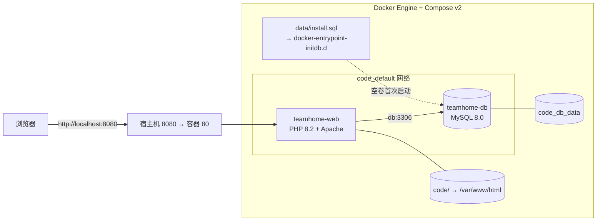

# 数聚 TeamHub 部署文档

> **课程**：互联网数据库开发　|　**团队**：M3　|　**编写**：M3 部署模块（学号待填）　|　**日期**：2026-11-08　|　**版本**：v1.0

---

## 文档信息

| 项目 | 内容 |
| --- | --- |
| 文档名称 | 数聚 TeamHub 部署文档 |
| 项目名称 | 数聚 TeamHub——团队主页与内容管理系统 |
| 团队名称 | M3 |
| 文档编号 | DATANOVA-DEP-001 |
| 编写人 | M3 部署模块（学号待填） |
| 所属课程 | 互联网数据库开发 |
| 编写日期 | 2026 年 11 月 8 日 |
| 适用读者 | 部署人员、演示人员、后续维护者 |
| 文档范围 | 环境要求、Docker 一键部署、无 Docker 备选部署、配置、备份恢复、安全加固、验收与排障 |

### 关联文档

| 文档 | 用途 |
| --- | --- |
| 《数聚 TeamHub 需求文档》 | 功能范围与验收基线 |
| 《数聚 TeamHub 设计文档》 | 架构、数据库、接口与安全设计 |
| 《数聚 TeamHub 实现文档》 | 开发过程与代码说明 |
| 《数聚 TeamHub 用户手册》 | 前台/后台操作说明 |
| 本文档 | 环境、安装、配置、备份与还原 |

---

## 1 部署概述

系统采用 **PHP 8.2 + Apache + MySQL 8.0**，提供三种部署路径：

| 路径 | 适用场景 | 自动化程度 | 推荐度 |
| --- | --- | --- | --- |
| Docker Compose | 开发、演示、课程验收 | 一条命令完成镜像构建、数据库初始化与启动 | ★★★★★ |
| `install.sh` / `install.bat` | 无法安装 Docker，已有 PHP/MySQL 环境 | 自动检查版本、建库、建账号、导入 SQL | ★★★ |
| 手工命令 | 需要接入既有 Apache/Nginx 或排查问题 | 手动执行建库、导入与站点配置 | ★★ |

三种路径使用同一份数据库脚本 `code/data/install.sql` 和同一套源码，差别只在运行环境。**课程验收优先使用 Docker Compose**。

### 1.1 交付物

| 文件/目录 | 说明 |
| --- | --- |
| `code/` | 完整源码（入口、控制器、模型、视图、静态资源） |
| `code/data/install.sql` | 数据库唯一真源：21 张表、3 个视图、索引、外键与种子数据 |
| `code/docker-compose.yml` | web + db 编排、健康检查、数据卷 |
| `code/Dockerfile` | PHP 8.2 + Apache 镜像，安装 PDO MySQL、fileinfo 等扩展 |
| `code/apache-site.conf` | 站点根指向 `public/`，附加安全响应头 |
| `code/.env.example` | 环境变量样例（复制为 `code/.env` 使用） |
| `code/install.sh` / `code/install.bat` | 无 Docker 环境的备选安装脚本 |

---

## 2 环境要求

### 2.1 Docker 路径

| 项 | 最低要求 | 说明 |
| --- | --- | --- |
| 操作系统 | Windows 10/11、macOS、Linux | Windows 建议启用 WSL2 |
| Docker | Docker Desktop 4.x 或 Docker Engine 24+ | 需支持 `docker compose`（Compose v2） |
| 资源 | 2 CPU、2 GB 内存、5 GB 磁盘 | 首次构建镜像需要额外空间 |
| 端口 | 8080 可用 | 被占用时修改 `docker-compose.yml` 的 `ports` |
| 网络 | 能拉取 `php:8.2-apache`、`mysql:8.0` | 受限网络需配置镜像加速源 |

检查命令：

```bash
docker --version
docker compose version
```

### 2.2 无 Docker 路径

| 项 | 要求 |
| --- | --- |
| PHP | 8.0+（推荐 8.2），扩展：`pdo_mysql`、`fileinfo`、`mbstring`、`session`、`json` |
| MySQL | 8.0+（**不支持 MariaDB**；`install.sql` 使用 `utf8mb4_0900_ai_ci`） |
| Web 服务器 | Apache 2.4（`mod_rewrite`、`mod_headers`）或 Nginx + PHP-FPM |
| 磁盘权限 | `public/static/uploads/`、`storage/` 对 Web 进程可写 |

检查 PHP 扩展：

```bash
php -v
php -m | grep -E 'pdo_mysql|fileinfo|mbstring'
```

检查端口占用：

```bash
# Linux / macOS
lsof -i :8080

# Windows PowerShell
Get-NetTCPConnection -LocalPort 8080 -ErrorAction SilentlyContinue
```

---

## 3 部署拓扑

Docker 路径由 `code/docker-compose.yml` 定义两个服务和一个数据卷：

- **web**：由 `code/Dockerfile` 构建，基础镜像 `php:8.2-apache`；源码绑定挂载到 `/var/www/html`；Apache `DocumentRoot` 指向 `/var/www/html/public`；对外映射 `8080 → 80`。
- **db**：官方 `mysql:8.0`，仅在 Compose 网络内暴露 3306；数据存放在命名卷 `code_db_data`；`data/install.sql` 只读挂载到 `/docker-entrypoint-initdb.d/`，**数据卷首次初始化时执行一次**。
- **启动顺序**：web 通过 `depends_on` 等待 db 的 `mysqladmin ping` 健康检查通过；web 自身健康检查访问 `/index.php?r=system/healthz`，数据库不可用时返回 503。
- **网络**：Compose 默认桥接网络 `code_default`；web 用服务名 `db:3306` 连接数据库，不能写 `127.0.0.1`。



**表 3-1  组件与端口**

| 组件 | 镜像/构建 | 容器名 | 端口 | 持久化 |
| --- | --- | --- | --- | --- |
| web | `code/Dockerfile`（`php:8.2-apache`） | `teamhome-web` | `8080:80` | `code/` 绑定挂载 |
| db | `mysql:8.0` | `teamhome-db` | 仅内网 3306 | 命名卷 `code_db_data` |
| 网络 | Compose bridge | `code_default` | — | — |

> Web 根只指向 `public/`，`app/`、`config/`、`data/`、`storage/` 均在 DocumentRoot 之外；即使根目录 `.htaccess` 失效，也不会被直接下载。上传文件位于 `public/static/uploads/`，由该目录的 `.htaccess` 禁止脚本执行。

---

## 4 Docker 一键部署（推荐）

### 4.1 获取代码

```bash
git clone <仓库地址>
cd <仓库目录>/code
git checkout dev          # 课程开发分支；发布时切到约定 tag/commit
```

### 4.2 配置环境变量

```bash
cp .env.example .env      # Windows PowerShell: Copy-Item .env.example .env
```

编辑 `code/.env`，至少修改：

```dotenv
MYSQL_ROOT_PASSWORD=<随机强口令>
MYSQL_PASSWORD=<随机强口令>
APP_KEY=<至少 32 字节随机串>
APP_DEBUG=false
```

生成 `APP_KEY`：

```bash
php -r "echo bin2hex(random_bytes(32)), PHP_EOL;"
```

说明：

- `.env` 已被 `.gitignore` 忽略，**不要提交**；`.env.example` 只保留占位符。
- `MYSQL_ROOT_PASSWORD`、`MYSQL_PASSWORD` 只在数据卷首次初始化时生效。已有数据卷要改口令，需进入 db 容器执行 `ALTER USER`，或重建数据卷（会丢数据）。
- `APP_KEY` 用于 IP/会话哈希。更换后历史 IP 哈希与匿名访客标识会变化，生产环境需评估后再轮换。

### 4.3 启动

```bash
docker compose up -d --build
docker compose ps
```

首次启动会依次完成：构建 web 镜像 → 创建网络与数据卷 → 初始化 MySQL 并执行 `data/install.sql` → 启动 Apache。等待 `docker compose ps` 中 **db、web 均为 `healthy`**。

若只需重启、不改镜像：

```bash
docker compose up -d
```

### 4.4 验证

```bash
# 1) 健康检查：应返回 200 与 {"status":"ok","database":"ok",...}
curl -i http://localhost:8080/healthz

# 2) 首页与后台登录页
curl -I http://localhost:8080/
curl -I "http://localhost:8080/index.php?r=auth/login"

# 3) 容器日志无致命错误
docker compose logs --tail=100 web
```

浏览器验收：

| 检查项 | 地址/操作 | 期望 |
| --- | --- | --- |
| 前台首页 | <http://localhost:8080/> | 正常渲染，静态资源加载 |
| 团队/成员/项目/公告 | 顶部导航 | 列表与详情可打开 |
| 下载中心 | `?r=resource/index` | 列表正常；放入 `data/team` 或 `data/personal` 的真实文件后可下载并计数 |
| 后台登录 | `?r=auth/login` | 初始账号可登录，首次强制改密 |
| 权限边界 | 用 editor 账号访问用户管理 | 返回 403 |
| 上传 | 后台上传 Logo/封面/头像 | 成功并可在前台显示 |
| 数据看板 | 后台首页 | 图表有数据（先访问几个前台页面） |

> 初始账号与课程演示口令写在 `data/install.sql` 文件头。首次登录必须修改密码；演示前请确认 `admin` 的 `must_change_password` 状态符合预期。

### 4.5 日常运维

| 目的 | 命令 |
| --- | --- |
| 查看状态 | `docker compose ps` |
| 实时日志 | `docker compose logs -f web`、`docker compose logs -f db` |
| 重启 Web | `docker compose restart web` |
| 进入 Web 容器 | `docker compose exec web bash` |
| 连接数据库 | `docker compose exec db mysql -uteam -p team_home` |
| 停止（保留数据） | `docker compose down` |
| 停止并清空数据 | `docker compose down -v`（仅开发环境） |
| 更新代码后重建 | `git pull` → `docker compose up -d --build` |

### 4.6 重置演示数据

`install.sql` 只在数据卷为空时执行。需要恢复初始演示数据时：

```bash
docker compose down -v     # 警告：删除 code_db_data，数据库与上传记录全部丢失
docker compose up -d --build
```

执行前必须先备份（见第 6 节）。生产环境禁止使用 `down -v`。

---

## 5 无 Docker 部署（备选）

### 5.1 Linux / macOS：`install.sh`

前置条件：`php`、`mysql` 客户端已加入 `PATH`，MySQL 服务已启动。

```bash
cd code
bash install.sh
```

脚本流程：

1. 检查 PHP ≥ 8.0、MySQL ≥ 8.0（拒绝 MariaDB）；
2. 询问 MySQL 管理员账号/口令（口令只写入临时文件，退出时删除）；
3. 检查目标库是否已有表，非空时要求输入 `yes` 确认；
4. 创建数据库 `team_home` 与应用账号 `team`（`localhost` 与 `127.0.0.1`）；
5. 导入 `data/install.sql`，校验表数量 ≥ 10，并打印启动命令。

非交互执行（CI/自动化）：

```bash
MYSQL_ADMIN_PASSWORD='***' FORCE=1 bash install.sh
```

自定义库名/账号（需与 `config/database.php` 的环境变量一致）：

```bash
DB_NAME=team_home DB_USER=team DB_PASS='***' bash install.sh
```

脚本会同步替换 `install.sql` 中的建库与 `USE` 两行；其余 SQL 不依赖库名。

### 5.2 Windows：`install.bat`

适用于 phpStudy / XAMPP。先把 PHP 与 MySQL 的 `bin` 目录加入 `PATH`，再双击或在 cmd 中执行：

```bat
cd /d <仓库目录>\code
install.bat
```

脚本输出为 ASCII，避免 Windows 代码页导致中文乱码或解析错误；流程与 `install.sh` 一致。管理员密码含 `& ^ | < > ( )` 等批处理特殊字符时，建议改用 `install.sh`（Git Bash）或按 5.3 手工执行。

### 5.3 手工部署

```bash
# 1) 建库（MySQL 8.0）
mysql -u root -p -e "CREATE DATABASE team_home DEFAULT CHARACTER SET utf8mb4 COLLATE utf8mb4_0900_ai_ci"

# 2) 建应用账号
mysql -u root -p -e "CREATE USER 'team'@'localhost' IDENTIFIED BY '<口令>'; GRANT ALL ON team_home.* TO 'team'@'localhost';"

# 3) 导入结构与种子
mysql -u root -p team_home < data/install.sql

# 4) 校验（应为 21 / 3）
mysql -u root -p -N -B -e "SELECT COUNT(*) FROM information_schema.tables WHERE table_schema='team_home' AND table_type='BASE TABLE'; SELECT COUNT(*) FROM information_schema.tables WHERE table_schema='team_home' AND table_type='VIEW';"
```

启动 PHP 内置服务器（仅本地演示）：

```bash
export DB_HOST=127.0.0.1 DB_PORT=3306 DB_NAME=team_home DB_USER=team DB_PASS='<口令>'
php -S localhost:8080 -t public
```

> 内置服务器不读取 `.htaccess`，`/healthz` 不可用，请访问 `/index.php?r=system/healthz`。它也不适合公网或正式演示，正式环境使用 Apache/Nginx。

### 5.4 Apache 站点配置

站点根必须指向 `code/public`，不能指向 `code/`：

```apache
<VirtualHost *:80>
    ServerName teamhub.local
    DocumentRoot "E:/path/to/code/public"

    <Directory "E:/path/to/code/public">
        Options -Indexes +FollowSymLinks
        AllowOverride All
        Require all granted
    </Directory>

    # 双保险：这些目录本来就在 Web 根之外
    <Directory "E:/path/to/code/app">Require all denied</Directory>
    <Directory "E:/path/to/code/config">Require all denied</Directory>
    <Directory "E:/path/to/code/data">Require all denied</Directory>
    <Directory "E:/path/to/code/storage">Require all denied</Directory>

    ErrorLog "logs/teamhub-error.log"
    CustomLog "logs/teamhub-access.log" combined
</VirtualHost>
```

项目自带的 `code/apache-site.conf` 已包含上述配置与安全响应头，Docker 镜像会自动启用。

### 5.5 Nginx + PHP-FPM（可选）

```nginx
server {
    listen 80;
    server_name teamhub.local;
    root /path/to/code/public;
    index index.php;

    location = /healthz {
        rewrite ^ /index.php?r=system/healthz last;
    }

    location / {
        try_files $uri $uri/ /index.php?$query_string;
    }

    location ~ \.php$ {
        include fastcgi_params;
        fastcgi_param SCRIPT_FILENAME $document_root$fastcgi_script_name;
        fastcgi_pass unix:/run/php/php8.2-fpm.sock;
    }

    # 上传目录禁止执行脚本
    location ~ ^/static/uploads/.*\.(php|phtml|phar)$ {
        deny all;
    }
}
```

---

## 6 数据库初始化、迁移与备份

### 6.1 初始化

- `code/data/install.sql` 是数据库**唯一真源**，包含 21 张表、3 个视图、索引、外键与种子数据。
- 脚本开头会 `DROP VIEW` / `DROP TABLE` 同名对象，**面向空库或可重置的演示库**；执行前必须备份。
- Docker 只在数据卷首次初始化时自动执行；手动导入时使用 `mysql ... < data/install.sql`。
- 表 `schema_migrations` 已预留给后续增量迁移；当前版本尚未提供独立迁移命令，结构变更仍通过修改 `install.sql` 并在干净库上完整验证来完成。

### 6.2 逻辑备份

以下命令在 Git Bash / macOS / Linux 执行；PowerShell 中把 `$(date +%F)` 换成手写日期。使用容器内 `--result-file` 写文件，避免 Windows PowerShell 重定向产生 UTF-16 编码。

```bash
docker exec teamhome-db sh -c 'mysqldump -uroot -p"$MYSQL_ROOT_PASSWORD" \
  --single-transaction --routines --triggers --default-character-set=utf8mb4 \
  --result-file=/tmp/team_home_backup.sql team_home'

docker cp teamhome-db:/tmp/team_home_backup.sql "./backup_team_home_$(date +%F).sql"
docker exec teamhome-db rm -f /tmp/team_home_backup.sql
```

备份内容只含 `team_home` 库。上传图片在 `public/static/uploads/`，需单独备份：

```bash
tar -czf "uploads_$(date +%F).tar.gz" public/static/uploads
```

建议：演示前、数据库结构变更前、提交课程材料前各备份一次；至少保留最近 3 份，并复制到另一台设备或云盘。

### 6.3 恢复

```bash
# 1) 确认目标库存在（全新环境可先启动 db，让容器创建 team_home）
docker exec teamhome-db sh -c 'mysql -uroot -p"$MYSQL_ROOT_PASSWORD" \
  -e "CREATE DATABASE IF NOT EXISTS team_home DEFAULT CHARACTER SET utf8mb4 COLLATE utf8mb4_0900_ai_ci"'

# 2) 复制备份进容器并导入
docker cp ./backup_team_home_2026-11-08.sql teamhome-db:/tmp/restore.sql
docker exec teamhome-db sh -c 'mysql -uroot -p"$MYSQL_ROOT_PASSWORD" \
  --default-character-set=utf8mb4 team_home < /tmp/restore.sql'
docker exec teamhome-db rm -f /tmp/restore.sql

# 3) 恢复上传文件（按备份时的目录结构解压）
tar -xzf uploads_2026-11-08.tar.gz
```

恢复后检查：表数量、`users` 可登录、首页/后台/详情页正常、上传图片可访问。恢复操作会覆盖同名表，执行前先对当前库再做一次备份。

### 6.4 数据卷整体备份（可选）

适合整机迁移，需在低峰期停止写入：

```bash
docker compose stop web
docker run --rm -v code_db_data:/data -v "$PWD":/backup alpine \
  tar -czf /backup/db_data_$(date +%F).tar.gz -C /data .
docker compose start web
```

数据卷备份与逻辑备份二选一即可；逻辑备份跨 MySQL 小版本更稳妥。

---

## 7 配置与安全

### 7.1 环境变量

当前代码实际读取的变量如下（`config/database.php`、`config/app.php`、`public/index.php`）：

| 变量 | 默认值 | 使用方 | 说明 |
| --- | --- | --- | --- |
| `DB_HOST` | `db` | 应用 | Docker 内为服务名；手动部署用 `127.0.0.1` |
| `DB_PORT` | `3306` | 应用 | MySQL 端口 |
| `DB_DATABASE` / `DB_NAME` | `team_home` | 应用 | 数据库名 |
| `DB_USERNAME` / `DB_USER` | `team` | 应用 | 数据库账号 |
| `DB_PASSWORD` / `DB_PASS` | `team123456` | 应用 | 演示默认值，生产必须覆盖 |
| `APP_KEY` | 本地演示串 | 应用 | IP/会话 HMAC 密钥，生产必须覆盖 |
| `APP_DEBUG` | `false` | 应用 | `true` 输出详细错误，仅限本地排障 |
| `APP_BASE` | 自动识别 | 应用 | 子目录部署时设 `/teamhub` 等前缀 |
| `SESSION_LIFETIME` | `1800` | 应用 | 会话空闲过期秒数 |
| `UPLOAD_MAX_MB` | `10` | 应用 | 业务侧上传上限（MB） |
| `MYSQL_ROOT_PASSWORD` | 仅演示默认 | db | 仅数据卷首次初始化生效 |
| `MYSQL_PASSWORD` | 仅演示默认 | db + web | 同时作为应用的 `DB_PASSWORD` |

> `MYSQL_DATABASE`、`MYSQL_USER` 在 compose 中固定为 `team_home`、`team`，与应用配置保持一致；修改时需同步 `docker-compose.yml`、`.env` 与 `install.sql`。

### 7.2 安全基线

| 措施 | 实现位置 | 说明 |
| --- | --- | --- |
| Web 根隔离 | `apache-site.conf` | DocumentRoot 指向 `public/`，源码/配置/SQL 不可下载 |
| 上传目录禁执行 | `public/static/uploads/.htaccess` | 禁止 `php/phtml/phar` 等脚本 |
| 安全响应头 | `apache-site.conf` | `X-Content-Type-Options`、`X-Frame-Options`、`Referrer-Policy`、`Permissions-Policy` |
| 隐藏 PHP 版本 | `uploads.ini` | `expose_php = Off` |
| 上传大小 | `uploads.ini` | 单文件 12 MB、表单 16 MB，业务侧 10 MB |
| 密码存储 | `install.sql` / `Auth` | bcrypt 散列，不存明文 |
| CSRF | 表单 `_token` | 写操作校验一次性令牌 |
| 会话 | `Auth::boot()` | `HttpOnly`、`SameSite=Lax`、HTTPS 时 `Secure` |
| 登录防爆破 | `AuthModel` | 失败次数锁定 + IP HMAC 记录 |
| 下载防穿越 | `ResourceModel` | 过滤 `../`，文件限制在 `data/team`、`data/personal` |

### 7.3 目录权限

Linux 宿主机（Docker 或手动部署）需要让 Web 进程可写上传与运行时目录：

```bash
# 手动部署：按实际 Web 用户调整（www-data / apache / nginx）
sudo chown -R www-data:www-data public/static/uploads storage
sudo chmod -R 775 public/static/uploads storage
```

Dockerfile 在构建时已对镜像内目录执行 `chown www-data:www-data`；Linux 绑定挂载时以宿主机权限为准。Windows Docker Desktop 的绑定挂载通常不需要额外 chmod。

### 7.4 HTTPS 与反向代理

生产环境建议在 8080 前加 Nginx/Caddy 做 TLS 终止，并设置：

- `proxy_set_header X-Forwarded-Proto $scheme;`（应用据此判断 HTTPS 并给 Cookie 加 `Secure`）
- 只暴露 80/443；不要暴露 db 的 3306
- 限制上传体积与请求体大小，与 PHP `post_max_size` 对齐
- 定期备份数据库与上传目录

---

## 8 验收清单

| # | 检查项 | 通过标准 |
| --- | --- | --- |
| 1 | 容器状态 | `db`、`web` 均为 `healthy` |
| 2 | 健康检查 | `GET /healthz` 返回 200，`status=ok`、`database=ok` |
| 3 | 前台页面 | 首页、团队、成员、项目、公告、下载中心均 200 |
| 4 | 后台登录 | 初始账号可登录，首次登录强制改密 |
| 5 | 权限边界 | 未登录跳登录页；editor 访问用户管理返回 403 |
| 6 | 内容管理 | 团队信息、成员技能、项目、公告、资源、留言可增删改 |
| 7 | 上传 | 图片可上传、前台显示；替换/删除后旧文件按引用清理 |
| 8 | 下载安全 | `../` 等穿越路径被拒绝 |
| 9 | 数据库 | 表数量 21、视图 3，外键与索引存在 |
| 10 | 备份恢复 | 按第 6 节导出后可在测试库完整恢复 |

**验证记录**：2026-11-08 在 Windows 11 + Docker Desktop 环境完成部署回归，覆盖前台公开路由、登录、后台全部页面、成员中心、权限边界、错误页与安全响应头，共 109 项检查通过；并在无源码挂载的干净镜像上复测通过。

---

## 9 常见问题

| 现象 | 可能原因 | 处理 |
| --- | --- | --- |
| `port is already allocated` | 8080 被占用 | 修改 compose `ports: "8081:80"`，或停止占用进程 |
| 拉取 `php:8.2-apache` 超时/EOF | 网络无法访问 Docker Hub | 配置镜像加速源，或改用可访问的镜像并同步修改 Dockerfile |
| `db` 一直 `unhealthy` | 密码/卷异常、初始化未完成 | `docker compose logs db`；首次初始化需等待；必要时 `down -v` 重建（先备份） |
| web 启动但页面 500 | 数据库未就绪、权限、代码错误 | `docker compose logs web`；临时 `APP_DEBUG=true` 查看；确认 `db` healthy |
| 修改 `install.sql` 后不生效 | 数据卷已存在，initdb 只执行一次 | 开发环境 `down -v` 重建；生产走增量变更 |
| 上传失败/403 | 目录不可写、超出大小、MIME 校验 | 检查 `public/static/uploads` 权限、`upload_max_filesize`/`post_max_size`、文件类型 |
| `/healthz` 404 | 使用 PHP 内置服务器，未读取 `.htaccess` | 改用 `/index.php?r=system/healthz`，或使用 Apache |
| 访问旧地址 `/public/index.php` 404 | 站点根已切到 `public/` | 使用 `/` 或 `/index.php?r=...`；`APP_BASE` 会自动识别两种入口 |
| 中文乱码 | 连接字符集或导入方式不对 | 确认 `utf8mb4`、`--default-character-set=utf8mb4`；用 `mysql < file` 而非复制粘贴 |
| `Unknown collation: utf8mb4_0900_ai_ci` | 使用了 MariaDB 或 MySQL 5.7 | 改用 MySQL 8.0+ |
| `install.bat` 中文乱码 | 批处理代码页差异 | 脚本输出已改为 ASCII；按 README/本文档中文说明操作 |

---

## 10 附录

### 10.1 关键路径

| 路径 | 说明 |
| --- | --- |
| `code/public/index.php` | 唯一入口，`?r=控制器/动作` |
| `code/app/controller/` | 控制器 |
| `code/app/model/` | 模型（PDO 预处理） |
| `code/app/view/` | 视图 |
| `code/config/database.php` | 数据库配置 |
| `code/config/app.php` | 应用密钥、会话、上传上限 |
| `code/data/install.sql` | 建表 + 种子 |
| `code/public/static/uploads/` | 上传图片（按年/月分目录） |
| `code/storage/` | 运行时文件（不在 Web 根内） |
| `code/apache-site.conf` | Apache vhost 与安全头 |
| `code/uploads.ini` | PHP 上传限制与 `expose_php=Off` |

### 10.2 初始账号

初始账号、角色与课程演示口令统一写在 `code/data/install.sql` 文件头：

- `admin`：超级管理员，`must_change_password=1`，首次登录必须改密
- `editor`：编辑，可管理内容，不能管理用户/站点设置
- `lin-zhiyuan`、`su-wanqing`、`chen-yiming`、`zhou-yuan`：成员账号

这些是**课程演示账号**，不是生产账号。演示前请确认密码已按课程要求修改，且不要把真实口令写入仓库或文档。

### 10.3 相关命令速查

```bash
# 启动/重建
docker compose up -d --build

# 状态/日志
docker compose ps
docker compose logs -f web
docker compose logs -f db

# 健康检查
curl -i http://localhost:8080/healthz

# 备份
docker exec teamhome-db sh -c 'mysqldump -uroot -p"$MYSQL_ROOT_PASSWORD" --single-transaction --routines --triggers --default-character-set=utf8mb4 --result-file=/tmp/team_home_backup.sql team_home'
docker cp teamhome-db:/tmp/team_home_backup.sql ./backup_team_home.sql
docker exec teamhome-db rm -f /tmp/team_home_backup.sql

# 清空演示库（仅开发环境，先备份）
docker compose down -v
docker compose up -d --build
```
