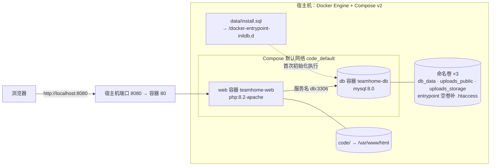

# 数聚 TeamHub 部署文档

> **课程**：互联网数据库开发　|　**团队**：M立方队　|　**编写**：钱泊瑜（2411282）　|　**日期**：2026-11-18

---

## 文档信息

| 项目 | 内容 |
| --- | --- |
| 文档名称 | 数聚 TeamHub 部署文档 |
| 项目名称 | 数聚 TeamHub——团队主页与内容管理系统 |
| 团队名称 | M立方队（M-Cubed） |
| 文档编号 | M3-DES-005 |
| 编写人 | 钱泊瑜（2411282） |
| 所属课程 | 互联网数据库开发 |
| 指导教师 | 乜鹏 |
| 编写日期 | 2026 年 11 月 18 日 |
| 适用读者 | 部署人员、演示负责人、后续维护者 |
| 文档范围 | 环境要求、一键部署、手动部署、数据库初始化与还原、配置、备份恢复、升级回滚、常见问题 |

### 术语与缩略语

| 术语 | 全称 / 英文 | 说明 |
| --- | --- | --- |
| Docker | — | 容器运行时，用于打包并运行应用与数据库。 |
| Compose | Docker Compose | 用一份 YAML 编排多个容器。 |
| 镜像 | Image | 容器的只读模板，本项目为 `php:8.2-apache` 与 `mysql:8.0`。 |
| 容器 | Container | 镜像的运行实例，如 `teamhome-web`、`teamhome-db`。 |
| 数据卷 | Volume | 持久化数据的存储，本项目为 `db_data`。 |
| 绑定挂载 | Bind Mount | 把宿主机目录挂进容器，如 `code/` → `/var/www/html`。 |
| DocumentRoot | — | Web 服务器的站点根目录，本项目应为 `public/`。 |
| DSN | Data Source Name | PDO 连接串，包含主机、端口、库名与字符集。 |
| initdb | Initialization | MySQL 容器首次启动时执行 `/docker-entrypoint-initdb.d/` 下的 SQL。 |
| 初始化数据 | Seed Data | 建库脚本预置的字典与管理员账号，不含业务内容。 |
| RTO / RPO | Recovery Time / Point Objective | 恢复所需时间 / 可容忍的数据丢失时间窗口。 |

### 关联文档

| 文档 | 用途 |
| --- | --- |
| 《数聚 TeamHub 需求文档》 | 数据与运维需求（FR-DB-*）。 |
| 《数聚 TeamHub 设计文档》 | 部署架构（第 9 章）、配置管理（2.6）、备份恢复（4.9）。 |
| 《数聚 TeamHub 实现文档》 | 编排文件、镜像与建库脚本的实现说明。 |
| 《数聚 TeamHub 用户手册》 | 部署完成后的使用说明。 |
| 《数聚 TeamHub 部署文档》 | 本文档：安装、配置、备份与还原。 |

> **阅读提示**：本文档按「装环境 → 部署代码 → 初始化数据库 → 录入内容」的顺序组织。仓库只提供源码与建库脚本，安装完成后数据库中是结构、字典与管理员账号，团队资料、成员、项目、公告等业务内容由管理员登录后台录入（见 6.5）。因此第 6 章既是数据库初始化章节，也是首次使用前的准备章节。

---

## 目录

**1 概述**

- [1.1 编写目的](#11-编写目的)
- [1.2 适用场景](#12-适用场景)
- [1.3 部署方式选型](#13-部署方式选型)
- [1.4 读者对象](#14-读者对象)
- [1.5 术语与缩略语](#15-术语与缩略语)

**2 环境要求**

- [2.1 硬件要求](#21-硬件要求)
- [2.2 软件要求](#22-软件要求)
- [2.3 PHP 扩展要求](#23-php-扩展要求)
- [2.4 端口与网络](#24-端口与网络)
- [2.5 目录与权限](#25-目录与权限)

**3 部署拓扑**

- [3.1 拓扑结构](#31-拓扑结构)
- [3.2 组件与端口](#32-组件与端口)

**4 一键部署**

- [4.1 前置检查](#41-前置检查)
- [4.2 获取代码](#42-获取代码)
- [4.3 准备环境变量](#43-准备环境变量)
- [4.4 启动服务](#44-启动服务)
- [4.5 首次启动做了什么](#45-首次启动做了什么)
- [4.6 验证部署](#46-验证部署)
- [4.7 停止与重置](#47-停止与重置)
- [4.8 访问路径与站点根](#48-访问路径与站点根)

**5 手动部署**

- [5.1 Windows 与 phpStudy](#51-windows-与-phpstudy)
- [5.2 Linux 与 Nginx](#52-linux-与-nginx)
- [5.3 数据库初始化](#53-数据库初始化)
- [5.4 站点根与重写规则](#54-站点根与重写规则)
- [5.5 验证手动部署](#55-验证手动部署)

**6 数据库初始化与还原**

- [6.1 执行初始化脚本](#61-执行初始化脚本)
- [6.2 校验结果](#62-校验结果)
- [6.3 重复执行与重置](#63-重复执行与重置)
- [6.4 从备份还原](#64-从备份还原)
- [6.5 初始化数据与首个管理员](#65-初始化数据与首个管理员)

**7 配置说明**

- [7.1 环境变量](#71-环境变量)
- [7.2 配置分层](#72-配置分层)
- [7.3 口令与密钥](#73-口令与密钥)
- [7.4 修改端口](#74-修改端口)
- [7.5 字符集与时区](#75-字符集与时区)

**8 备份与恢复**

- [8.1 备份策略](#81-备份策略)
- [8.2 备份命令](#82-备份命令)
- [8.3 恢复步骤](#83-恢复步骤)
- [8.4 恢复演练](#84-恢复演练)

**9 升级、回滚与监控**

- [9.1 发布流程](#91-发布流程)
- [9.2 回滚流程](#92-回滚流程)
- [9.3 监控清单](#93-监控清单)
- [9.4 日志位置](#94-日志位置)

**10 常见问题**

- [10.1 容器与镜像](#101-容器与镜像)
- [10.2 数据库与编码](#102-数据库与编码)
- [10.3 页面与权限](#103-页面与权限)

**11 云服务器部署实录（2026-11-09 阿里云 ECS）**

**12 部署检查清单**

- [12.1 交付前逐项核对](#121-交付前逐项核对)

**13 附录**

- [13.1 附录 A：命令速查](#131-附录-a命令速查)
- [13.2 附录 B：文件职责](#132-附录-b文件职责)
- [13.3 附录 C：待确认事项](#133-附录-c待确认事项)

---

## 1 概述

部署要解决的不是“能不能跑”，而是“换一台机器、换一个人，能不能在 30 分钟内还原出同一个站点”。

### 1.1 编写目的

**核心目的：** 本文档给出「数聚 TeamHub」从零开始到可访问站点的完整步骤：装什么、改哪个文件、执行哪条命令、怎么确认成功、失败后怎么退回。所有命令都可在 Windows（PowerShell / Git Bash）与 Ubuntu（bash）上直接使用。

- **对部署人员**：按章节顺序执行即可完成安装，不需要读源码。
- **对演示负责人**：掌握启停、重置与备份恢复，演示前可快速演练一次。
- **对使用者**：验证项目可在新环境一键还原，评估部署的可重复性。

### 1.2 适用场景

**表 1-1  部署场景**

| 场景 | 说明 | 推荐方式 |
| --- | --- | --- |
| 本地开发与调试 | 开发者自己的电脑，需要改代码即时生效 | 一键部署（第 4 章），源码卷挂载 |
| 现场演示 | 一台演示机，需稳定运行、可快速重置 | 一键部署（第 4 章），提前备份数据卷 |
| 校园服务器 | 已有 Docker 的 Ubuntu 服务器 | 一键部署（第 4 章），前置反向代理与 HTTPS |
| 无 Docker 环境 | 机房电脑、课程统一环境 | 手动部署（第 5 章），phpStudy 或 Nginx + PHP-FPM |

### 1.3 部署方式选型

**表 1-2  两种方式对比**

| 对比项 | 一键部署（Docker Compose） | 手动部署（LAMP / LNMP） |
| --- | --- | --- |
| 前置条件 | 安装 Docker 与 Compose v2 | 自行安装 PHP、MySQL、Web 服务器 |
| 安装耗时 | 首次约 5—10 分钟（含拉取镜像） | 约 20—40 分钟（取决于环境） |
| 环境一致性 | 高，开发与演示同一镜像 | 低，受本机版本影响 |
| 数据库初始化 | 容器首次启动自动导入 `data/install.sql` | 手工执行 `mysql < install.sql` |
| 升级方式 | 拉代码后 `up -d --build` | 覆盖代码目录 |

**结论：** 优先使用 Docker Compose；只有在无法安装 Docker 的机器上才走手动部署。两种方式共用同一份代码与同一份 `install.sql`，因此切换成本主要是数据库导入与站点根配置。

### 1.4 读者对象

**表 1-3  读者对象与阅读建议**

| 读者 | 关注重点 | 阅读建议 |
| --- | --- | --- |
| 首次部署的成员 | 一步步装起来、验证成功 | 按第 2 章 → 第 4 章顺序执行，最后用第 12 章清单核对 |
| 演示负责人 | 启停、重置、备份、快速恢复 | 重点阅读 4.7、第 8 章与 13.1 命令速查 |
| 服务器管理员 | 端口、权限、反向代理、HTTPS | 阅读 2.4、2.5、5.2 与 7.4 |
| 参数调整者 | 改端口、改口令、改库名 | 阅读第 7 章并在修改后重新执行第 4.6 验证 |

### 1.5 术语与缩略语

本文档使用的 Docker、Compose、镜像、容器、数据卷、绑定挂载、DocumentRoot、DSN、initdb、RTO/RPO 等术语，已在文档信息页的「术语与缩略语」表中统一解释。命令行中的占位符约定：`<项目目录>` 表示仓库根目录，`<code 目录>` 表示其中的 `code/` 子目录。

## 2 环境要求

环境要求按“最低可运行”和“推荐配置”两档给出，课程演示机器一般远高于最低要求。

### 2.1 硬件要求

**表 2-1  硬件要求**

| 项 | 最低 | 推荐 | 说明 |
| --- | --- | --- | --- |
| CPU | 2 核 | 4 核 | 首次构建镜像与导入数据库时占用较高。 |
| 内存 | 4 GB | 8 GB | Docker Desktop 建议分配 4 GB 以上给容器。 |
| 磁盘 | 10 GB 可用 | 20 GB 可用 | 镜像约 1 GB，数据库与上传文件随使用增长。 |
| 网络 | 能拉取 Docker 镜像 | 稳定的宽带 | 拉取镜像失败时可配置镜像加速源。 |

### 2.2 软件要求

**表 2-2  软件要求**

| 内容 | 版本 | 用途 | 检查命令 |
| --- | --- | --- | --- |
| Docker Engine | 24+ | 运行容器 | `docker --version` |
| Docker Compose | v2（`docker compose` 子命令） | 编排 web 与 db | `docker compose version` |
| Git | 2.x | 拉取代码 | `git --version` |
| 浏览器 | Chrome/Edge/Firefox/Safari 近两版 | 访问站点 | — |

手动部署额外需要以下组件，一键部署无需在宿主机安装：

**表 2-3  手动部署额外依赖**

| 内容 | 版本 | 说明 |
| --- | --- | --- |
| PHP | 8.1+，推荐 8.2 | 需与镜像版本接近，避免语法差异。 |
| MySQL | 8.0 | 需支持 `utf8mb4`、窗口函数与 CHECK 约束。 |
| Apache | 2.4 | 需启用 `mod_rewrite`（phpStudy 默认包含）。 |
| Nginx | 1.24+（可选） | 作为 Web 服务器或反向代理。 |
| phpMyAdmin / Navicat（可选） | 任意 | 图形化查看数据库，非必需。 |

### 2.3 PHP 扩展要求

**表 2-4  PHP 扩展**

| 扩展 | 必需 | 用途 | 缺失时的表现 |
| --- | --- | --- | --- |
| `pdo_mysql` | 是 | 数据库连接 | 页面 500，日志提示 could not find driver。 |
| `mbstring` | 是 | 中文长度与编码处理 | 中文校验、截断异常。 |
| `fileinfo` | 是 | 上传文件真实 MIME 校验 | 上传功能报错。 |
| `gd` | 否 | 当前实现未使用 GD 处理图片（上传为原图存储，展示由 CSS 缩放） | — |
| `openssl` | 是 | 随机数与加密 | 会话令牌生成失败。 |
| `json` | 是 | JSON 接口 | 图表接口报错（PHP 8 默认内置）。 |
| `intl` | 否 | 日期格式化 | 日期显示为默认格式。 |
| `zip` | 否 | 批量导出资源 | 导出功能不可用。 |

Docker 镜像已内置 `mysqli` 与 `pdo_mysql`，其余扩展可在 `code/Dockerfile` 中按需补充。

### 2.4 端口与网络

**表 2-5  端口占用**

| 端口 | 归属 | 是否对外 | 说明 |
| --- | --- | --- | --- |
| 8080 | web 容器 80 → 宿主机 | 是 | 浏览器访问入口；被占用时按 7.4 修改。 |
| 80 / 443 | 可选反向代理（Nginx/Caddy） | 是 | 生产环境建议经反代暴露，做 HTTPS 终止。 |
| 3306 | db 容器 | **否** | 仅 Compose 内网可达，不映射到宿主机。 |

web 容器通过服务名 `db:3306` 访问数据库，**不能写 `127.0.0.1`**：容器内的 `127.0.0.1` 指向容器自身，而不是数据库容器。

### 2.5 目录与权限

**表 2-6  目录与权限**

| 目录 / 文件 | 容器内路径 | 权限要求 | 说明 |
| --- | --- | --- | --- |
| `<code 目录>/` | `/var/www/html` | 宿主机可读写 | 源码根，开发期以卷挂载方式进入容器 |
| `<code 目录>/public/` | `/var/www/html/public` | 只读 | 唯一 Web 根，静态资源在 `static/` 下 |
| `<code 目录>/data/` | `/var/www/html/data` | 只读 | 含 `install.sql`、`team/`、`personal/` |
| `<code 目录>/runtime/` | `/var/www/html/runtime` | 容器内可写 | 日志与缓存；已在 `.gitignore` 中忽略 |
| `<code 目录>/storage/` | `/var/www/html/storage` | 容器内可写 | 上传文件、会话；生产环境需持久化 |
| `<code 目录>/.env` | 由应用读取 | 0600 / 0640 | 含数据库口令与 `APP_KEY`，**不得提交 Git** |

## 3 部署拓扑

拓扑很简洁：浏览器 → 宿主机 8080 → web 容器 → db 容器，数据落在命名卷里。

### 3.1 拓扑结构



拓扑由 `code/docker-compose.yml` 定义，两个服务、一个命名卷、一个默认网络，没有额外的负载均衡或缓存组件——这是课程场景下的有意取舍：组件越少，越容易在演示机上还原。

### 3.2 组件与端口

**表 3-1  组件清单**

| 组件 | 镜像 / 构建 | 容器名 | 端口 | 持久化 | 说明 |
| --- | --- | --- | --- | --- | --- |
| web | `code/Dockerfile`（`php:8.2-apache`） | `teamhome-web` | `8080:80` | 源码卷挂载 | 站点入口；`restart: unless-stopped` |
| db | `mysql:8.0` | `teamhome-db` | 无对外映射 | 命名卷 `db_data` | 健康检查 `mysqladmin ping`；首启导入 SQL |
| 网络 | Compose 默认 bridge | `code_default` | — | — | web 通过 `db:3306` 访问 db |

Web 根为 `public/`：`app/`、`data/`、`storage/` 都在 DocumentRoot 之外，浏览器无法直接访问；上传文件与作业下载都由控制器输出，不暴露磁盘路径。

## 4 一键部署

以下命令在仓库根目录执行，Windows 可用 PowerShell 或 Git Bash，Ubuntu 用 bash。

### 4.1 前置检查

**代码 4-1  检查 Docker 环境**

```bash
docker --version                 # 期望：Docker version 24.x 及以上
docker compose version           # 期望：Docker Compose version v2.x
docker info                      # 期望：能正常输出 Server 信息（说明 Docker 已启动）
```

三条命令任意一条失败，先解决 Docker 安装或启动问题，不要继续后续步骤：Docker Desktop 未启动时，`docker compose up` 会报 `cannot connect to the Docker daemon`。

### 4.2 获取代码

**代码 4-2  克隆或解压代码**

```bash
git clone https://github.com/mon3trteam/nku2026DBdev.git
cd nku2026DBdev/code
```

若演示机无法访问 GitHub，可在能联网的机器上打包仓库（`git archive` 或压缩后排除 `.git`），拷贝到目标机器解压，再进入 `code/` 目录。

### 4.3 准备环境变量

Compose 使用 `code/.env` 中的变量覆盖默认值，按 7.1 的清单创建该文件即可。

**代码 4-3  创建 .env（示例值，部署时替换）**

```bash
# 在 code/ 目录下创建 .env
cat > .env <<'EOF'
# 完整变量说明见 7.1 与 code/.env.example
MYSQL_ROOT_PASSWORD=请替换为强随机口令
MYSQL_PASSWORD=请替换为强随机口令
WEB_PORT=8018
APP_KEY=请粘贴 openssl rand -hex 32 的输出

# ---- 应用 ----
APP_ENV=production
APP_DEBUG=false
APP_URL=http://localhost:8080
APP_KEY=请替换为32字节随机串
DB_HOST=db
DB_PORT=3306
DB_DATABASE=team_home
DB_USERNAME=team
DB_PASSWORD=请替换为强随机口令
SESSION_LIFETIME=1800
UPLOAD_MAX_MB=10
EOF
```

Windows PowerShell 中可用 `New-Item .env` 建文件后粘贴同样内容。注意三点：`DB_HOST` 必须是 `db` 而不是 `127.0.0.1`；`MYSQL_DATABASE` 与 `DB_DATABASE`、`MYSQL_USER` 与 `DB_USERNAME`、`MYSQL_PASSWORD` 与 `DB_PASSWORD` 必须两两一致；`.env` 不得提交到 Git。

### 4.4 启动服务

**代码 4-4  构建并启动**

```bash
docker compose up -d --build
```

首次执行会依次完成：拉取 `mysql:8.0` 基础镜像 → 基于 `code/Dockerfile` 构建 web 镜像（安装 `mysqli`、`pdo_mysql`，启用 `mod_rewrite`，写入站点根配置）→ 创建网络 `code_default` → 创建数据卷 `code_db_data` → 启动 db 并等待健康检查通过 → 启动 web → db 首次初始化时自动执行 `data/install.sql`。

**表 4-1  启动输出与含义**

| 输出 | 含义 |
| --- | --- |
| `Network code_default Created` | 网络已创建，首次启动才有。 |
| `Volume "code_db_data" Created` | 数据卷已创建，首次启动才有。 |
| `Container teamhome-db Started` | 数据库容器已启动，尚未就绪。 |
| `Container teamhome-web Started` | web 容器已启动。 |
| `failed to solve` / `ERROR` | 镜像构建失败，查看报错行并检查 Dockerfile。 |

### 4.5 首次启动做了什么

理解首次启动的三个动作，能解释大部分“为什么改了 SQL 没生效”的问题：

1. **建库建账号**：`MYSQL_DATABASE`、`MYSQL_USER`、`MYSQL_PASSWORD` 只在数据卷为空时生效，创建 `team_home` 库与应用账号 `team`。
2. **导入结构与字典**：`code/data/install.sql` 以只读方式挂载到 `/docker-entrypoint-initdb.d/`，MySQL 容器首次初始化时自动执行，建立 21 张表、3 个视图、索引与基础字典；业务数据不在此预置。
3. **健康检查门控**：web 容器等待 db 健康检查通过后才启动，避免页面先于数据库就绪而报 500。

> **改 SQL 后必须重建卷**
>
> 修改 `data/install.sql` 后，仅执行 `docker compose restart` 不会重新导入。开发环境应使用 `docker compose down -v` 删除数据卷后重新 `up -d`（详见 4.7）；生产环境只允许用迁移脚本增量变更，禁止删卷。

### 4.6 验证部署

**代码 4-5  验证命令**

```bash
docker compose ps                       # 期望：db 为 healthy，web 为 running
docker compose logs --tail=50 web       # 期望：无 PHP Fatal error
curl -I http://localhost:8080/          # 期望：HTTP/1.1 200
docker compose exec db mysql -uteam -p -e "USE team_home; SHOW TABLES;"   # 期望：21 张表
```

浏览器访问 `http://localhost:8080/`，应看到首页；若部署时未启用站点根配置，则需访问 `http://localhost:8080/public/`（见 4.8）。

**表 4-2  验证清单**

| 检查项 | 通过标准 | 失败时先看 |
| --- | --- | --- |
| 容器状态 | 两个容器均为 `Up`，db 为 `healthy` | `docker compose ps`、`logs db` |
| 端口可达 | 宿主机可访问 8080 | 端口占用（10.1） |
| 入口文件 | 首页返回 200 | `logs web` 中的 PHP 错误 |
| 数据库连接 | 容器内 `mysqladmin ping` 成功 | db 健康检查日志 |
| 业务表 | `SHOW TABLES` 返回 21 张 | 6.1、6.2 |

### 4.7 停止与重置

**代码 4-6  常用操作**

```bash
docker compose stop              # 停止容器，保留容器与数据
docker compose start             # 启动已停止的容器
docker compose restart web       # 只重启 web（改 PHP 代码一般不需要）
docker compose down              # 停止并删除容器与网络，保留数据卷
docker compose down -v           # 连同数据卷一起删除（数据将丢失）
```

重置流程（**仅开发与演示环境**）：

1. 确认不再需要当前数据：`docker compose exec db mysql -uteam -p -e "SELECT COUNT(*) FROM users"`。
2. 执行 `docker compose down -v`，删除 `code_db_data`。
3. 执行 `docker compose up -d --build`，数据库将按 `install.sql` 重新初始化，回到“结构 + 字典 + 管理员”的初始状态。

### 4.8 访问路径与站点根

站点根指向 `public/` 是部署的关键一步：配置正确时直接用 `http://localhost:8080/` 访问；沿用默认站点根时，入口文件位于 `public/` 子目录，需要访问 `http://localhost:8080/public/`。

**表 4-3  两种访问方式**

| 部署配置 | 访问地址 | 说明 |
| --- | --- | --- |
| 已启用站点根配置（推荐） | `http://localhost:8080/` | `DocumentRoot` 指向 `/var/www/html/public` |
| 沿用 Apache 默认站点根 | `http://localhost:8080/public/` | 入口文件在 `public/` 下；`data/` 等目录仍不可直接访问 |

配置方式有两种，任选其一即可：

1. **镜像内配置**：在 `code/Dockerfile` 中把 `apache-site.conf` 复制到 `/etc/apache2/sites-available/000-default.conf`，其 `DocumentRoot` 设为 `/var/www/html/public`，随后 `docker compose up -d --build`。
2. **宿主机覆盖**：在 `docker-compose.yml` 的 web 服务下增加挂载 `- ./apache-site.conf:/etc/apache2/sites-available/000-default.conf:ro`，修改后同样重建容器。

无论采用哪种方式，都要验证敏感路径不可直接下载：`curl -I http://localhost:8080/data/install.sql` 应返回 403 或 404。

## 5 手动部署

无法安装 Docker 时使用本节流程。手动部署用于无 Docker 环境，保证在任意机器上可运行。

> **脚本备选**：仓库提供 `code/install.sh`（Linux/macOS）与 `code/install.bat`（Windows），会自动建库、导入 `install.sql` 并提示口令设置，优先于下列手工步骤使用；FORCE=1 可跳过二次确认。

### 5.0 使用一键安装脚本

### 5.1 Windows 与 phpStudy

1. 安装 phpStudy 或 XAMPP，选择 PHP 8.1+ 与 MySQL 8.0 组件，启动 Apache 与 MySQL。
2. 在 `php.ini` 中确认 `pdo_mysql`、`mbstring`、`fileinfo`、`gd`、`openssl` 已启用（取消行首 `;`），保存后重启 Apache。
3. 把仓库 `code/` 目录放到站点目录下，例如 `D:\phpstudy_pro\WWW\nku2026DBdev\code`。
4. 打开 phpStudy 的「网站」设置，把站点根目录指向 `code\public`（而不是 `code\`）。
5. 在 phpMyAdmin 中新建数据库 `team_home`，字符集选 `utf8mb4`，排序规则 `utf8mb4_0900_ai_ci`。
6. 导入数据库：在 phpMyAdmin 中选择该库 →「导入」→ 选择 `code\data\install.sql` → 执行。
7. 浏览器访问 `http://localhost/`（或你配置的域名），确认页面可打开。
8. 把数据库连接参数写入 `.env`（或 `code\app\config.local.php`），指向本机 MySQL 的 `team` 账号。

> **站点根最容易配错**
>
> 若把站点根指到 `code\`，浏览器可以直接下载 `data/install.sql`、`data/team/` 下的 PDF，属于信息泄露。必须指到 `code\public`，并确认 `http://localhost/data/install.sql` 返回 404。

### 5.2 Linux 与 Nginx

**代码 5-1  安装依赖（Ubuntu 22.04）**

```bash
sudo apt update
sudo apt install -y nginx mysql-server php8.2-fpm php8.2-mysql \
  php8.2-mbstring php8.2-xml php8.2-gd php8.2-curl php8.2-zip
sudo systemctl enable --now nginx mysql php8.2-fpm
```

**代码 5-2  Nginx 站点配置**

```nginx
server {
    listen 80;
    server_name teamhub.local;
    root /opt/teamhub/code/public;      # 必须指向 public
    index index.php;

    location / {
        try_files $uri $uri/ /index.php?$query_string;
    }

    location ~ \.php$ {
        include snippets/fastcgi-php.conf;
        fastcgi_pass unix:/run/php/php8.2-fpm.sock;
    }

    # 禁止访问 data 与 storage
    location ~ ^/(data|storage|app)/ {
        deny all;
    }
}
```

保存后执行 `sudo nginx -t && sudo systemctl reload nginx`。若入口仍使用 `/?r=控制器/动作` 形态，Nginx 只需 `index index.php` 即可，不需要额外的重写规则；升级为 PATH_INFO 路由后再依赖 `try_files`。

### 5.3 数据库初始化

**代码 5-3  建库并导入**

```bash
sudo mysql -e "CREATE DATABASE IF NOT EXISTS team_home \
  DEFAULT CHARACTER SET utf8mb4 COLLATE utf8mb4_0900_ai_ci;"
sudo mysql -e "CREATE USER IF NOT EXISTS 'team'@'localhost' IDENTIFIED BY '替换为强口令';"
sudo mysql -e "GRANT ALL PRIVILEGES ON team_home.* TO 'team'@'localhost'; FLUSH PRIVILEGES;"
sudo mysql team_home < /opt/teamhub/code/data/install.sql
```

应用连接数据库时使用 `team` 账号，不使用 `root`：最小权限原则，且避免误操作影响其它库。

### 5.4 站点根与重写规则

- **Apache**：站点根指向 `code/public`，开启 `mod_rewrite` 与 `AllowOverride All`；若使用 PATH_INFO 路由，需在 `public/.htaccess` 中加 `RewriteRule ^ index.php [L]`。
- **Nginx**：见 5.2 的 `try_files`。
- **PHP 内置服务器**（仅本地调试）：`cd code/public && php -S localhost:8080`。
- 无论哪种方式，都必须验证 `data/` 与 `app/` 不可直接访问。

### 5.5 验证手动部署

**代码 5-4  验证命令**

```bash
curl -I http://localhost/                      # 期望 200
curl -I http://localhost/data/install.sql      # 期望 403 或 404（不可下载！）
mysql -uteam -p team_home -e "SHOW TABLES;"    # 期望列出 21 张表
php -v                                         # 期望 8.1 以上
php -m | grep -E "pdo_mysql|mbstring|fileinfo|gd"
```

## 6 数据库初始化与还原

数据库的唯一真源是 `code/data/install.sql`：所有表结构改动都写入该文件，并在干净库上验证可完整还原。

### 6.1 执行初始化脚本

**代码 6-1  三种执行方式**

```bash
# 方式一：Docker 内执行（推荐，避免版本差异）
docker compose exec -T db mysql -uteam -p"$MYSQL_PASSWORD" team_home < code/data/install.sql

# 方式二：宿主机有 mysql 客户端
mysql -h 127.0.0.1 -P 3306 -uteam -p team_home < code/data/install.sql

# 方式三：phpMyAdmin 导入（选择目标库后导入文件）
```

脚本按外键依赖顺序建表，先 `SET FOREIGN_KEY_CHECKS = 0`，建表与字典写入完成后再置回 `1`，因此单次导入不会因外键顺序失败。

### 6.2 校验结果

**代码 6-2  校验 SQL**

```sql
-- 表数量：应为 21（作业要求 > 10）
SELECT COUNT(*) AS table_count FROM information_schema.tables
WHERE table_schema = 'team_home' AND table_type = 'BASE TABLE';

-- 视图数量：应为 3
SELECT COUNT(*) AS view_count FROM information_schema.views
WHERE table_schema = 'team_home';

-- 字符集：应全部为 utf8mb4
SELECT table_name, table_collation FROM information_schema.tables
WHERE table_schema = 'team_home';
```

### 6.3 重复执行与重置

`install.sql` 开头会 `DROP` 同名视图与表再重建——这不是幂等脚本，**重复导入会清空全部业务数据**；其价值在于空库可一次装好、且重复执行结果可预期。验证方法是连续执行两次，比较表数量与字典行数一致。

**代码 6-3  重复执行验证**

```bash
mysql -uteam -p team_home < code/data/install.sql   # 第一次
mysql -uteam -p team_home < code/data/install.sql   # 第二次
mysql -uteam -p team_home -e "SELECT COUNT(*) FROM roles;"   # 期望仍为 3
```

因此**只允许在开发与演示环境重复执行**；生产环境用数据包或增量迁移变更，执行前先按 6.4 备份。

### 6.4 从备份还原

还原顺序固定：停应用 → 恢复数据库 → 恢复上传文件 → 恢复配置 → 迁移 → 清缓存 → 启动 → 冒烟。具体命令见第 8 章。

### 6.5 初始化数据与首个管理员

安装完成后，数据库处于“结构 + 字典 + 管理员”的状态，这是设计的起点：仓库不携带任何业务数据，内容全部由页面录入生成。

**表 6-1  初始化数据清单**

| 数据 | 内容 | 用途 |
| --- | --- | --- |
| 角色 | 超级管理员、编辑、成员 | 账号权限的基础 |
| 权限码与角色权限 | 功能级权限与角色映射 | 后台菜单与接口鉴权 |
| 管理员账号 | 用户名 + bcrypt 散列 + `must_change_password=1` | 首次登录后必须改密 |
| 技能字典 | 按分类的示例技能 | 成员资料中可选择 |
| 团队资料 | `team_profile` 单例 `id=1` | 首页与团队介绍的基础信息 |
| 站点设置 | 站点名、SEO、页脚、维护模式 | 全局文案与开关 |

**首次登录后的录入顺序**（与《用户手册》5.1 一致）：

1. 用初始管理员账号登录 `/login`，按提示修改密码。
2. 进入后台「团队资料」填写团队名称、口号、故事与联系方式。
3. 进入「成员管理」创建成员档案，需要登录的成员同时创建账号并告知临时密码。
4. 进入「项目管理」创建项目并关联成员。
5. 进入「公告管理」发布首条公告，确认首页「最新动态」出现内容。
6. 进入「资源管理」上传团队文档与个人作业，前台下载中心即可看到条目。
7. 成员登录后完善个人资料、头像与技能。

> **为什么安装后是空站点**
>
> 表结构由源码提供，内容属于运行期产生的数据。这样仓库保持纯源码，任何人在任何机器上部署后录入的内容互不干扰；也意味着演示前必须完成上述录入，否则前台只有空状态。

### 6.5 初始账号（模板种子）

初始账号、角色与课程演示口令统一写在 `code/data/install.sql` 文件头：

- `admin`：超级管理员，`must_change_password=1`，首次登录必须改密
- `editor`：编辑，可管理内容，不能管理用户/站点设置
- `member1` ~ `member4`：成员账号（与四个成员占位档案绑定）

这些是**模板初始账号**，不是生产账号。首次登录强制改密；正式使用前请确认全部口令已修改，且不要把真实口令写入仓库或文档。member 账号可由管理员在「用户与角色」中改名（如改为学号）后分配给成员。

## 7 配置说明

配置分三层：`.env` 存环境相关密钥；代码内配置存默认值；数据库 `site_settings` 存管理员可改的运营文案。三者不要混用。

### 7.1 环境变量

**表 7-1  环境变量清单（实测口径，与 `config/database.php`、`config/app.php`、compose 一致）**

| 变量 | 默认值 | 使用方 | 说明 |
| --- | --- | --- | --- |
| `DB_HOST` | `db` | 应用 | Docker 内为服务名；手动部署用 `127.0.0.1`。 |
| `DB_PORT` | `3306` | 应用 | MySQL 端口。 |
| `DB_DATABASE` / `DB_NAME` | `team_home` | 应用 | 数据库名。 |
| `DB_USERNAME` / `DB_USER` | `team` | 应用 | 数据库账号。 |
| `DB_PASSWORD` / `DB_PASS` | `team123456` | 应用 | 演示默认值，生产必须覆盖。 |
| `APP_KEY` | 本地演示串 | 应用 | IP/会话 HMAC 密钥，生产必须覆盖。 |
| `APP_DEBUG` | `false` | 应用 | `true` 输出详细错误，仅限本地排障。 |
| `APP_BASE` | 自动识别 | 应用 | 子目录部署时设 `/teamhub` 等前缀。 |
| `SESSION_LIFETIME` | `1800` | 应用 | 会话空闲过期秒数。 |
| `UPLOAD_MAX_MB` | `10` | 应用 | 业务侧上传上限（MB）。 |
| `WEB_PORT` | `8080` | compose | 宿主机映射端口；云端设 `80`。 |
| `HEALTHZ_TOKEN` | 未设（探活公开） | 应用 | 设置后 `/healthz` 需带 `?token=` 校验。 |
| `MYSQL_ROOT_PASSWORD` | 仅演示默认 | db | 仅数据卷首次初始化生效。 |
| `MYSQL_PASSWORD` | 仅演示默认 | db + web | 同时作为应用的 `DB_PASSWORD`。 |

> `MYSQL_DATABASE`、`MYSQL_USER` 在 compose 中固定为 `team_home`、`team`，与应用配置保持一致；修改时需同步 `docker-compose.yml`、`.env` 与 `install.sql`。`APP_ENV`、`APP_URL` 并非代码读取的变量（仅 `APP_DEBUG`、`APP_KEY`、`APP_BASE` 生效）。

### 7.2 配置分层

**表 7-2  配置落点**

| 配置类型 | 位置 | 示例 | 是否入库 | 说明 |
| --- | --- | --- | --- | --- |
| 密钥与连接信息 | `code/.env` | 数据库口令、`APP_KEY` | 否 | 已在 `.gitignore` 中忽略，禁止提交 |
| 本地个人覆盖 | `code/app/config.local.php` | 本机数据库地址 | 否 | 已忽略 |
| 结构化默认值 | 代码内常量 | 每页条数、权限码、上传上限 | 是 | 与设计文档 2.6 对应 |
| 运营配置 | 数据库 `site_settings` | 站点名、页脚、维护模式 | 是 | 管理员在后台修改，缓存 5 分钟 |

### 7.3 口令与密钥

1. **默认口令必须覆盖**：`docker-compose.yml` 中的 `MYSQL_ROOT_PASSWORD`、`MYSQL_PASSWORD` 默认值只用于本地演示，创建 `.env` 后即被覆盖；上线前逐项核对第 11 章清单。
2. **生成强口令**：`openssl rand -base64 24`（Linux/macOS）或 PowerShell `[Convert]::ToBase64String((1..24|%{Get-Random -Max 256}))`。
3. **数据库口令一致性**：`MYSQL_PASSWORD` 与 `DB_PASSWORD` 必须相同，否则应用连接被拒。
4. **`APP_KEY` 轮换风险**：轮换会使 IP 哈希与已签名数据失效，需先评估再做。
5. **禁止入库**：口令、`.env`、备份文件、含口令的截图都不能进入 Git 历史。

### 7.4 修改端口

宿主机 8080 被占用时，修改 `code/docker-compose.yml` 中 web 的端口映射：

**代码 7-1  修改端口**

```yaml
services:
  web:
    ports:
      - "8081:80"      # 宿主机 8081 → 容器 80
```

修改后执行 `docker compose up -d` 生效。若同时修改了数据库口令，需要 `docker compose down -v` 重建数据卷才会重新初始化；只改端口则无需删卷。

### 7.5 字符集与时区

- **字符集**：库、表、字段与连接统一 `utf8mb4`，排序规则 `utf8mb4_0900_ai_ci`；连接串必须带 `charset=utf8mb4`，否则中文可能变乱码。
- **时区**：应用层统一使用 Asia/Shanghai；生产环境建议在 compose 中为 db 设置 `TZ=Asia/Shanghai`，并保证 PHP 的 `date.timezone` 一致。
- **容器时间**：若日志时间与本地差 8 小时，检查宿主机与容器时区设置，不要通过修改业务代码“补时差”。

### 7.3 安全基线（实现位置清单）

| 措施 | 实现位置 | 说明 |
| --- | --- | --- |
| Web 根隔离 | `apache-site.conf` | DocumentRoot 指向 `public/`，源码/配置/SQL 不可下载 |
| 上传目录禁执行 | `public/static/uploads/.htaccess` | 禁止 `php/phtml/phar` 等脚本 |
| 安全响应头 | `apache-site.conf` | `X-Content-Type-Options`、`X-Frame-Options`、`Referrer-Policy`、`Permissions-Policy` |
| 隐藏 PHP 版本 | `apache-site.conf` | `expose_php = Off` |
| 上传大小 | `uploads.ini` | 单文件 12 MB、表单 16 MB，业务侧 10 MB |
| 密码存储 | `install.sql` / `Auth` | bcrypt 散列，不存明文 |
| CSRF | 表单 `_token` | 写操作校验一次性令牌 |
| 会话 | `Auth::boot()` | `HttpOnly`、`SameSite=Lax`、HTTPS 时 `Secure` |
| 登录防爆破 | `AuthModel` | 失败次数锁定 + IP HMAC 记录 |
| 下载防穿越 | `ResourceModel` | 过滤 `../`，文件限制在 `data/team`、`data/personal` |
| 原生密码按钮抑制 | `components.css` | 隐藏 Edge `::-ms-reveal`，统一自定义眼睛按钮 |

## 8 备份与恢复

备份的目标不是“有文件”，而是“恢复后能打开页面、数据一致”。

### 8.1 备份策略

**表 8-1  备份策略**

| 对象 | 频率 | 保留 | 位置 | 说明 |
| --- | --- | --- | --- | --- |
| 数据库逻辑备份 | 每日 02:00 | 7 天 | Web 根之外 | `mysqldump` + gzip |
| 上传文件与配置 | 每周全量 + 每日增量 | 2 周 | Web 根之外 | `storage/` 与 `.env` |
| 数据卷整体快照 | 演示前一次 | 演示结束 | 宿主机 | 应急回退用 |
| 异地副本 | 每周 | 1 份 | 网盘或另一台机器 | 防单机损坏 |

### 8.2 备份命令

**代码 8-1  容器化备份**

```bash
# 1) 逻辑备份：从 db 容器导出并压缩到宿主机
docker compose exec -T db sh -c \
  'exec mysqldump -uroot -p"$MYSQL_ROOT_PASSWORD" --single-transaction \
   --routines --triggers --default-character-set=utf8mb4 team_home' \
  | gzip > team_home_$(date +%F).sql.gz

# 2) 上传文件与配置备份
tar -czf storage_$(date +%F).tar.gz code/storage code/.env

# 3) 数据卷整体打包（低峰期执行）
docker run --rm -v code_db_data:/data -v "$PWD":/backup alpine \
  tar -czf /backup/db_data_$(date +%F).tar.gz -C /data .

# 4) 校验与清理
sha256sum team_home_$(date +%F).sql.gz > team_home_$(date +%F).sha256
```

备份文件不得放在 `code/public/` 下，否则可被直接下载。

### 8.3 恢复步骤

**代码 8-2  恢复流程**

```bash
# 1) 停 web，避免恢复过程中有写入
docker compose stop web

# 2) 恢复数据库
gunzip -c team_home_2026-11-18.sql.gz | docker compose exec -T db \
  sh -c 'exec mysql -uroot -p"$MYSQL_ROOT_PASSWORD" team_home'

# 3) 恢复上传文件与配置
tar -xzf storage_2026-11-18.tar.gz -C ./

# 4) 启动并验证
docker compose start web
curl -I http://localhost:8080/
```

若使用数据卷快照恢复，则先 `docker compose down`，再 `docker run --rm -v code_db_data:/data -v "$PWD":/backup alpine tar -xzf /backup/db_data_日期.tar.gz -C /data`，最后 `docker compose up -d`。

### 8.4 恢复演练

演示前至少完成一次恢复演练，并记录结果：恢复开始时间、恢复完成时间、核对项（表数量、成员数、最近留言、上传文件可访问）、总耗时。目标 RTO ≤ 30 分钟、RPO ≤ 24 小时。演练记录写入本表，便于复盘时展示“部署可还原”。

**表 8-2  恢复演练记录（模板）**

| 日期 | 执行人 | 备份文件 | 恢复耗时 | 核对结果 | 备注 |
| --- | --- | --- | --- | --- | --- |
| 待填 | 待定 | 待填 | 待填 | 待填 | 待填 |

## 9 升级、回滚与监控

升级的原则是：先备份、再换代码、最后验证，任何一步失败都能退回去。

### 9.1 发布流程

1. **备份**：按 8.2 做一次数据库与文件备份，记录文件名。
2. **拉代码**：`cd <项目目录> && git fetch --all && git checkout <发布 tag 或提交>`。
3. **更新配置**：比对 `.env` 是否有新增变量，按 7.1 补齐。
4. **重建镜像**：`cd code && docker compose up -d --build`。
5. **执行迁移**：若本次包含表结构变更，按 6.1 导入或执行迁移脚本。
6. **冒烟验证**：访问首页、登录、后台看板、下载中心，确认无 500。
7. **观察**：查看 10 分钟内的 `docker compose logs -f web`，确认无异常堆叠。

### 9.2 回滚流程

1. 切回上一个稳定提交或 tag：`git checkout <上一个 tag>`。
2. 重建并启动：`docker compose up -d --build`。
3. 若本次升级改动了表结构，按 8.3 恢复升级前的数据库备份。
4. 重新执行冒烟验证。

镜像构建失败或冒烟不通过时，**保留旧容器与旧数据卷**，不要执行 `docker compose down -v`。

### 9.3 监控清单

**表 9-1  最小监控清单**

| 监控项 | 阈值 | 检查方式 | 异常时动作 |
| --- | --- | --- | --- |
| 容器状态 | 非 running / 反复重启 | `docker compose ps` | 看 `logs` 中的退出原因 |
| 数据库健康 | 健康检查连续 3 次失败 | `docker compose ps` 的 health 列 | 检查磁盘、内存与 db 日志 |
| 页面可用性 | 首页非 200 | `curl -I http://localhost:8080/` | 查 `logs web` |
| 磁盘空间 | 剩余 < 20% | `df -h`、`docker system df` | 清理旧镜像与日志 |
| 5xx 比例 | > 1% / 5 分钟 | `logs web` 中的状态码 | 按请求时间定位异常堆栈 |
| 备份时效 | 超过 24 小时未备份 | 检查备份目录 | 立即补备并排查定时任务 |

### 9.4 日志位置

**表 9-2  日志位置**

| 日志 | 位置 | 查看命令 |
| --- | --- | --- |
| Apache 访问日志 | 容器内 `/var/log/apache2/access.log` | `docker compose exec web tail -f /var/log/apache2/access.log` |
| Apache 错误日志 | 容器内 `/var/log/apache2/error.log` | `docker compose exec web tail -f /var/log/apache2/error.log` |
| PHP 错误 | 同上或 `code/runtime/logs/` | `docker compose logs -f web` |
| MySQL 日志 | 容器 stdout | `docker compose logs -f db` |
| 应用业务日志 | `code/runtime/logs/app-YYYY-MM-DD.log` | 直接在宿主机查看 |

## 10 常见问题

以下问题按“容器 → 数据库 → 页面”的顺序排列，先定位层次，再查具体原因。

### 10.1 容器与镜像

**表 10-1  容器与镜像问题**

| 现象 | 原因 | 解决方法 |
| --- | --- | --- |
| `docker: command not found` | 未安装 Docker 或未加入 PATH | 安装 Docker Desktop / Docker Engine 后重开终端。 |
| `Cannot connect to the Docker daemon` | Docker 服务未启动 | 启动 Docker Desktop 或 `sudo systemctl start docker`。 |
| `port 8080 is already allocated` | 端口被其它程序占用 | 按 7.4 改成 8081，或关掉占用端口的程序。 |
| 拉取镜像超时 / `TLS handshake timeout` | 网络无法访问镜像仓库 | 配置镜像加速源（如 `docker.m.daocloud.io`）后重试。 |
| `failed to solve` 构建失败 | Dockerfile 语法或扩展安装失败 | 看报错行；多为网络问题，重试或换镜像源。 |
| 容器反复重启 | 启动命令或配置错误 | `docker compose logs <服务名>` 查看退出码与日志。 |
| db 一直 `unhealthy` | 初始化未完成或磁盘不足 | 等待 1—2 分钟；仍失败看 `logs db`。 |

### 10.2 数据库与编码

**表 10-2  数据库与编码问题**

| 现象 | 原因 | 解决方法 |
| --- | --- | --- |
| `SQLSTATE[HY000] [2002] Connection refused` | `DB_HOST` 写成 `127.0.0.1` | 容器内改为 `db`；手动部署才用 `127.0.0.1`。 |
| `Access denied for user 'team'` | 口令不一致或账号不存在 | 核对 `MYSQL_PASSWORD` 与 `DB_PASSWORD`；必要时重建数据卷。 |
| 页面查询报 `Table doesn't exist` | 数据库未执行初始化脚本 | 按 6.1 导入 `install.sql` 后重试。 |
| 改了 SQL 但没生效 | `initdb` 只在数据卷为空时执行 | `docker compose down -v` 后重新 `up -d`。 |
| 中文显示为 `???` 或乱码 | 连接未指定 `utf8mb4` | 连接串加 `charset=utf8mb4`；检查库表排序规则。 |
| 导入时报外键错误 | 表顺序不对或未关闭外键检查 | 使用 `install.sql` 自带的 `SET FOREIGN_KEY_CHECKS=0`。 |
| `Unknown collation: utf8mb4_0900_ai_ci` | 使用了 MariaDB 或 MySQL 5.7 | 改用 MySQL 8.0+。 |
| `install.bat` 中文乱码 | 批处理代码页差异 | 脚本输出已改为 ASCII；按 README/本文档中文说明操作。 |

### 10.3 页面与权限

**表 10-3  页面与权限问题**

| 现象 | 原因 | 解决方法 |
| --- | --- | --- |
| 访问 8080 根路径看到目录列表 | 站点根未指向 `public/` | 按 4.8 配置站点根，或访问 `/public/`。 |
| 首页 404 | 入口文件未被识别 | 确认访问的是 `/public/index.php` 或已配置站点根；检查 `DirectoryIndex`。 |
| 首页 500 | PHP 扩展缺失、数据库连不上或未初始化 | `logs web` 查看错误；按 2.3 检查扩展、按 6.1 初始化。 |
| 页面样式全无 | 静态资源路径错误或未挂载 | 确认 `public/static/` 存在且 Web 根正确。 |
| `/healthz` 404 | 使用 PHP 内置服务器，未读取 `.htaccess` | 改用 `/index.php?r=system/healthz`，或使用 Apache。 |
| 能访问 `data/install.sql` | 站点根配置错误，存在泄露风险 | 立即把站点根改为 `public/`，并验证返回 404。 |
| 上传文件失败 | `upload_max_filesize` / `post_max_size` 过小 | 调整 php.ini（建议 10M / 12M）后重启。 |
| 时间差 8 小时 | 容器时区为 UTC | 为容器设置 `TZ=Asia/Shanghai`。 |

## 11 云服务器部署实录（2026-11-09 阿里云 ECS）

以下为实际执行记录，可作为生产部署的操作范本。

- 服务器：阿里云 ECS（Ubuntu 22.04，1核1.8G 内存 + 2G swap，Docker 29），公网 IP `39.96.23.4`
- 代码位置：`/var/www/nku2026DBdev/`（git archive 导出解压）
- 端口：`.env` 设 `WEB_PORT=8018`，安全组放行 8018
- 镜像：本地 `docker compose build` 后 `docker save | gzip` 传输（167MB），服务器 `gunzip -c | docker load`——**不在小内存服务器上现场构建**
- 数据：本地后台导出的数据包 ZIP 上传服务器，由管理员后台导入，整站数据与本地一致
- 健康检查：`HEALTHZ_TOKEN` 未设置（/healthz 公网可达），生产环境建议设置

## 12 部署检查清单

交付或演示前逐项核对，全部通过才算部署完成。

### 12.1 交付前逐项核对

**表 11-1  部署检查清单**

| # | 检查项 | 通过标准 | 结果 |
| --- | --- | --- | --- |
| 1 | Docker 与 Compose 可用 | `docker compose version` 输出 v2.x | ☐ |
| 2 | 代码已更新到发布版本 | `git log -1` 为约定提交 | ☐ |
| 3 | `.env` 已创建且不入库 | `git status` 无 `.env` | ☐ |
| 4 | 默认口令已覆盖 | `.env` 中无默认口令 | ☐ |
| 5 | 容器状态正常 | db `healthy`、web `running` | ☐ |
| 6 | 站点可访问 | 首页返回 200 | ☐ |
| 7 | 数据库已初始化 | 表数量 21、视图 3 | ☐ |
| 8 | 敏感目录不可访问 | `/data/install.sql` 返回 403/404 | ☐ |
| 9 | 管理员可登录并已改密 | 首次登录强制改密成功 | ☐ |
| 10 | 内容已录入 | 团队资料、成员、首条公告、资源条目存在 | ☐ |
| 11 | 下载中心可用 | 团队与个人作业各下载一次成功 | ☐ |
| 12 | 备份已执行 | 备份文件生成且校验通过 | ☐ |
| 13 | 恢复演练已完成 | 按 8.3 恢复到新环境成功 | ☐ |
| 14 | 日志无致命错误 | `logs web` 无 `Fatal error` | ☐ |
| 15 | 时区与字符集正确 | 时间正确、中文无乱码 | ☐ |

## 13 附录

### 13.1 附录 A：命令速查

**表 13-1  命令速查**

| 目的 | 命令 |
| --- | --- |
| 构建并启动 | `docker compose up -d --build` |
| 查看状态 | `docker compose ps` |
| 实时日志 | `docker compose logs -f web` / `logs -f db` |
| 进入 web 容器 | `docker compose exec web bash` |
| 连接数据库 | `docker compose exec db mysql -uteam -p team_home` |
| 停止（保留数据） | `docker compose down` |
| 停止并清空数据 | `docker compose down -v` |
| 查看表清单 | `docker compose exec db mysql -uteam -p team_home -e "SHOW TABLES;"`（条数校验见 6.2） |
| 逻辑备份 | 见 8.2 代码 8-1（`mysqldump` 导出后 gzip 压缩） |
| 恢复备份 | 见 8.3 代码 8-2（解压后导入，先停 web） |
| 冒烟检查 | `curl -I http://localhost:8080/` |

### 13.2 附录 B：文件职责

**表 13-2  部署相关文件**

| 文件 | 职责 | 修改时机 |
| --- | --- | --- |
| `code/docker-compose.yml` | 定义 web、db、网络与数据卷 | 改端口、改镜像版本、加减服务 |
| `code/Dockerfile` | 定义 web 镜像、PHP 扩展与站点根 | 需要新增扩展、调整站点根 |
| `code/data/install.sql` | 数据库唯一真源（建表 + 基础字典） | 表结构或字典变更 |
| `code/.env` | 环境变量（不入库） | 改口令、改连接、改端口 |
| `code/install.bat` / `install.sh` | 无 Docker 时的部署脚本 | 手动部署流程变化时 |
| `code/data/team/` | 团队文档 PDF | 文档定稿导出后 |
| `code/data/personal/` | 个人作业 zip | 作业打包后 |

### 13.3 附录 C：待确认事项

**表 13-3  待确认与已确认事项**

| 编号 | 事项 | 影响范围 | 建议决策时间 | 默认方案 |
| --- | --- | --- | --- | --- |
| D-01 | 演示环境是 Docker 还是 XAMPP | 本文档第 4、5 章的选用、演示脚本 | 演示前两周 | 已确认：Docker Compose（本地 8080 / 服务器 8018），XAMPP 仅作无 Docker 环境备选 |
| D-02 | 是否配置域名与 HTTPS | `APP_URL`、分享链接、反向代理 | 上线前 | 本地 8080，不上 HTTPS |
| D-03 | 数据库口令由谁保管 | `.env` 管理与交接 | 首次部署时 | 已确认：仅存服务器 `code/.env`，不进仓库与文档 |
| D-04 | 备份文件存放位置 | 8.1 备份策略、可还原证据 | 首次备份前 | 已落地：每日 03:17 定时备份至宿主机 `/var/www/backups/`；异地副本待建 |
| D-05 | 是否保留迁移目录 | 6.3 重复执行策略 | 表结构稳定后 | 已确认：本期只维护 `install.sql`，无独立迁移命令 |

**维护约定：** 部署方式、端口、目录或口令策略发生变化时，应同步更新本文档对应章节与第 11 章检查清单；每次正式部署后，把实际耗时与遇到的问题补记在 8.4 或第 10 章，作为下一次还原的依据。
