# 个人作业1 —— Web前端初探

- 姓名：杨斯源
- 学号：2412796
- 班级：计算机二班
- 提交日期：2026-11-23

---

## 一、实验目的

本次作业从"看得见请求"出发，完成三件事：其一，亲手构造并抓取 GET、POST 两类 HTTP 请求，
弄清参数放在哪、响应长什么样；其二，用 jQuery 绑定事件驱动页面状态变化，理解"事件 → 处理函数
→ DOM 更新"这条链路；其三，把前面两部分的认识封装成一个浏览器插件，实现"网页表格 → SQL"的
自动转换。三个任务共用一套代码，保证"抓到的请求"和"截到的界面变化"来自同一份实现。

## 二、实验环境

| 项目 | 内容 |
|---|---|
| 操作系统 | Windows 11 家庭中文版 26200 |
| 浏览器 | Microsoft Edge 158.0.4370.33（Chromium 内核） |
| 开发语言 | Python 3.14.1 / JavaScript (ES6) |
| 关键工具 | 浏览器 DevTools（Network / Console）、curl 8.22.0、Node.js 22、SQLite 3 |
| 前端库 | jQuery 3.7.1（本地文件，不走 CDN） |

演示站点由本地的 Python 标准库服务 `capture-server/server.py` 提供（`127.0.0.1:8000`，
零第三方依赖），它同时承担"被访问的网页"和"抓包服务端"两个角色。

## 三、实验内容

### 任务1 调研网页的 GET、POST 请求

**要求**：针对任意网页，调研其不同方式请求，至少包括 get、post 请求，写出或截图其请求及响应数据包。

**做法**：

不使用真实网站，而是自建一个 REST 风格的本地服务，接口设计与课程后续的数据库作业对齐：

| 方法 | 路径 | 参数位置 | 用途 |
|---|---|---|---|
| GET | `/api/items?keyword=&page=&size=` | URL query | 列表查询（演示 GET） |
| POST | `/api/items` | JSON 请求体 | 新增记录（演示 POST） |
| PUT | `/api/items/<id>` | JSON 请求体 | 修改 |
| DELETE | `/api/items/<id>` | 路径参数 | 删除 |

服务端对每个请求打印"请求行 / 请求头 / 请求体"，并按 JSON Lines 追加写入
`capture-server/logs/requests.log`，因此同一组请求可以从"浏览器视角"和"服务端视角"两个角度对照。

**结果与分析**：

**（1）GET 请求**——参数出现在 URL 的查询串中，请求体为空：

```text
> GET /api/items?keyword=%E5%A4%96%E8%AE%BE&page=1&size=50 HTTP/1.1
> Host: 127.0.0.1:8000
> User-Agent: curl/8.22.0
> Accept: */*
< HTTP/1.1 200 OK
< Server: P1CaptureServer/1.0 Python/3.14.1
< Content-Type: application/json; charset=utf-8
< Content-Length: 362
< Access-Control-Allow-Origin: *
```

```json
{"code": 0, "message": "ok",
 "query": {"keyword": "外设", "page": 1, "size": 50},
 "total": 3,
 "data": [{"id": 1, "name": "机械键盘", "category": "外设", "qty": 12, "price": 399.0}, "..."]}
```

观察点：中文参数"外设"在请求行里变成了 `%E5%A4%96%E8%AE%BE`，即浏览器/curl 按 UTF-8
做百分号编码；服务端再解码还原，所以响应里的 `query.keyword` 又是中文。

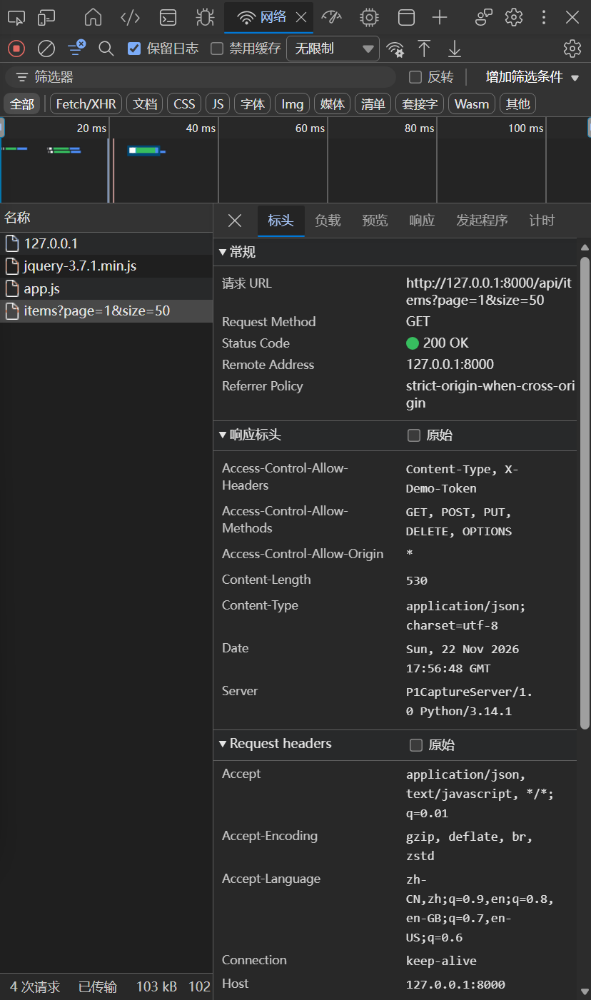

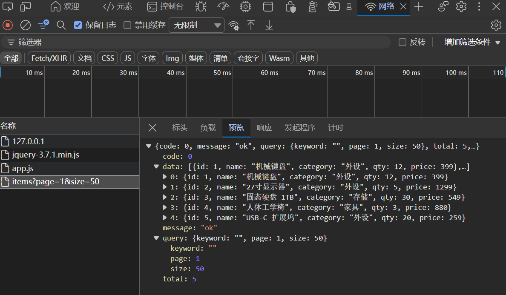

**（2）POST 请求**——参数放在请求体里，且响应码是 201：

```text
> POST /api/items HTTP/1.1
> Host: 127.0.0.1:8000
> Content-Type: application/json
> Content-Length: 63
< HTTP/1.1 201 Created
< Content-Type: application/json; charset=utf-8
< X-Demo-Server: P1CaptureServer
```

```json
{"name":"测试键盘","category":"外设","qty":2,"price":199}

→ {"code": 0, "message": "created",
   "data": {"id": 6, "name": "测试键盘", "category": "外设", "qty": 2, "price": 199.0}}
```

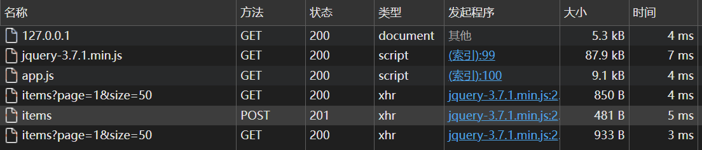

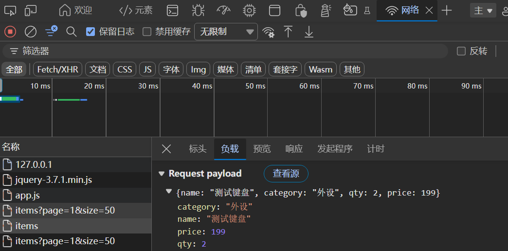

**（3）两类请求的对照**：

| 对比项 | GET | POST |
|---|---|---|
| 参数位置 | URL 查询串 | 请求体（JSON） |
| 是否可被缓存/收藏 | 可以 | 不适合 |
| 语义 | 读取，幂等 | 新增，非幂等 |
| 本例响应码 | 200 OK | 201 Created |
| 长度限制 | 受 URL 长度限制 | 只受服务端限制 |

**（4）服务端视角的证据**——`logs/requests.log` 中同一条 POST 的记录，包含方法、路径、
客户端、完整请求体与请求头：

```json
{"method": "POST", "path": "/api/items", "http": "HTTP/1.1", "client": ["127.0.0.1", 59521],
 "body": "{\"name\":\"测试键盘\",\"category\":\"外设\",\"qty\":2,\"price\":199}",
 "headers": {"Host": "127.0.0.1:8000", "Content-Type": "application/json", "Content-Length": "63"},
 "time": "2026-11-23 01:49:49"}
```

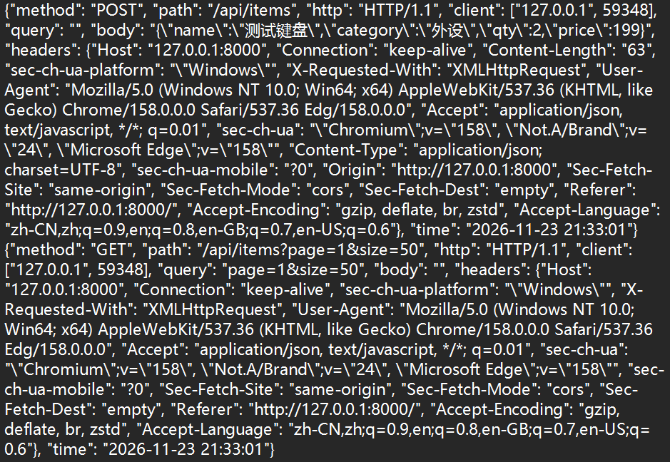

**（5）第三方网站对照**——为说明"参数位置不同"不是本地服务造成的，另用公开回显站
httpbin.org 复核一次：

```text
$ curl "https://httpbin.org/get?keyword=%E5%A4%96%E8%AE%BE&page=2"
{
  "args":    { "keyword": "外设", "page": "2" },
  "headers": { "Accept": "*/*", "Host": "httpbin.org", "User-Agent": "curl/8.22.0" },
  "method":  "GET",
  "url":     "https://httpbin.org/get?keyword=%E5%A4%96%E8%AE%BE&page=2"
}

$ curl -X POST "https://httpbin.org/post" -H "Content-Type: application/json" -d '{"name":"wireless_mouse","qty":8}'
{
  "json":   { "name": "wireless_mouse", "qty": 8 },
  "data":   "{\"name\":\"wireless_mouse\",\"qty\":8}",
  "method": "POST"
}
```

GET 的参数被解析进 `args`，POST 的参数被解析进 `json` / `data`，与本地服务的结论完全一致。
（POST 示例值用英文，只因 Windows 命令行默认代码页会把中文请求体转成乱码，与参数位置无关。）

**遇到的问题与解决**：

- 直接访问真实网站难以反复重放、截图也夹杂无关请求，改为本地服务后同一用例可复现。
- 本机曾出现浏览器访问 `127.0.0.1:8000` 超时的情况，排查后确认是 Windows 防火墙的入站规则
  过滤了回环连接，与 DNS 无关；为端口补一条仅回环的放行规则后恢复。

### 任务2 用 jQuery 触发事件并观察状态变化

**要求**：针对任意网页，使用 Jquery，能够触发某一事件，写出至少三条语句，截图响应前后不同的状态。

**做法**：

任务1 的演示页 `web/index.html` 本身就是任务2 的素材：页面上每个交互都同时产生一次可抓的
请求和一次可见的 DOM 变化。页面顶部有状态区（记录数 / 请求次数 / 最后一次操作），底部有
操作日志，任何变化都能在界面上留下痕迹。共绑定 6 处事件：

| 语句 | 事件 | 响应 |
|---|---|---|
| `$('#btn-add').on('click', ...)` | click | `#form-panel` 通过 `slideToggle(180)` 展开/收起 |
| `$('#btn-save').on('click', ...)` | click | `$.ajax` POST 提交，成功后收起表单并刷新表格 |
| `$('#btn-reload').on('click', ...)` | click | 按当前关键字重新 GET 列表 |
| `$('#tbody').on('click', '.btn-del', ...)` | 事件委托 click | 确认后 DELETE，行 `fadeOut` 再 `remove` |
| `$('#keyword').on('input', ...)` | input | 250ms 防抖后 GET 查询，连续输入只发一次请求 |
| `$('#tbody').on('dblclick', 'td.editable', ...)` | dblclick | 单元格变输入框，失焦/回车提交 PUT，Esc 取消 |

**结果与分析**：

**语句①：`$('#btn-add').on('click', function () { $('#form-panel').slideToggle(180); })`**

点击前后表单区高度从 0 变为展开、日志追加一行"click 事件命中 #btn-add：新增表单 展开"。
整个过程没有网络请求，说明这是纯前端事件。

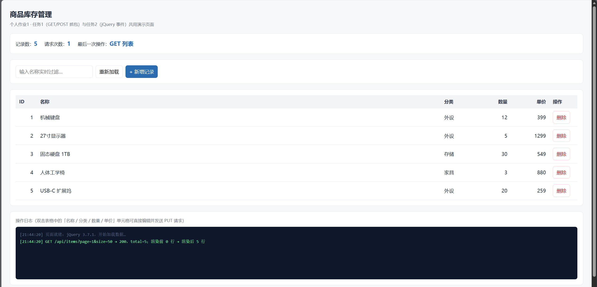

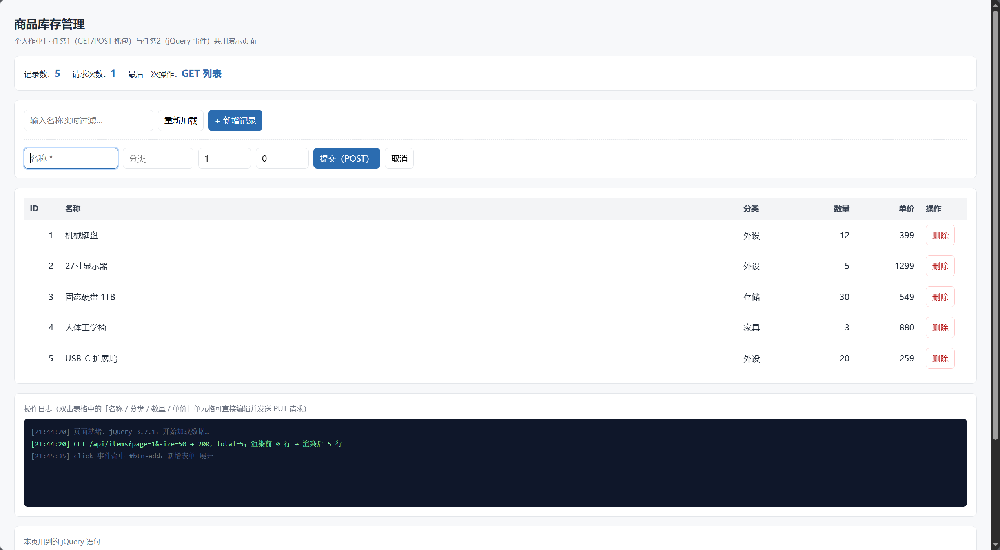

**语句②：`$('#btn-save').on('click', function () { $.ajax({ url: '/api/items', type: 'POST', ... }) })`**

填写名称后提交，表格由 5 行变 6 行，状态区记录数变为 6、"请求次数"+1、"最后一次操作"显示
`POST 新增`，底部日志同时打出请求体与返回的 id。

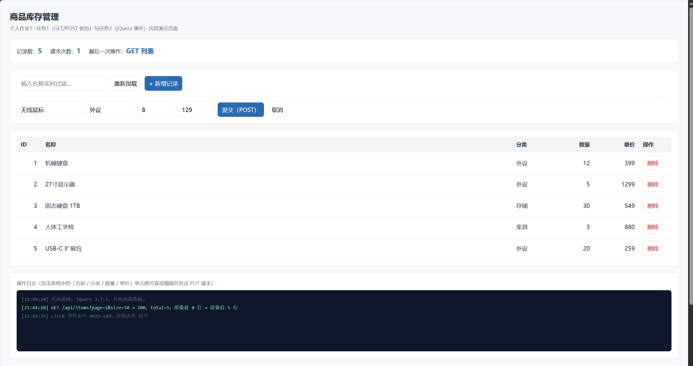

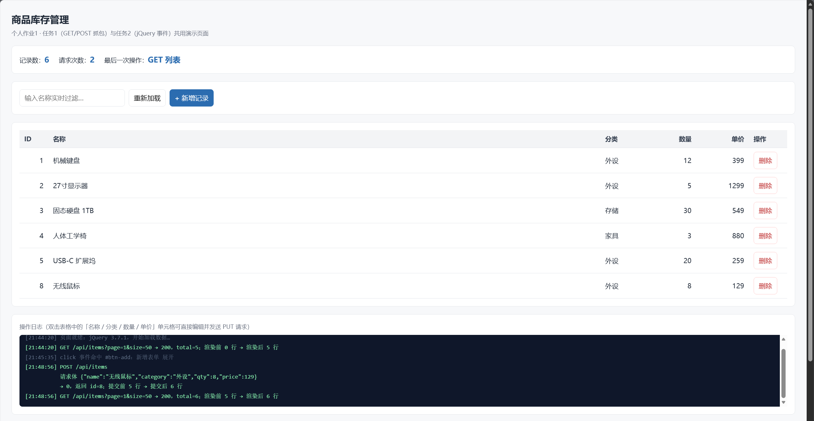

**语句③：`$('#tbody').on('click', '.btn-del', function () { $.ajax({ url: '/api/items/' + id, type: 'DELETE' }) })`**

用的是事件委托：按钮是 AJAX 渲染出来的，绑在 `#tbody` 上才能对后续新增的行同样生效。
确认后该行淡出移除，记录数减 1。

**语句④：`$('#keyword').on('input', function () { clearTimeout(t); t = setTimeout(load, 250); })`**

输入"外设"三个字只会触发一次请求（防抖），表格从 5 行过滤为 3 行；清空则恢复 5 行。

**语句⑤：`$('#tbody').on('dblclick', 'td.editable', function () { ... $input.on('blur', commit) })`**

双击"名称"单元格进入编辑态（黄色高亮），改名后失焦发送 PUT，成功则单元格显示新值，
失败则回滚为原值。

**语句⑥：Console 中的三条验证语句**（用于截图取证）：

```javascript
$('#tbody tr').length                       // 5
$('#keyword').val('外设'); $('#btn-reload').trigger('click')
                                            // 触发重载，请求返回后表格变 3 行
$('#tbody tr').length                       // 3
$('#stat-req').text()                       // '4'，请求次数累计值
```

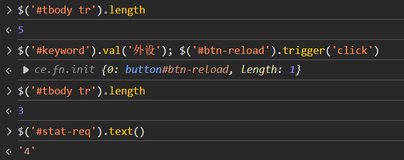

**遇到的问题与解决**：

- 直接给动态生成的删除按钮绑定 `click`，新增的行会失效；改用 `$('#tbody').on('click', '.btn-del', ...)`
  事件委托解决。
- 输入框逐字触发请求会造成大量无效请求，加 250ms 防抖。
- 状态区用"渲染前行数 → 渲染后行数"记录对比，截图时能直接说明"响应前后不同的状态"。

### 任务3 网页表格 → SQL 生成器（浏览器插件）

**要求**：完成一个浏览器插件，功能不限，文档中写明功能及代码。

**功能**：

插件基于 Manifest V3，抓取当前页面里所有可见的 `<table>`，自动推断列类型，生成可直接执行的
`CREATE TABLE` + `INSERT` 语句，支持一键复制或下载 `.sql` 文件。

| 功能 | 说明 |
|---|---|
| 抓取表格 | 一次抓取页面内全部可见表格，下拉框逐个切换 |
| 表头识别 | 优先 `<thead>`；没有则把首行当表头并给出"这是猜测"的提示，可一键取消 |
| 表尾排除 | `<tfoot>` 合计行不会混进数据 |
| `colspan` 展开 | 合并单元格按跨度补列，保证每行列数一致 |
| 类型推断 | 逐列扫描取值，推断 `INTEGER` / `REAL` / `DATE` / `DATETIME` / `VARCHAR(n)` |
| 主键猜测 | 首列为 `id`、取整数且不重复时加 `PRIMARY KEY`，否则提示原因 |
| 表名推断 | `<caption>` → 最近的 `<h1>`~`<h6>` → `id` 属性，清洗为合法标识符 |
| 方言切换 | MySQL（反引号）/ SQLite、PostgreSQL（双引号） |
| 安全转义 | 单引号按 SQL 标准翻倍，标识符清洗后加引号，防止注入 |
| 复制 / 下载 | 一键复制到剪贴板，或下载 `<表名>.sql` |

**关键代码**：

插件共 8 个源文件，权限声明只申请了 `activeTab` 与 `scripting`（所以安装时不会出现"读取所有网站"的警告）：

```json
// manifest.json（节选）
{
  "manifest_version": 3,
  "name": "网页表格 → SQL 生成器",
  "version": "1.0.0",
  "permissions": ["activeTab", "scripting"],
  "action": { "default_title": "网页表格 → SQL", "default_popup": "popup.html" }
}
```

内容脚本在页面里采集表格（`extension/content.js`），重点处理两件事：没有 `<thead>` 时同时返回
`rows`（不含首行）与 `allRows`（含首行），避免用户取消"首行作为表头"后首行凭空丢失；
任何情况下都排除 `<tfoot>`：

```javascript
// content.js（节选）：tfoot 是合计行，任何情况下都不当数据
var dataRows = rows.filter(function (r) { return footRows.indexOf(r) === -1; });

if (headRows.length) {
  // 有 thead：多行表头取最贴近数据的那一行
  headers = expandCells(headRows[headRows.length - 1]);
  headerSource = 'thead';
  allRows = dataRows.filter(function (r) { return headRows.indexOf(r) === -1; })
                    .map(expandCells);
  bodyRows = allRows;
} else if (dataRows.length) {
  // 没有 thead：首行先当表头用，但标记成「猜的」，界面上提示可取消
  var first = dataRows[0];
  var allTh = first.cells.length > 0 &&
    Array.prototype.every.call(first.cells, function (c) { return c.tagName === 'TH'; });
  headerSource = allTh ? 'first-row-th' : 'first-row-guess';
  headers = expandCells(first);
  allRows = dataRows.map(expandCells);
  bodyRows = allRows.slice(1);      // rows 不含首行，allRows 含首行
}
```

SQL 生成与转义在 `extension/lib/sqlbuilder.js`（UMD 写法：浏览器挂 `window.SqlBuilder`，
Node 里 `require` 拿到同一份实现，便于测试）：

```javascript
// sqlbuilder.js（节选）：单引号按 SQL 标准翻倍转义
function escapeString(value) {
  return "'" + String(value).split("'").join("''") + "'";
}

// 标识符按方言加引号：MySQL 用反引号，SQLite / PostgreSQL 用双引号
function quoteIdent(name, dialect) {
  var open = dialect === 'mysql' ? '`' : '"';
  var clean = String(name).split(open).join('');   // 去掉会破坏引用的字符
  return open + clean + open;
}

// 类型推断：整数 → 实数 → 日期 → 日期时间 → VARCHAR(n)
function inferType(values) {
  var filled = values.filter(function (v) { return !isBlank(v); })
                     .map(function (v) { return String(v).trim(); });
  if (!filled.length) return { type: 'VARCHAR(255)', kind: 'text', allEmpty: true };
  if (filled.every(function (v) { return INT_RE.test(v); }))
    return { type: 'INTEGER', kind: 'int', allEmpty: false };
  if (filled.every(function (v) { return NUM_RE.test(v); }))
    return { type: 'REAL', kind: 'real', allEmpty: false };
  if (filled.every(function (v) { return DATE_RE.test(v); }))
    return { type: 'DATE', kind: 'text', allEmpty: false };
  if (filled.every(function (v) { return DATE_RE.test(v) || DATETIME_RE.test(v); }))
    return { type: 'DATETIME', kind: 'text', allEmpty: false };
  var maxLen = filled.reduce(function (m, v) { return Math.max(m, v.length); }, 0);
  var n = Math.min(Math.max(10, Math.ceil(maxLen * 1.2 / 10) * 10), 4000);
  return { type: 'VARCHAR(' + n + ')', kind: 'text', allEmpty: false };
}
```

**结果与分析**：

以 `web/demo.html` 的三张表为例（`http://127.0.0.1:8000/demo.html`）：

| 表格 | 验证点 | 生成结果 |
|---|---|---|
| 表一 商品库存清单 | `<caption>` 取表名、`<tfoot>` 排除 | 4 行数据，合计行未进入 |
| 表二 无 `<thead>` | 首行猜表头、可取消 | 取消后列名退化为 `col_1`…，首行仍在 |
| 表三 脏数据 | 两行表头取第二行、`colspan` 展开、空值 `NULL`、`Tom's` 转义 | `Tom''s 五金店`，空电话为 `NULL` |

生成的 SQL 已在真实 SQLite 中执行成功（图3-5），自动化测试里三张表的字段类型与数据
也全部核对一致。

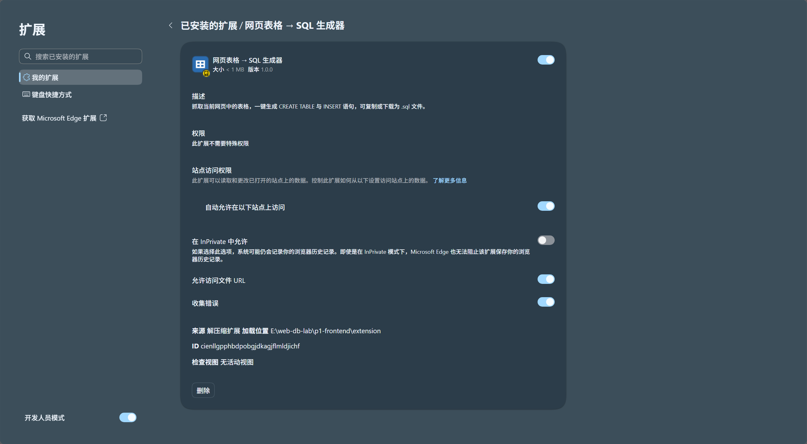

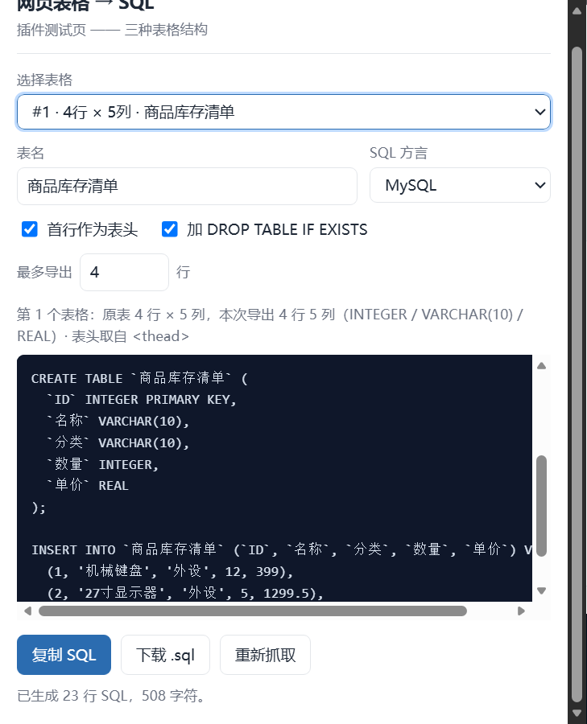

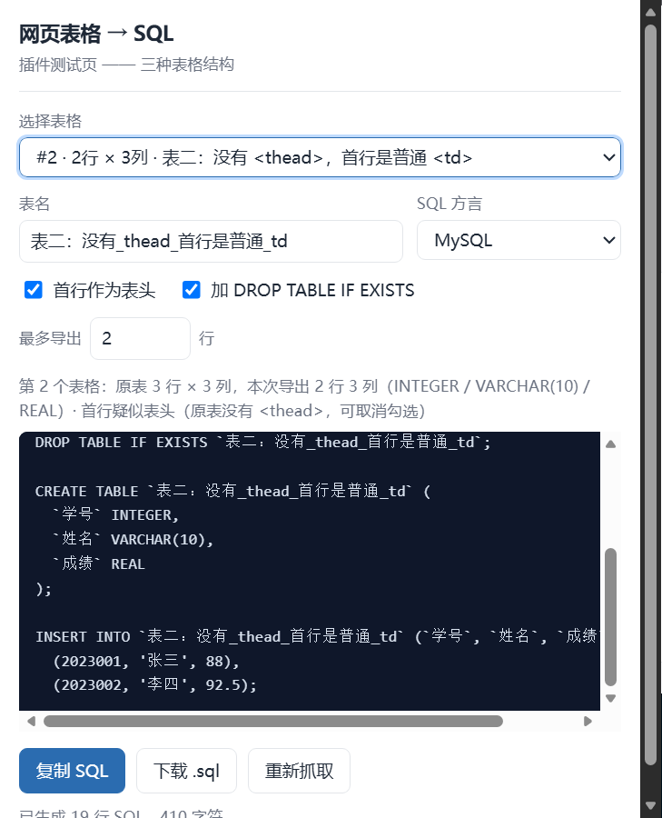

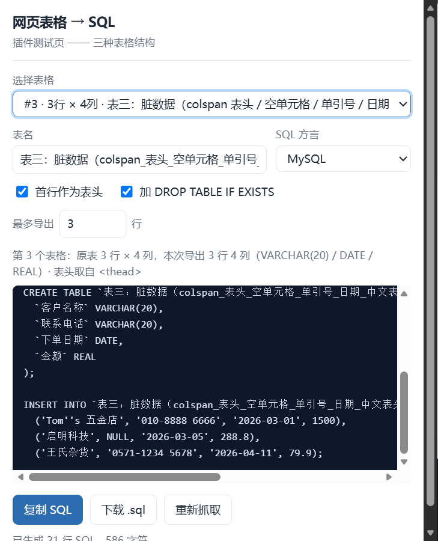

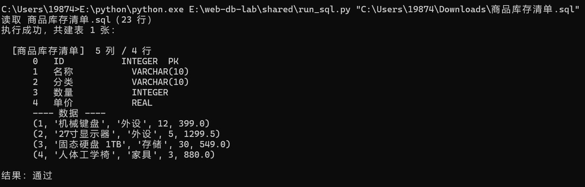

**自动化测试**：

为避免"打开浏览器看一眼"式的验证，插件的核心逻辑全部有命令行测试（`tests/run-all.bat`）：

| 测试 | 项数 | 覆盖 |
|---|---|---|
| `extension/lib/sqlbuilder.test.js` | 52 | 类型推断、转义、注入防护、标识符清洗、主键猜测、方言差异 |
| `tests/collector.test.js`（jsdom 真加载 `demo.html`） | 41 | 注入防重入、消息通道、表头定位、`tfoot` 排除、`colspan` 展开、空单元格 |
| `tests/run-in-sqlite.py` | 3 张表 | 生成 SQL 丢进真 SQLite 执行并回查 |

三项合计 93 项全部通过。测试还抓出并修复了两个真实缺陷：无 `<thead>` 且取消首行表头时首行丢失、
`<tfoot>` 合计行被当成数据插入。

**遇到的问题与解决**：

- 内容脚本重复注入会重复采集，加入防重入标记后解决。
- 合并单元格导致各行长度不一致，按 `colspan` 补齐后再生成 SQL。
- 中文表名/列名不能直接当标识符，先清洗再加方言引号。

## 四、总结

这次作业最大的收获是把 HTTP 从"课本上的概念"变成"看得见的数据包"。自建服务让每个用例都能
重放，请求行、请求头、请求体与响应码的差异在 GET 与 POST 之间一目了然；jQuery 部分体会到
事件委托和防抖这类工程细节的必要性——它们不是炫技，而是页面行为正确性的前提；插件部分则
把"网页数据 → 数据库"这条链路打通，类型推断与转义让我理解了为什么手写 SQL 容易出错。

如果重做，我会更早把"可测试的核心逻辑"和"依赖浏览器的外壳"拆开：插件里 `sqlbuilder.js` 用 UMD
写成可被 Node 直接 `require` 的模块，正是这次改动让 93 项测试得以在命令行跑完，也比反复开浏览器
看界面高效得多。

## 五、参考资料

- [HTTP 请求方法（MDN）](https://developer.mozilla.org/zh-CN/docs/Web/HTTP/Methods)
- [jQuery API 文档](https://api.jquery.com/)
- [Chrome 扩展 Manifest V3 文档](https://developer.chrome.com/docs/extensions/develop/migrate/what-is-mv3)
