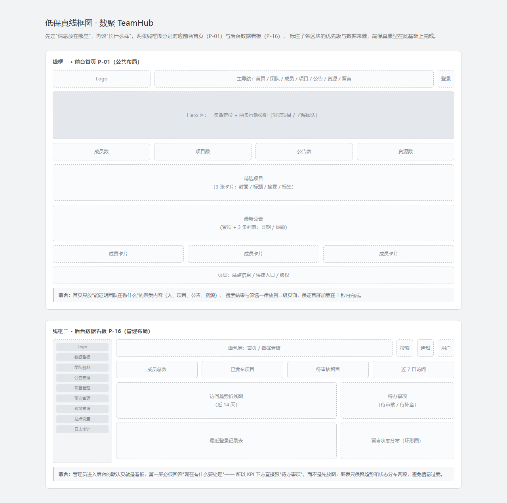
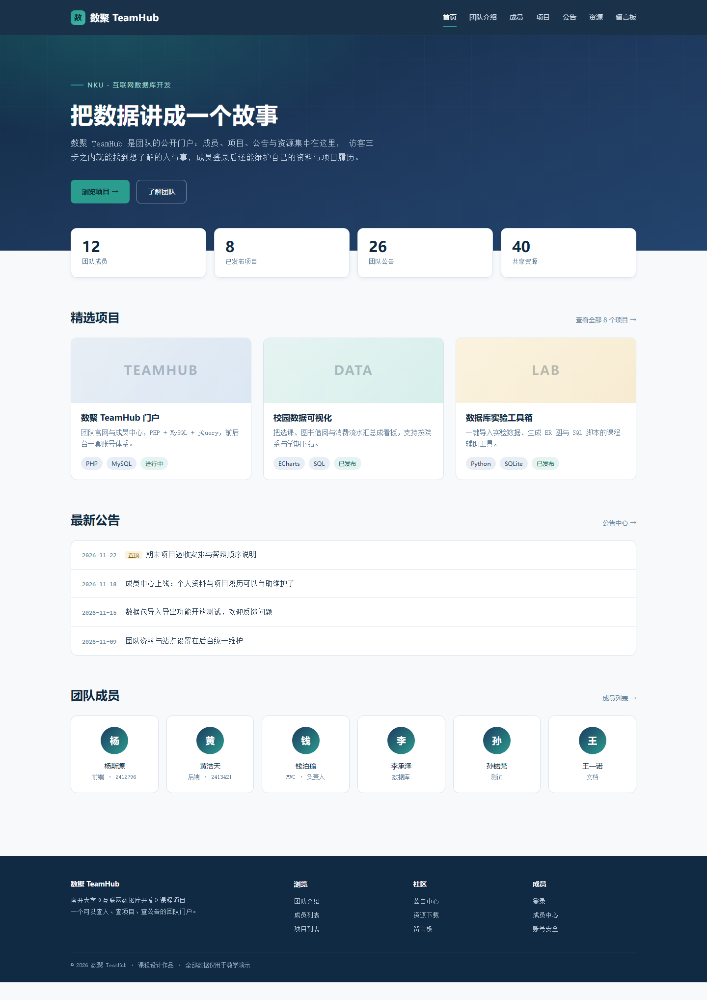
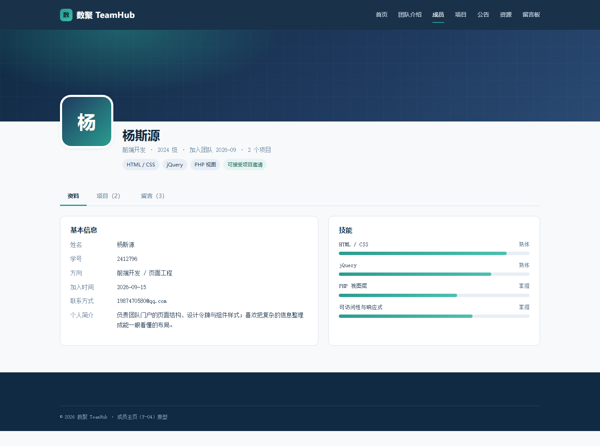
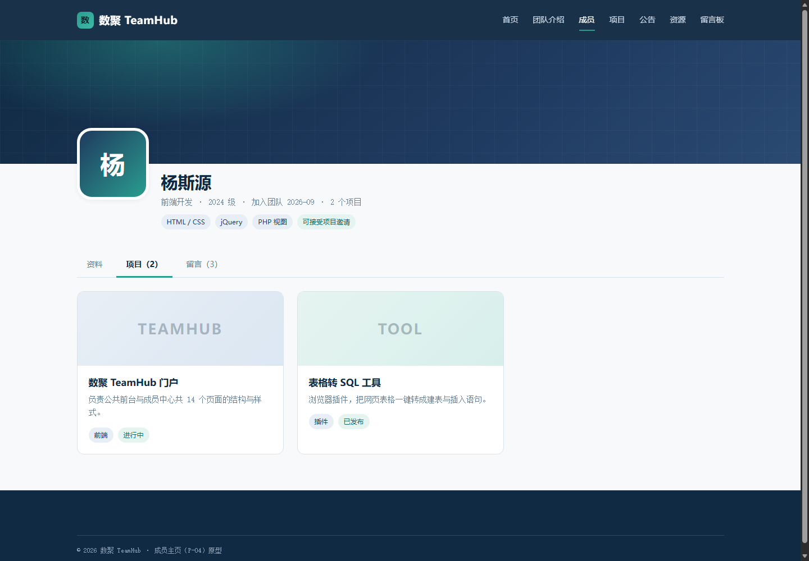
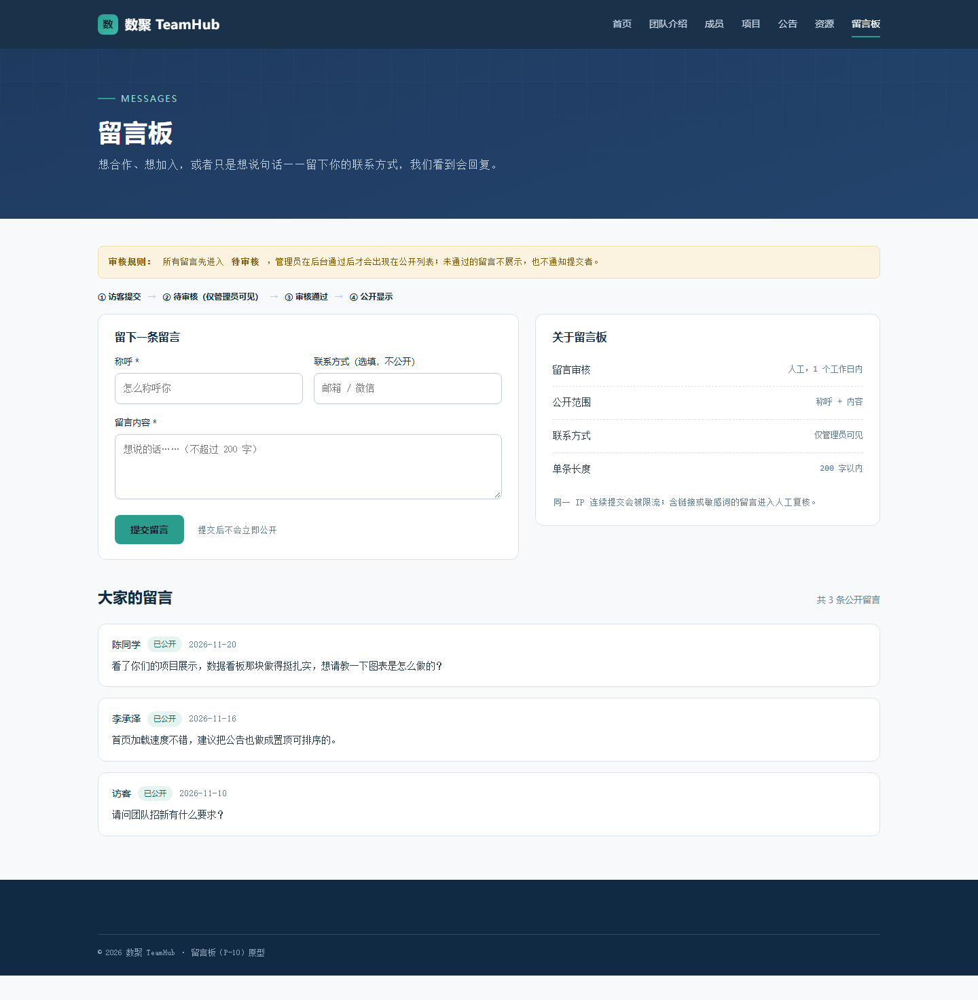
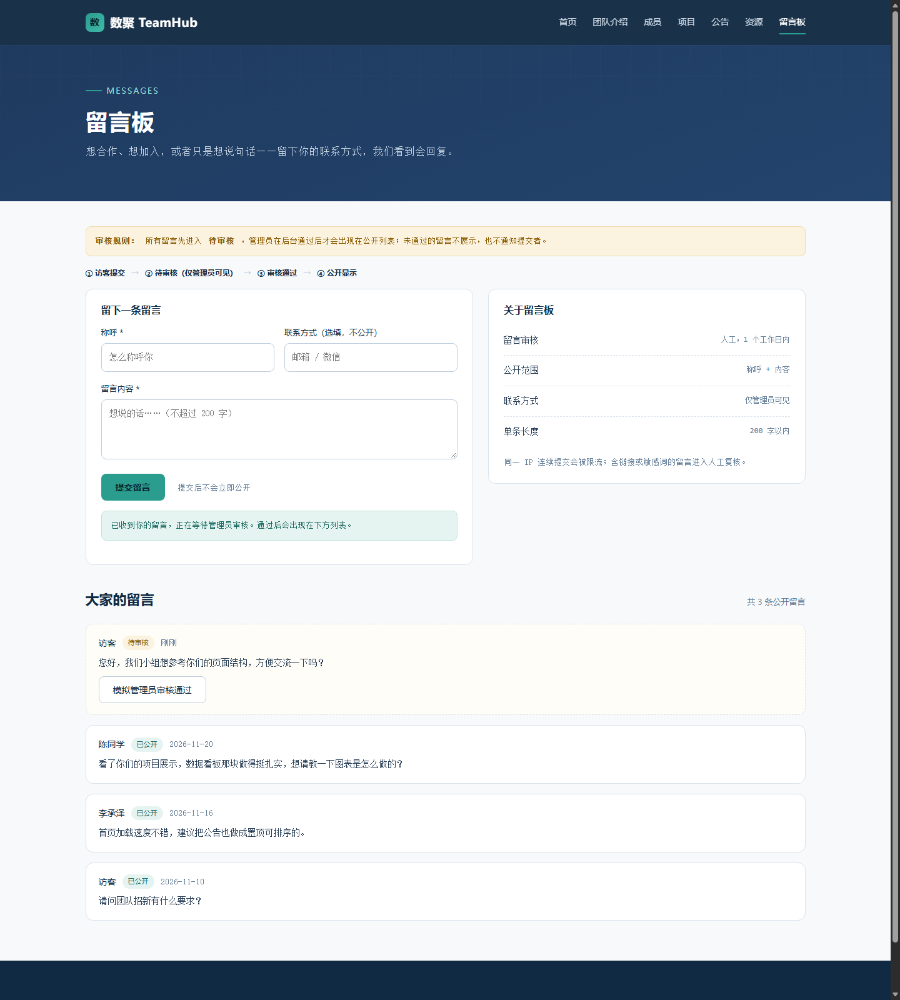
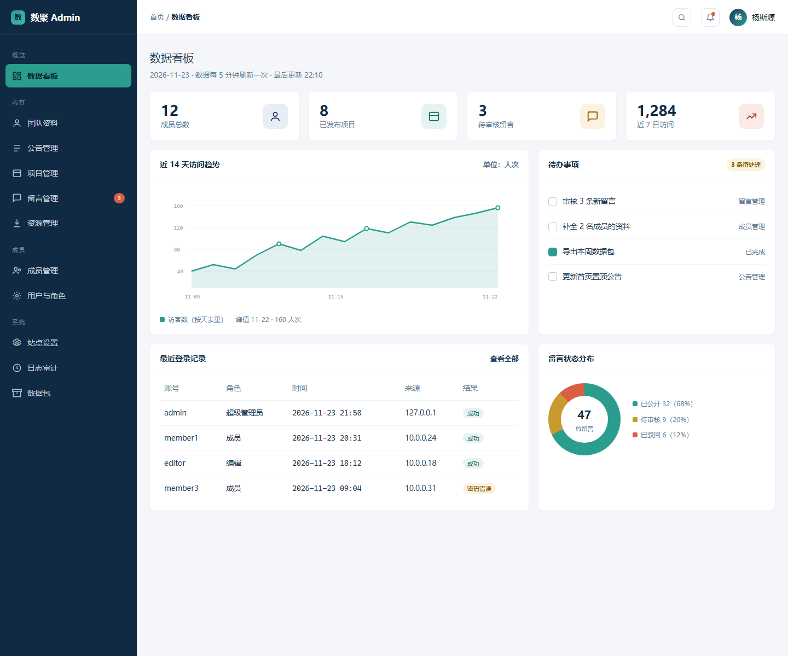
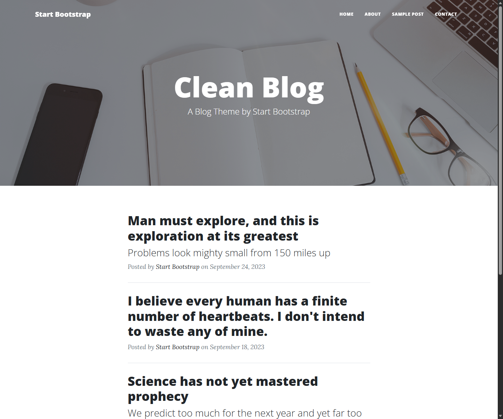
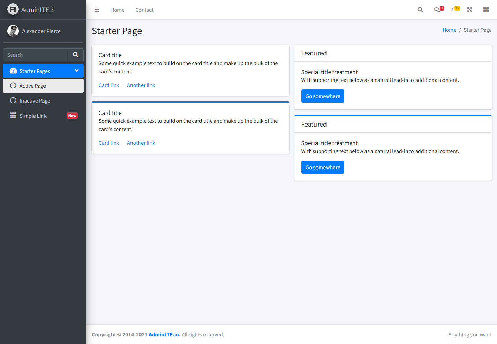

# 个人作业2 —— Web 前端设计

- 姓名：杨斯源
- 学号：2412796
- 班级：计算机二班
- 提交日期：2026-11-23

---

## 一、作业概述

本次作业包含两件事：

1. **页面原型设计**：使用 Axure 等工具设计一个页面；
2. **模板选型**：为团队大作业选取一套前台与一套后台模板。

我的做法是：以团队大作业《数聚 TeamHub》的真实页面为设计对象，先用线框图确定信息结构，
再用 **HTML + CSS 可交互原型**（`prototype/` 目录，可直接在浏览器打开）完成高保真页面；
模板选型与团队内结论保持一致（前台 Clean Blog、后台 AdminLTE 3），并补充对比依据。

**为什么用 HTML 原型代替 Axure 文件**：Axure 的核心产出是"可点击、可评审的界面方案"。HTML 原型同样
满足这一点，而且有三个额外好处——① 团队仓库里能直接打开预览，不需要装 Axure 或导出图片；
② 可以直接复用到大作业的 PHP 视图层，原型与实现之间没有二次翻译；③ 改动可以 diff、可以截图，
评审成本更低。原型只用到原生 HTML/CSS 与少量原生 JS，不引入任何构建工具，与团队
"原生 jQuery + PHP 模板"的技术基调一致。

设计令牌（颜色、字体、间距、圆角、阴影）直接取自团队
`code/public/static/css/tokens.css`，因此原型与最终网站同源，不存在"原型一套、实现另一套"的问题。

---

## 二、任务一：页面原型设计

### 2.1 设计目标与页面清单

团队门户共有 25 个页面（见需求文档附录 A）。本次原型挑选 4 个最具代表性的页面，
覆盖"公共前台 / 成员中心 / 社区互动 / 管理后台"四类布局：

| 页面 | 编号 | 布局 | 本次原型重点 |
|---|---|---|---|
| 首页 | P-01 | 公共前台 | 首屏定位、数据条、精选项目、公告与成员入口 |
| 成员主页 | P-04 | 公共前台 | 封面 + 头像、资料 / 项目 / 留言三页签 |
| 留言板 | P-10 | 公共前台 | 提交表单与"待审核 → 公开"的状态流转 |
| 数据看板 | P-16 | 管理后台 | KPI、趋势图、待办、最近登录 |

### 2.2 第一步：低保真线框图

先不碰颜色和字体，只回答"信息放在哪里"。线框图覆盖首页与后台两张典型布局，并为每个区块
标注数据来源与取舍理由。



两个关键取舍：

- **首页只放四类内容**（人、项目、公告、资源），搜索与筛选全部下沉到二级页面，
  保证首屏在 1 秒内完成加载；
- **后台第一屏先给"要处理什么"**，KPI 下面紧跟待办事项，图表只保留趋势与状态分布两项。

### 2.3 第二步：高保真原型——前台首页

首页沿用团队设计令牌：深蓝主色 `#102A43` 承载品牌感，青绿强调色 `#2A9D8F` 只用在行动按钮与
数据高亮上。首屏是渐变底色 + 网格纹理的 Hero 区，一句话说明团队在做什么，右侧不堆按钮——
只保留"浏览项目"和"了解团队"两个动作。



版式要点：

- 导航栏固定在顶部，半透明深蓝 + 模糊，滚动时始终可见；
- 数据条用负外边距压在 Hero 下沿，形成层次，同时让"成员 / 项目 / 公告 / 资源"四个数字
  成为首屏的第二视觉焦点；
- 项目卡片用三种低饱和封面底色区分状态，标签区分技术栈与"进行中 / 已发布"；
- 成员入口采用 6 列头像网格，视觉密度刚好，点击进入成员主页。

### 2.4 成员主页（页签交互）

成员主页是"一个人"的完整档案：封面、大头像、姓名与方向，下面是**资料 / 项目 / 留言**三个页签。
默认打开"资料"，点击页签只切换内容区，不整页刷新；也支持直接用 `member.html#projects`
这样的地址打开指定页签。





资料页采用 1.1 : 0.9 的两栏：左边是"基本信息"定义列表，右边是技能条。技能条用统一的
8px 圆角轨道 + 渐变填充，读起来像"能力刻度"，比纯文字标签更容易横向对比。

### 2.5 留言板（提交 → 待审核 → 公开）

留言板最容易做错的地方是"提交即公开"。团队的需求是**先审后发**，所以原型把状态流转做成
页面上明示的规则：顶部一条审核规则说明，下面用 ①②③④ 四步画清楚流转，再放表单。



原型里可以直接演示完整流程：填写并提交后，新留言以**黄色虚线的"待审核"样式**插入列表顶部，
并提示"提交后不会立即公开"；点击"模拟管理员审核通过"，该条留言变成绿色"已公开"标签。
这比静态截图更能说明"审核前后"的差别。



### 2.6 后台数据看板

后台采用经典的管理布局：左侧 250px 深蓝固定侧栏，顶部 64px 白底栏（面包屑 + 搜索 + 通知 + 用户），
内容区用浅灰底色衬托白色卡片。管理员登录后的默认页就是看板。



- **KPI 四宫格**：成员总数、已发布项目、待审核留言、近 7 日访问，图标用淡色底衬托，数字做视觉主体；
- **趋势图**：近 14 天访问折线，用手写 SVG 绘制（不用图表库），可直接嵌入 PHP 模板；
- **待办事项**：待审核留言、待补全资料等，回答"现在要做什么"；
- **最近登录记录**与**留言状态分布环形图**：前者用于安全审计，后者一眼看出审核压力。

### 2.7 原型使用说明

```
prototype/
├── index.html            首页 P-01
├── member.html           成员主页 P-04（#projects / #messages 切换页签）
├── message.html          留言板 P-10（#pending 直接查看待审核状态）
├── admin.html            后台数据看板 P-16
├── wireframe.html        低保真线框图
└── style.css             全部样式（含设计令牌）
```

直接用浏览器打开任一 HTML 文件即可，无需服务器、无需安装依赖。建议按下面的顺序演示：

1. `wireframe.html` —— 讲信息结构；
2. `index.html` —— 讲前台视觉与信息层次；
3. `member.html` —— 点页签，讲成员中心的信息组织；
4. `message.html` —— 提交一条留言，再点"模拟审核通过"，讲审核流程；
5. `admin.html` —— 讲后台的"先看要处理什么"。

### 2.8 设计说明

| 项目 | 做法 |
|---|---|
| 设计令牌 | 颜色 / 字体 / 间距 / 圆角 / 阴影全部取自团队 `tokens.css` |
| 栅格 | 8px 间距体系，内容最大宽度 1200px |
| 响应式 | 1080px / 860px / 620px 三个断点，侧栏在窄屏收成 72px 图标栏 |
| 无障碍 | 正文对比度 ≥ 4.5:1，表单控件有 `label`，页签用 `role="tablist"` |
| 依赖 | 零第三方依赖，图标为内联 SVG，字体用系统字体栈 |

---

## 三、任务二：团队前台与后台模板选型

### 3.1 选型原则

1. **与现有技术栈契合**：团队用 PHP 模板 + 原生 jQuery，不引入构建工具，模板必须是"拿来即用的 HTML/CSS"；
2. **许可清晰**：优先 MIT，允许课程项目使用与修改；
3. **可维护**：模板结构简单、文档齐全，后续改版成本低；
4. **体积可控**：不为了一个后台引入整套框架和图表库；
5. **中文友好**：字体、按钮宽度、日期/表单控件在中文环境下不别扭。

### 3.2 前台模板：Start Bootstrap Clean Blog（选定）



- **是什么**：Start Bootstrap 出品的博客型前台模板，基于 Bootstrap 5；
- **为什么选它**：它的版式（大图 Hero + 居中窄栏正文 + 干净页脚）正好适合"团队门户"这种
  以内容展示为主的场景；页面结构只有导航、Hero、列表、文章、页脚五段，砍改成本低；
- **怎么用**：**只取版式与排版规则，不直接套用它的配色**。页面骨架换成团队的设计令牌，
  导航与卡片换成团队组件，最终视觉仍以 `tokens.css` 为准；
- **许可**：MIT。

### 3.3 后台模板：AdminLTE 3（选定）



- **是什么**：最成熟的开源管理后台模板之一，Bootstrap 4 生态，组件（侧栏、面包屑、
  信息框、卡片、表格、表单）齐全；
- **为什么选它**：后台页面数量多（10 个），需要一套现成的"外壳"保证一致性；
  AdminLTE 的布局与团队设计文档里的后台线框几乎一一对应，能省掉大量重复样式；
- **怎么用**：取它的布局骨架与交互（侧栏折叠、下拉菜单），颜色变量覆盖为团队的
  `--c-primary` / `--c-accent`，避免"套模板"的违和感；
- **许可**：MIT。

### 3.4 与其他候选的对比

| 候选 | 类型 | 契合度 | 体积 | 结论 |
|---|---|---|---|---|
| **Clean Blog** | 前台 | 高：版式简洁，改造成本低 | 小 | **选定** |
| Bootstrap 官方示例 | 前台 | 中：更像组件库演示，缺少完整页面 | 小 | 备选 |
| **AdminLTE 3** | 后台 | 高：布局与团队线框一致 | 中 | **选定** |
| Tabler | 后台 | 高：设计更现代，但 Bootstrap 5 + 大量图标字体 | 较大 | 备选（后续升级） |
| CoreUI | 后台 | 中：偏 React/Vue 生态，纯 HTML 版文档较少 | 中 | 不选 |

### 3.5 选型结论与整合方案

- 前台采用 **Clean Blog 的版式**，后台采用 **AdminLTE 3 的布局骨架**；
- 两者都只作为"结构与交互参考"，**视觉层统一由团队的 `tokens.css` 控制**，
  避免两份模板风格打架；
- 现有已实现的 14 个前台页面**不回退重写**，只在新页面和后台页面按模板结构补齐；
- 该结论与团队内黄浩天同学的作业2 一致，保证团队材料的说法统一。

---

## 四、总结

这次作业让我把"设计"和"实现"之间的那条线画清楚了：线框图解决信息优先级，高保真原型解决
视觉与交互，模板选型解决"重复造轮子"。用 HTML 做原型还有一个意外收获——它逼着我按真实的
布局约束去思考，比如首页数据条要压在 Hero 下沿、后台侧栏在窄屏怎么收，这些问题在 Axure 里
很容易被"拖一个方块"掩盖过去。

模板选型上最大的体会是：**模板不是用来直接套的**。Clean Blog 和 AdminLTE 真正有价值的是版式
结构与组件边界，配色、圆角、字号必须回到团队的设计令牌，否则拼出来的页面一定"各说各话"。

## 五、参考资料

- [Start Bootstrap · Clean Blog](https://startbootstrap.com/theme/clean-blog)
- [AdminLTE 3](https://adminlte.io/themes/v3/)
- 团队需求文档 `docs/team/01-需求文档/M3_需求文档().md`（页面清单见附录 A）
- 团队设计文档 `docs/team/02-设计文档/M3_设计文档().md`
- 团队设计令牌 `code/public/static/css/tokens.css`

## 附件清单

| 文件 | 说明 |
|---|---|
| `prototype/*.html`、`prototype/style.css` | 可交互原型（5 个页面 + 样式） |
| `img/proto-*.png` | 原型截图（7 张） |
| `img/tpl-*.png` | 模板预览截图（2 张） |
