# 个人作业3 —— WordPress 建站

- 姓名：杨斯源
- 学号：2412796
- 班级：计算机二班
- 提交日期：2026-11-24

---

## 一、作业概述

本次作业要求自行安装 WordPress，安装模块并设计布局，记录安装步骤与最终页面。

我采用 **Docker Compose 部署**：一条命令拉起 WordPress + MySQL 两个容器，站点运行在
`http://localhost:8080`。这样做的好处是环境完全隔离、可重复搭建，本机不需要安装 PHP 或
MySQL 服务；数据放在 Docker 卷里，`docker compose down` 之后重新 `up` 站点依然存在。

| 组件 | 版本 |
|---|---|
| WordPress | 6.9.4（官方 `wordpress:6.9.4-php8.3-apache` 镜像） |
| 数据库 | MySQL 8.0 |
| 主题 | Astra 4.14.3 |
| 插件 | Contact Form 7 6.1.7、WP Super Cache 3.1.5 |
| 宿主环境 | Windows 11 + Docker Desktop 29.6.2 |

站点内容以「数聚笔记」为主题，与团队大作业的方向保持一致：记录数据库与前端的学习。

---

## 二、安装步骤

### 2.1 编写 docker-compose.yml

```yaml
services:
  db:
    image: mysql:8.0
    environment:
      MYSQL_DATABASE: wordpress
      MYSQL_USER: wpuser
      MYSQL_PASSWORD: wp_pass_2026
      MYSQL_ROOT_PASSWORD: root_pass_2026
    volumes:
      - db_data:/var/lib/mysql
    healthcheck:
      test: ["CMD", "mysqladmin", "ping", "-h", "127.0.0.1", "-uroot", "-proot_pass_2026"]
      interval: 5s
      retries: 30

  wordpress:
    image: wordpress:6.9.4-php8.3-apache
    depends_on:
      db:
        condition: service_healthy
    ports:
      - "8080:80"
    environment:
      WORDPRESS_DB_HOST: db:3306
      WORDPRESS_DB_NAME: wordpress
      WORDPRESS_DB_USER: wpuser
      WORDPRESS_DB_PASSWORD: wp_pass_2026
    volumes:
      - wp_data:/var/www/html
      - ./apache-allow-override.conf:/etc/apache2/conf-enabled/zz-allow-override.conf:ro

volumes:
  db_data:
  wp_data:
```

几个关键点：

- `healthcheck` + `condition: service_healthy`：保证 MySQL 真正可用后再启动 WordPress，避免首次启动时连不上库；
- 两个命名卷：数据库与站点文件分别持久化，重建容器不丢数据；
- `apache-allow-override.conf`：修正官方镜像默认的 `AllowOverride None`（见 6.3）。

### 2.2 启动容器

```bash
docker compose up -d
```

两个容器启动后，浏览器打开 `http://localhost:8080`，进入 WordPress 安装向导。

### 2.3 安装向导

**（1）选择语言**——列表中选择「简体中文」。WordPress 会在安装时从官方下载语言包，
所以后续界面全部是中文。

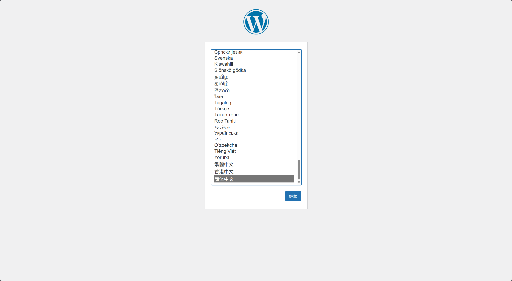

**（2）填写站点信息**——站点标题「数聚笔记」，设置管理员账号与邮箱。

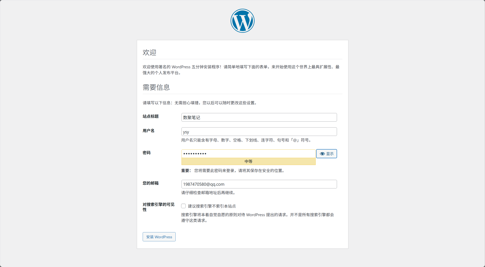

**（3）安装成功**——页面提示「成功！WordPress 已安装」，点击「登录」。

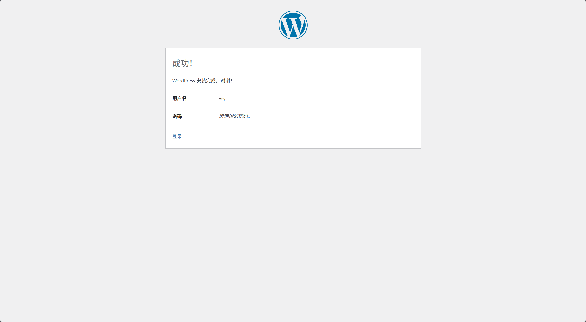

### 2.4 登录后台

用刚才设置的账号登录，进入中文后台。

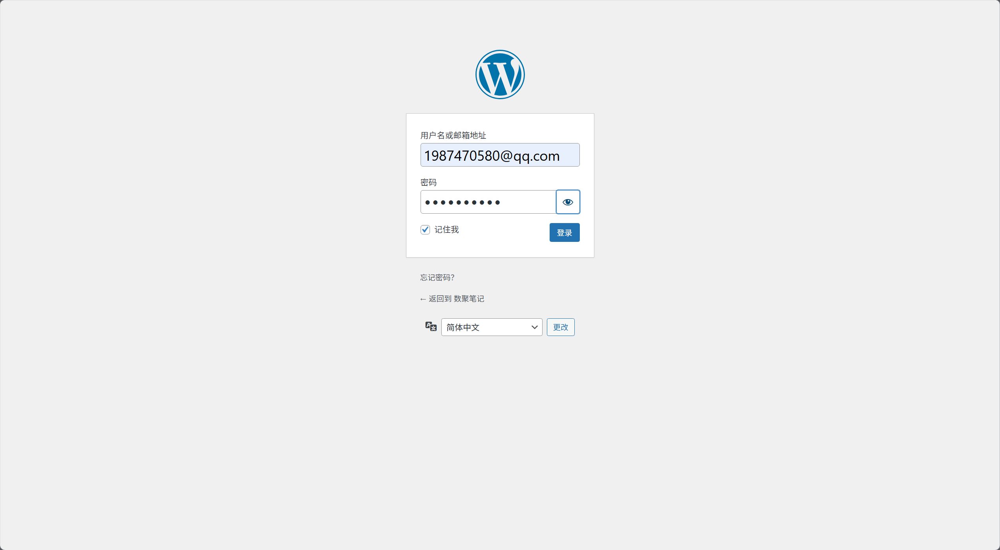

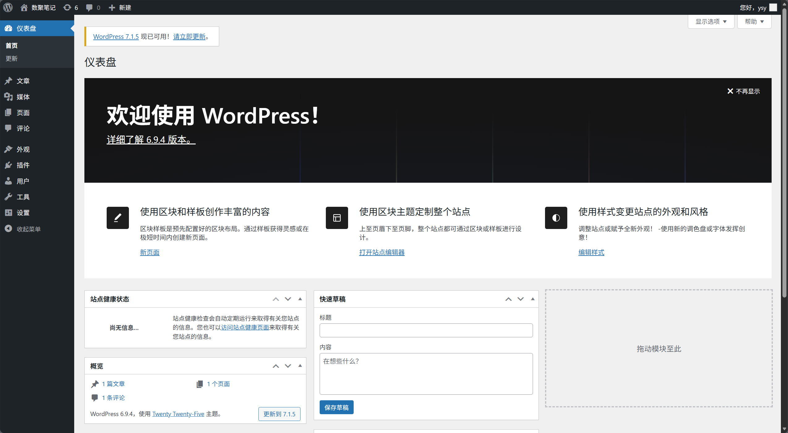

---

## 三、安装模块

### 3.1 主题：Astra

在「外观 → 添加新主题」中搜索 **Astra** 并安装、启用。选择它的原因是轻量、与 Gutenberg
区块编辑器兼容好，且自带传统的「外观 → 菜单」，方便配置导航。

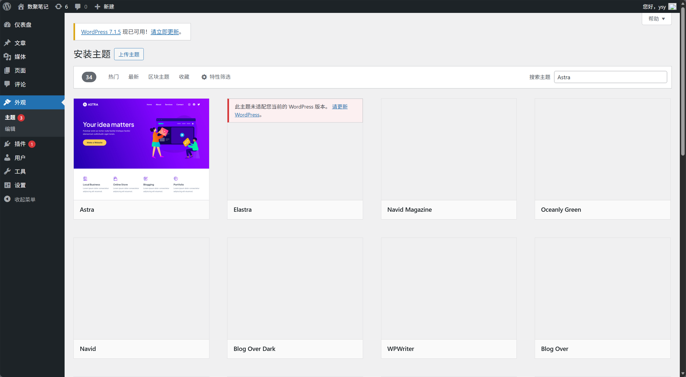

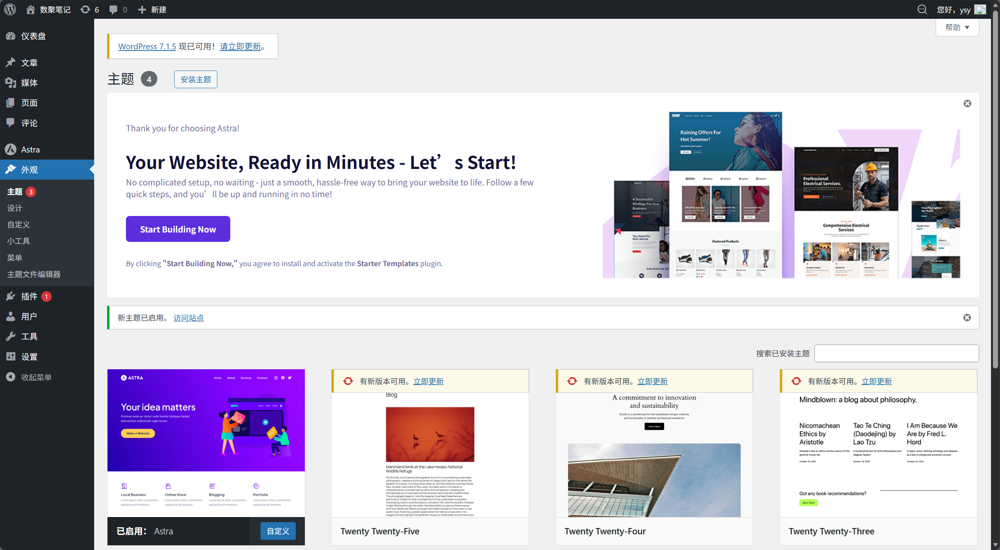

### 3.2 插件：Contact Form 7 + WP Super Cache

在「插件 → 已安装的插件」中启用两个插件：

- **Contact Form 7**：提供联系表单，挂在「联系」页面；
- **WP Super Cache**：页面静态缓存，后台顶部会出现「删除缓存」入口。

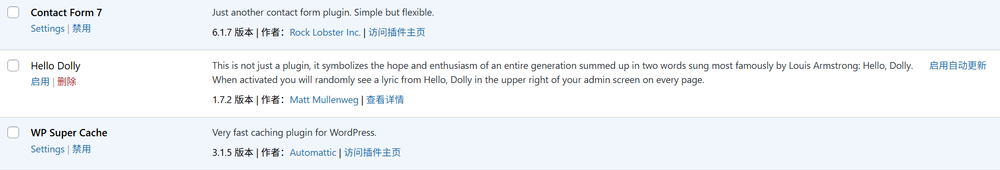

---

## 四、设计布局

### 4.1 首页：区块化布局

首页用 Gutenberg 区块搭建，结构是「深色 Hero + 三栏介绍 + 最新文章」：

- **分组区块**做 Hero：深蓝底（`#102a43`）+ 标题 + 副标题；
- **栏目区块**分三栏：数据库 / 前端 / 课程，各配一句说明；
- **最新文章**区块自动拉取最近发布的文章。

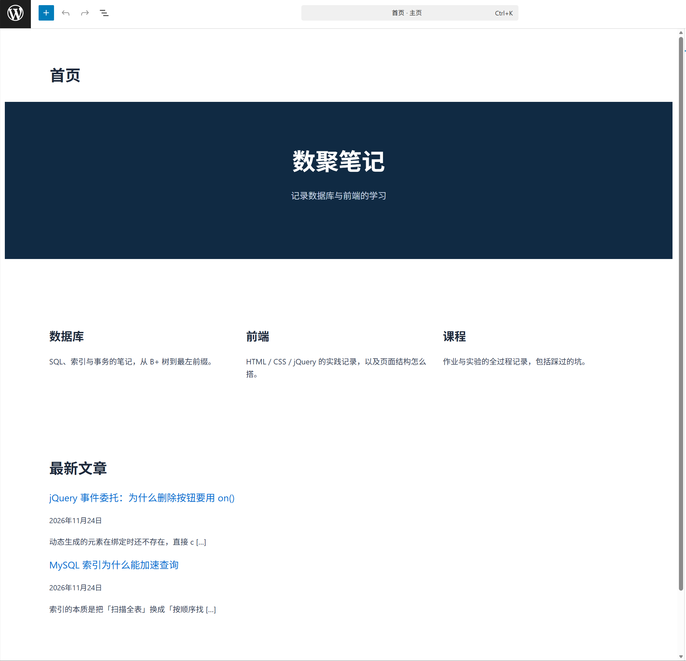

### 4.2 静态首页

「设置 → 阅读」中把主页设为静态页面：主页 = 首页，文章页 = 博客。这样首页是设计好的
落地页，文章列表独立在 `/blog/`。

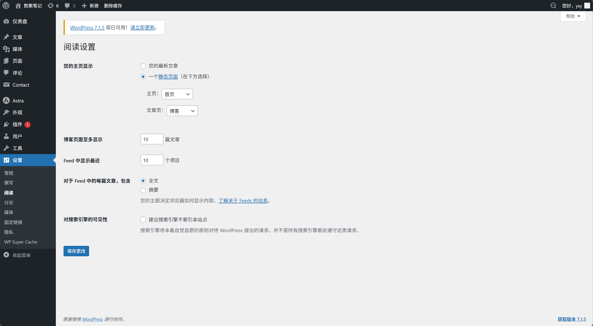

### 4.3 导航菜单

「外观 → 菜单」新建菜单「主导航」，加入首页、关于、联系、博客四项，并勾选显示位置
「Primary Menu」。

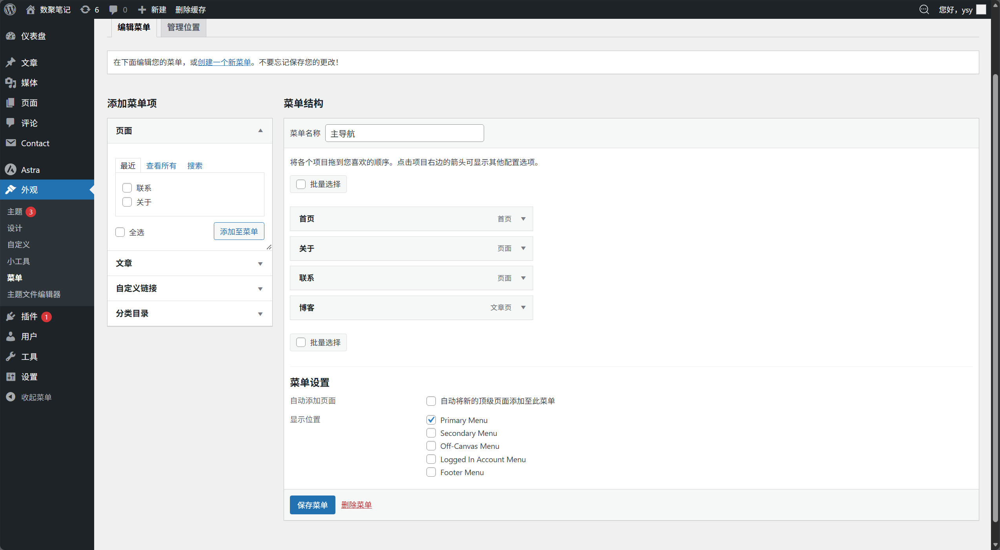

### 4.4 文章与联系页

发布了两篇示例文章（MySQL 索引、jQuery 事件委托）；「联系」页面通过短代码嵌入
Contact Form 7 表单。

---

## 五、最终页面

**首页**：深色 Hero、三栏介绍、最新文章列表，顶部是四项目主导航。

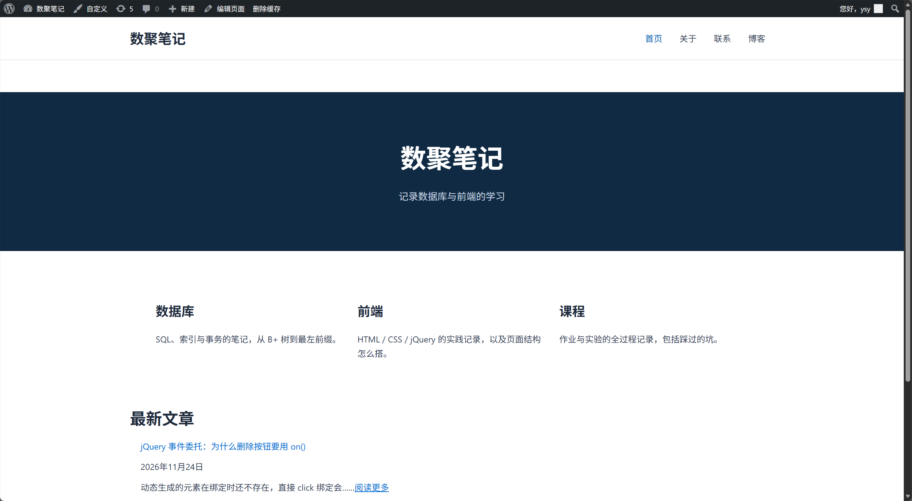

**文章页**：正文排版、标题层级正常，可从首页「最新文章」进入。

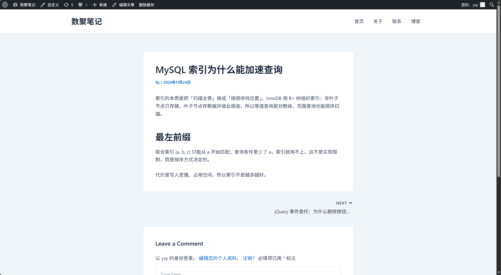

**联系页**：Contact Form 7 表单已生效，提交后可发送邮件。

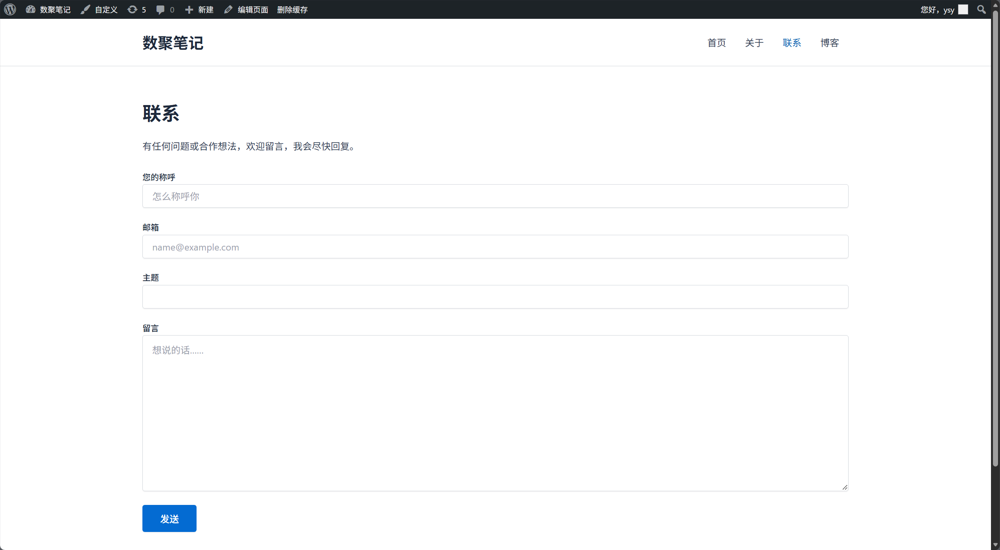

---

## 六、遇到的问题与解决

### 6.1 后台安装主题一直超时

后台点「安装」时提示 `cURL 错误 28：操作在 300000 毫秒后超时`。原因是容器到
`downloads.wordpress.org` 的带宽只有几 KB/s，Astra 有 6.7 MB，必然超过 WordPress 的下载超时。

**解决**：在本机用代理下载主题与插件压缩包，解压后直接放进容器的
`wp-content/themes` 与 `wp-content/plugins`，再在后台点「启用」。安装过程仍然完整，
只是绕开了慢速下载。

### 6.2 插件提示「不适用于您的 WordPress 版本」

Contact Form 7 最新版（6.2.6）要求 WordPress **7.1**，而镜像自带的是 **6.9.4**。

**解决**：不升级核心（升级要下载 30 MB 以上并触发数据库升级，风险大），改用兼容的
**6.1.7**（要求 6.7+）。这是实际部署里更合适的选择。

### 6.3 固定链接全部 404

开启「/%postname%/」后所有页面 404。两个原因叠加：

1. 官方镜像的 Apache 默认 `AllowOverride None`，`.htaccess` 根本不生效；
2. WordPress 在容器里检测不到 `mod_rewrite`，`.htaccess` 里只写了标记、没有重写规则。

**解决**：新增 `apache-allow-override.conf` 并挂载到 `conf-enabled/`，开启
`AllowOverride All`；同时手动补上标准的重写规则：

```apache
<IfModule mod_rewrite.c>
RewriteEngine On
RewriteBase /
RewriteRule ^index\.php$ - [L]
RewriteCond %{REQUEST_FILENAME} !-f
RewriteCond %{REQUEST_FILENAME} !-d
RewriteRule . /index.php [L]
</IfModule>
```

### 6.4 首页 Hero 颜色发灰、标题重复

- Cover 区块默认带 50% 蒙层，深蓝色被冲成灰蓝 → 改用**分组区块**加实色背景；
- Astra 会在内容上方输出页面标题「首页」→ 用自定义 CSS 隐藏 `.entry-header`。

### 6.5 联系表单是英文标签

Contact Form 7 的默认表单模板是英文（Your name / Your email）。表单内容实际存在
`_form` 元字段里，只改文章正文不生效。

**解决**：直接更新表单的 `_form` 元字段，把标签与提交按钮改成中文。

---

## 七、总结

这次作业最有价值的不是"点完安装向导"，而是三个真实的部署问题：官方的网络在国内基本不可用、
插件版本与核心版本会打架、官方镜像的 Apache 默认配置会让固定链接失效。这三个问题在课堂演示里
不出现，但只要真部署一次就一定会遇到。

用 Docker 的体会也很深：把所有配置写进 `docker-compose.yml` 和挂载文件后，站点环境变成
"可丢弃、可重建"的——`down` 再 `up` 一次，之前的折腾全部复现，这对课程作业和小团队项目都
比手工装 PHP + MySQL 可靠得多。

## 八、参考资料

- [WordPress 官方文档](https://wordpress.org/documentation/)
- [Astra 主题](https://wpastra.com/)
- [Contact Form 7](https://contactform7.com/)
- [WP Super Cache](https://wordpress.org/plugins/wp-super-cache/)
- [Docker 官方 WordPress 镜像](https://hub.docker.com/_/wordpress)

## 附件清单

| 文件 | 说明 |
|---|---|
| `docker-compose.yml` | 一键部署配置（WordPress + MySQL） |
| `apache-allow-override.conf` | 修正固定链接 404 的 Apache 配置 |
| `img/wp-01 … wp-14` | 安装、模块、布局、最终页面共 14 张截图 |
