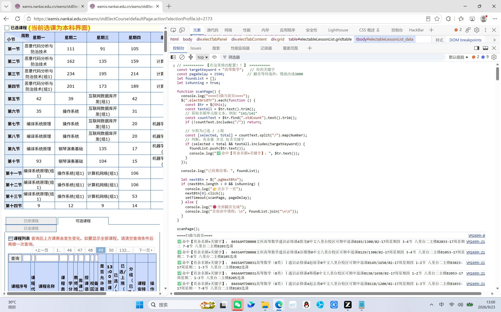
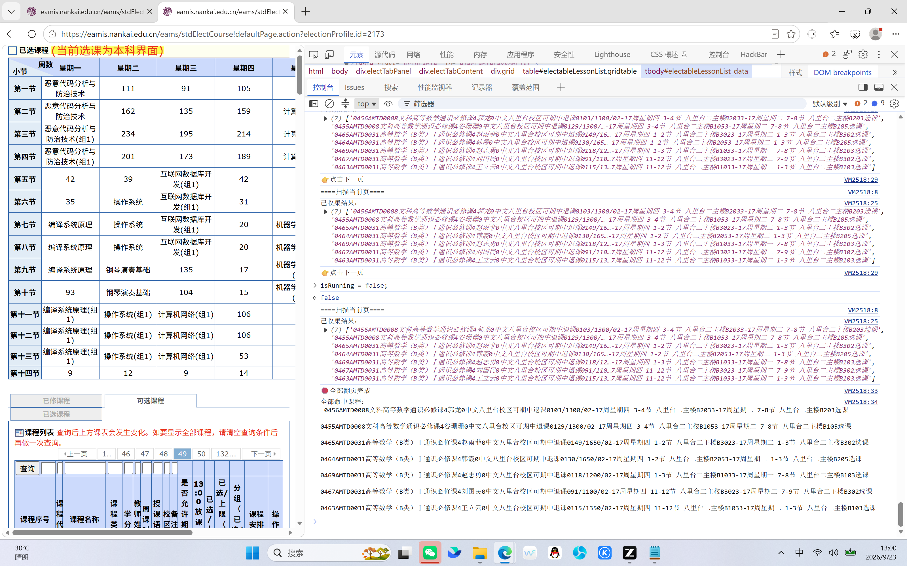
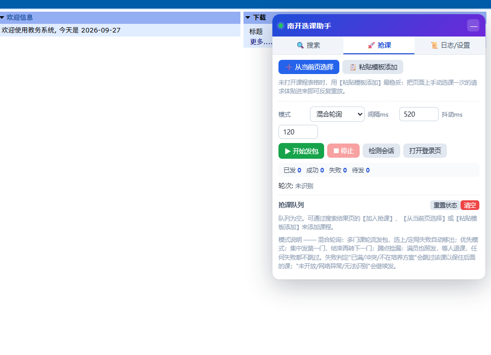

# 个人作业1——Web前端初探

> 课程：互联网数据库开发　|　学号：2413421　|　姓名：黄浩天　|　日期：2026年9月

---

## 一、作业概述

本次作业以南开大学本科教务系统（eamis.nankai.edu.cn，下称教务系统）为主要调研对象，围绕 Web 前端开发的三个基础环节展开：其一，使用浏览器开发者工具抓取并分析该系统的 GET 与 POST 两种请求报文；其二，编写 jQuery 语句在选课页面上触发事件，实现课程表格的自动扫描；其三，把前两步的成果整合工程化，完成一个可直接安装使用的 Chrome 浏览器插件——**南开选课助手**，提供课程多功能搜索与自动化发包两项功能。

三个任务层层递进：任务一的报文分析揭示了选课操作在网络协议层面的细节，是任务三自动化发包的依据；任务二验证了在浏览器内直接操控页面元素的可行性，是任务三多功能搜索功能的前身；任务三则把协议分析与页面操控合并进一个插件，在已登录的浏览器会话内完成搜索与选课请求的自动重放。

---

## 二、任务一：网页请求方式调研（GET 与 POST）

### 2.1 调研对象与方法

调研对象为教务系统。方法：登录系统后打开 Chrome 开发者工具（F12）的 Network（网络）面板，分别执行【查看培养方案】与【提交一次选课操作】，抓取对应的 HTTP 请求与响应报文。以下报文均摘录自真实抓包记录（原始文件见附件 `教务系统包.txt`），其中 Cookie 等会话凭据做了截断处理。该系统采用 Ajax 局部刷新，大部分数据请求都带有 `X-Requested-With: XMLHttpRequest` 头。

### 2.2 GET 请求实例：获取培养计划

在教务系统首页点击【培养方案】页签时，页面通过 XMLHttpRequest 发起 GET 请求，从服务器拉取培养计划文档。

**报文 2-1　GET 请求：**

```http
GET /eams/myPlan!programDoc.action?_=1790138176666 HTTP/2
Host: eamis.nankai.edu.cn
Cookie: semester.id=4424; JSESSIONID=05963DDA...(会话凭据，略)
X-Requested-With: XMLHttpRequest
Accept: text/html, */*; q=0.01
User-Agent: Mozilla/5.0 (Windows NT 10.0; Win64; x64) ... Chrome/131.0 Safari/537.36
Referer: https://eamis.nankai.edu.cn/eams/home.action
Accept-Encoding: gzip, deflate, br
```

服务器返回 `HTTP/2 200 OK`，响应体为一段 HTML 片段（专业基本信息、培养目标、毕业要求等），由前端回调函数插入到页面选项卡中。

**报文 2-2　GET 响应（节选）：**

```html
HTTP/2 200 OK
Server: volcclb
Content-Type: text/html;charset=UTF-8
Set-Cookie: CLBSERVERID=5141c869...; Path=/

<p style="color:#00108c;...">一.专业基本信息</p>
<p>专业名称：信息安全　学科门类：工学　学制：4年　授予学位：工学学士</p>
<p style="color:#00108c;...">二.培养目标</p>
<p>面向国家网络强国重大战略需求……培养目标1（技术能力）……</p>
<p style="color:#00108c;...">三.毕业要求</p>
<p>（1）工程知识：能够将数学、自然科学、工程基础和专业知识用于解决……</p>
<!-- 响应体为 HTML 片段，由前端 Ajax 回调插入页面选项卡，此处截取 -->
```

**分析**：GET 请求的参数（时间戳 `_`）直接拼接在 URL 查询串中，没有请求体；请求通过 `X-Requested-With: XMLHttpRequest` 头标识自己为 Ajax 请求；会话状态完全依赖 Cookie（`JSESSIONID` 等）。

### 2.3 POST 请求实例：提交选课

在选课页面点击某门课程的【选课】按钮时，页面以 POST 方式提交选课操作。

**报文 2-3　POST 请求：**

```http
POST /eams/stdElectCourse!batchOperator.action?profileId=2173 HTTP/2
Host: eamis.nankai.edu.cn
Cookie: semester.id=4424; JSESSIONID=05963DDA...(会话凭据，略)
X-Requested-With: XMLHttpRequest
Content-Type: application/x-www-form-urlencoded; charset=UTF-8
Origin: https://eamis.nankai.edu.cn
Referer: https://eamis.nankai.edu.cn/eams/stdElectCourse!defaultPage.action?electionProfile.id=2173
Accept: text/html, */*; q=0.01

optype=true&operator0=650670%3Atrue%3A0&lesson0=650670&expLessonGroup_650670=undefined
```

响应体同样是一段 HTML 片段：失败时包含红色的失败原因提示，并附带一段用于同步页面选课状态的脚本；成功时对应位置显示成功提示。

**报文 2-4　POST 响应（节选）：**

```html
HTTP/2 200 OK
Content-Type: text/html;charset=UTF-8

<table width="100%" align="center">
  <tr><td><div style="color:red;text-align:left;margin:auto;">
    文科高等数学[0454]选课 失败:因课程代码不在培养方案中认定为计划外选课，
    且计划外名额已满，请核对培养方案或选择其他课程</br>
  </div></td>
  <script type="text/javascript">
    if(window.electCourseTable){
      window.electCourseTable.lessons({id:650670})
        .update({ preElect:false, defaultElected:false, elected:false });
    }
  </script>
</table>
<!-- 服务器以 HTML 片段返回操作结果，并同时下发脚本同步页面选课状态 -->
```

请求体为 urlencoded 格式，各参数含义如下：

| 参数 | 示例值 | 含义 |
| --- | --- | --- |
| `optype` | `true` | 操作类型：确认为批量选退操作 |
| `operator0` | `650670%3Atrue%3A0` | URL 编码后的 `650670:true:0`，即 课程ID:是否选中:标志位 |
| `lesson0` | `650670` | 本次操作的课程 ID |
| `expLessonGroup_650670` | `undefined` | 该课程的教学组 ID（无分组时取值为 undefined） |

### 2.4 GET 与 POST 请求对比

| 对比项 | GET（获取培养计划） | POST（提交选课） |
| --- | --- | --- |
| 参数位置 | 拼接在 URL 查询串（`?_=时间戳`） | 放在请求体中 |
| 请求体 | 无 | `application/x-www-form-urlencoded` |
| 语义 | 读取数据，幂等 | 提交/修改数据，不幂等 |
| 典型场景 | 查询、拉取页面片段 | 表单提交、选课/退课操作 |
| 触发方式 | 页签切换、局部刷新 | 点击【选课】按钮 |
| 会话依赖 | Cookie（JSESSIONID 等） | Cookie（JSESSIONID 等） |

两类请求的会话状态都完全依赖 Cookie。特别注意：选课 POST 报文的结构（报文 2-3）正是任务三插件中自动化发包功能所重放的报文。

---

## 三、任务二：使用 jQuery 触发事件

### 3.1 应用场景

选课页面的课程列表分页展示，人工逐页查找满足「有余量 + 关键字」的课程非常低效。本任务在选课页面打开浏览器控制台，执行一段 jQuery 脚本（完整脚本见附件 `Jquery.txt`），自动扫描每一页的课程行、判断余量并翻页汇总。脚本匹配的关键页面元素为：课程行 `.electGridTr`、名额单元格 `.stdCount`（文本形如 `141/141`）、下一页按钮 `.pgNextBtn`。

### 3.2 事件触发语句（共四条，满足不少于三条的要求）

**代码 3-1　选课页自动扫描脚本（jQuery）：**

```javascript
// ========== 【在这里修改配置！！】 ==========
const targetKeyword = "高等数学";   // 你的关键字
const pageDelay = 500;               // 翻页等待毫秒
let foundList = [];
let isRunning = true;

function scanPage() {
  console.log("====扫描当前页====");
  // 语句1: 遍历当前页所有课程行, 读取名额并按条件筛选
  $(".electGridTr").each(function () {
    const $tr = $(this);
    const textAll = $tr.text().trim();
    const countText = $tr.find(".stdCount").text().trim();  // 如 141/141
    if (!countText.includes("/")) return;
    const [selected, total] = countText.split("/").map(Number);
    if (selected < total && textAll.includes(targetKeyword)) {
      foundList.push($tr.text());
      console.log("✅命中【有余名额+关键字】：", $tr.text());
    }
  });

  // 语句2: 触发【下一页】按钮的点击事件; 语句3: 延时后再次扫描形成循环
  let nextBtn = $(".pgNextBtn");
  if (nextBtn.length > 0 && isRunning) {
    console.log("👉点击下一页");
    nextBtn[0].click();
    setTimeout(scanPage, pageDelay);
  } else {
    console.log("🛑全部翻页完成");
    console.log("全部命中课程：\n", foundList.join("\n\n"));
  }
}
scanPage();

// 语句4: 停止 —— 在控制台执行 isRunning = false 即终止翻页循环
```

- **语句 1　`$(".electGridTr").each(...)`**：遍历当前页所有课程行（隐式迭代），在回调内读取每行的名额文本 `.stdCount`，按「已选 < 上限 且 行文本包含关键字」的条件筛选，是对页面元素批量读取与处理的过程。
- **语句 2　`$(".pgNextBtn")[0].click()`**：选中【下一页】按钮并主动触发其点击事件，使课程表格翻到下一页，页面随之发生可见变化（表格刷新、页码高亮移动）。
- **语句 3　`setTimeout(scanPage, pageDelay)`**：翻页后延时 500ms 再次调用扫描函数，等待表格渲染完成，形成「扫描 → 翻页 → 再扫描」的自动循环。
- **语句 4　`isRunning = false`**：在控制台执行该赋值后，循环条件不成立，翻页停止并在控制台打印全部命中课程的汇总，页面停止变化。

### 3.3 运行效果（响应前后状态截图）

**图 3-1** 为脚本运行中的状态：控制台逐页输出扫描进度与命中课程（✅命中【有余名额+关键字】……），左侧课程表格随语句 2 的点击事件不断翻页。



**图 3-2** 为执行语句 4（`isRunning = false`）停止后的状态：控制台输出全部翻页完成与全部命中课程的汇总列表，运行结束。



通过上述四条语句，无需人工操作即完成了对一百余页课程列表的条件筛选。该脚本即任务三插件中「多功能搜索」功能的原型。

---

## 四、任务三：浏览器插件——南开选课助手

### 4.1 功能简介

插件名为**南开选课助手**，基于 Chrome/Edge 的 Manifest V3 开发，包含两大功能：

1. **多功能搜索**：对选课页课程表格按关键字（支持多关键字、任一或全部命中）、教师、校区、是否有余量等条件过滤；自动点击下一页扫描全部页面并汇总结果；支持关键字高亮、结果定位、CSV 导出；搜索结果可一键加入抢课队列。该功能把任务二的控制台脚本产品化，无需再手动粘贴代码。
2. **自动化发包**：把任务一分析的选课 POST 报文在浏览器内定时重放（默认每 520ms 一次，可加随机抖动），支持混合轮询、优先、蹲点捡漏三种模式；自动解析服务器返回（成功 / 已满冲突等定局失败 / 未开放 / 会话失效 / 网络异常）并分别处理；选课成功时播放提示音并发送桌面通知。发送前先 GET 一次选课轮次页进行会话预热，与人工操作流程一致。

与在浏览器外运行的抓包重放工具相比，插件的优势在于：脚本运行在**已登录**的教务系统页面内，同源请求自动携带会话 Cookie，因此不需要账号密码配置、Cookie 文件和自动登录模块；会话一旦失效，插件暂停并提醒用户重新登录，每 15 秒自动探测，恢复后继续任务。

### 4.2 总体结构

| 文件 | 职责 |
| --- | --- |
| `manifest.json` | MV3 清单：权限（storage、notifications）、注入规则、快捷键 Alt+Shift+O |
| `content/content.js` | 核心逻辑：Shadow DOM 面板、多功能搜索、发包引擎、结果分类 |
| `background.js` | 后台 Service Worker：桌面通知、工具栏角标、快捷键转发 |
| `popup/` | 工具栏弹窗：运行状态查看、停止发包、快速跳转面板页签 |
| `icons/` | 插件图标（16/48/128） |

### 4.3 工作原理

1. **内容脚本注入**：manifest 的 `content_scripts` 声明在 eamis.nankai.edu.cn 的页面自动注入 content.js。脚本在页面中创建 Shadow DOM 悬浮面板（搜索、抢课、日志三个页签），样式与页面完全隔离。
2. **同源发包**：通过 `fetch` 以 `credentials:include` 向 `/eams/stdElectCourse!batchOperator.action` 发送 POST，浏览器自动附带当前登录会话的 Cookie；报文结构与手工点击【选课】按钮时完全一致（报文 2-3）。
3. **结果判定**：解析响应文本中的成功/失败关键字与登录页特征，把每发结果归类为完成、跳过、继续、会话失效四种动作，分别驱动队列推进；会话失效时暂停并提醒重新登录，探测恢复后自动继续。
4. **后台与弹窗**：background.js 在收到消息时创建桌面通知、设置角标；popup 向当前页面的内容脚本查询运行状态并提供停止按钮。

### 4.4 安装与使用

安装：打开 `chrome://extensions`（Edge 为 `edge://extensions`），开启开发者模式，点击【加载已解压的扩展程序】选择 `插件` 文件夹即可。

使用：登录教务系统并进入选课页面，面板自动展开；在搜索页设置条件执行全页扫描，把命中课程加入抢课队列；在抢课页选择模式与间隔后点击开始发包；日志页实时显示每一步执行记录。

### 4.5 代码实现

以下为插件关键代码（完整源码见附件 `插件.zip`，内有 `README.md` 使用说明）。

**代码 4-1　manifest.json（插件清单，全文）**

```json
{
  "manifest_version": 3,
  "name": "南开选课助手 · 多功能搜索 + 自动发包",
  "version": "1.0.0",
  "description": "教务系统选课页多功能搜索（关键字/余量过滤/自动翻页扫描/高亮/导出），以及浏览器内自动化发包抢课（混合/优先/蹲点三种模式，会话失效提醒并自动续跑）。",
  "icons": {
    "16": "icons/icon16.png",
    "48": "icons/icon48.png",
    "128": "icons/icon128.png"
  },
  "permissions": ["storage", "notifications"],
  "host_permissions": ["https://eamis.nankai.edu.cn/*"],
  "background": {
    "service_worker": "background.js"
  },
  "action": {
    "default_title": "南开选课助手",
    "default_popup": "popup/popup.html",
    "default_icon": {
      "16": "icons/icon16.png",
      "48": "icons/icon48.png"
    }
  },
  "content_scripts": [
    {
      "matches": ["https://eamis.nankai.edu.cn/*"],
      "js": ["content/content.js"],
      "run_at": "document_idle"
    }
  ],
  "commands": {
    "toggle-panel": {
      "suggested_key": { "default": "Alt+Shift+O" },
      "description": "打开/收起选课助手面板"
    }
  }
}
```

**代码 4-2　background.js（后台 Service Worker，全文）**

```javascript
/* 南开选课助手 - 后台 Service Worker
 * 职责：桌面通知、工具栏角标、快捷键转发。
 * 抢课发包逻辑全部在页面内的 content script 中完成（同源携带登录会话）。
 */

chrome.runtime.onMessage.addListener((msg, sender, sendResponse) => {
  if (!msg || typeof msg !== 'object') return;

  if (msg.type === 'ext-notify') {
    try {
      chrome.notifications.create(
        {
          type: 'basic',
          iconUrl: chrome.runtime.getURL('icons/icon128.png'),
          title: msg.title || '南开选课助手',
          message: msg.message || '',
          priority: 2,
        },
        () => void chrome.runtime.lastError
      );
    } catch (e) {
      /* 通知失败不影响主流程 */
    }
    sendResponse({ ok: true });
  }

  if (msg.type === 'badge') {
    try {
      chrome.action.setBadgeText({ text: msg.text || '', tabId: sender.tab && sender.tab.id });
      if (msg.color) chrome.action.setBadgeBackgroundColor({ color: msg.color, tabId: sender.tab && sender.tab.id });
    } catch (e) {
      /* 忽略 */
    }
    sendResponse({ ok: true });
  }

  return false; // 全部同步应答
});

// 快捷键：转发给当前标签页的 content script
chrome.commands.onCommand.addListener(async (command) => {
  if (command !== 'toggle-panel') return;
  try {
    const [tab] = await chrome.tabs.query({ active: true, currentWindow: true });
    if (tab && tab.id) {
      chrome.tabs.sendMessage(tab.id, { type: 'toggle-panel' }, () => void chrome.runtime.lastError);
    }
  } catch (e) {
    /* 忽略 */
  }
});
```

**代码 4-3　content.js：选课报文构造与发送（节选）**

```javascript
function buildBody(item) {
  if (item.source === 'template' && item.post) return item.post;
  const flag = item.kind === 'drop' ? 'false' : 'true';
  const gid = item.groupId && /^\d+$/.test(item.groupId) ? item.groupId : 'undefined';
  // 与教务系统页面点击"选课"按钮时发出的报文完全一致
  return `optype=true&operator0=${item.lessonId}%3A${flag}%3A0&lesson0=${item.lessonId}&expLessonGroup_${item.lessonId}=${gid}`;
}
function buildUrl(item) {
  if (item.source === 'template' && item.url) return item.url;
  const pid = item.profileId || detectProfileId();
  return `${BASE}/eams/stdElectCourse!batchOperator.action?profileId=${pid}`;
}

async function sendOnce(item) {
  const url = buildUrl(item);
  const body = buildBody(item);
  Engine._t0 = performance.now();
  const r = await fetch(url, {
    method: 'POST',
    credentials: 'include',          // 同源请求自动携带已登录会话 Cookie
    redirect: 'follow',
    headers: {
      'Content-Type': 'application/x-www-form-urlencoded; charset=UTF-8',
      'X-Requested-With': 'XMLHttpRequest',
      'Accept': 'text/html, */*; q=0.01',
    },
    body,
  });
  const text = await r.text();
  return { resp: { status: r.status, redirected: r.redirected, finalUrl: r.url, text }, url, body };
}
```

`buildBody` 按报文 2-3 的结构拼接选课/退课请求体，`sendOnce` 以同源 fetch 发送并自动携带会话 Cookie。

**代码 4-4　content.js：服务器返回分类（节选）**

```javascript
/* 移植 grabber._classify：done 选上 / skip 定局失败 / keep 继续发 / session 需重登 */
function classifyAction(cls, msg) {
  if (cls === 'SUCCESS') return 'done';
  if (cls === 'EXPIRED') return 'session';
  if (['不开放', '未开放'].some((k) => msg.includes(k))) return 'keep';
  if (cls === 'UNKNOWN') return 'keep';
  return 'skip';
}
```

把每发结果归类为 done/skip/keep/session 四种动作，驱动抢课队列推进。

**代码 4-5　content.js：课程行解析（节选）**

```javascript
function extractRowInfo(tr) {
  const cells = qsa('td,th', tr).map((td) => td.textContent.trim());
  const rowText = cells.join(' | ') || tr.textContent.trim();

  const countEl = qs('.stdCount', tr);
  const countText = (countEl || { textContent: '' }).textContent.trim();
  let selected = null, total = null;
  const cm = countText.match(/(\d+)\s*\/\s*(\d+)/);
  if (cm) { selected = +cm[1]; total = +cm[2]; }

  const html = tr.outerHTML;
  let lessonId = tr.getAttribute('data-lesson-id') || tr.getAttribute('data-id') || '';
  if (!lessonId) {
    const m =
      html.match(/operator0[=:"]\s*(\d{5,})/i) ||
      html.match(/lesson(?:0|Id)?[=:"]\s*(\d{5,})/i) ||
      html.match(/elect\w*\(,?\s*['"]?(\d{5,})/i) ||
      html.match(/value="(\d{6,})"/);
    if (m) lessonId = m[1];
  }

  let groupId = null;
  const selEl = qs('select[name*="expLessonGroup"]', tr);
  if (selEl && selEl.value && /^\d+$/.test(selEl.value)) groupId = selEl.value;
  if (groupId == null) {
    const m =
      html.match(/expLessonGroup[_\d]*[=:"]+\s*(\d+)/i) ||
      html.match(/expLessonGroup[_\d]*[=:"]+\s*(undefined)/i);
    if (m) groupId = m[1] === 'undefined' ? null : m[1];
  }

  const nameCandidates = cells.filter(
    (c) => /[\u4e00-\u9fa5A-Za-z]{4,}/.test(c) && !c.includes('/') && !/星期|周[0-9一二三四五六七八九十]/.test(c)
  );
  nameCandidates.sort((a, b) => b.length - a.length);
  const name = nameCandidates[0] || cells[1] || rowText.slice(0, 24);

  return { el: tr, lessonId, groupId, name, rowText, countText, selected, total, cells };
}
```

`extractRowInfo` 从课程行提取课程ID、分组ID、余量等信息，是搜索与发包共享的数据基础。

**代码 4-6　content.js：多功能搜索自动翻页扫描（节选）**

```javascript
/* scanPage() 的全页版：收集 -> 翻页 -> 再收集，直到最后一页 */
async scan(opts, onProgress) {
  this.running = true;
  this.abort = false;
  this.results = [];
  this.lastKeywords = opts.keywords;
  const results = [];
  let step = 0;
  try {
    while (true) {
      if (this.abort) { Log.add('warn', '扫描已手动停止。'); break; }
      const rows = currentRows();
      let hit = 0;
      for (const r of rows) {
        if (this.match(r, opts)) {
          results.push({
            uid: uid(), pageIndex: step + 1,
            lessonId: r.lessonId, groupId: r.groupId,
            name: r.name, rowText: r.rowText, countText: r.countText,
            selected: r.selected, total: r.total,
          });
          hit++;
        }
      }
      onProgress(step + 1, rows.length, hit, results.length);
      const btn = pagerNext();
      if (isDisabled(btn)) { Log.add('info', '已是最后一页，扫描结束。'); break; }
      if (opts.maxPages > 0 && step + 1 >= opts.maxPages) { Log.add('info', `已达到扫描页数上限（${opts.maxPages} 页）。`); break; }
      btn.click();
      await waitGridChange();   // MutationObserver 等待表格刷新
      step++;
      await sleep(100);
    }
  } catch (e) {
    Log.add('error', '扫描异常: ' + e);
  } finally {
    this.running = false;
  }
  this.results = results;
  return results;
},
```

任务二 `scanPage` 脚本的工程化版本：逐页匹配条件，经 MutationObserver 等待表格刷新后再翻页。

**代码 4-7　content.js：会话检测与预热（节选）**

```javascript
async function checkSession() {
  try {
    const r = await fetchPage(`${BASE}/eams/stdElectCourse.action`);
    if (/login\.action|iam\./i.test(r.url)) return { ok: false, msg: '被重定向到登录页（会话失效）' };
    if (LOGIN_MARKERS.some((m) => r.text.includes(m))) return { ok: false, msg: '返回登录页内容（会话失效）' };
    if (r.status === 200) return { ok: true, msg: '会话有效' };
    return { ok: false, msg: 'HTTP ' + r.status };
  } catch (e) {
    return { ok: false, msg: '网络异常: ' + e };
  }
}

async function warmUp(pid) {
  const id = pid || detectProfileId();
  if (!id) return false;
  try {
    await fetchPage(`${BASE}/eams/stdElectCourse!defaultPage.action?electionProfile.id=${id}`);
    Log.add('info', `已预热选课会话（轮次 ${id}）`);
    return true;
  } catch (e) {
    Log.add('warn', '预热请求失败（不影响继续）: ' + e);
    return false;
  }
}
```

`checkSession` 通过访问选课入口并识别登录页特征判断会话有效性；`warmUp` 预热选课轮次。

**代码 4-8　content.js：混合模式轮询主循环（节选）**

```javascript
async function loopMixed() {
  while (!Engine.stopFlag) {
    const list = Engine.queue.filter((i) => i.state === 'pending');
    if (!list.length) { Log.add('success', '所有课程均已处理完毕，任务结束。'); break; }
    const item = list[0];
    const action = await sendAndHandle(item);
    if (action === 'done') { persist(); continue; }
    if (action === 'skip') {
      item.state = 'skip';
      Log.add('warn', `跳过课程 ${item.name}（${item.lastMsg}）——不再发送该课程`);
      persist(); UI.renderQueue(); continue;
    }
    if (action === 'session') { if (await waitSessionRecovered()) continue; else break; }
    await pace();
    const idx = Engine.queue.indexOf(item);
    Engine.queue.splice(idx, 1); Engine.queue.push(item); // 轮转：发完一个换下一个
    UI.renderQueue();
  }
}
```

多门课程轮流发包：选上或定局失败自动移出队列，其余按间隔继续。

**代码 4-9　popup/popup.js（工具栏弹窗，节选）**

```javascript
async function refresh() {
  const tab = await getActiveTab();
  if (!tab || !tab.id || !/eamis\.nankai\.edu\.cn/.test(tab.url || '')) {
    renderState(null);
    return;
  }
  renderState(await sendToTab(tab.id, { type: 'popup-state' }));
}

$('#btn-panel').addEventListener('click', async () => {
  const tab = await getActiveTab();
  if (tab && tab.id) { await sendToTab(tab.id, { type: 'toggle-panel' }); window.close(); }
});
$('#btn-stop').addEventListener('click', async () => {
  const tab = await getActiveTab();
  if (tab && tab.id) {
    await sendToTab(tab.id, { type: 'stop-engine' });
    setTimeout(refresh, 400);
  }
});
```

弹窗与内容脚本通信，展示运行状态并提供停止发包等快捷操作。

### 4.6 运行效果说明

插件安装后，工具栏出现「选」字图标；进入选课页面后右侧自动展开助手面板。搜索页执行全页扫描时，面板顶部实时显示「第 N 页 · 本页 X 门 · 命中 Y · 累计 Z」；抢课页开始发包后，日志页逐条滚动记录每发的返回信息，选课成功时触发提示音与系统通知，对应课程标记为已选上并移出队列。

---

## 五、总结

本次作业完整走通了从协议分析到工程实现的流程：通过抓包掌握了 GET 与 POST 报文的结构差异与会话机制；用 jQuery 语句在真实页面上触发事件，实现了对百余页课程列表的自动筛选；最终把这两项能力整合为一个 Manifest V3 浏览器插件。主要收获有三点：一是学会了从网络报文层面理解网页行为，抓包重放比模拟点击更直接可控；二是掌握了 jQuery 选择器与事件触发在自动化场景中的用法；三是熟悉了浏览器插件的内容脚本、后台与弹窗三层架构，以及 Shadow DOM 样式隔离、同源请求携带会话等工程细节。

使用注意：自动化发包的频率应保持默认或更低，避免对教务系统造成压力；插件仅用于辅助本人选课，应遵守学校选课规则。

---

## 附件清单

| 附件 | 说明 |
| --- | --- |
| `插件.zip` | 插件完整源码（含 README.md 使用说明），解压后按 4.4 节步骤加载即可使用 |
| `img/` | 任务二运行效果截图 |
| `教务系统包.txt` | 任务一原始抓包记录（GET/POST 完整报文） |
| `Jquery.txt` | 任务二 jQuery 脚本原始文件 |
