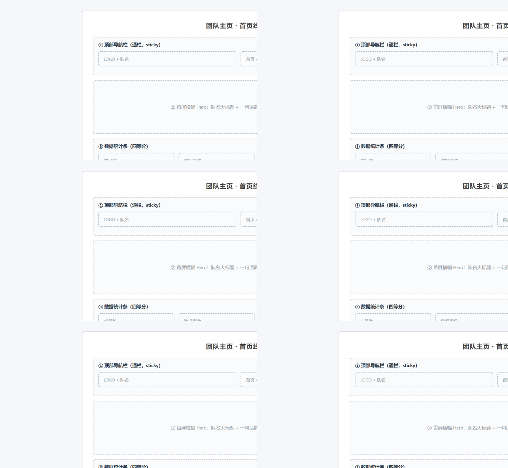
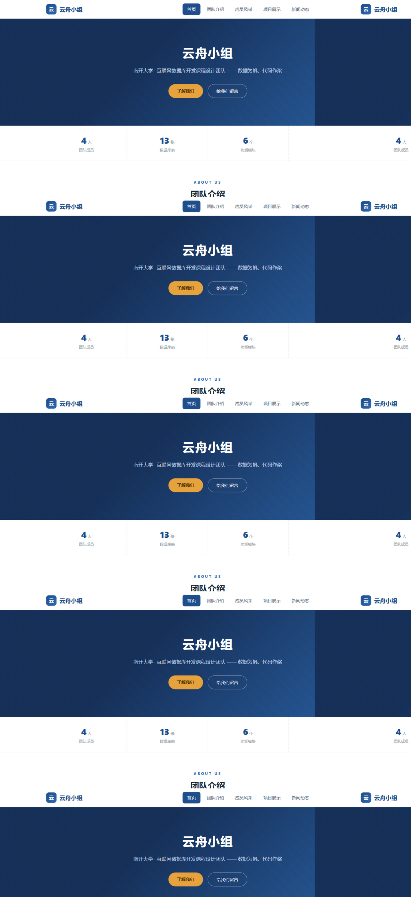
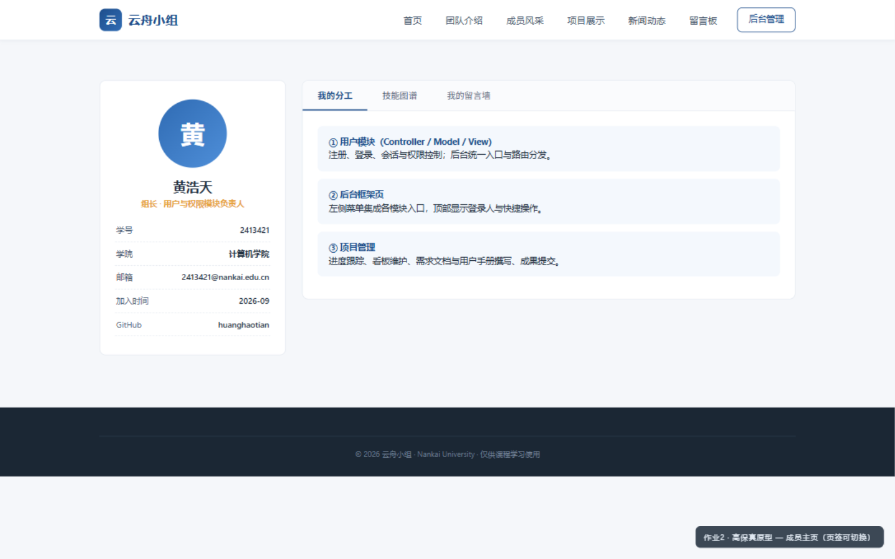
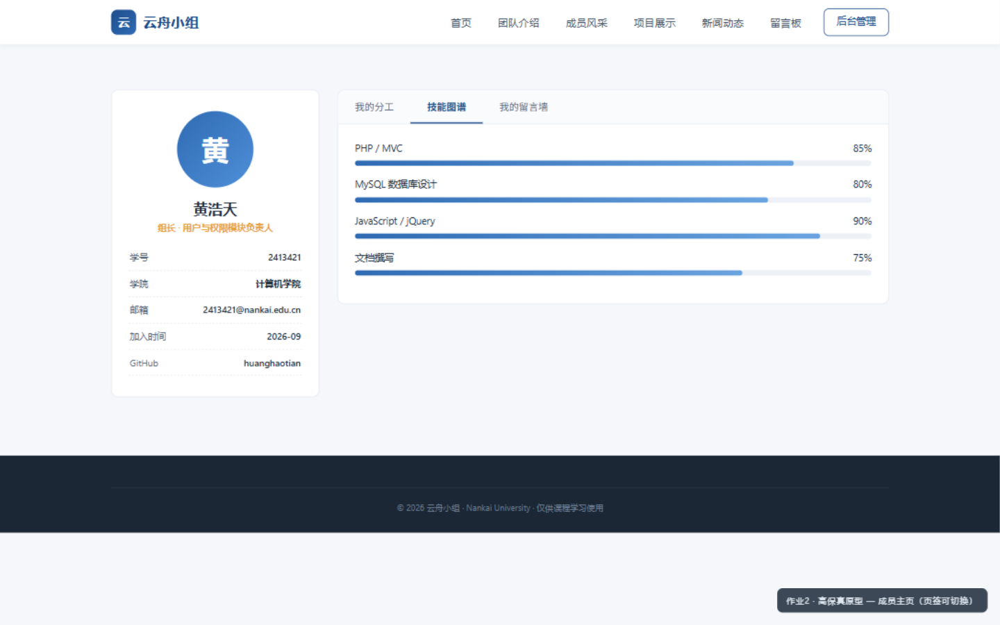
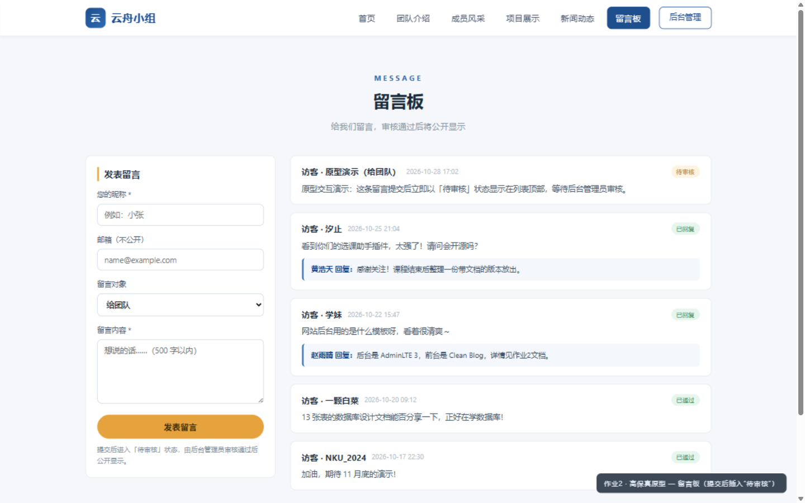
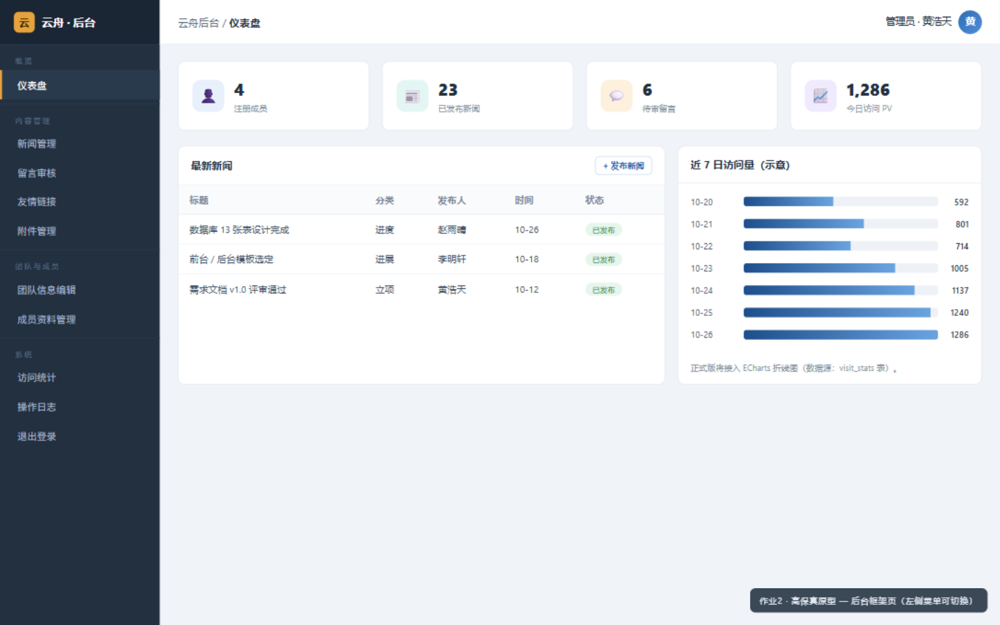
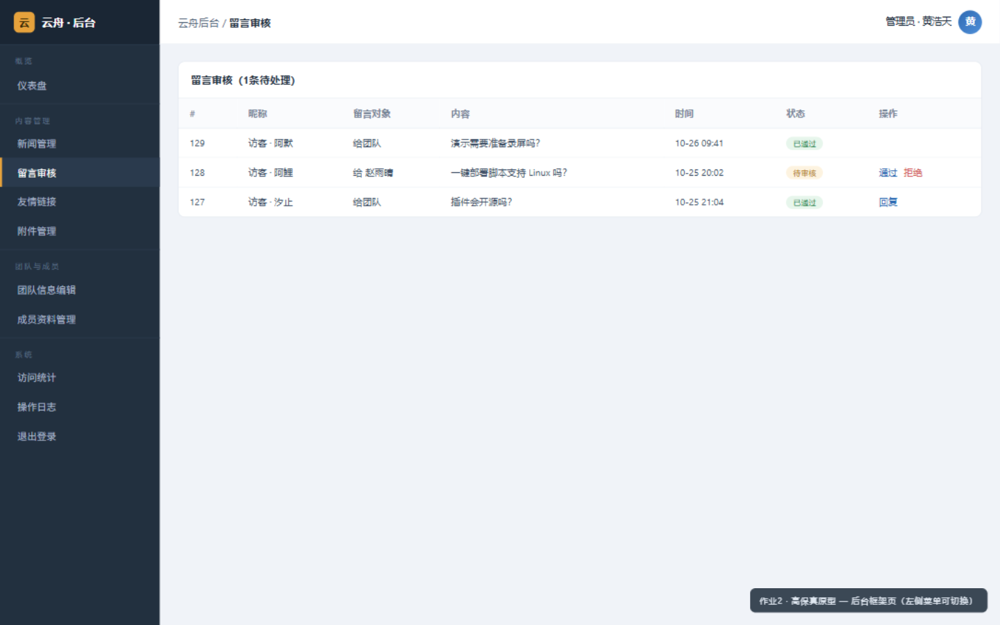
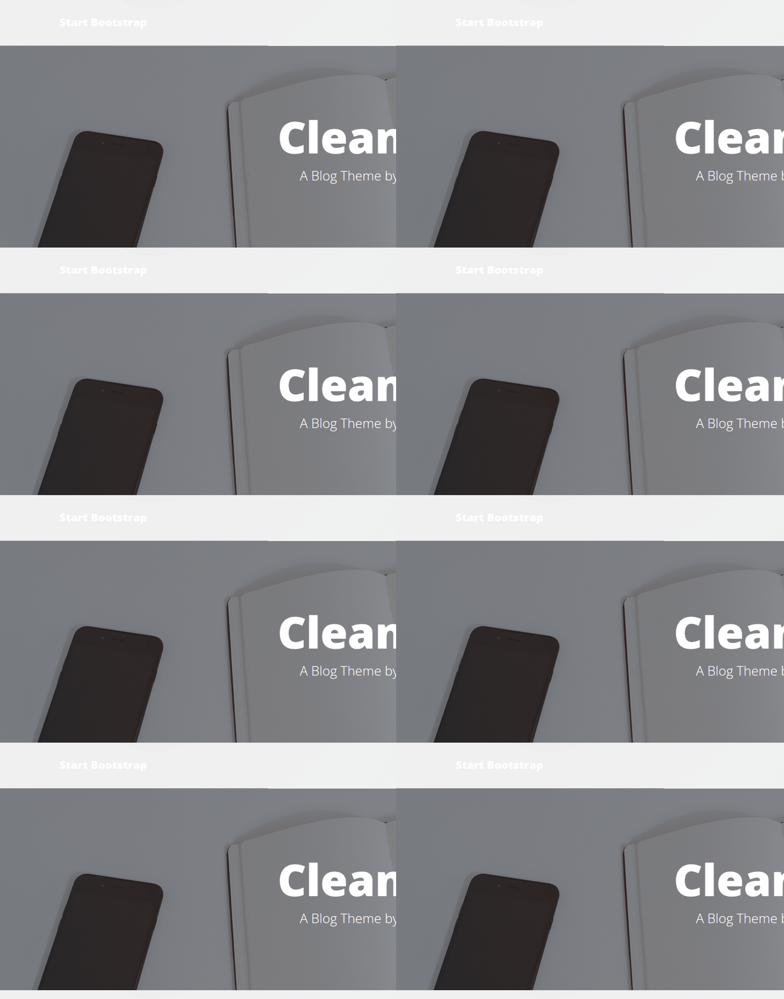
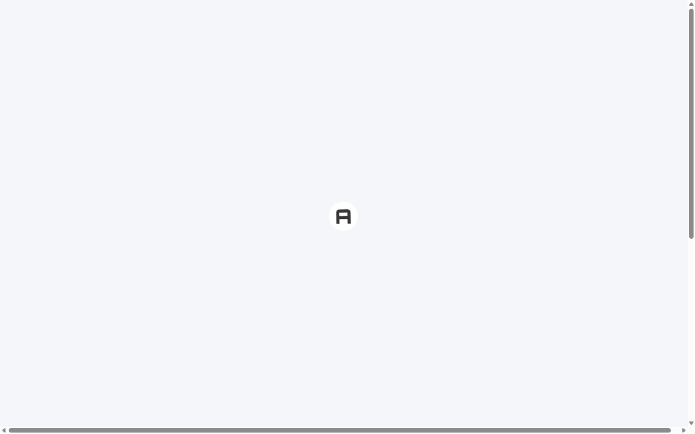

# 个人作业2——Web前端设计

> 课程：互联网数据库开发　|　学号：2413421　|　姓名：黄浩天　|　日期：2026年10月

---

## 一、作业概述

本作业包含两项任务。**任务一**：为课程设计项目「团队主页」设计页面原型——先绘制低保真线框图推演信息架构，再制作可交互的高保真原型，覆盖前台首页、成员个人主页、留言板与后台管理框架页共 4 个页面。**任务二**：为团队选定一个前台模板与一个后台模板，给出对比、选型理由与适配计划，选型结论为：前台 **Start Bootstrap Clean Blog**，后台 **AdminLTE 3**。

关于原型工具的说明：作业要求"使用 Axure 等软件设计页面"。Axure RP 导出的原型本身就是一组可点击跳转的 HTML 页面，因此本作业直接使用原生 HTML + CSS + JavaScript 编写了同等形态的**可交互高保真原型**（页面间可跳转、页签可切换、表单可提交、后台菜单可展开），并额外提供一张低保真线框图展示设计推演过程。原型零依赖、可离线双击打开，便于团队评审与后续开发对照。

---

## 二、任务一：页面原型设计

### 2.1 设计目标与页面清单

围绕课程设计要求（前台：团队及个人展示、留言；后台：信息编辑、发布），原型共设计 4 个页面：

| 页面 | 文件 | 主要内容 | 原型交互 |
| --- | --- | --- | --- |
| 前台首页 | `index.html` | 导航、首屏横幅、数据统计条、团队介绍、成员风采、项目展示、新闻动态、友情链接、页脚 | 锚点滚动、导航高亮、页面跳转 |
| 成员个人主页 | `member.html` | 资料卡（学号/学院/邮箱）+ 我的分工 / 技能图谱 / 我的留言墙 | 页签切换 |
| 留言板 | `message.html` | 留言表单（昵称/邮箱/对象/内容）+ 留言列表 | 提交后新留言以「待审核」状态插入列表顶部 |
| 后台管理框架页 | `admin.html` | 左侧分组菜单 + 顶栏面包屑 + 仪表盘/新闻管理/留言审核三个面板 | 菜单切换面板、留言审核「通过/拒绝」改变行状态 |

另有 `wireframe.html` 为首页的低保真线框图。原型中队名「云舟小组」与成员姓名为占位内容，接入团队实际信息即可。

### 2.2 第一步：低保真线框图（信息架构推演）

动手制作高保真原型之前，先用线框图确定首页的区块次序与栅格关系：导航 → 首屏横幅 → 数据统计条（四等分）→ 团队介绍（左图右文）→ 成员风采（四卡片）→ 项目展示（三卡片）→ 新闻动态（2/3）+ 友情链接（1/3）→ 页脚。灰色虚线框均为占位区域，不涉及任何视觉样式。

### 2.3 第二步：高保真原型——前台首页

高保真原型确立了正式的视觉规范：主色深蓝（#1e4e8c）、强调色琥珀（#e6a23c）、卡片圆角 10px、浅灰页面底色，与团队模板选型（Clean Blog，见第三章）的清爽风格保持一致。首页从上到下依次为：

| 区块 | 设计要点 |
| --- | --- |
| 顶部导航 | LOGO + 六个菜单项，吸顶；「后台管理」以描边按钮区隔 |
| 首屏横幅 | 队名大标题 + 一句话简介 +「了解我们 / 给我们留言」双按钮 |
| 数据统计条 | 成员数 / 数据表数 / 功能模块数 / 累计留言数，四等分虚线分隔 |
| 团队介绍 | 左侧照片位 + 右侧两段简介与技术标签（PHP、MySQL、Bootstrap、ECharts…） |
| 成员风采 | 四张卡片，头像取姓氏首字、渐变底色区分角色，悬停上浮 |
| 项目展示 | 三张项目卡：团队主页（课设）、选课助手插件、WordPress 建站实践 |
| 新闻动态 | 日期块 + 分类标签 + 标题摘要的条目式列表，右侧为友情链接面板 |
| 页脚 | 团队信息 / 快速入口 / 资源下载（下载中心，对应作业要求的下载链接）三栏 |

### 2.4 成员个人主页（页签交互）

左侧为个人资料卡（头像、姓名、角色、学号、学院、邮箱、GitHub），右侧三个页签。点击「技能图谱」页签可切换内容，验证了原型的交互能力。

### 2.5 留言板（提交 → 待审核 → 公开）

留言板完整演示了课程设计的留言业务流程：访客填写表单提交后，新留言**立即以「待审核」状态插入列表顶部**（琥珀色徽标），与已公开留言（绿色「已通过」徽标）和已回复留言（带团队回复块）在视觉上明确区分；审核动作在后台完成（见 2.6）。

### 2.6 后台管理框架页（菜单切换 + 留言审核）

后台采用课程设计统一规划的「左侧分组菜单 + 顶栏 + 内容区」布局：菜单按 概览 / 内容管理 / 团队与成员 / 系统分组，对应数据库 13 张表的职责划分；顶栏显示面包屑与登录管理员。仪表盘含四个统计卡（注册成员、已发布新闻、待审留言、今日访问 PV）与最新新闻表、近 7 日访问量示意图（正式版接入 ECharts，数据源 visit_stats 表）。

切换到「留言审核」面板后，点击某条待审留言的「通过」，该行状态徽标由「待审核」变为绿色「已通过」，待处理计数从 2 减为 1，操作按钮同步移除——与前台留言板的「待审核」状态形成完整闭环。

### 2.7 原型使用说明

打开 `prototype/index.html` 即可浏览（任意现代浏览器，无需服务器与网络）。导航可在四个页面间跳转；成员主页页签、留言板提交、后台菜单切换与留言审核均为可操作的交互原型。每个 HTML/CSS 文件头部均有注释头，说明文件名、功能与作者，与课程编码规范保持一致。

---

## 三、任务二：团队前台与后台模板选型

### 3.1 选型原则

1. **与原型风格一致**：前台需呈现"清爽、内容为主"的团队展示风格；
2. **技术栈统一**：基于 Bootstrap，与团队规划的 PHP + MySQL + Bootstrap 技术栈无缝衔接，降低学习成本；
3. **协议允许**：MIT 等宽松开源协议，课程作业与二次开发无法律风险；
4. **文档与生态**：持续维护、文档齐全、中文资料多，出问题易排查。

### 3.2 前台模板：Start Bootstrap Clean Blog（选定）

| 候选 | 协议 | 特点 | 结论 |
| --- | --- | --- | --- |
| **Clean Blog**（Start Bootstrap） | MIT | Bootstrap 5、博客式版式、结构极简、无冗余依赖 | **选定** |
| Bootstrap 官方 Blog 示例 | MIT | 最简陋，仅演示用 | 版式过于朴素 |
| Bootslander / 一体化企业模板 | 多为 CCA 3.0 | 动效多、组件重 | 与"内容为主"的定位不符 |

选型理由：Clean Blog 只有四个页面模板（首页 / 文章页 / 关于 / 联系），恰好覆盖团队主页前台的展现场景；顶图 + 居中标题 + 分隔线的版式与作业 2.3 节高保真原型的清爽风格完全同构，改造成本最低——把顶图换成团队横幅、首页列表由"文章列表"改为"新闻动态 + 成员卡片区"，即可承载全部前台需求。

- 官网：<https://startbootstrap.com/theme/clean-blog>（GitHub: startbootstrap/startbootstrap-clean-blog）
- 本地实测截图（v6.0.9，npm 包官方 dist）：

### 3.3 后台模板：AdminLTE 3（选定）

| 候选 | 协议 | 特点 | 结论 |
| --- | --- | --- | --- |
| **AdminLTE 3** | MIT | Bootstrap 4/5、经典"侧边栏+顶栏+内容"布局、30+ 现成组件页 | **选定** |
| Layui 后台主题 | MIT/自定义 | 国产、轻量，但社区趋于停更 | 组件不如 AdminLTE 丰富 |
| Tabler | MIT | 颜值高、现代 | 定制风格与前台 Bootstrap 版本存在割裂 |

选型理由：AdminLTE 是后台管理模板的事实标准之一，其"左侧折叠菜单 + 顶部导航 + 内容卡片"布局与作业 2.6 节的后台原型完全一致；内置 DataTables、ChartJS 集成示例，直接服务课设的加分项——动态图形展示（访问统计、留言趋势）；每个成员的后台模块（用户/新闻/留言/下载）都能在组件页中找到现成形态，便于按 13 张表的分工分头开发。

- 官网：<https://adminlte.io>（GitHub: ColorlibHQ/AdminLTE）
- 本地实测截图（v3.2.0，npm 包官方 dist 仪表盘页）：

### 3.4 选型结论与整合方案

| 课设部分 | 模板 | 落地方式 |
| --- | --- | --- |
| 前台首页/新闻列表/文章页 | Clean Blog | 顶图换团队横幅；列表区对接 news 表；新增成员卡片区 |
| 前台留言板 | Clean Blog + 自定义 | 参照作业 2.5 原型实现表单与状态徽标 |
| 后台全部页面 | AdminLTE 3 | 侧边栏按模块分组；内容区对接各数据表；图表页接 ECharts/ChartJS |

两份模板均为 MIT 协议，可自由修改与随作业提交，版权风险为零。

---

## 四、总结

本作业完成了从信息架构到可交互原型的完整设计流程：线框图确定区块次序，高保真原型固化视觉规范与交互细节，四类页面（首页/成员主页/留言板/后台）覆盖了课程设计前台展示与后台管理的核心场景，且原型中「留言待审核 → 后台通过」的状态闭环直接对应数据库 messages 表的状态字段设计，为后续开发提供了明确的对照物。模板选型环节通过对候选方案的横向对比确定了 Clean Blog + AdminLTE 3 的组合，两者与原型风格、团队技术栈（Bootstrap）、课设加分项（动态图表）均能对齐，原型与模板可以平滑衔接。

---

## 附件清单

| 附件 | 说明 |
| --- | --- |
| `prototype/` | 可交互高保真原型（index / member / message / admin）+ 首页线框图 wireframe + 共享样式 style.css，双击 index.html 即可离线浏览 |
| `img/` | 原型与模板截图（图2-1～2-7、图3-1～3-2） |
