# 个人作业3——开源建站工具初试

> 课程：互联网数据库开发　|　学号：2413421　|　姓名：黄浩天　|　日期：2026年10月

---

## 一、作业概述

本作业自行安装了开源建站工具 **WordPress**，完成了完整的安装、配置、主题切换、插件安装与页面布局设计流程，并全程截图记录。站点信息如下：

| 项目 | 内容 |
| --- | --- |
| 站点名称 | 浩天的博客 |
| 副标题 | 记录互联网数据库开发与建站实践 · WordPress 作业3 |
| 访问地址 | <http://localhost:8080/>（本机 Docker 部署） |
| 管理后台 | <http://localhost:8080/wp-admin/>（用户 admin） |
| 主题 | Astra（默认主题 Twenty Twenty-Five 切换而来） |
| 已装插件 | Contact Form 7、WP Statistics、Classic Editor |

安装方式说明：常见的安装方式是在 Windows 下使用 phpStudy/XAMPP 搭配 WordPress 安装包。本作业采用更贴近生产环境的 **Docker 容器化部署**：`wordpress` 与 `mysql:8.0` 两个容器由 docker compose 一键编排，环境隔离、可随时销毁重建、数据持久化在卷中。两种方式的 WordPress 安装向导与后台操作完全一致。

---

## 二、环境准备与容器编排

宿主机环境：Windows + Docker Desktop（Docker 29.5）。新建目录 `wordpress-docker/`，编写 `docker-compose.yml`（完整内容见附件）：

```yaml
services:
  db:
    image: mysql:8.0
    container_name: wp-db
    environment:
      MYSQL_ROOT_PASSWORD: root123456
      MYSQL_DATABASE: wordpress
      MYSQL_USER: wordpress
      MYSQL_PASSWORD: wordpress123
    volumes:
      - db_data:/var/lib/mysql

  wordpress:
    image: wordpress:latest
    container_name: wp-site
    depends_on:
      - db
    ports:
      - "8080:80"
    environment:
      WORDPRESS_DB_HOST: db:3306
      WORDPRESS_DB_USER: wordpress
      WORDPRESS_DB_PASSWORD: wordpress123
      WORDPRESS_DB_NAME: wordpress
    volumes:
      - wp_data:/var/www/html

volumes:
  db_data:
  wp_data:
```

启动并确认容器状态：

```bash
$ docker compose up -d
[+] Running 2/2
 ✔ Container wp-db    Started
 ✔ Container wp-site  Started

$ docker ps --format "{{.Names}} {{.Status}}"
wp-site Up   # WordPress，宿主机 8080 端口
wp-db   Up   # MySQL 8.0
```

此时浏览器访问 `http://localhost:8080/` 会 302 重定向到 `/wp-admin/install.php`——官方镜像已根据环境变量自动写好 `wp-config.php`（数据库连接免配置），直接进入著名的"五分钟安装"向导。

> 注：本机网络访问 Docker Hub 直连受限，镜像通过 DaoCloud 镜像加速源（`docker.m.daocloud.io`）拉取：`docker pull docker.m.daocloud.io/library/wordpress:latest` 后 `docker tag` 为本地名。

---

## 三、安装过程记录

### 步骤 1：语言选择

打开站点自动进入安装向导，语言列表中选择 **简体中文**，点击「继续」。向导会先下载中文语言包，随后整站（含后台）切换为中文。

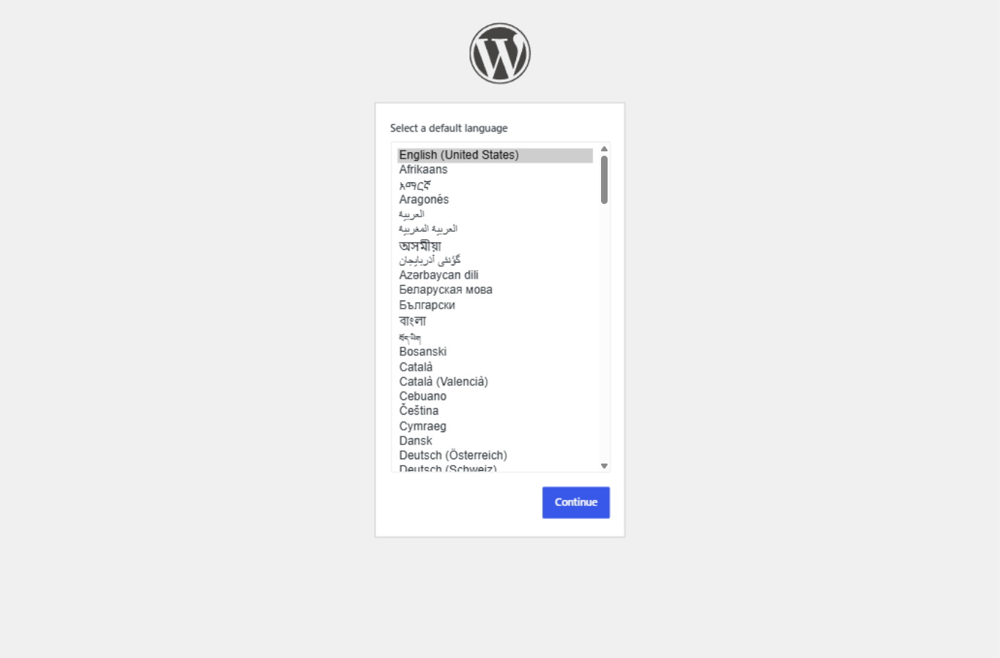

### 步骤 2：填写站点信息（五分钟安装表单）

按表单填写站点基本信息：

| 字段 | 填写值 | 说明 |
| --- | --- | --- |
| 站点标题 | 浩天的博客 | 前台顶部与浏览器标题显示 |
| 用户名 | admin | 后台登录账号，安装后不可更改 |
| 密码 | （自动生成的强密码） | 安装完成页会再次提示记录 |
| 电子邮件 | 2413421@nankai.edu.cn | 用于接收密码找回邮件 |
| 对搜索引擎可见 | 勾选"允许" | 本机演示环境无影响 |

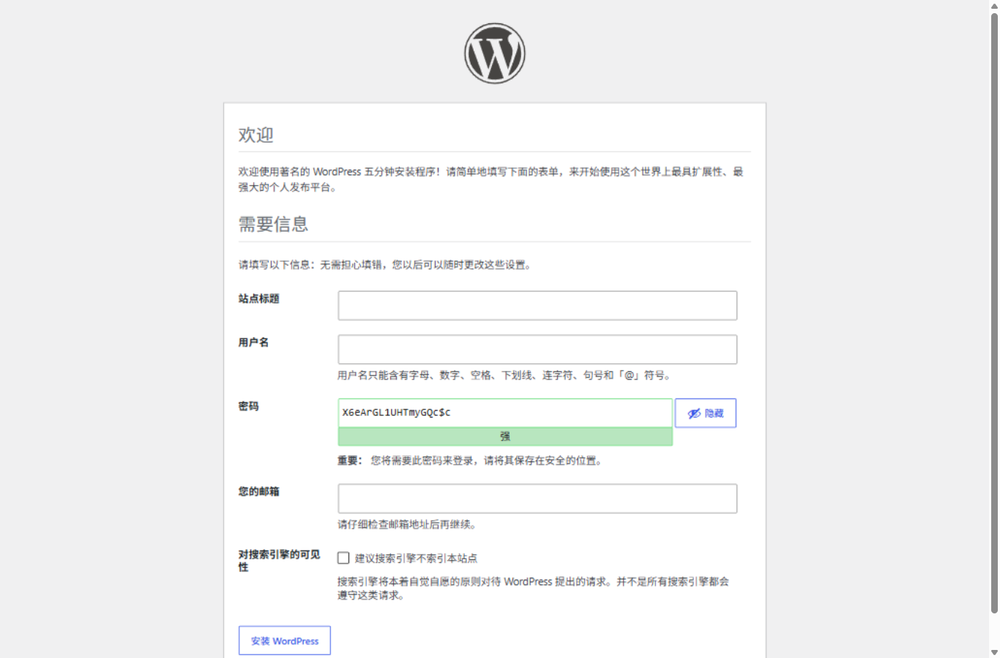

### 步骤 3：提交安装

点击「安装 WordPress」，数秒后页面显示 **「成功！WordPress 安装完成。谢谢！」**，并给出用户名与密码提示及「登录」按钮。（该成功提示页为一次性页面，再次访问安装入口只会显示"已安装过"；安装完成的凭据即下方登录页与仪表盘所见状态。）

安装向导的本质：向导把站点信息写入 MySQL 数据库（wp_users 表创建管理员、wp_options 表写入站点标题等）——WordPress 没有任何配置文件需要手工编辑，**一切状态皆在数据库中**，这正是它作为"数据库驱动建站工具"的典型特征。

### 步骤 4：登录后台

点击「登录」进入登录页，输入步骤 2 设置的用户名与密码。

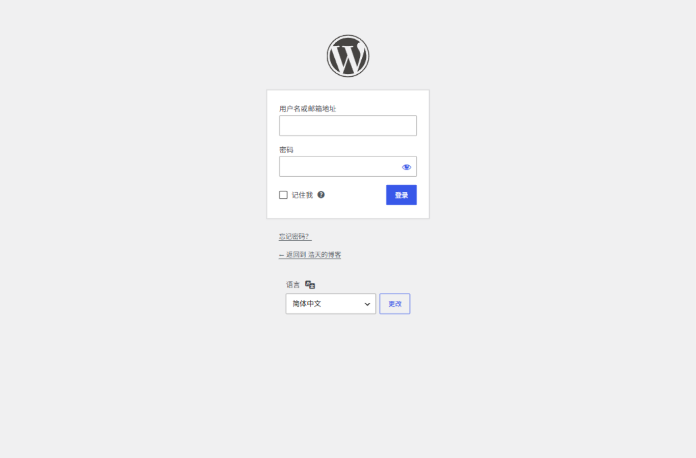

### 步骤 5：进入仪表盘

登录成功，进入 WordPress 管理后台（仪表盘）。左侧为后台菜单（文章、媒体、页面、评论、外观、插件、用户、工具、设置），与课程设计团队主页的后台规划结构一致。

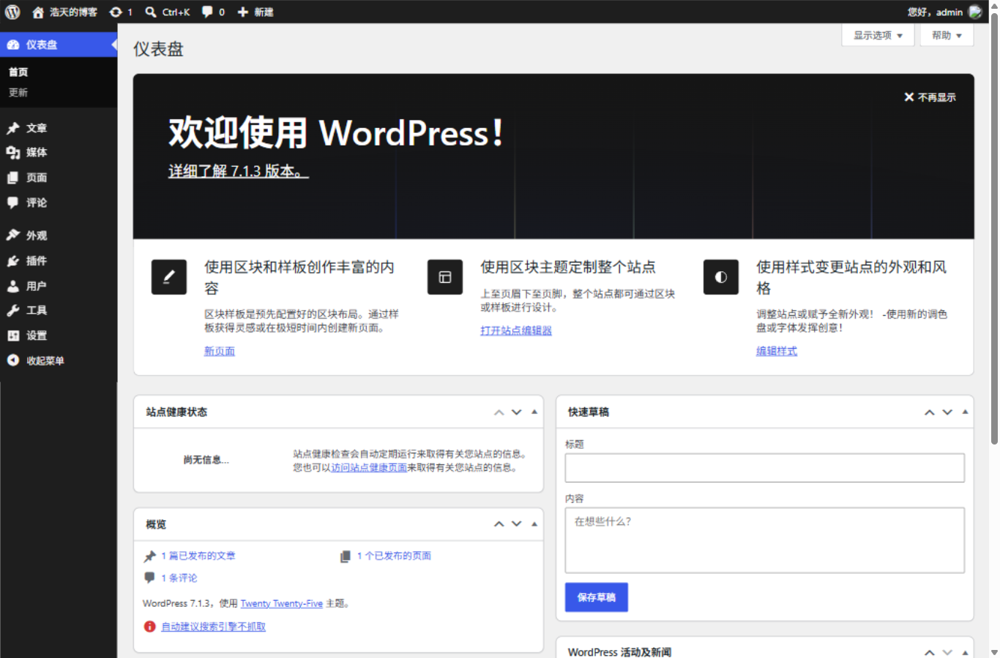

---

## 四、主题安装与布局设计

### 4.1 主题管理

进入「外观 → 主题」，初始启用主题为 WordPress 6.x 自带的 **Twenty Twenty-Five**。

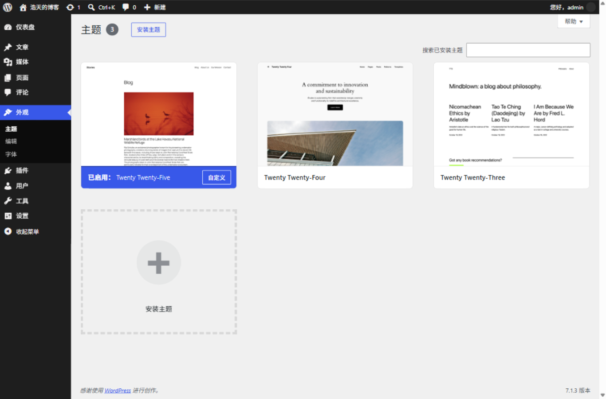

### 4.2 在线搜索主题

进入「外观 → 添加主题」，搜索 **Astra**（轻量、高性能的流行主题，官网活跃安装量 100 万+），卡片上提供「安装 / 预览」操作。

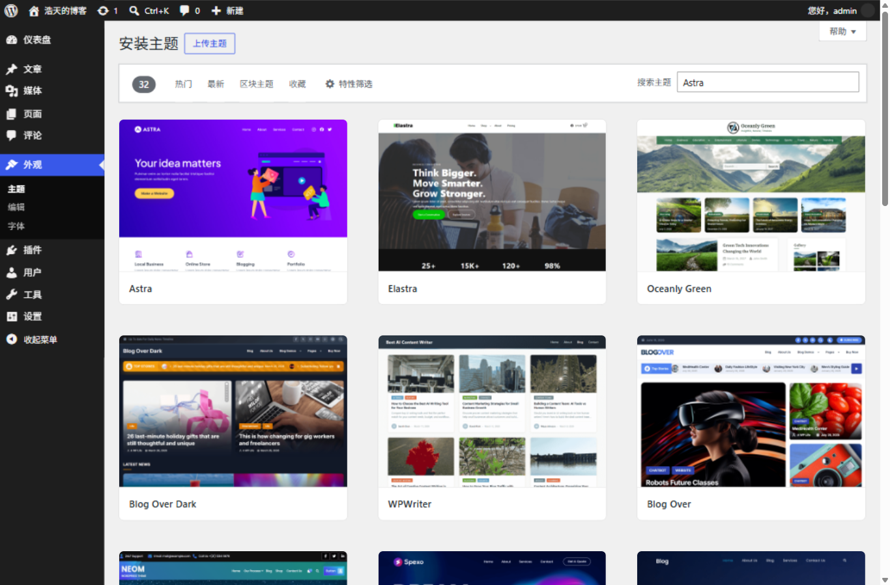

> 说明：点击在线「安装」时，因容器访问 WordPress 官方下载源不稳定而失败（按钮显示"安装失败"）。改用**离线安装**：在宿主机下载 `astra.zip` 官方安装包，解压后放入容器的 `wp-content/themes/` 目录（`docker cp` + `chown www-data`）——这与后台"上传主题 ZIP 安装"完全等效，主题立即出现在主题列表中。

### 4.3 启用 Astra 主题

回到「外观 → 主题」，Astra 卡片出现「启用」按钮，点击启用。

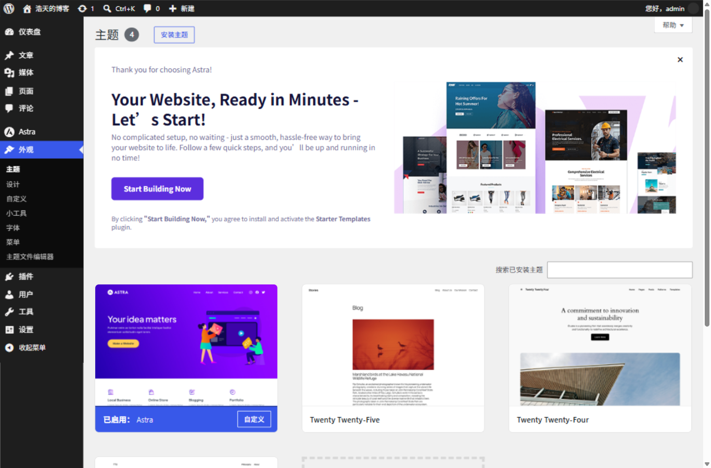

启用后前台首页版式即刻切换为 Astra 的博客布局：顶栏站点名 + 首页大图 + 卡片式文章列表（最终效果见第六章）。

---

## 五、插件安装（模块安装）

### 5.1 插件市场

进入「插件 → 安装插件」，可按热门/推荐浏览官方插件市场（数据来自 api.wordpress.org）。

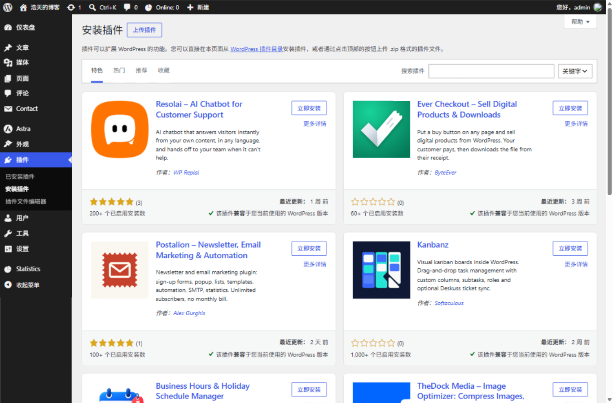

### 5.2 安装并启用三个插件

与主题同样方式安装（宿主机下载官方 ZIP → 放入 `wp-content/plugins/`），随后在「插件 → 已安装插件」页逐个点击「启用」：

| 插件 | 功能 | 用途 |
| --- | --- | --- |
| **Contact Form 7** | 联系表单 | 与课程设计"留言板"功能同类，学习其表单与邮件机制 |
| **WP Statistics** | 访问统计（独立建表，不依赖第三方服务） | 对课设的 visit_stats 表与动态图表加分项有直接参考价值 |
| **Classic Editor** | 经典编辑器 | 替代 Gutenberg 区块编辑器，便于发布传统格式的文章 |

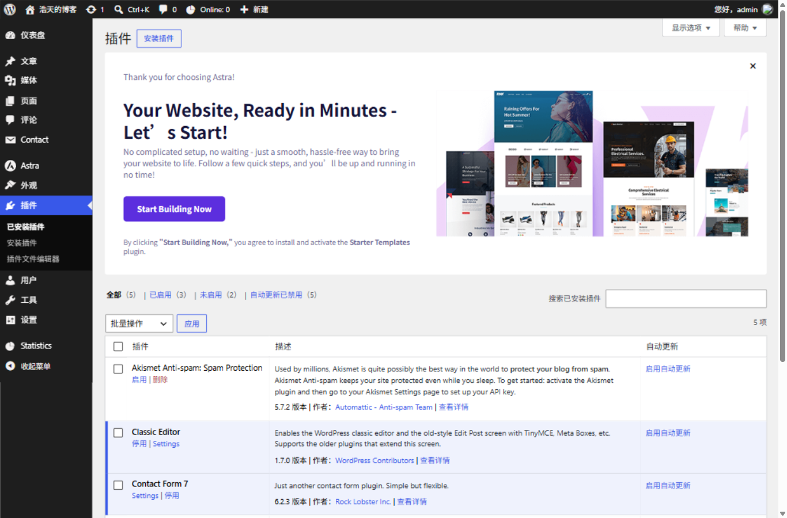

三个插件启用后，后台菜单相应新增「表单」「统计」等入口，文章编辑器也切换为经典模式。

---

## 六、站点设置与内容发布

### 6.1 常规设置

「设置 → 常规」中修改站点副标题为「记录互联网数据库开发与建站实践 · WordPress 作业3」，时区设为 **上海**，保存后页面顶部显示"设置已保存"。

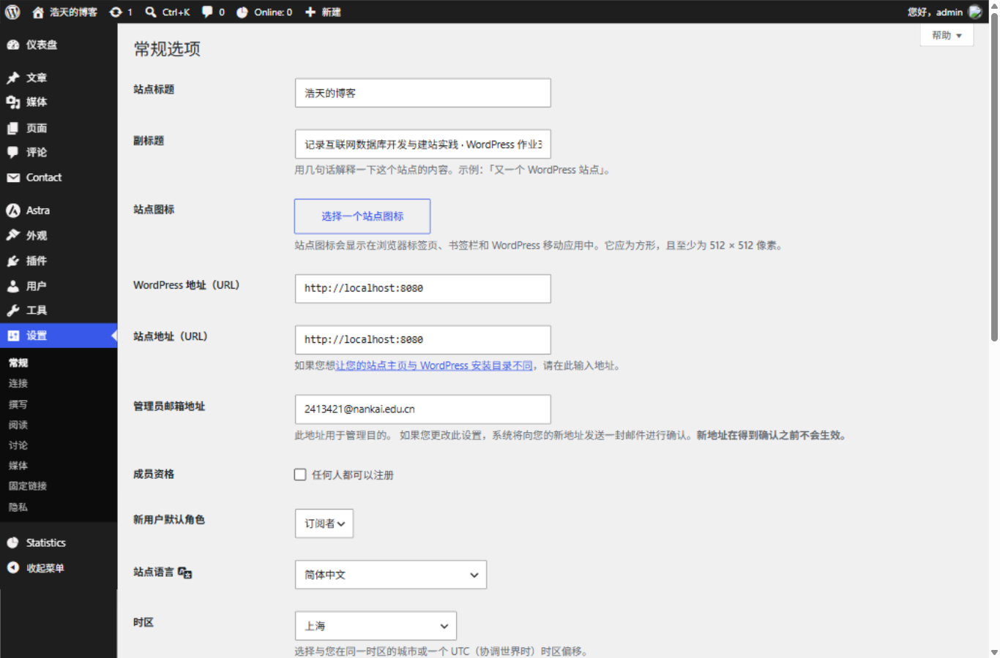

### 6.2 发布文章与页面

使用 Classic Editor（经典编辑器）发布 **3 篇文章 + 1 个页面**：

| 类型 | 标题 |
| --- | --- |
| 文章 | WordPress 初体验：用 Docker 五分钟搭好一个博客 |
| 文章 | 课程作业清单：互联网数据库开发 |
| 文章 | 从 wp_posts 看 WordPress 的数据表设计 |
| 页面 | 关于我 |

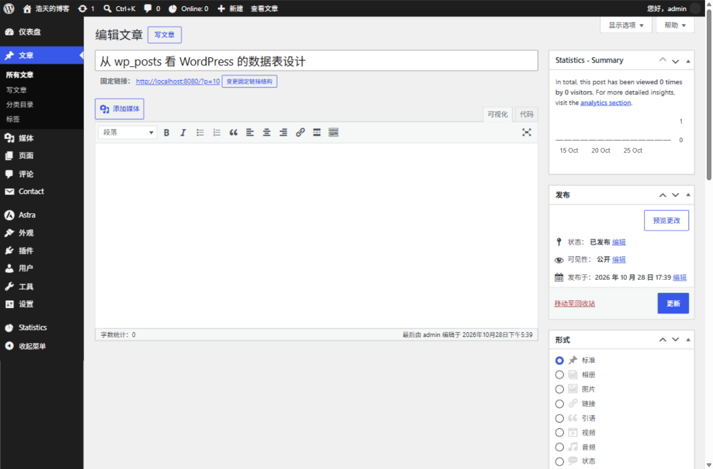

---

## 七、最终页面

前台首页（Astra 主题）：顶栏为站点名「浩天的博客」，下方依次为 4 篇内容卡片（3 篇文章 + 关于我页面入口），每张卡片含标题、日期、分类与摘要——一个完整可用的博客站点。

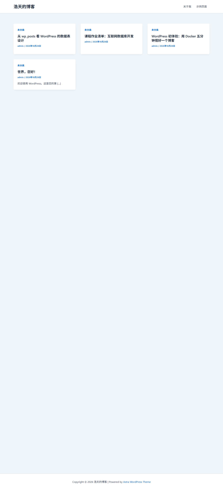

文章详情页：《WordPress 初体验：用 Docker 五分钟搭好一个博客》，含标题、发布日期、分类与完整正文。

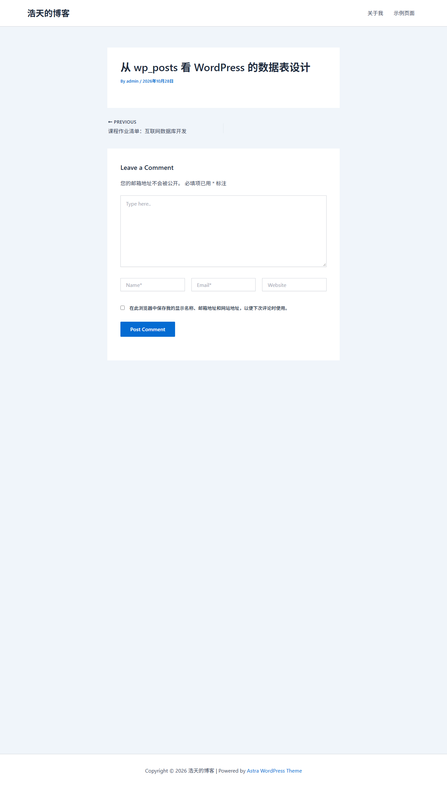

---

## 八、总结

通过本次作业完整走通了开源建站工具的使用流程，主要收获有四点：

1. **部署方式**：掌握了用 Docker Compose 编排 WordPress + MySQL 的生产级部署方式，一条 `docker compose up -d` 即可拉起完整站点，数据持久化于卷中，随时可销毁重建——相比传统 phpStudy 手工搭建，环境一致性和可复现性都更好。
2. **安装机制**：理解了 WordPress"一切状态皆在数据库"的设计——安装向导只是向 MySQL 写入初始数据；官方镜像通过环境变量自动生成 wp-config.php，把数据库配置这一步也自动化了。
3. **模块生态**：实践了主题（外观体系）与插件（功能体系）的安装、启用与切换，理解了二者通过钩子（hooks）机制与核心解耦的设计，这正是 WordPress 能形成庞大生态的原因。
4. **与课程的联系**：WP Statistics 独立建表做统计、Contact Form 7 的表单处理、wp_posts 的单表多态设计（post_type 区分文章/页面/附件/修订），对课程设计的留言板、访问统计表设计与前后台划分都有直接参考价值。

本站点继续保留运行于本机 Docker 环境中，可作为后续课程设计的前端效果参照。

---

## 附件清单

| 附件 | 说明 |
| --- | --- |
| `img/` | 安装与配置全过程截图（图3-1～3-4、图4-1～4-3、图5-1～5-2、图6-1～6-2、图7-1～7-2） |
| `docker-compose.yml` | 站点容器编排文件，`docker compose up -d` 一键还原本站环境 |
